# CSS - WRO Future Engineers 2026

This repository contains the engineering documentation for **CSS**'s autonomous vehicle ***"The Maker"*** for the **WRO Future Engineers** 2026 season. Our team is based in Querétaro, México.

> **Current version: design v7 (International Final, Puerto Rico, December 2026).**
> Design v6, the vehicle that placed **2nd at the 2026 Mexico National Final**, is preserved as release [`v1.0.0`](https://github.com/alex309-duarte/WRO_Future_Engineers_Queretaro_CSS/releases/tag/v1.0.0). Design numbers v1–v7 count every vehicle we have built since 2025, so they are vehicle designs, not repository releases ([§7.4](#lessons)). This README documents design v7 and explains **what changed since nationals, why, when, how, and what for**.

<table>
<tr>
<td align="center" width="50%"><a href="https://www.youtube.com/shorts/fHsPBr_Bzps">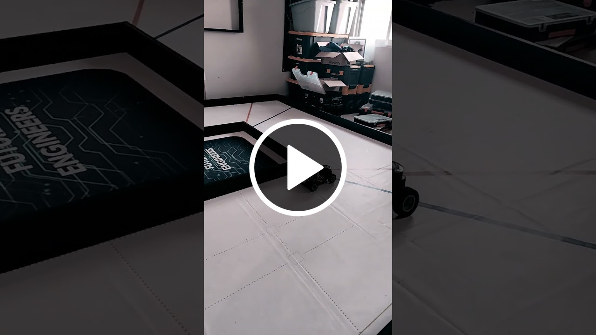</a><br><b><a href="https://www.youtube.com/shorts/fHsPBr_Bzps">▶ Watch the Open Challenge</a></b></td>
<td align="center" width="50%"><a href="https://www.youtube.com/shorts/g_2ZrS4TVyc">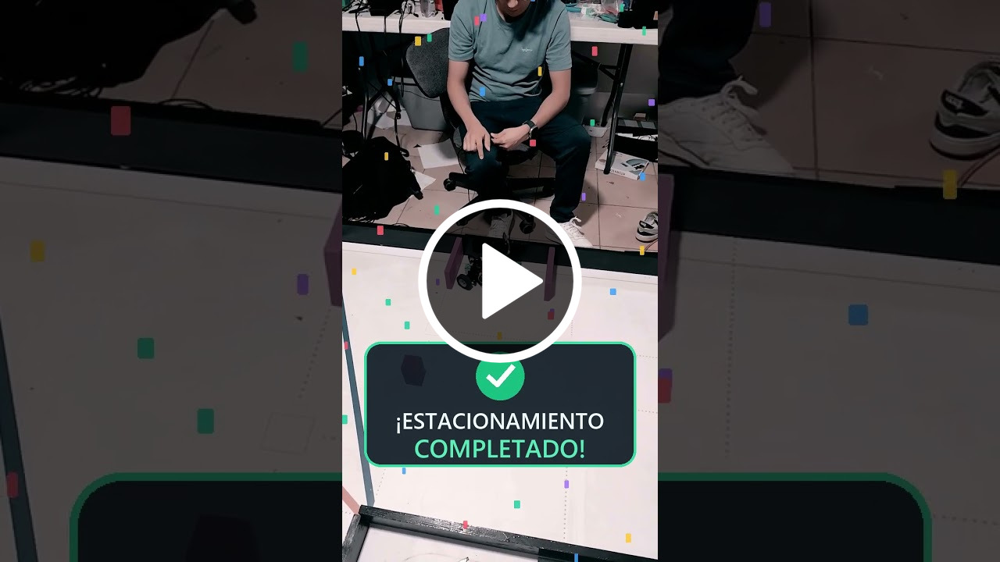</a><br><b><a href="https://www.youtube.com/shorts/g_2ZrS4TVyc">▶ Watch the Obstacle Challenge</a></b></td>
</tr>
<tr>
<td colspan="2" align="center"><a href="https://sebassesq.github.io/the-maker-3d/">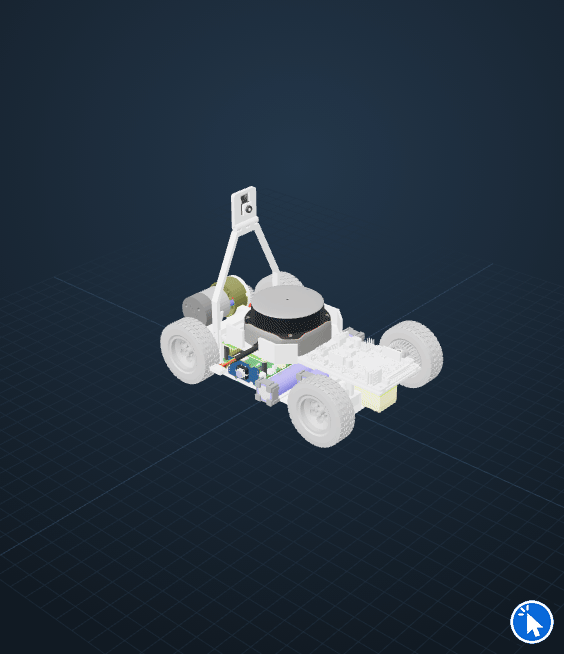</a><br><a href="https://sebassesq.github.io/the-maker-3d/"></a> <b><a href="https://sebassesq.github.io/the-maker-3d/">Open the interactive 3D model</a></b>: rotate it, zoom in and take the vehicle apart, in the browser (<a href="#viewer-3d">§4.1</a>)</td>
</tr>
</table>

**Quick links:** [Videos](#driving-videos) · [What changed since nationals](#what-changed) · [Assembly instructions](other/Assembly_photos/Assembly_Process_EN.md) · [Bill of Materials](#bom) · [3D-print files](#printed-parts) · [Interactive 3D model](#viewer-3d) · [Wiring diagram](#wiring-v7) · [Setup and run](#setup-instructions) · <a href="https://github.com/JRavenelco/hiwonder-brick"></a> [Firmware development repository](https://github.com/JRavenelco/hiwonder-brick) · [Firmware video](https://www.youtube.com/watch?v=Mzc6JfptzTI) · [Engineering Journal](Engineering_Journal_CSS_WRO2026_International.pdf) · [Releases](https://github.com/alex309-duarte/WRO_Future_Engineers_Queretaro_CSS/releases)

---

## Where each rubric item is answered <a id="rubric-map"></a>

The sections follow the five criteria of the WRO 2026 documentation rubric (Appendix C of the General Rules). The table uses the rubric's own words and links each item to the place where it is answered.

> [!NOTE]
> **How to read this page.** To keep it short, supporting detail (constants, long tables and calculations, biographies) is folded into blue boxes like this one, marked <kbd>Click to open</kbd>: click the line to unfold it. Cards marked <kbd>Other page</kbd> lead to a page of their own (the full setup instructions, the firmware, the design v6 robot): click the picture or the link. A picture with this round blue mark  opens a page, a document or a product page when you click it; a picture with a play button  is a video. **Purple boxes** are [decision cards](#decision-cards), the reasoning behind each design choice. Every link in the table below leads to text that is always visible.

| Rubric criterion | Where to find it |
|---|---|
| **1. Mobility and Mechanical Design** ([§4](#mobility)) | **Torque/speed reasoning:** [torque and speed calculation](#torque-speed)<br>**Design trade-offs:** decision cards for the [drive motor](#d2), the [steering servo](#d1) and the [differential](#d3)<br>**Why components were chosen:** [chassis](#chassis) (with an [interactive 3D model](#viewer-3d)), [steering](#steering), [drivetrain](#drivetrain)<br>**Testing or iterations affecting performance:** [what each test changed](#test-to-change), [iteration history v1–v7](#lessons) |
| **2. Power and Sensor Architecture** ([§5](#power-sensors)) | **Power budget:** [power budget and peak current](#power-budget), [wiring diagram](#wiring-v7)<br>**Sensor trade-offs:** decision cards for the [LiDAR](#d5) and the [AI accelerator](#d6)<br>**Placement justified using field geometry:** [placement and field geometry](#placement)<br>**Calibration method:** [calibration](#calibration)<br>**Failure-point considerations:** [noise, interference and failure points](#noise)<br>**Iteration evidence:** [failure log](#failure-log) |
| **3. Software Architecture and Obstacle Strategy** ([§6](#software)) | **State machine with rationale:** [Open Challenge states](#open-states), [Obstacle Challenge states](#obstacle-states)<br>**Algorithm justification (PID, CV, IMU):** [steering PD](#pd), [vision model](#vision), [LiDAR processing](#lidar), [heading estimation](#heading)<br>**Handling edge cases:** [avoidance, parking and edge cases](#edge-cases), [surprise rule: modified traffic sign](#surprise-rule)<br>**Testing/tuning process:** [testing and tuning workflow](#testing)<br>**Metrics used to validate performance:** [component tests](#component-tests), [run logs](#run-logs) |
| **4. Systems Thinking and Engineering Decisions** ([§7](#systems)) | **Explicit constraints:** [constraints](#constraints), [rule compliance](#rule-compliance)<br>**Trade-offs:** [how the subsystems interact](#interactions)<br>**Iteration cycles:** [iteration history v1–v7](#lessons), [what changed from v6 to v7](#what-changed)<br>**Risk/failure analysis:** [risk and failure-mode register](#risks), [failure log](#failure-log), [known limitations and next steps](#limitations)<br>**"Why we chose X instead of Y":** the *Alternatives* row of every decision card ([D1](#d1), [D2](#d2), [D3](#d3), [D4](#d4), [D5](#d5), [D6](#d6), [D7](#d7), [D8](#d8), [D9](#d9)) |
| **5. Reproducibility and GitHub Quality** ([§8](#reproducibility), [§9](#setup-instructions), [§10](#construction-guide)) | **Fully reproducible system:** [build this robot yourself](#build-it), [board firmware](#board-firmware), its [explainer video](https://www.youtube.com/watch?v=Mzc6JfptzTI) and its [development repository](https://github.com/JRavenelco/hiwonder-brick)<br>**Clear project structure:** [repository structure](#structure)<br>**Meaningful commit messages:** [commit history](https://github.com/alex309-duarte/WRO_Future_Engineers_Queretaro_CSS/commits/main)<br>**Testing workflow documented:** [testing and tuning workflow](#testing), [competition-day checklist](#checklist)<br>**Versioning or release notes:** [versions and releases](#versions), [release notes](other/releases) |

---

## Decision cards

Every design decision in this document is written as a **decision card**, shown in a **purple box** like the one below, that answers the same six questions: **what**, **why**, **when**, **how**, **what for** and **alternatives**. There are nine, numbered **D1 to D9 in the order they appear** on this page:

| Card | Decision | Where |
|---|---|---|
| [D1](#d1) | Steering servo | [§4.2 Steering](#steering) |
| [D2](#d2) | Drive motor | [§4.3 Drivetrain](#drivetrain) |
| [D3](#d3) | Rear differential | [§4.3 Drivetrain](#drivetrain) |
| [D4](#d4) | 3S battery | [§5.1 Power architecture](#power) |
| [D5](#d5) | LiDAR: back to the RPLidar S2L | [§5.2 Sensors](#sensors) |
| [D6](#d6) | AI accelerator: Hailo-10H → Hailo-8 | [§5.2 Sensors](#sensors) |
| [D7](#d7) | Controller board: Hiwonder board behind a compatibility layer | [§6.1 Code modules](#code-modules) |
| [D8](#d8) | Retrained detection model | [§6.4 Vision model](#vision) |
| [D9](#d9) | Emergency stop | [§7.3 Risk register](#risks) |

> [!IMPORTANT]
> **A decision card looks like this.** Each of its six rows answers one question:
>
> | | |
> |---|---|
> | **What** | What we built or changed |
> | **Why** | The problem or constraint behind it, with data when we have it |
> | **When** | Version and date |
> | **How** | How it was implemented (files, parts, parameters) |
> | **What for** | The result we measured |
> | **Alternatives** | What else we considered and why we did not choose it |

<table>
<tr>
<td width="150" align="center"><a href="Engineering_Journal_CSS_WRO2026_International.pdf">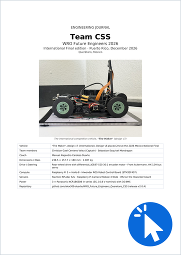</a></td>
<td><b><a href="Engineering_Journal_CSS_WRO2026_International.pdf">Engineering Journal (international edition)</a></b><br>The full engineering story, with the tradeoff and risk registers and the dated logbook. Click the cover to open it.</td>
</tr>
</table>

---

## Build this robot yourself <a id="build-it"></a>

This documentation is written so that another team can build the same robot and run both challenges with it. Everything needed is in this repository:

| | What to do | Where | Preview (click to open) |
|---|---|---|:---:|
| 1 | Get the parts | [Bill of Materials](#bom), with a link and a price for every part | <a href="#bom">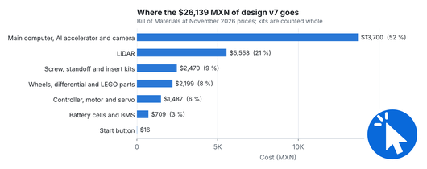</a> |
| 2 | Print the chassis and the other printed parts | [STL files, quantities and printer settings](#printed-parts) | <a href="#printed-parts">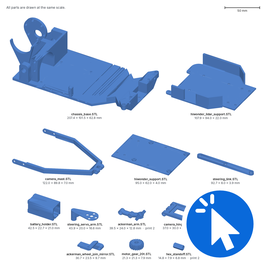</a> |
| 3 | Assemble the vehicle | [Assembly instructions](other/Assembly_photos/Assembly_Process_EN.md): one photo per step, with the tools and every screw | <a href="other/Assembly_photos/Assembly_Process_EN.md">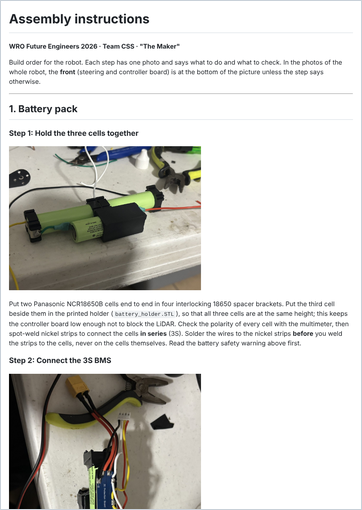</a> |
| 4 | Connect the electronics | [Wiring diagram](#wiring-v7) and [connection table](#connections) | <a href="#wiring-v7">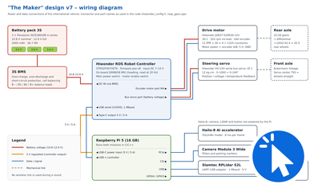</a> |
| 5 | Flash the board firmware, then build and run the programs | [Setup and execution instructions](#setup-instructions). Firmware: [video](https://www.youtube.com/watch?v=Mzc6JfptzTI) and [development repository](https://github.com/JRavenelco/hiwonder-brick) | <a href="#setup-instructions">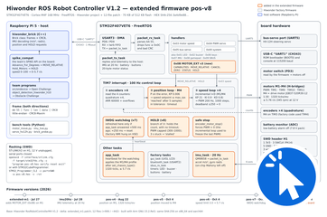</a> |


---

## Table of Contents

1. [Our Team](#our-team)
2. [Challenge Overview](#challenge-overview)
3. [Our Robot: design v7 at a glance](#our-robot)
4. [Mobility and Mechanical Design](#mobility)
5. [Power and Sensor Architecture](#power-sensors)
6. [Software Architecture and Obstacle Strategy](#software)
    - [Surprise rule: modified traffic sign](#surprise-rule)
7. [Systems Thinking and Engineering Decisions](#systems)
8. [Reproducibility: repository, versions and testing](#reproducibility)
9. [Setup and Execution Instructions](#setup-instructions)
10. [Construction Guide and Bill of Materials](#construction-guide)
    - [Assembly instructions: 37 steps with photos](other/Assembly_photos/Assembly_Process_EN.md)
    - [3D-printed parts](#printed-parts) and [Bill of Materials](#bom)
11. [Driving Videos](#driving-videos)
12. [Resources](#resources)
13. [License](#license)

---

## 1. Our Team <a id="our-team"></a>
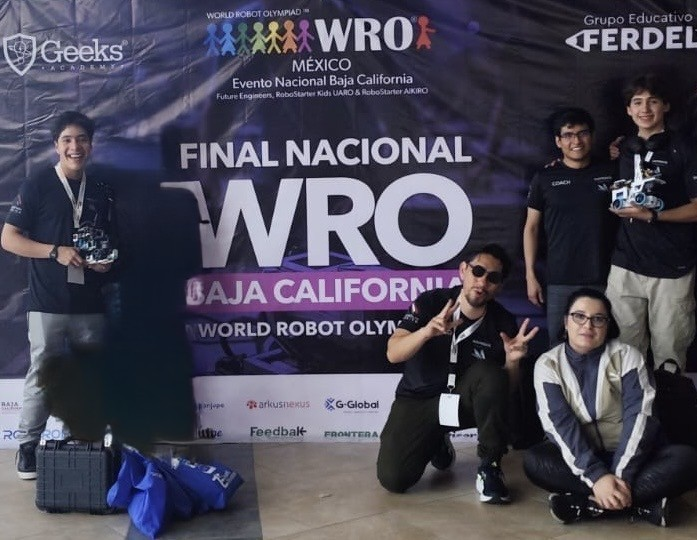<br>
***Disclaimer:***
*This image has been edited to remove former team members who are no longer part of the project, in order to protect their privacy. Editing was done using Microsoft Photos' generative erase feature.*

### Team Members

<table>
<tr>
<td align="center" valign="top" width="50%"><br><b>Christian Gael Centeno Velez</b><br>Age 17<br><b>Role:</b> Captain. Software, electronics and mechanical design</td>
<td align="center" valign="top" width="50%"><br><b>Sebastián Esquivel Mondragón</b><br>Age 19<br><b>Role:</b> Documentation, electronics and mechanical design<br><a href="https://www.linkedin.com/in/sebastian-esquivel-mondragon/"></a></td>
</tr>
</table>

> [!NOTE]
> <details>
> <summary><kbd>Click to open</kbd> <b>Biographies of the two team members</b></summary>
>
> >**Christian Gael Centeno Velez.** I am currently in my senior year of high school at the Colegio de Estudios Científicos y Tecnológicos del Estado de Querétaro (CECyTEQ), specializing as a Mechatronics Technician. I have a strong background in competitive robotics, having participated in previous editions of the World Robot Olympiad (WRO). In 2024, I competed in the RoboMission category, and in 2025, I secured third place at the national level in the Future Engineers category with another team. Through my years of experience competing in the WRO, I have developed solid skills in robot programming, design, and electronics.
>
> >**Sebastián Esquivel Mondragón.** Currently pursuing a Bachelor of Science in Mechatronics Engineering at Monterrey Institute of Technology and Higher Education (ITESM), on an academic talent scholarship. My background in robotics began in middle school with the MekLab Robotics team (UAQ), where I competed in WRO RoboMission, placing 3rd nationally in 2022 (Junior) and 2nd nationally in 2023 (Senior), qualifying for the international final in Panama. In 2025, our now independent and disaffiliated team moved into WRO Future Engineers, placing 2nd nationally. Most of my software and electronics experience comes from these competitions. I've also worked as an intern at GS de México (GS Global), in the Research and Development (R&D) department, where I further developed CAD design skills and many other engineering competencies, such as problem solving skills, now applied towards this project.
>
> </details>

---

### National Final 2026

<table>
<tr>
<td align="center" width="45%">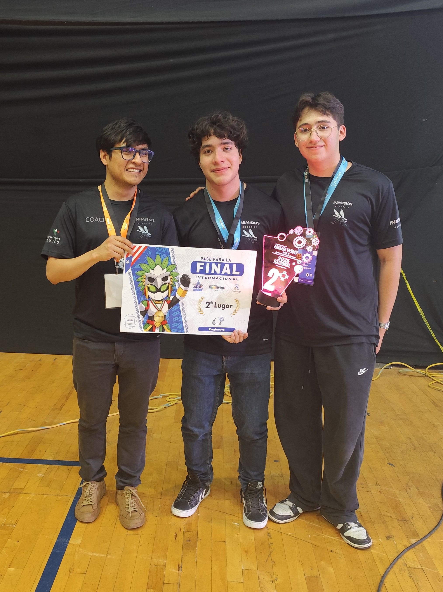<br><em>Team CSS with coach Manuel Alejandro Cardoso Duarte after the 2026 Mexico National Final (Tijuana): 2nd place and qualification for the International Final.</em></td>
<td align="center" width="55%">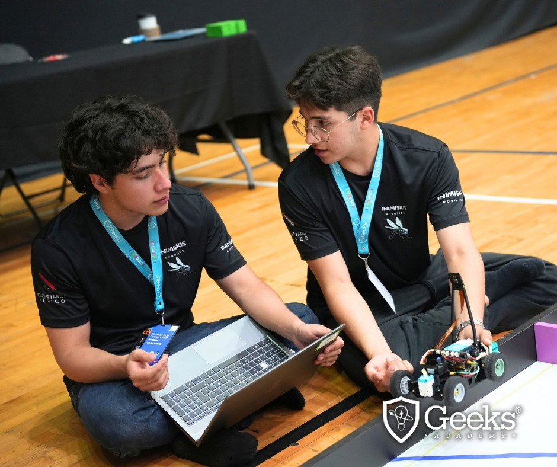<br><em>Preparing the vehicle at the field during the National Final. Photo: Geeks Academy.</em></td>
</tr>
</table>

---

### Coach and other members

<table>
<tr>
<td align="center" valign="top" width="33%"><br><b>Manuel Alejandro Cardoso Duarte</b><br>Coach<br><a href="https://www.linkedin.com/in/manuel-alejandro-cardoso-duarte-b68523129/"></a></td>
<td align="center" valign="top" width="33%"><br><b>José de Jesús Santana Ramírez, M.Sc.</b><br>Assistant coach</td>
<td align="center" valign="top" width="33%"><br><b>Rocío Damara Merlo Espino, Ph.D.</b><br>Administrative project manager<br><a href="https://www.linkedin.com/in/roc%C3%ADo-damara-merlo-espino-826198aa/"></a></td>
</tr>
</table>

> [!NOTE]
> <details>
> <summary><kbd>Click to open</kbd> <b>Biographies of the coach, the assistant coach and the project manager</b></summary>
>
> #### Manuel Alejandro Cardoso Duarte
> **Age:** 27\
> **Role:** Coach
> > Bachelor of Technology from the Universidad Nacional Autónoma de México (UNAM), Centro de Física Aplicada y Tecnología Avanzada (CFATA), and currently works as an Embedded Software Engineer at KOSTAL Automotive Services Mexicana, developing AUTOSAR-based embedded software (C, CAN/LIN bus communication, memory stack integration) for automotive door control modules serving clients such as Stellantis, FORD, and Rivian. His background in robotics coaching spans since February 2018, guiding high school teams at the Facultad de Ingeniería, Universidad Autónoma de Querétaro (UAQ) through the World Robot Olympiad, including leading our team to the 2023 international final in Panama City and to a national podium finish in RoboMission. As coach, his role is to teach the underlying engineering and programming concepts (Python, C, embedded systems) and guide the team's problem-solving process, without building or programming the vehicle himself. For more information visit: [CV Alejandro](other/additionalMedia/Others/CV_Manuel_Alejandro_Cardoso_Duarte_2026-compressed.pdf)
>
> ---
>
> #### José de Jesús Santana Ramírez, M.Sc.
> **Age:** 40\
> **Role:** Assistant coach
>
> >Mechatronics Engineer and Master of Science in Instrumentation and Control, with a solid track record in teaching, technological development, and innovation-oriented engineering applications. Currently pursuing a Ph.D. in Computer Science, focusing on research areas related to artificial intelligence, neural networks, computational modeling of physical systems, and control of mechanical systems. His expertise integrates hardware and software development for robotics, automation, and embedded systems projects. He serves as the coordinator of the Center for Studies in Robotics and Sciences (CEROC) at UAQ, as well as a professor in the Space Engineering degree program at ENES-UNAM. His professional profile is distinguished by connecting academic training, applied research, and a commitment to the scientific and technological education of future generations.
> ---
>
> #### Rocío Damara Merlo Espino, Ph.D.
> **Age:** 36\
> **Role:** Administrative project manager
>
> >Academic Degrees:
> >- Bachelor’s Degree in Psychology, Educational concentration.
> >- Specialization in School Learning.
> >- Master’s Degree in Innovation in Virtual Teaching-Learning Environments.
> >- Ph.D. in Educational Technology.
> >
> >Professional with a background in Psychology, School Learning, Innovation in Virtual Teaching-Learning Environments, and Educational Technology. She is the co-leader of the international chapter Women in Robotics Querétaro, Mexico, and brings over 12 years of experience in educational robotics, science pedagogy, and scientific outreach. Currently, she is completing a postdoctoral fellowship in Quality Management Systems for Engineering and Space Industry Laboratories at the High Technology Unit of the Faculty of Engineering at UNAM. In addition, she is a professor of Aerospace Engineering at ENES Juriquilla, a researcher, and Head of the Outreach Department at the Center for Studies in Robotics and Sciences (CEROC) at UAQ. She has driven academic, scientific, and technological projects, as well as student development in STEAM competencies.
>
> </details>

---

## 2. Challenge Overview <a id="challenge-overview"></a>

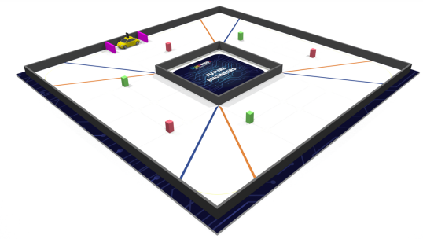

The **WRO Future Engineers** challenge requires teams to build a fully autonomous vehicle capable of completing both of the following challenges:

### Open Challenge
The vehicle must complete three laps on the track with random placements of the inside track walls.

### Obstacle Challenge
The vehicle must complete three laps on the track while detecting and avoiding randomly placed coloured obstacles (either green or red blocks), passing them on a specific side according to their colour, and then finish by performing a parallel parking maneuver.

### Surprise rule (International Final)
Optional extra task of the Obstacle Challenge, published on 2026-11-09: one traffic sign is replaced by a sign of the opposite colour that is 50 mm or 150 mm tall, and the vehicle must pass it on the side of its original colour. Our plan for it is in [§6.10](#surprise-rule).

<table>
<tr>
<td align="center" valign="bottom"><a href="other/WRO-2026-FE_GeneralRules.pdf">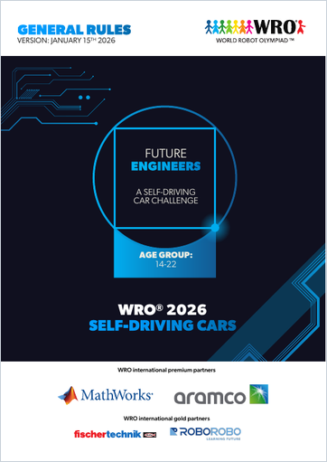</a><br><a href="other/WRO-2026-FE_GeneralRules.pdf">General Rules</a></td>
<td align="center" valign="bottom"><a href="other/WRO-2026-FE_SurpriseRule.pdf"></a><br><a href="other/WRO-2026-FE_SurpriseRule.pdf">Surprise Rule</a></td>
<td align="center" valign="bottom"><a href="other/WRO-2026-FE_DocumentationRubric.pdf">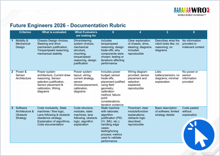</a><br><a href="other/WRO-2026-FE_DocumentationRubric.pdf">Documentation rubric</a></td>
<td align="center" valign="bottom"><a href="other/WRO-2026-FE_Playfield.pdf">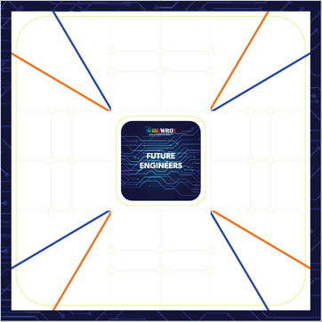</a><br><a href="other/WRO-2026-FE_Playfield.pdf">Playfield</a></td>
</tr>
</table>

More info: [WRO Official Site](https://wro-association.org/) | [Future Engineers Rules](https://wro-association.org/wp-content/uploads/WRO-2026-Future-Engineers-Self-Driving-Cars-General-Rules.pdf) (copy in [`other/`](other/WRO-2026-FE_GeneralRules.pdf)) | [Surprise Rule](other/WRO-2026-FE_SurpriseRule.pdf) | [Documentation rubric](other/WRO-2026-FE_DocumentationRubric.pdf) | [Playfield](other/WRO-2026-FE_Playfield.pdf)

---
## 3. Our Robot: design v7 at a glance <a id="our-robot"></a>

**Robot name:** ***"The Maker"***

### Design v7: International Final version (current)


<table style="width:100%">
<tr>
<td align="center">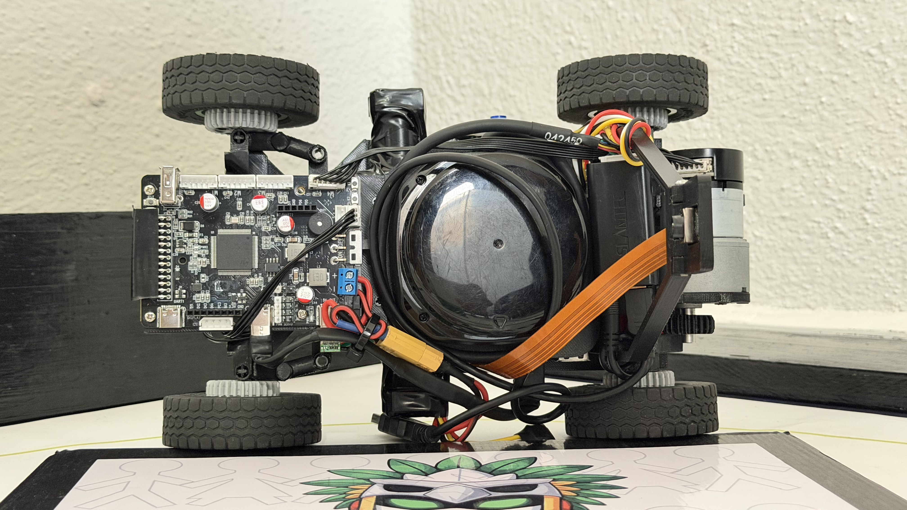<br>Top</td>
<td align="center">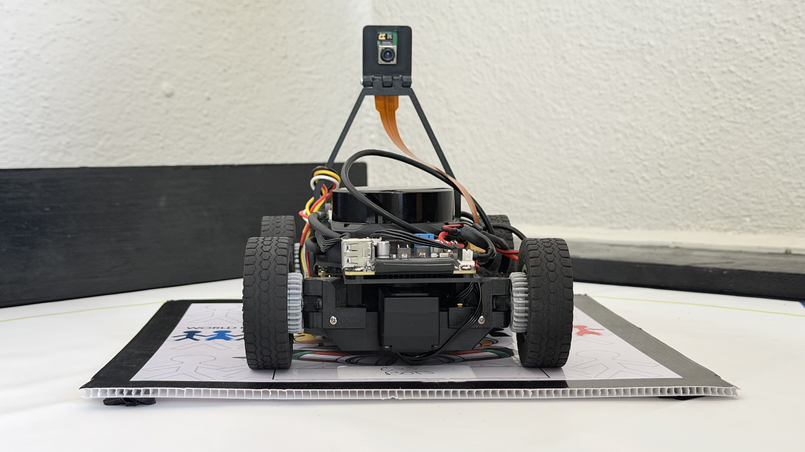<br>Front</td>
<td align="center">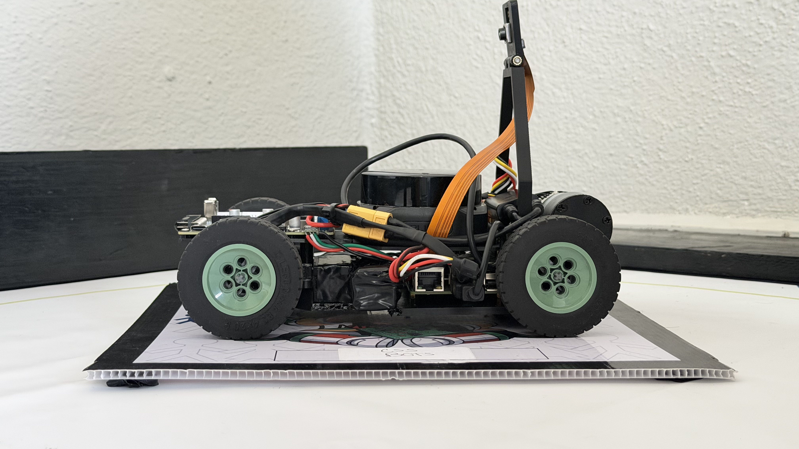<br>Left</td>
</tr>
<tr>
<td align="center">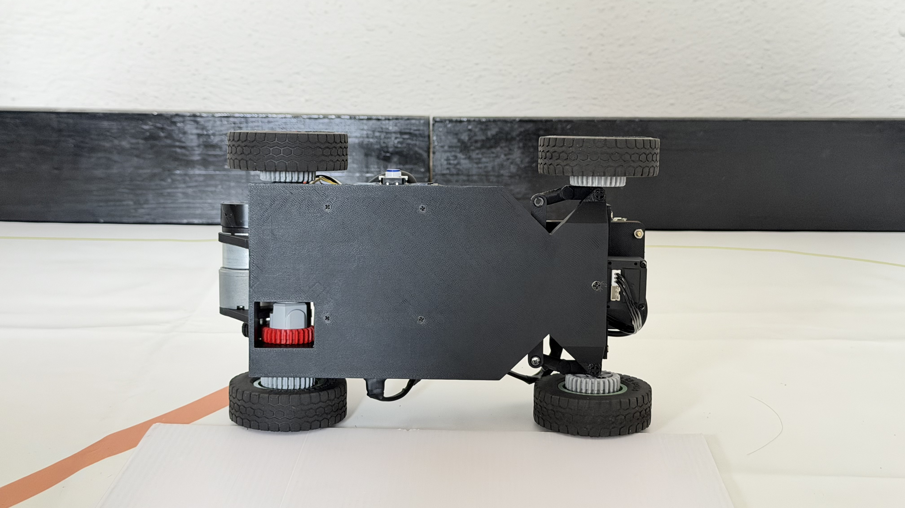<br>Bottom</td>
<td align="center">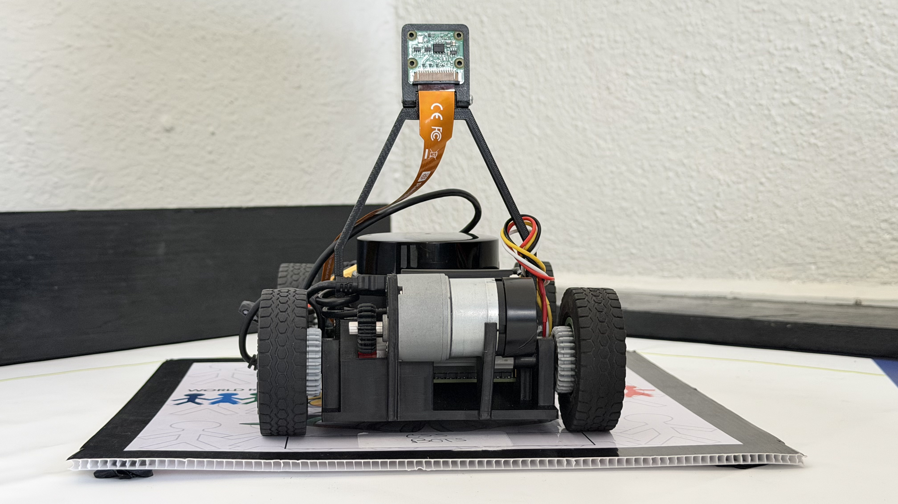<br>Back</td>
<td align="center">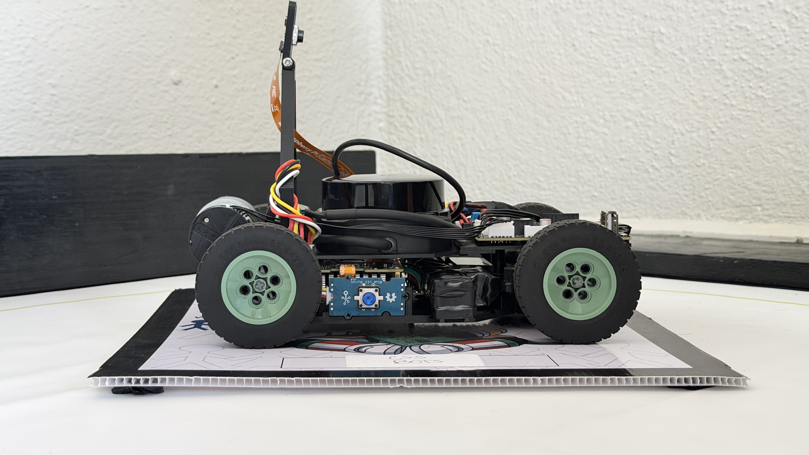<br>Right</td>
</tr>
</table>

### Design v7 specifications

| Parameter | Value |
|---|---|
| Dimensions (L × W × H) | 238.5 × 157.7 × 180 mm (limit 300 × 200 × 300 mm) |
| Mass | 1.087 kg (v6: 1.006 kg; limit 1.5 kg) |
| Drive | Rear-wheel drive, one JGB37-520 30:1 motor with Hall encoder, rear differential |
| Steering | Front Ackermann, HX-12H bus servo |
| Battery | 3S Panasonic NCR18650B, 10.8 V nominal, 12.6 V full, 3400 mAh, 36.7 Wh |
| Main computer | Raspberry Pi 5 (16 GB) |
| Perception | RPLidar S2L (360°, 10 Hz) + Camera Module 3 Wide + Hailo-8 |
| Language | C/C++ |

### What changed from design v6 (national) to design v7 (international) <a id="what-changed"></a>

The robot has gone through seven designs across two seasons (see [§7.4](#lessons)). **Design v6** competed at the 2026 Mexico National Final; **design v7** is the international version documented here.

<table>
<tr>
<th align="center" width="45%">Design v6: National Final (September 2026)</th>
<td rowspan="3" align="center" valign="middle" width="90"></td>
<th align="center" width="45%">Design v7: International Final (December 2026)</th>
</tr>
<tr>
<td align="center">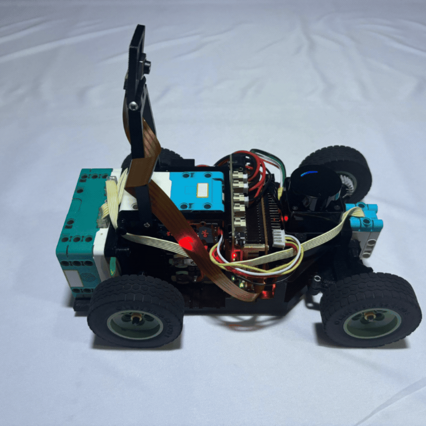</td>
<td align="center"></td>
</tr>
<tr>
<td align="center">
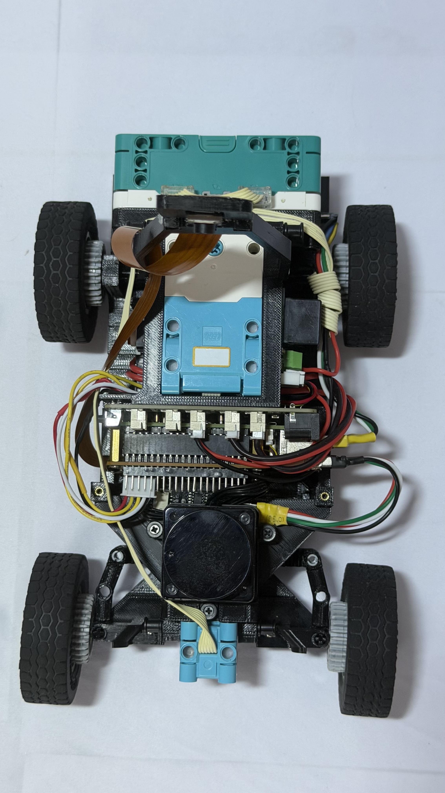 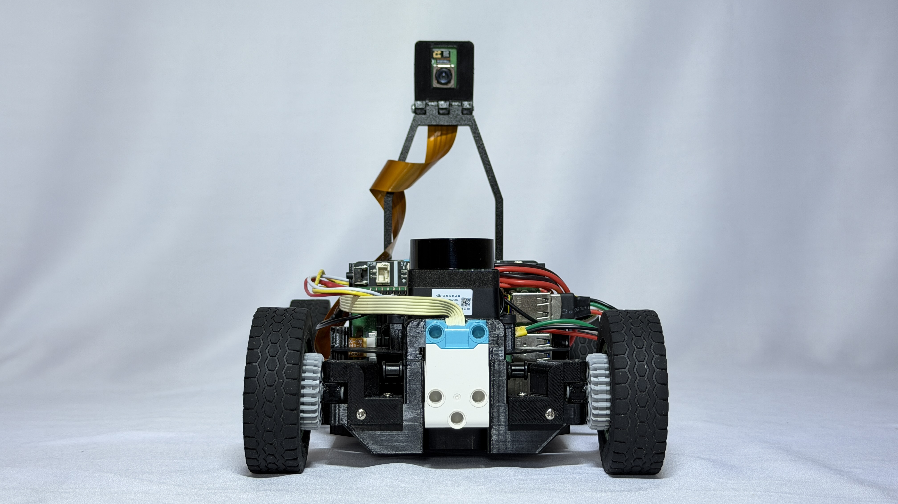 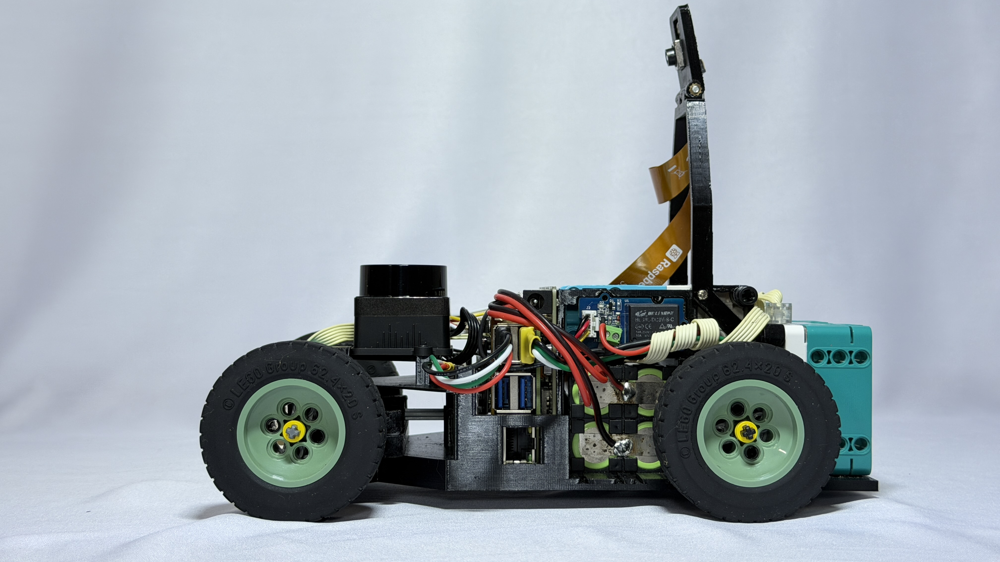<br>
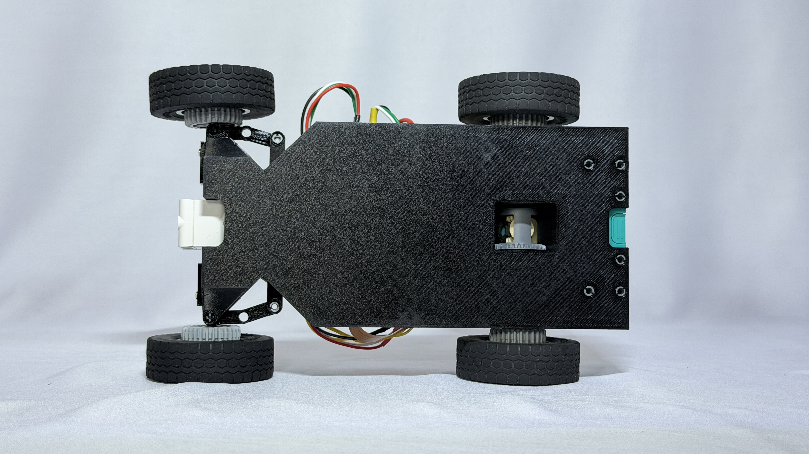 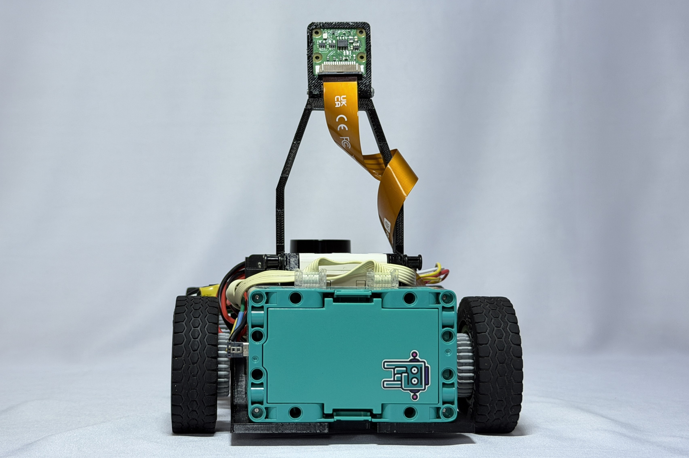 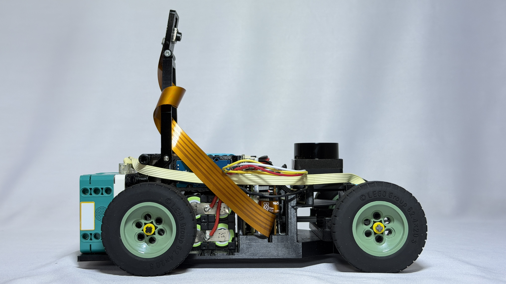
</td>
<td align="center">
  <br>
  
</td>
</tr>
</table>

*Design v6 (left) and design v7 (right). Views in each block: top, front, left (first row); bottom, back, right (second row). Click an image to see it full size.*

| Repository release | Vehicle design | Event |
|---|---|---|
| [`v1.0.0`](https://github.com/alex309-duarte/WRO_Future_Engineers_Queretaro_CSS/releases/tag/v1.0.0) | Design v6 | Mexico National Final, Tijuana (2nd place) |
| [`v2.0.4`](https://github.com/alex309-duarte/WRO_Future_Engineers_Queretaro_CSS/releases/tag/v2.0.4) | Design v7 | International Final, Puerto Rico |

| Subsystem | Design v6: National Final (Sep 2026) | Design v7: International Final (Dec 2026) | Decision card |
|---|---|---|---|
| Motor controller | LEGO SPIKE Prime Hub | Hiwonder ROS Robot Control Board (STM32F407), firmware `pos-v8` | [D7](#d7) |
| Drive motor | LEGO SPIKE Large Angular Motor (45602), 175 rpm no-load | Hiwonder JGB37-520 Hall-encoder DC gear motor, 30:1, 12 V, 320 rpm no-load | [D2](#d2) |
| Rear differential | v6 differential | New differential (LEGO 65414 housing + 65413 28T gear in a custom mount), same 20:28 ratio | [D3](#d3) |
| Steering actuator | LEGO SPIKE Small Angular Motor (45607) | Hiwonder HX-12H serial bus servo (12 kg·cm) | [D1](#d1) |
| Heading (IMU) | SPIKE Hub built-in IMU | IMU on the Hiwonder board (20 Hz) | [D7](#d7) |
| Battery | 4× Panasonic NCR18650B + Geekworm X1203 UPS | 3× Panasonic NCR18650B in series (3S, 10.8 V nominal) with a 3S BMS | [D4](#d4) |
| LiDAR | Orbbec Oradar MS200k | Slamtec RPLidar S2L | [D5](#d5) |
| AI accelerator | Raspberry Pi AI HAT+ 2 (Hailo-10H) | Hailo-8 (HailoRT 4.23) | [D6](#d6) |
| Vision model | YOLOv8n, 320×320, previous dataset | YOLOv8n 640×640, retrained on 23,938 images (9,354 originals), mAP50 0.990 on the Hailo-8 | [D8](#d8) |
| Control software | SPIKE API over serial REPL | Same mission code on a `spike_compat` layer, with offline unit tests | [D7](#d7) |
| Safety | Ctrl+C stops the process only | Signal-based emergency stop: motors to COAST, steering torque off | [D9](#d9) |
| Chassis | Custom 3D-printed, SolidWorks | Modified to fit the new components and lowered as close to the ground as possible | [§4.1](#mobility) |
| Main computer, camera | Raspberry Pi 5, Camera Module 3 Wide | Unchanged | — |

### More about the two designs

> [!NOTE]
> <details>
> <summary><kbd>Click to open</kbd> <b>Design v7 described in one paragraph</b></summary>
>
> ***"The Maker"*** is a rear-wheel-drive autonomous vehicle with regular-Ackermann front steering, built around a custom SolidWorks chassis that was modified from the national design to fit the new components cleanly and to sit as low to the ground as possible, so the LiDAR always scans below the top of the 100 mm walls. For the international final the LEGO SPIKE actuation was replaced to gain speed and control: a Hiwonder JGB37-520 30:1 DC gear motor with a Hall encoder (1320 counts per output revolution) drives the rear axle through a differential under closed-loop speed and position control, a Hiwonder HX-12H serial bus servo actuates the steering, and both are commanded by a Hiwonder ROS Robot Control Board (STM32F407), whose on-board IMU now supplies the heading. Perception comes from a Slamtec RPLidar S2L, which we brought back after fixing our own integration of it, fused with a Raspberry Pi Camera Module 3 Wide accelerated by a Hailo-8 AI accelerator. The LiDAR handles wall-following and obstacle range, while the camera detects the pillars (and recognises the magenta parking markers, so they are never taken for pillars) with a YOLOv8n model retrained on 23,938 images (9,354 originals, 3,831 of them taken with the car's own camera), reaching mAP50 0.990 at 8 ms per frame on the Hailo-8. All control and vision code still runs in C/C++ on a Raspberry Pi 5: instead of rewriting the mission logic that placed 2nd at nationals, we ported it to the new board through a SPIKE-compatibility layer verified by 84 offline tests, and added a signal-based emergency stop that cuts the motors on any program exit, because the new board's firmware has no command timeout. We also extended the board's firmware (`pos-v8`) with position control, HOLD and a watchdog for a hung firmware. Power comes from three Panasonic NCR18650B cells in series (3S, 10.8 V nominal) with a BMS, which feed the 12 V motor and servo directly. The complete vehicle weighs 1.087 kg, 72 % of the 1.5 kg limit.
>
> </details>

<table>
<tr>
<td align="center" width="120"><a href="other/docs/Design_v6_National.md#photos">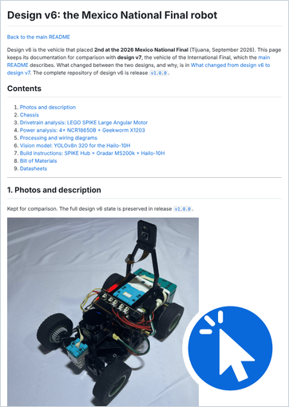</a></td>
<td><kbd>Other page</kbd> <b><a href="other/docs/Design_v6_National.md#photos">Design v6, the National Final robot (2nd place, Tijuana, September 2026)</a></b><br>Full-size photos, the rotating view and the description of the national robot.</td>
</tr>
</table>

---

## 4. Mobility and Mechanical Design <a id="mobility"></a>

### 4.1 Chassis <a id="chassis"></a>

The v7 chassis is a modification of the v6 design, modeled in SolidWorks. It was changed for two reasons:

1. **To fit the new components cleanly.** The Hiwonder board, the JGB37 motor, the HX-12H servo, the 3S battery with its BMS and the RPLidar S2L have different shapes and mounting points from the LEGO SPIKE Hub, the LEGO motors and the MS200k. The new parts in the assembly include two printed plates screwed together above the Raspberry Pi (the LiDAR plate, `Soporte de hiwonder-lidar`, and the Hiwonder board plate, `Soporte hiwonder`), a motor mount and the rear differential.
2. **To sit as low to the ground as possible.** In v4 we learned that a LiDAR mounted too high scans over the 100 mm walls (see [§7.4](#lessons)). v7 keeps the LiDAR scanning plane low and also lowers the heavy parts, which keeps the centre of gravity low at the higher v7 speed.

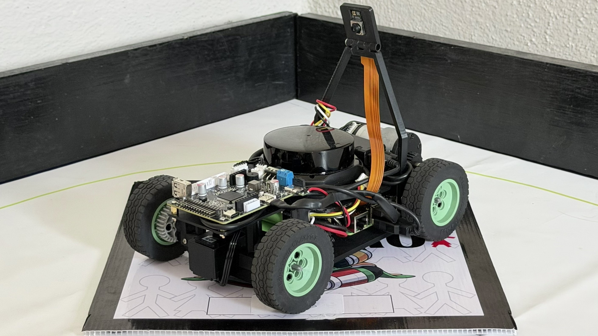

*Figure 1. Isometric view of design v7: Hiwonder controller at the front, RPLidar S2L in the centre, camera mast and JGB37 drive motor at the rear. The SolidWorks assembly is in [`models/cad/v7_assembly/`](models/cad/v7_assembly) (open `Assem1.SLDASM`).*

#### Interactive 3D model: open it and take the vehicle apart <a id="viewer-3d"></a>

> [!TIP]
> ##  [INTERACTIVE 3D MODEL: CLICK HERE TO OPEN IT](https://sebassesq.github.io/the-maker-3d/)
>
> This is not a picture. The whole SolidWorks assembly of the vehicle opens **in your browser, with nothing to install**, and you can move it yourself: **rotate** it, **zoom** in, **take the vehicle apart** and put it back, and **see the name of every part**.

<a href="https://sebassesq.github.io/the-maker-3d/"></a>

 *Click the animation to open the model.* What you can do in it:

| Rotate | Zoom | Take it apart | Standard views | Name of a part |
|:---:|:---:|:---:|:---:|:---:|
| Drag with the left button | Mouse wheel | **Disassemble** button | **Iso**, **Front**, **Top** … buttons | Rest the pointer on it |

*The model is made from the SolidWorks assembly with its colours (27 components and the parts inside them). All the controls, and how to update the model after a CAD change, are in [`models/cad/viewer/`](models/cad/viewer/README.md). GitHub can also show the whole vehicle in its own 3D viewer: [`models/cad/vehicle_v7.stl`](models/cad/vehicle_v7.stl).*

**CAD views of design v7.**<a id="cad-v7"></a> The same assembly in still views and one full turn. The tyres are LEGO parts, not printed.

| Isometric | One full turn |
|---|---|
| 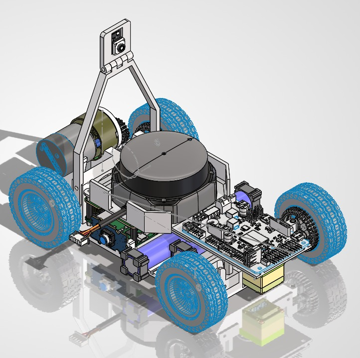 | 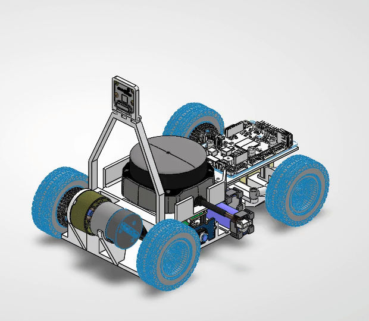 |
| **Side** | **Opposite side** |
| 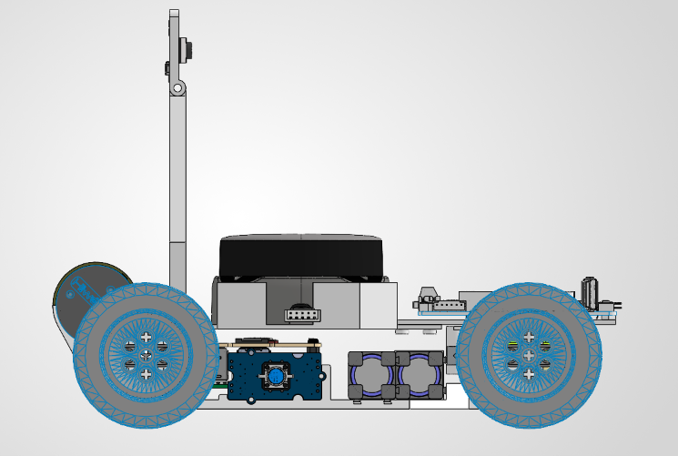 | 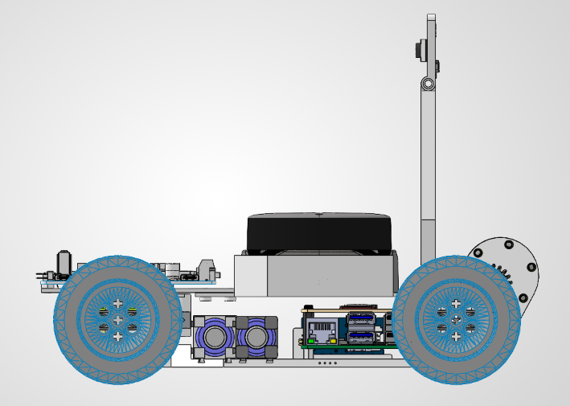 |
| **Front** | **Rear** |
| 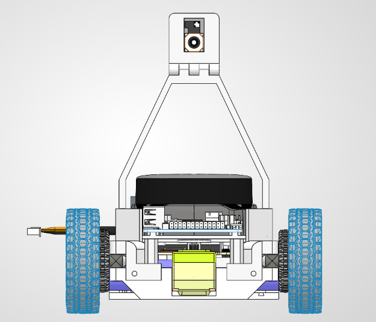 | 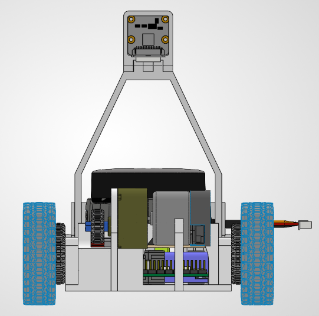 |
| **Top** | **Bottom** |
| 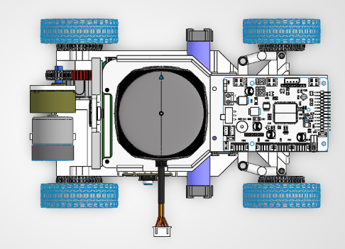 | 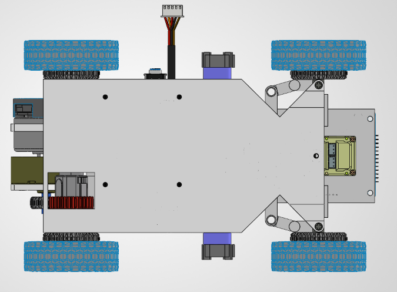 |

*Figure 2. Design v7 in SolidWorks (`models/cad/v7_assembly/Assem1.SLDASM`). Side views: steering servo, Hiwonder board and front wheels on one end; camera mast, drive motor and differential on the other; the RPLidar S2L in the middle, its scanning plane about 75 mm above the ground; the Raspberry Pi and the 3S pack below it. Bottom view: the flat underside of the chassis and the Ackermann linkage at the front.*

<table>
<tr>
<td align="center" width="190"><a href="other/docs/Design_v6_National.md#chassis">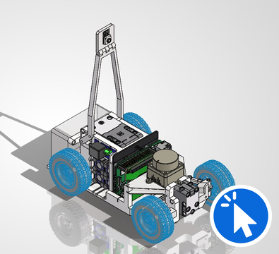</a></td>
<td><kbd>Other page</kbd> <b><a href="other/docs/Design_v6_National.md#chassis">Design v6 (national): the chassis</a></b><br>The national chassis and how it was designed.</td>
</tr>
</table>

### 4.2 Steering <a id="steering"></a>

The Maker's steering uses a regular Ackermann linkage. In the design v7 CAD the linkage reaches a maximum steering angle of **45.9°** (Figure 3), practically the 45.44° of design v6 (Figures 4 and 5), so the turning radius is the same as in v6. In software the steering is limited to **±35°** from center, inside that mechanical travel (see [D1](#d1)). This geometry ensures the inner and outer front wheels trace concentric arcs around a common turning center during a turn, minimizing tire scrub and keeping the front tires rolling rather than dragging through corners, a property that matters directly for both consistency and tire wear over a full run.

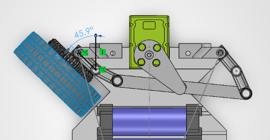

*Figure 3. Design v7: Ackermann linkage driven by the HX-12H bus servo, shown at full lock (45.9° in the CAD). The front of the robot is at the top.*

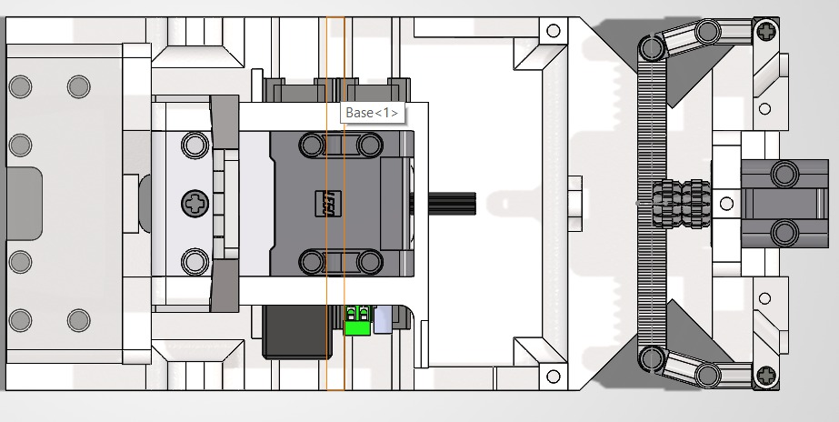

*Figure 4. Design v6: plan view of the Ackermann steering linkage, showing the tie-rod and knuckle geometry.*

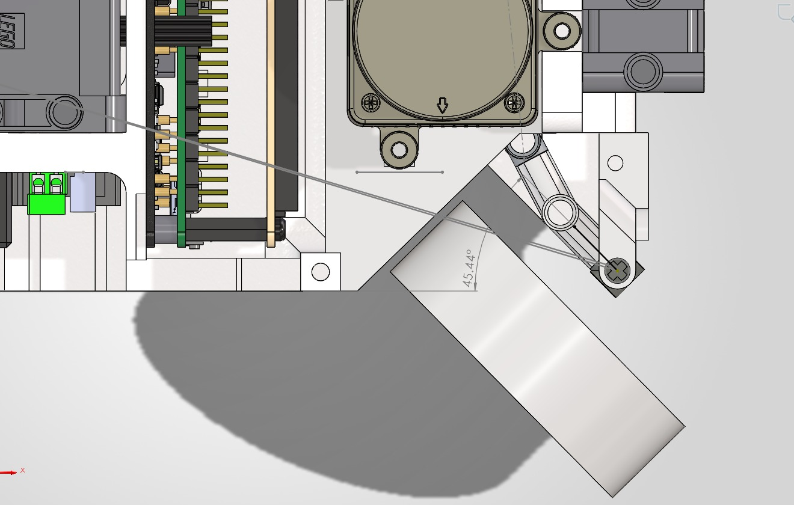

*Figure 5. Design v6: detail view of the CAD model highlighting the maximum steering angle of 45.44°.*

In design v6 the linkage was actuated by a LEGO SPIKE Prime Small Angular Motor (Part 45607). In v7 it is actuated by a bus servo (decision card D1 below).

This regular Ackermann design also represents a deliberate step back from the 2025 steering geometry (design v2). In the previous season, the team implemented a custom double-Ackermann linkage, which allowed for a tighter turning radius but introduced mechanical inconsistencies and reliability flaws during testing.

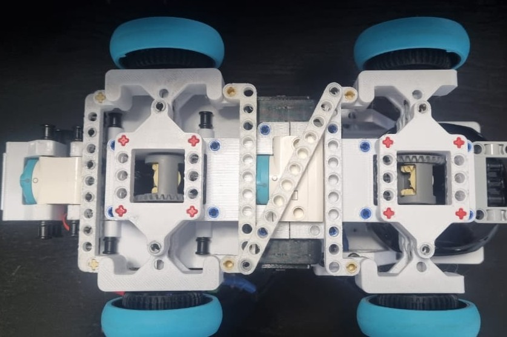

*Figure 6. Bottom view of the previous season's robot (design v2), showing the double-Ackermann steering configuration used last year.*

After weighing both options, the team concluded that the regular Ackermann's slightly wider turning radius was an acceptable trade-off given the reliability gained: it consistently completes every required turn on the WRO track, while eliminating the mechanical inconsistencies that affected the double-Ackermann design.


#### Decision card D1: steering servo <a id="d1"></a>

> [!IMPORTANT]
> | | |
> |---|---|
> | **What** | The LEGO SPIKE Small Angular Motor was replaced by a **Hiwonder HX-12H serial bus servo** driving the same Ackermann linkage. |
> | **Why** | With the SPIKE Hub removed ([D7](#d7)), the steering needed an actuator that the Hiwonder board can command. A bus servo holds its position on its own (closed loop inside the servo), reports its position, temperature and voltage, and runs directly from the 3S battery (9–12.6 V), so no extra regulator is needed. Its torque margin means the steering reaches its commanded angle at the same speed regardless of tire grip on the mat. |
> | **When** | Design v7, October 2026 (bench calibration on 2026-10-04). |
> | **How** | Positions 0–1000 map to 0–240° (0.24° per unit). Center (wheels straight) = 750; the linkage is assembled with the servo at that position. All steering commands pass through one function (`set_steering`) that clamps to **±35°** (`kDireccionMaxGrados`: 35 / 0.24 = 145 units each side, positions 605–895), so the wheel can never be driven into the chassis. At start-up the program refuses to move the servo if it is outside the allowed range, and on emergency stop the servo torque is released. Parameters: [`src/ondevice/hiwonder_config.h`](src/ondevice/hiwonder_config.h). |
> | **What for** | Fast steering response (0.2 s/60° at 11.1 V) directly from battery voltage, with position feedback at start-up. |
> | **Alternatives** | A PWM hobby servo (no position feedback, needs a separate PWM output); keeping a LEGO motor through an adapter. |

> [!NOTE]
> <details>
> <summary><kbd>Click to open</kbd> <b>Specifications of the HX-12H servo</b></summary>
>
> | HX-12H specification ([Hiwonder](https://www.hiwonder.com/products/hx-12h)) | Value |
> |---|---|
> | Operating voltage | 9–12.6 V |
> | Stall torque | 12 kg·cm at 11.1 V |
> | Speed | 0.2 s/60° at 11.1 V |
> | Range / resolution | 0–240°, command range 0–1000 |
> | Feedback | Position, temperature, voltage |
> | Interface | Serial bus (UART) |
> | Stall current | 1.3 A |
> | Mass | 36.3 g |
>
> </details>

<table>
  <tr>
    <td align="center">
      <a href="https://www.hiwonder.com/products/hx-12h">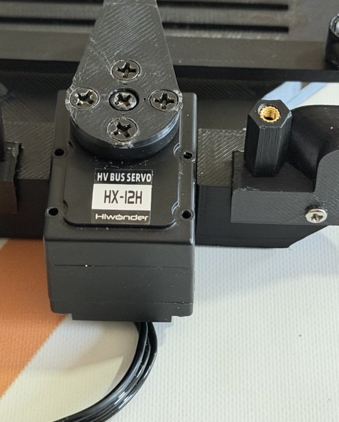</a><br>
      <em><a href="https://www.hiwonder.com/products/hx-12h">Hiwonder HX-12H serial bus servo</a></em>
    </td>
  </tr>
</table>


### 4.3 Drivetrain <a id="drivetrain"></a>

#### Decision card D2: drive motor <a id="d2"></a>

> [!IMPORTANT]
> | | |
> |---|---|
> | **What** | The LEGO SPIKE Large Angular Motor was replaced by a **Hiwonder JGB37-520 Hall-encoder DC gear motor** (30:1, 12 V, 320 rpm no-load). |
> | **Why** | The v6 motor reached a loaded top speed of only **0.365 m/s** (v6 calculation in the collapsible section below). With a 3-minute round limit and the same mission, a faster drivetrain gives margin for slower, more careful manoeuvres where they matter. The SPIKE motor was too slow for the level we expect at the international final, where every team is the best of its country, so v7 needed a faster drive motor. Its encoder also gives the board closed-loop speed and distance control. |
> | **When** | Design v7, October 2026. |
> | **How** | The board runs closed-loop speed and position control using the encoder: 11 pulses per motor revolution × 30:1 gearbox × 4 (quadrature) = **1320 counts per output revolution**, which matches the 1320 ticks/rev we measured. `speed = 100` in the mission code maps to `kRpsVelocidad100`; the environment variable `WRO_MAX_RPS` lowers it for first tests without recompiling. |
> | **What for** | Calculated loaded top speed **0.62 m/s at 10.8 V**, about **1.7×** the v6 robot (calculation below). |
> | **Alternatives** | Other JGB37 ratios (higher speed, less torque); other DC encoder motors; keeping the LEGO motor. We chose the Hiwonder JGB37 because we already had a similar Hiwonder motor and were familiar with it, and its speed and torque cover our needs with margin (calculation below). |

> [!NOTE]
> <details>
> <summary><kbd>Click to open</kbd> <b>Specifications of the JGB37-520 drive motor</b></summary>
>
> | JGB37-520R30-12V specification ([Hiwonder](https://www.hiwonder.com/products/hall-encoder-dc-geared-motor)) | Value |
> |---|---|
> | Rated voltage | 12 V |
> | Gear ratio | 30:1 |
> | No-load speed | 320 rpm |
> | Rated speed / torque / current | 280 rpm / 1.2 kg·cm / 0.36 A |
> | Stall torque / current | 5.8 kg·cm / 3.2 A |
> | Encoder | Hall, AB quadrature, 11 pulses per motor revolution |
> | Mass | 152 g |
>
> </details>

<table>
  <tr>
    <td align="center">
      <a href="https://www.hiwonder.com/products/hall-encoder-dc-geared-motor">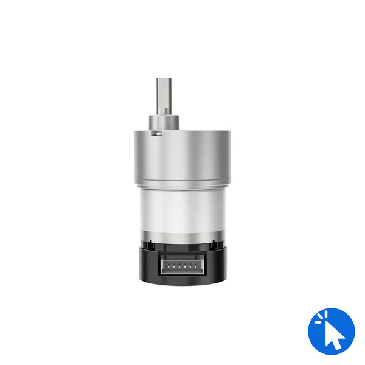</a><br>
      <em><a href="https://www.hiwonder.com/products/hall-encoder-dc-geared-motor">Hiwonder JGB37-520 Hall-encoder motor, 30:1</a></em>
    </td>
  </tr>
</table>


#### Design v7 torque and speed calculation <a id="torque-speed"></a>

Same method as the design v6 calculation ([design v6 page](other/docs/Design_v6_National.md#drivetrain)).

Inputs use the measured v7 mass (1.087 kg); the last row repeats the check at the 1.5 kg rule limit. The transmission is the same **20:28** gear reduction as v6, now driving the rear differential.

| Parameter | Symbol | Value |
|---|---|---|
| Robot mass | $m$ | 1.087 kg |
| Wheel diameter / radius | $d$ / $r$ | 0.0624 m / 0.0312 m |
| Target acceleration (cruise speed in ≈ 0.5 s) | $a$ | 1.3 m/s² |
| Rolling resistance coefficient | $C_{rr}$ | 0.03 |
| Transmission ratio (20:28) | $R$ | 1.4 |
| Transmission efficiency | $\eta$ | 0.85 |
| Battery voltage (3S nominal) | $V$ | 10.8 V |

$$F_{acc} = m \cdot a = 1.087 \cdot 1.3 = 1.413\text{ N} \qquad F_{rr} = C_{rr} \cdot m \cdot g = 0.03 \cdot 1.087 \cdot 9.81 = 0.320\text{ N}$$

$$T_w = (F_{acc} + F_{rr}) \cdot r = 1.733 \cdot 0.0312 = 0.0541\text{ N·m} \qquad T_m = \frac{T_w}{\eta R} = \frac{0.0541}{0.85 \cdot 1.4} = 0.0454\text{ N·m} \;(0.46\text{ kg·cm})$$

With the same 1.25× safety factor as v6: $T_{m,req} = 0.0568$ N·m (0.58 kg·cm).

| Check | Value | Interpretation |
|---|---|---|
| Load vs rated torque (1.2 kg·cm) | 39 % (48 % with safety factor) | Inside the continuous rating |
| Load vs stall torque (5.8 kg·cm) | 8 % | No stall risk in normal driving |
| No-load speed at 10.8 V | 320 × 10.8 / 12 = 288 rpm | Speed scales with voltage |
| Loaded motor speed | 288 × (1 − 0.0454 / 0.569) = 265 rpm | |
| Wheel speed | 265 / 1.4 = 189 rpm | |
| **Loaded top speed** | 189 × π × 0.0624 / 60 = **0.62 m/s** | v6: 0.365 m/s → **1.7×** |
| Time to top speed at $a$ = 1.3 m/s² | 0.48 s | Meets the 0.5 s target |
| Same check at the 1.5 kg rule limit | 53 % of rated torque, 0.60 m/s | The motor still has margin if mass is added |

> [!WARNING]
> **Speed set-point and battery voltage.** The motor's speed falls with battery voltage (no-load 320 rpm at 12 V, 288 rpm at 10.8 V). With `kRpsVelocidad100 = 5.7` rev/s the speed loop saturates, so the real speed depends on the battery charge: measured **0.580 m/s at 12.3 V and 0.524 m/s at 10.7 V** (−9.7 %). With 4.0 rev/s the loss drops to −6.1 % (0.539 → 0.506 m/s), at the cost of about 7 % of top speed ([§6.9](#testing)).

#### Decision card D3: rear differential <a id="d3"></a>

> [!IMPORTANT]
> | | |
> |---|---|
> | **What** | A **new rear differential**: LEGO 65414 differential housing with the 65413 28-tooth bevel gear, in a custom mount (`Diferencial.SLDASM`), replacing the differential of design v6. |
> | **Why** | The v6 differential had a shape and size that did not fit the modified chassis and the new JGB37 motor well. This one fits the new structure and the motor mount better. A differential is kept because in a corner the outer rear wheel travels farther than the inner one; without it one wheel must slip, which wastes traction, wears the tyres and makes the encoder distance less accurate. |
> | **When** | Design v7, October–November 2026. |
> | **How** | The motor drives the differential through the 20:28 gear pair. CAD: `Diferencial.SLDASM` (`Cuerpo diferencial`, `Engrane_diferencial`, LEGO 65413/65414 parts). |
> | **What for** | Same function as in v6 with a better fit to the new chassis and motor. Because the **gear ratio stays 20:28**, the speed and torque calculation above ([D2](#d2)) and the distance constants of the missions keep the same meaning. |
> | **Alternatives** | Keeping the v6 differential with adapters; a solid axle (wheel scrub in corners); two independent motors (not allowed: one driving axle, rule 11.3). |

<table>
  <tr>
    <td align="center">
      <a href="https://www.brickshop.eu/lego-parts/technics/lego-differential-housing-light-grey.html">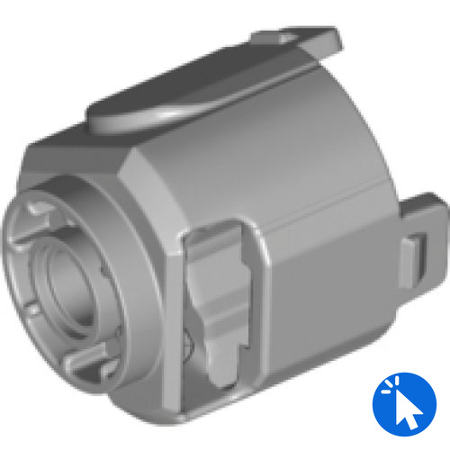</a><br>
      <em><a href="https://www.brickshop.eu/lego-parts/technics/lego-differential-housing-light-grey.html">LEGO differential housing (65414)</a></em>
    </td>
    <td align="center">
      <a href="https://www.brickowl.com/catalog/lego-red-bevel-gear-with-28-teeth-65413">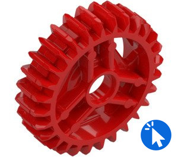</a><br>
      <em><a href="https://www.brickowl.com/catalog/lego-red-bevel-gear-with-28-teeth-65413">LEGO 28-tooth bevel gear (65413)</a></em>
    </td>
    <td align="center">
      <a href="https://www.amazon.com.mx/LEGO-Tire-86652-32019-75999/dp/B01CODUYCE">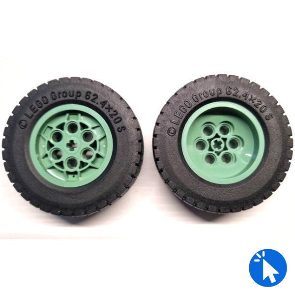</a><br>
      <em><a href="https://www.amazon.com.mx/LEGO-Tire-86652-32019-75999/dp/B01CODUYCE">LEGO tyre 62.4 × 20 S (32019)</a></em>
    </td>
  </tr>
</table>


Both 2026 designs (v6 and v7) also mark a layout change from last year's all-wheel-drive (AWD) configuration (see [Figure 6](other/additionalMedia/Others/Bottom2025.jpg)) to a rear-wheel-drive (RWD) layout. Driving only the rear axle simplified the drivetrain (removing the front differential/driveshaft hardware needed for AWD), reducing weight and mechanical complexity, while still providing enough traction for the WRO track once paired with the new LEGO 62.4×20S rubber tires.

<table>
<tr>
<td align="center" width="250"><a href="other/docs/Design_v6_National.md#drivetrain">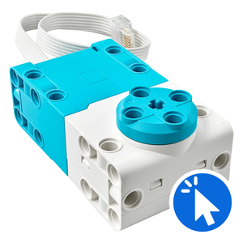</a> <a href="other/docs/Design_v6_National.md#drivetrain"></a></td>
<td><kbd>Other page</kbd> <b><a href="other/docs/Design_v6_National.md#drivetrain">Design v6 (national): drivetrain analysis</a></b><br>Torque and speed calculation with the LEGO SPIKE Large Angular Motor.</td>
</tr>
</table>

---

## 5. Power and Sensor Architecture <a id="power-sensors"></a>

### 5.1 Power architecture <a id="power"></a>

#### Decision card D4: 3S battery <a id="d4"></a>

> [!IMPORTANT]
> | | |
> |---|---|
> | **What** | Three **Panasonic NCR18650B** cells in series (**3S**): 10.8 V nominal, 12.6 V full, 3400 mAh, 36.7 Wh, protected by a **3S BMS**. |
> | **Why** | The new motor and the HX-12H servo are 12 V parts, and the Hiwonder board is designed for a 12 V supply. A 3S pack gives that voltage directly, without the boost stage of the v6 Geekworm X1203 (a 5 V UPS for the Pi only). We kept the NCR18650B cells because in v6 they solved the brownouts caused by generic high-resistance cells. |
> | **When** | Design v7, October 2026. |
> | **How** | Pack → 3S BMS → **Hiwonder ROS Robot Controller** (STM32F407VET6, input 7–14 V; [product page](https://hiwonder.com/products/ros-robot-control), [documentation](https://wiki.hiwonder.com/projects/ROS-Robot-Control-Board/en/latest/)), which drives the motor and the bus servo at battery voltage. The controller's independent **5 V / 5 A Type-C output powers the Raspberry Pi 5**, which in turn powers the Hailo-8, the camera, the LiDAR and the start button. The Pi 5 needs 5 V / 5 A to run its USB ports at full current, which matters because the LiDAR is USB-powered ([Raspberry Pi: USB Power Delivery on Raspberry Pi 5](other/datasheets/RP-009856-WP-1-USB-Power-Delivery-on-Raspberry-Pi-5.pdf)). Pi ↔ controller: USB serial (UART, 1 Mbaud). Wiring diagram below. Two cells sit end to end, held by four generic interlocking 18650 spacer brackets, and the third cell lies beside them in a printed holder ([`battery_holder.STL`](models/cad/Stl/v7/battery_holder.STL)), so the three cells are at the same height. This small change to design v7 lowered the Hiwonder board, which before partly blocked the LiDAR's view. |
> | **What for** | Estimated runtime about 1.7 h (budget below), far above a 3-minute round. |
> | **Alternatives** | v6 pack + X1203 for the Pi plus a separate 12 V pack (two batteries to charge, more mass); a 2S pack (7.2–8.4 V, too low for the 12 V motor's speed). |

<table>
  <tr>
    <td align="center">
      <a href="other/datasheets/Panasonic-NCR18650B-datasheet.pdf"></a><br>
      <em><a href="other/datasheets/Panasonic-NCR18650B-datasheet.pdf">Panasonic NCR18650B cell (×3, in series)</a></em>
    </td>
    <td align="center">
      <a href="https://www.inteligenciaartificialyrobotica.com/products/balanceador-cargador-de-baterias-li-ion-bms3s10a"></a><br>
      <em><a href="https://www.inteligenciaartificialyrobotica.com/products/balanceador-cargador-de-baterias-li-ion-bms3s10a">3S BMS (BMS3S10A)</a></em>
    </td>
  </tr>
</table>


*Power tree of design v7: one battery pack feeds everything through the Hiwonder controller.*

**Power budget (estimates from datasheets)** <a id="power-budget"></a>


> [!NOTE]
> <details>
> <summary><kbd>Click to open</kbd> <b>The numbers behind the chart, with the operating state and the source of each one</b></summary>
>
> | Component | Supply | Operating state | Estimate |
> |---|---|---|---|
> | [Raspberry Pi 5](https://www.raspberrypi.com/products/raspberry-pi-5/) | 5 V | High CPU load | 9.0 W |
> | Hailo-8 | 5 V (from the Pi) | Continuous inference (typical, [Hailo-8 product brief](other/datasheets/Hailo-8-product-brief-rev3.26.pdf)) | 2.5 W |
> | RPLidar S2L | 5 V | Scanning, 10 Hz ([Slamtec](https://www.slamtec.com/en/s2): 500 mA typical) | 2.5 W |
> | Grove LED button | 5 V | | 0.1 W |
> | **5 V subtotal** | | | **14.1 W → 15.7 W from the pack at ~90 % regulator efficiency** |
> | JGB37 drive motor | Battery | Accelerating at $a$ = 1.3 m/s² (≈ 0.35 A, linear torque–current estimate) | 3.8 W |
> | HX-12H servo | Battery | Holding / small corrections (≈ 0.1 A) | 1.1 W |
> | Hiwonder controller logic | Battery | Estimate | 0.5 W |
> | **Total** | | | **≈ 21 W → 1.95 A from the pack at 10.8 V** |
>
> </details>

$$t_{runtime} = \frac{36.7\text{ Wh}}{21\text{ W}} \approx 1.7\text{ h}$$

**Peak current.** The motor stall current is 3.2 A and the servo stall current is 1.3 A. In the worst case (both stalled while the 5 V side draws 1.45 A) the pack would supply ≈ 5.95 A, above the NCR18650B's 4.875 A continuous rating. In a 3S pack all three cells carry the full current (there is no parallel branch to share it, unlike v6). This is a short-duration case, but it is the same kind of transient that caused the v6 brownouts, so we calculated its effect below and track it in the risk register ([§7.3](#risks)).

#### Wiring diagram (design v7) <a id="wiring-v7"></a>


*Figure 7. Design v7 wiring diagram: battery voltage (red), regulated 5 V (orange), data (blue), mechanical links (dashed).*

**Connection table (design v7)** <a id="connections"></a>

> [!NOTE]
> <details>
> <summary><kbd>Click to open</kbd> <b>The connection table: every cable, from which port to which port</b></summary>
>
> | From | To | Connection | Notes |
> |---|---|---|---|
> | 3S pack (3 × NCR18650B in series) | 3S BMS | Battery leads | Protection for the pack |
> | 3S BMS output | Hiwonder controller, power input | Battery voltage, 9.9–12.6 V in use (the board accepts 7–14 V) | The board's main power switch turns the whole robot on and off |
> | Hiwonder controller, 5 V / 5 A Type-C output | Raspberry Pi 5, USB-C power input | 5 V | Powers the Pi and, through it, the Hailo-8, the camera, the LiDAR and the start button |
> | Raspberry Pi 5, USB port | Hiwonder controller, USB serial port (CH343) | USB serial, 1 Mbaud | Motion commands to the board, IMU heading back |
> | JGB37-520 drive motor (motor and Hall encoder) | Hiwonder controller, encoder-motor port **M4** | Motor cable | Closed-loop speed and position control on the board |
> | HX-12H steering servo | Hiwonder controller, serial bus servo port | Bus servo cable, battery voltage | Servo ID 1 |
> | RPLidar S2L | Raspberry Pi 5, USB port | USB through the LiDAR's UART adapter, 1 Mbaud | Powered from the Pi's USB port |
> | Camera Module 3 Wide | Raspberry Pi 5, CSI connector | Flat camera cable | |
> | AI HAT+ 26 TOPS (Hailo-8) | Raspberry Pi 5, PCIe connector | Mounted on the Pi as a HAT | |
> | Grove LED button, button | Raspberry Pi 5, **GPIO4** (BCM) | Grove cable | Start button |
> | Grove LED button, LED | Raspberry Pi 5, **GPIO3** (BCM) | Grove cable | Blinks when the gyro calibration is done |
> | ST-LINK/V2 (only to flash the firmware) | Hiwonder controller, header **H1**: pin 1 3V3, pin 3 SWCLK, pin 5 GND, pin 7 SWDIO | SWD | With the battery unplugged ([firmware README](firmware/hiwonder_pos-v8/README.md#flash-it)) |
>
> </details>


> [!NOTE]
> <details>
> <summary><kbd>Click to open</kbd> <b>Cell limits from the Panasonic datasheet and the voltage-sag calculation</b></summary>
>
> **Electrical limits, calculated from the Panasonic datasheet**
>
> | NCR18650B ([Panasonic datasheet](other/datasheets/Panasonic-NCR18650B-datasheet.pdf); max. discharge: [Battery Bro](https://batterybro.com/products/panasonic-b-ncr18650b-3400mah-4-8a); resistance: [lygte-info](https://lygte-info.dk/review/batteries2012/Panasonic%20NCR18650B%203400mAh%20(Green)%20UK.html)) | Value |
> |---|---|
> | Capacity | 3200 mAh rated minimum, 3350 mAh typical (sold as 3400 mAh) |
> | Nominal / charge / cut-off voltage | 3.6 V / 4.20 V / 2.5 V per cell |
> | Maximum continuous discharge | 4.875 A |
> | Internal resistance (AC, 1 kHz) | ≤ 45 mΩ |
> | Mass | 48.5 g max. |
>
> | Quantity | Calculation | Result |
> |---|---|---|
> | Average pack current, Obstacle Challenge run | 21 W ÷ 10.8 V (1.67 A at 12.6 V full, 2.12 A at 9.9 V low) | **≈ 1.9 A**, 0.58 C, 40 % of the 4.875 A rating |
> | Peak pack current, start from standstill | motor at stall 3.2 A + 5 V side 1.45 A + servo holding 0.1 A | **≈ 4.75 A**, 97 % of the rating, for the start-up transient only |
> | Worst case | motor and servo both stalled + 5 V side | ≈ 5.95 A (122 % of the rating); avoided by the steering clamp, see [§7.3](#risks) |
> | Voltage sag at the peak | I × R<sub>pack</sub>, R<sub>pack</sub> = 3 × 45 mΩ = 0.135 Ω (doubled to 0.27 Ω to allow for DC resistance, BMS and wiring) | 0.6–1.3 V at 4.75 A; 0.8–1.6 V at 5.95 A |
> | Lowest board input | low pack (3.3 V/cell = 9.9 V) minus the worst-case sag | **≈ 8.3 V**, above the controller's 7 V minimum, so its 5 V / 5 A output to the Pi stays regulated |
> | Energy per round | 21 W × 121 s (Obstacle) / 48 s (Open) | 0.71 Wh (2 % of the pack) / 0.28 Wh (0.8 %) |
> | Test session of 10 + 10 runs | 10 × 0.71 + 10 × 0.28 Wh of driving | ≈ 9.9 Wh, 29 % of the 34.6 Wh minimum capacity, plus idle time between runs (≈ 16 W) |
> | Runtime | 34.6 Wh (rated minimum) ÷ 21 W | ≈ 1.65 h (1.7 h with the typical capacity) |
>
> Even the worst-case sag leaves the Hiwonder board's input inside its 7–14 V range, and the board regulates the Pi's 5 V from it.
>
> </details>


<table>
<tr>
<td align="center" width="120"><a href="other/docs/Design_v6_National.md#power"></a></td>
<td><kbd>Other page</kbd> <b><a href="other/docs/Design_v6_National.md#power">Design v6 (national): power analysis</a></b><br>Energy, runtime and current of the 4× NCR18650B pack with the Geekworm X1203.</td>
</tr>
</table>

### 5.2 Sensors <a id="sensors"></a>

#### Decision card D5: LiDAR, back to the RPLidar S2L <a id="d5"></a>

> [!IMPORTANT]
> | | |
> |---|---|
> | **What** | The Orbbec Oradar MS200k was replaced by the **Slamtec RPLidar S2L**, the LiDAR we had dropped in July. |
> | **Why** | In July 2026 (design v4, before the v5 mount revision of 2026-08-01) we replaced the S2L for two reasons: distorted readings very close to the walls and its weight (185 g). For v7 we solved both. **Weight:** removing other parts (the SPIKE Hub, the X1203 UPS and one battery cell) freed the mass budget. **Readings:** the distorted readings came from our own integration, not from the sensor: we had reused the driver program written for another Slamtec LiDAR (the RPLidar A1) and, implementing it in the last days before the change, never properly adapted it to the S2L. Adapted with enough time and attention, the S2L proved accurate and reliable. |
> | **When** | Design v7, October 2026 (commits `78e9faf`, `eba156a`). |
> | **How** | Driver: [`src/ondevice/Oradar_S2L.cpp`](src/ondevice/Oradar_S2L.cpp) (S2L backend, 360-slot distance buffer, no quality filter). The build selects the S2L by default; the MS200 build is still available (Open Challenge: `make WRO_LIDAR=ORADAR`; Obstacle Challenge: `cmake ... -DWRO_LIDAR=ORADAR`). The emergency stop also sends the LiDAR stop frames so its motor does not keep spinning after the program ends. |
> | **What for** | Wall detected in **98.4 %** of frames vs 96.2 % for the MS200k, with lower noise at every distance and as accurate at short range ([§6.9](#testing)). |
> | **Alternatives** | Oradar MS200k (v5–v6), ultrasonic sensors (removed in 2026). |

> [!NOTE]
> <details>
> <summary><kbd>Click to open</kbd> <b>Specifications of the RPLidar S2L</b></summary>
>
> | | RPLidar S2L ([Slamtec](https://www.slamtec.com/en/s2)) |
> |---|---|
> | Range | 0.05–18 m (white), 0.05–8 m (black) |
> | Sample rate / scan rate | 32 kHz / 10 Hz |
> | Angular resolution | 0.1125° (3,200 points per turn) |
> | Accuracy / resolution | ±50 mm typical / 13 mm |
> | Supply | 5 V, 500 mA typical (1.5 A at start-up) |
> | Interface | UART, 1 Mbaud |
> | Mass | 185 g |
>
> </details>

<table>
  <tr>
    <td align="center">
      <a href="https://www.slamtec.com/en/s2"></a><br>
      <em><a href="https://www.slamtec.com/en/s2">Slamtec RPLidar S2L</a></em>
    </td>
  </tr>
</table>


> **What we learned:** we judged the sensor by a test of our own integration. A component should be ruled out only after the integration has been tested on its own, with time to separate a sensor problem from a software problem.

<a id="placement"></a>**Placement and field geometry.** The track walls and the traffic signs (pillars) are both 100 mm tall. In v4 the LiDAR was mounted too high and its scanning plane passed over the walls; v5 lowered the mount (see [§7.4](#lessons)). The v7 chassis was lowered so the S2L's scanning plane sits about **75 mm above the ground**, 25 mm below the top of the walls and the pillars, so every wall and pillar is cut by the scan even with small chassis pitch on the track (side views in [Figure 2](#cad-v7)).


*The scanning plane of the LiDAR against the wall and the traffic signs, including the two modified signs of the surprise rule ([§6.10](#surprise-rule)).*

#### Camera and AI accelerator

**Raspberry Pi Camera Module 3 Wide** ([product brief](other/datasheets/RP-008151-DS-1-camera-module-3-product-brief.pdf)) captures the frames used to detect the obstacle pillars. The model also recognises the magenta parking markers, so that they are not mistaken for pillars ([§6.4](#d8)). The camera detects *what* the obstacle is and roughly *where*; the LiDAR gives the precise distance (see [§6.6](#heading)).

<table>
  <tr>
    <td align="center">
      <a href="other/datasheets/RP-008151-DS-1-camera-module-3-product-brief.pdf"></a><br>
      <em><a href="other/datasheets/RP-008151-DS-1-camera-module-3-product-brief.pdf">Raspberry Pi Camera Module 3 Wide</a></em>
    </td>
  </tr>
</table>


#### Decision card D6: Hailo-10H → Hailo-8 <a id="d6"></a>

> [!IMPORTANT]
> | | |
> |---|---|
> | **What** | Design v7 runs inference on a **Hailo-8** ([Raspberry Pi AI HAT+ 26 TOPS](other/datasheets/RP-008133-DS-1-raspberry-pi-ai-hat-plus-product-brief.pdf), HailoRT 4.23) instead of the Hailo-10H AI HAT+ 2 used in v6. |
> | **Why** | Our YOLOv8n model is light enough to run on the Hailo-8 at the same accuracy, and the Hailo-8 board is lighter and smaller, which reduces the overall mass and dimensions of the vehicle. For a single small detection model the Hailo-10H was more than we needed. |
> | **When** | Design v7, October 2026. |
> | **How** | The same v4 model was compiled for both chips ([D8](#d8)); the Hailo-8 version uses the [Hailo Dataflow Compiler](https://hailo.ai/products/hailo-software/hailo-ai-software-suite/) 3.34. Run script: `src/cpp/object_detection_hiwonder_h10/run_hiwonder_h8.sh`. |
> | **What for** | Same accuracy on both chips (mAP50 0.990 Hailo-8 vs 0.991 Hailo-10H) and **8 ms per frame** on the Hailo-8. |
> | **Alternatives** | Hailo-10H (v6), OAK-D Lite (2025 season). |

<table>
  <tr>
    <td align="center">
      <a href="other/datasheets/RP-008133-DS-1-raspberry-pi-ai-hat-plus-product-brief.pdf"></a><br>
      <em><a href="other/datasheets/RP-008133-DS-1-raspberry-pi-ai-hat-plus-product-brief.pdf">Raspberry Pi AI HAT+ 26 TOPS (Hailo-8)</a></em>
    </td>
  </tr>
</table>


#### Heading: IMU on the Hiwonder board

With the SPIKE Hub gone, heading comes from the **IMU on the Hiwonder board**, read at **20 Hz**. See [D7](#d7) and the calibration below.

#### Removed: ultrasonic sensors

Ultrasonic sensors used in previous seasons were removed in 2026; the robot relies on the LiDAR and camera only.

### 5.3 Calibration <a id="calibration"></a>

| What | Method | Where |
|---|---|---|
| Gyroscope bias | Automatic at start-up: the robot must stay still for **5 s** while the bias is measured (the button LED blinks when done). On the bench, 2 s left ~0.5° of drift in 20 s; the error falls with the square root of the averaging time, so 5 s reduces it about 1.6×. | `kSegundosCalibracionGiro` in `hiwonder_config.h` |
| Yaw sign | With the wheels lifted, turn the robot clockwise by hand: yaw must **decrease**, as on the SPIKE Hub. | [`src/ondevice/HIWONDER.md`](src/ondevice/HIWONDER.md) |
| Steering center and side | Servo at 750 = wheels straight. Commanding the "right" position must turn the wheels right; if not, swap `kDireccionDerecha` and `kDireccionIzquierda`. | `hiwonder_config.h` |
| Distance | `Spike_Advance_For_distance(50, 1000, 0)` must travel 1000 mm; if it travels L mm, multiply `kDiametroRuedaMm` by L/1000. | `reto2_config.h` |
| LiDAR angle offset | The S2L is mounted with its own 90° angle pointing to the front of the robot, and its angles grow clockwise: `Lidar_Angle_Orientation_fixed_to_robot = 90` in `common_var.h` (used as `RPLIDAR_FRONT_DEG`) and `RPLIDAR_CLOCKWISE = 1`. The driver stores every scan already rotated to the robot and in the buffer layout of design v6 (`ORADAR_ANGLE_OFFSET = 270°`), so the mission code reads `FRONT`, `RIGHT`, `BACK`, `LEFT` exactly as before. If the LiDAR is remounted, change that one value in the `common_var.h` of both programs and rebuild, then check the four walls in the LiDAR window: a box in front of the robot must appear at the top. | `common_var.h` (in `src/ondevice/` and `src/cpp/object_detection_hiwonder_h10/`), `Oradar_S2L.cpp` |
| Camera / lighting | No fixed camera settings: the camera runs with libcamera's automatic exposure and white balance (800×600 frames through GStreamer, stretched to 640×640 for the model). Robustness to light comes from the dataset: photos taken in poor light and with shadows, plus augmentation of brightness (±20 %) and exposure (±10 %) ([D8](#d8)). On the track: 96 of 100 pillars read correctly, the 4 errors in strong shadows. Check with `./run_hiwonder_h8.sh --solo-percepcion`, which shows the detections without moving the robot. | `toolbox.cpp`, `run_hiwonder_h8.sh` |

### 5.4 Noise, interference and failure points <a id="noise"></a>

| Issue | Effect | Mitigation |
|---|---|---|
| LiDAR outliers and seams | False walls | Angular windowing, chassis filter (< 150 mm), radius outlier removal and segment scoring ([§6.5](#lidar)) |
| Single noisy LiDAR reading at the start | Wrong start-box or direction decision | The Open Challenge now takes 3 readings that must agree within 30 mm (`Lidar_Debounced_Read`, `main.cpp`) |
| IMU at 20 Hz vs control loop every 2 ms | The D term of the heading PD only sees a change in 1 of ~25 calls, so steering may vibrate on straights | Documented in `HIWONDER.md`. The heading gains were re-tuned on the track by trial and error, with small adjustments until the robot held its straights satisfactorily ([§6.7](#67-steering-control-pd)) |
| Voltage sag on acceleration | Pi brownouts (seen in June 2026, design v4) | Low-resistance NCR18650B cells, kept in v7; 3S pack with BMS; peak current check in [§5.1](#power) |
| Lighting changes, shadows | Missed or wrong pillar color | Dataset with many lighting conditions ([D8](#d8)); on track 96 % correct, errors from strong shadows; fails consistently only in near darkness |

### 5.5 Processing architecture

The control loop runs on the **Raspberry Pi 5**. The RPLidar S2L streams 360° scans over USB-serial into a background buffer. The camera frames go through the YOLOv8n model on the Hailo-8, which classifies the pillars (green, red) and the parking marker. The Pi fuses both streams and sends motion commands over USB-serial (CH343, 1 Mbaud) to the **Hiwonder board**, which closes the speed and position loops of the drive motor, drives the HX-12H steering servo, and reports the IMU heading. The Pi GPIO handles the start button (GPIO4) and its LED (GPIO3). The v6 relay that powered the SPIKE Hub is no longer used.

<table>
  <tr>
    <td align="center">
      <a href="other/datasheets/RP-008348-DS-6-raspberry-pi-5-product-brief.pdf"></a><br>
      <em><a href="other/datasheets/RP-008348-DS-6-raspberry-pi-5-product-brief.pdf">Raspberry Pi 5 (16 GB)</a></em>
    </td>
    <td align="center">
      <a href="https://wiki.seeedstudio.com/Grove-LED_Button/"></a><br>
      <em><a href="https://wiki.seeedstudio.com/Grove-LED_Button/">Grove LED button (start button, GPIO4 / LED GPIO3)</a></em>
    </td>
  </tr>
</table>


The design v7 wiring is in [Figure 7](#wiring-v7) (§5.1) and the v7 software data flow in Figure 11 (§6.1).

<table>
<tr>
<td align="center" width="330"><a href="other/docs/Design_v6_National.md#wiring"></a> <a href="other/docs/Design_v6_National.md#wiring"></a></td>
<td><kbd>Other page</kbd> <b><a href="other/docs/Design_v6_National.md#wiring">Design v6 (national): processing and wiring diagrams</a></b><br>How the SPIKE Hub, the MS200k LiDAR, the camera and the Raspberry Pi were connected.</td>
</tr>
</table>

**Custom PCB.** Design v7 has no custom PCB. The Hiwonder ROS Robot Control Board replaced both the Geekworm X1203 UPS and the SPIKE Hub, so the motor driver, the servo bus, the IMU and the Raspberry Pi's 5 V supply all come from one stock board, and the rest of the system (LiDAR, camera, Hailo-8, Grove start button) connects with standard cables, as drawn in [Figure 7](#wiring-v7). The KiCad expansion-board project in [`schemes/hardware/pcb`](schemes/hardware/pcb) is a design study and is not mounted on the robot.

#### Wireless communication

During development, the team connects to the Raspberry Pi 5 primarily over SSH, occasionally through RealVNC Viewer when a full graphical display is needed, or through a direct terminal connection when the display is not required. This is normally done wirelessly for convenience during testing.

However, since the WRO Future Engineers rules prohibit wireless communication during the rounds, at the competition we disable the Raspberry Pi's Wi-Fi and Bluetooth radios and connect over wired Ethernet for setup and debugging between rounds, then physically disconnect the Ethernet cable before each round ([rule compliance, §7.2](#rule-compliance)).

---

## 6. Software Architecture and Obstacle Strategy <a id="software"></a>

### 6.1 Code modules and their hardware <a id="code-modules"></a>

| Module | Files | Hardware it talks to | Used by |
|---|---|---|---|
| Open Challenge mission | `src/ondevice/main.cpp` | — | Open Challenge |
| Obstacle Challenge mission | `src/cpp/object_detection_hiwonder_h10/object_detection.cpp` | Camera, Hailo-8 | Obstacle Challenge |
| Vision pipeline | `src/cpp/common/` (`hailo_infer.cpp`, `resources_manager.cpp`), `src/cpp/object_detection_hiwonder_h10/toolbox.cpp` | Camera Module 3 Wide, Hailo-8 | Obstacle Challenge |
| LiDAR driver and wall detection | `src/ondevice/Oradar_S2L.cpp`, `src/cpp/object_detection_hiwonder_h10/lidar_reto2.cpp` | RPLidar S2L | Both |
| SPIKE compatibility layer | `src/ondevice/spike_compat.cpp` (header `src/ondevice/hiwonder/include/spike_compat/spike_compat.h`), `src/ondevice/spike_hiwonder.cpp`, `src/ondevice/spike.h`; Obstacle Challenge unit conversions in `src/cpp/object_detection_hiwonder_h10/spike_reto2.cpp` | — | Both |
| Board protocol | `src/ondevice/hiwonder/` (`src/hiwonder_brick.cpp`, `include/hiwonder_brick/hiwonder_brick.hpp`) | Hiwonder board: motor, servo, IMU | Both |
| Robot calibration | `src/ondevice/hiwonder_config.h`, `src/cpp/object_detection_hiwonder_h10/reto2_config.h` | — | Both |
| Emergency stop | `src/ondevice/parada_emergencia.cpp` | Hiwonder board, LiDAR | Both |
| Start button and LED | `src/ondevice/rasp_gpio.cpp`, `src/cpp/object_detection_hiwonder_h10/rasp_gpio.cpp` | Raspberry Pi GPIO | Both |
| Offline tests | `src/ondevice/tests/`, `src/cpp/object_detection_hiwonder_h10/tests/` | Fake board (no hardware) | Development |

#### Decision card D7: Hiwonder board behind a compatibility layer <a id="d7"></a>

> [!IMPORTANT]
> | | |
> |---|---|
> | **What** | The LEGO SPIKE Prime Hub was replaced by the **Hiwonder ROS Robot Control Board** (STM32F407; [product page](https://hiwonder.com/products/ros-robot-control), [documentation](https://wiki.hiwonder.com/projects/ROS-Robot-Control-Board/en/latest/)). Instead of rewriting the mission code, we wrote a **`spike_compat` layer** that keeps the same API the missions already used (`Spike_Advance_For_Degrees`, `Spike_Turn_For_Degrees`, `Spike_Reset_Gyro`, …) and translates it to the board. |
> | **Why** | The faster drive motor ([D2](#d2)) cannot be driven by the SPIKE Hub, so we needed a new controller that works with it and also replaces what the hub gave us, above all its **integrated IMU** for the heading. The Hiwonder board drives the JGB37 encoder motor, has an on-board IMU, and its 5 V / 5 A output also **powers the Raspberry Pi** ([D4](#d4)). Keeping the API meant the mission logic that placed 2nd at nationals did not have to be rewritten and re-tuned from zero two months before the international final. |
> | **When** | Open Challenge on the board: 2026-10-04 (`7925b70`). Obstacle Challenge: 2026-10-18. Merged to `main`: 2026-11-08. |
> | **How** | `hiwonder_brick` implements the board protocol. `spike_compat` reproduces the hub semantics, for example: `Spike_Reset_Gyro` receives **decidegrees** like the hub's `reset_yaw()`; `speed` 0–100 becomes rev/s in closed loop; `Spike_Turn_For_Degrees` turns with full steering like the hub's `turn()`; `Spike_Advance_For_Degrees` converts hub degrees to encoder ticks and stops 40 ticks early, then coasts, like the hub's `ag()`. The obstacle mission is the national `object_detection.cpp` with targeted substitutions, each marked with a `Hiwonder:` comment, so a diff against the original shows only the board-related changes. |
> | **What for** | The same mission code runs on both robots, and the translations are covered by offline tests with a fake board: **53 checks** for the Open Challenge layer and **31** for the Obstacle Challenge layer. On the track (2026-11-08) the v7 robot completed **9 of 10** Open Challenge runs and **8 of 10** Obstacle Challenge runs ([§6.9](#testing)). |
> | **Alternatives** | Rewriting the missions directly on the board API (more risk, no reuse of tuned constants); keeping the SPIKE Hub. |

> [!NOTE]
> <details>
> <summary><kbd>Click to open</kbd> <b>Specifications of the Hiwonder ROS Robot Controller</b></summary>
>
> | Hiwonder ROS Robot Controller specification ([Hiwonder](https://www.hiwonder.com/products/ros-robot-control), [documentation](https://wiki.hiwonder.com/projects/ROS-Robot-Control-Board/en/latest/)) | Value | How we use it |
> |---|---|---|
> | Microcontroller | STM32F407VET6: Arm Cortex-M4, 168 MHz with FPU, 512 KB flash, 192 KB RAM | Runs our modified Hiwonder firmware `pos-v8` (closed-loop motor control and position control, servo bus, IMU; see below) |
> | Power input | DC 7–14 V | 3S pack, 9.9–12.6 V in use ([§5.1](#power)) |
> | 5 V output | Independent 5 V / 5 A, USB Type-C | Powers the Raspberry Pi 5 and, through it, the Hailo-8, camera, LiDAR and button |
> | Encoder motors | 4 channels with PID speed control | Port M4: JGB37-520 drive motor |
> | Servos | 4 PWM servo ports (5 V), 2 serial bus servo ports (battery voltage) | One bus port: HX-12H steering servo (ID 1) |
> | IMU | On-board 6-axis IMU, QMI8658 (the chip the V1.2 firmware drives; Hiwonder's product page lists an MPU6050) | Heading, read by the Pi at 20 Hz |
> | Communication | 2 USB serial ports, CAN, SBUS, I²C, UART, Bluetooth module port | USB serial to the Pi at 1 Mbaud |
> | Controls and indicators | Main power switch, motor enable switch, 2 user buttons, user LED, buzzer, OLED port | Main power switch = hardware kill switch ([D9](#d9)) |
> | Protection | Over-temperature, short-circuit, over-current, reverse connection | |
> | Size and mass | 85 × 60 mm (holes 57 × 49 mm), 39.5 g | Mounted on its printed plate (`hiwonder_support.STL`), which is screwed to the LiDAR plate |
>
> </details>

<table>
  <tr>
    <td align="center">
      <a href="https://wiki.hiwonder.com/projects/ROS-Robot-Control-Board/en/latest/"></a><br>
      <em><a href="https://wiki.hiwonder.com/projects/ROS-Robot-Control-Board/en/latest/">Hiwonder ROS Robot Controller (STM32F407VET6)</a></em>
    </td>
  </tr>
</table>


<a id="board-firmware"></a>**Board firmware (`pos-v8`).** The board runs Hiwonder's FreeRTOS firmware with our patch on top ([`firmware/hiwonder_pos-v8/`](firmware/hiwonder_pos-v8)): `extended_m1.patch` changes 12 files of Hiwonder's official project (+906 / −442 lines). The folder has the image on the robot (`.hex` / `.bin` with SHA-256), the patch, the GCC build scripts, the protocol description and the flashing steps. Hiwonder's original source project (V1.2) and its factory recovery images are included unmodified, with credit to Hiwonder and the third-party libraries it uses, in [`firmware/hiwonder_original/`](firmware/hiwonder_original). The firmware is developed in a repository of its own, **[hiwonder-brick](https://github.com/JRavenelco/hiwonder-brick)**, and explained step by step in a **[video](https://www.youtube.com/watch?v=Mzc6JfptzTI)**; both are right below the diagram.


*Figure 10. Extended firmware `pos-v8`. The orange blocks are what we added to Hiwonder's firmware.*


<table>
<tr>
<td align="center" width="50%"><a href="https://www.youtube.com/watch?v=Mzc6JfptzTI"></a><br><kbd>Video</kbd> <b><a href="https://www.youtube.com/watch?v=Mzc6JfptzTI">▶ The firmware explained, from scratch (9:52)</a></b></td>
<td align="center" width="50%"><a href="https://github.com/JRavenelco/hiwonder-brick"></a><br><kbd>Other repository</kbd> <b><a href="https://github.com/JRavenelco/hiwonder-brick">hiwonder-brick: the firmware development repository</a></b></td>
</tr>
<tr>
<td>We create the STM32CubeIDE project from zero, add the sources and the settings, build it, explain <a href="https://www.youtube.com/watch?v=Mzc6JfptzTI&t=351s">how the firmware works</a> (from 5:51) and <a href="https://www.youtube.com/watch?v=Mzc6JfptzTI&t=511s">flash and test it</a> on the board (from 8:31). The image on the robot is the <code>pos-v8</code> of this repository; the video builds the same sources in the IDE.</td>
<td><a href="https://github.com/JRavenelco/hiwonder-brick"></a> <b>A second repository, only for the firmware:</b> <a href="https://github.com/JRavenelco/hiwonder-brick">github.com/JRavenelco/hiwonder-brick</a>. Everything behind the firmware and the host library, in more detail than this page: Hiwonder's project and our extension, the C++17 host library, the bench tools, the dated bench logs (July to October 2026), the protocol and the recovery procedure. Its documentation is in Spanish.</td>
</tr>
</table>

<table>
<tr>
<td align="center" width="120"><a href="firmware/hiwonder_pos-v8/README.md"></a></td>
<td><kbd>Other page</kbd> <b><a href="firmware/hiwonder_pos-v8/README.md">Firmware page</a></b><br>What we added to Hiwonder's firmware, the <code>MOTOR_EXT</code> commands, the versions, and how to flash and build it.</td>
</tr>
</table>


*View from the robot's camera on the track. The boxes are the model's detections with their class and confidence: `RedBox`, `GreenBox` and the parking markers (`Xparking`).*

The Obstacle Challenge program is structured as cooperating threads: a Hailo preprocess → inference → postprocess pipeline for the camera frames, a background LiDAR reader thread that keeps a 360-slot distance buffer up to date, and an `Obstacle_Challenge_Thread` that runs the navigation and avoidance logic and sends motion commands to the Hiwonder board through `spike_compat`.


*Figure 11. Design v7 software data flow (Obstacle Challenge), from sensor input through processing and decision-making to the Hiwonder board, which drives the motor and the steering servo.*

### 6.2 Open Challenge

Unlike the Obstacle Challenge, the Open Challenge runs a separate, simpler program, [`src/ondevice/main.cpp`](src/ondevice/main.cpp). There are no color pillars to detect, so the Hailo/camera pipeline isn't used at all: the program only needs the Slamtec RPLidar S2L and the Hiwonder ROS Robot Controller board. Motion goes through the `spike_compat` layer (section 6.1), so the mission keeps the team's `Spike_*` API while the board does the driving; the LiDAR functions keep their historical `Oradar_S2L_*` names from design v6. The whole run lives in `Recorrido()` ("the run"), which `main()` calls directly, or from a second thread when the optional "Lidar Coordinates" debug window is open (`--no-display` turns it off; the window only reads the LiDAR and the gyro, so the run is identical with or without it).

**Strategy in one line:** find the driving direction at the first corner, then for each of the 12 corners wait for the inner wall to end, turn toward it, drive into the new section and re-zero the gyro on the outer wall, so heading errors never add up from one corner to the next. The trace below follows `Recorrido()` top to bottom. The two driving directions are mirror images in the code and are drawn once here as `sentido` (the detected open side); the speeds and turn angles that differ between them are in the table under the figure.


*Figure 12. Open Challenge program flow, traced directly from `Recorrido()` in [`src/ondevice/main.cpp`](src/ondevice/main.cpp).*

> [!NOTE]
> <details>
> <summary><kbd>Click to open</kbd> <b>How each step of the flow works, and the values of the inside and outside starts</b></summary>
>
> > **How each step works.** `Lidar_Debounced_Read` copies the 360-slot distance buffer until 3 consecutive samples of the same angle agree within 30 mm, so a single bad return cannot choose the wrong start case. `Oradar_S2L_Advance_And_Detect_Side` drives straight until the front wall is within 1100 mm and one side reads more than 1350 mm (or gives no return): that open side is `sentido`, fixed for the whole run (`right` = clockwise). `Spike_Turn_For_Degrees` turns with full steering lock until |yaw| reaches 70-80°, a little short of 90°, and `Spike_Advance_For_Degrees` then holds heading &minus;90 (right turn) or +90 (left turn) for a fixed number of motor degrees, which completes the turn and brings the robot into the new section. Finally, `Oradar_S2L_Wall_Slope` fits the outer wall (the continuous one, on the side opposite `sentido`) and `Spike_Reset_Gyro` redefines the yaw so that heading 0 is parallel to it. This cancels gyro drift and turn error at every corner.
>
> | Case / `sentido` | First turn (speed, yaw) | First straight (speed, motor deg, heading) | Gap search speed | Loop turn (speed, yaw) | Loop straight (speed, motor deg, heading) | Outer wall |
> |---|---|---|---|---|---|---|
> | Outside, right | 60 %, 80° | 50 %, 1350, &minus;90 | 60 % | 50 %, 80° | 60 %, 600, &minus;90 | `LEFT` |
> | Outside, left | 50 %, 80° | 60 %, 1350, +90 | 60 % | 50 %, 70° | 60 %, 600, +90 | `RIGHT` |
> | Inside, right | 50 %, 70° | 60 %, 600, &minus;90 | 60 % | 50 %, 70° | 60 %, 600, &minus;90 | `LEFT` |
> | Inside, left | 50 %, 70° | 60 %, 600, +90 | 60 % | 50 %, 70° | 60 %, 600, +90 | `RIGHT` |
>
> The "outside" case (one side wall farther than 800 mm at the start) has a longer first straight and searches for the driving direction at 30 %; the "inside" case starts close to both walls, uses the short first straight and searches at 50 %. Every other move runs at 50 to 60 % in both cases. At the end of the 12th corner the robot is back in the starting section and drives at heading 0 until the front wall is at 1500 mm, i.e. the middle of the 3000 mm side, then holds the drive motor.
>
> </details>

#### High-level states <a id="open-states"></a>

The same run, one level up: the states a judge or teammate would actually watch the robot move through.


*Figure 13. Open Challenge high-level state machine. The Open Challenge has no parking: it ends with a stop in the starting section.*

> **Emergency stop.** The Hiwonder board firmware has no command timeout (its IWDG watchdog only resets a hung firmware): if the program died with the motor running, the motor would keep its last speed. So, from the moment the LiDAR is opened, Ctrl+C, `kill` or a crash triggers `parada_emergencia` ("emergency stop"), which sends the board a COAST command for all four motors and the LiDAR its stop frames, then ends the process immediately, so no half-finished loop can send another speed. If the board or the LiDAR does not start (no scan within 5 s), `Recorrido()` returns 1 before anything moves; if only the board is missing and the window is on, the window keeps showing the LiDAR until Ctrl+C, which is useful to check the LiDAR without the board.

#### Thresholds


> [!NOTE]
> <details>
> <summary><kbd>Click to open</kbd> <b>The constants of the Open Challenge (distances, angles, speeds) and where each one acts</b></summary>
>
> Pulled straight from the constants in [`main.cpp`](src/ondevice/main.cpp) and the `Oradar_S2L_*` helpers it calls, for whoever tunes this next. Distances are in mm from the LiDAR; straights are in motor degrees, the unit of `Spike_Advance_For_Degrees`.
>
> | Threshold | Value | Where / purpose |
> |---|---|---|
> | LiDAR start timeout | `50 × 100 ms = 5 s` | Wait for the first full scan (`Oradar_S2L_Get_Scan_Seq`); without it every distance is 0, so the run exits without moving. |
> | Gyro calibration | `5 s` | `Spike_Hiwonder_Init`, robot still, steering already centered so the servo does not shake the IMU. |
> | Debounce | `3 samples, ≤ 30 mm apart` | `Lidar_Debounced_Read` for the front / right / left start readings. |
> | Outside / inside split | `> 800 mm` | Right or left start reading above this selects the "outside" case, else "inside". |
> | Open side (direction) | `> 1350 mm` or no return | `Oradar_S2L_Advance_And_Detect_Side`: the side where the inner wall ends sets `sentido`. |
> | Corner gate, front | `≤ 1100 mm` | Detect-side and gap helpers only stop when the front wall is this close, so an opening seen too early is ignored. |
> | Corner gap, side | `≥ 1350 mm`, or front `≤ 500 mm` | `Oradar_S2L_Advance_Until_Right_Gap` / `_Left_Gap`: inner wall gone (or wall ahead very close), time to turn. |
> | Corner turn yaw | `80°` / `70°` | `Spike_Turn_For_Degrees`, full lock; 80° in the outside case (except the left-loop turns, 70°), 70° in the inside case. |
> | First straight | `1350` / `600` motor deg | `Spike_Advance_For_Degrees` after the first turn, outside / inside case. |
> | Corner straight | `600` motor deg | `Spike_Advance_For_Degrees` after every loop turn, at heading &minus;90 / +90. |
> | Speeds | `50-60 %`; direction search `30 %` (outside) / `50 %` (inside) | `Spike_*` speed scale 0-100, converted to closed-loop rev/s by `spike_compat`. |
> | Corners per run | `1 + 11 = 12` (`while (v < 11)`) | First corner before the loop, 11 in the loop: 3 laps of the four-corner field. |
> | Final stop | `≤ 1500 mm` front, `50 %` | `Oradar_S2L_Advance_Until_Distance(50, 0, 1500)`, then `Spike_Hold_Motors`: stops mid-way along the 3000 mm starting side. |
>
> </details>


### 6.3 Obstacle Challenge

The v7 mission is the national (v6) mission running on the Hiwonder layer: the strategy and the corner and section logic are the ones used at the national final. In November 2026 the LiDAR was remounted towards the back of the robot and rotated 90° ([§5.3](#calibration)), so the distances to the front wall in this section are about 100 mm longer than at the national final. Nine things changed in v7, each marked `Hiwonder:` in the code: the actuation through `spike_compat`, the start-up checks, a LiDAR-guarded advance, bounded waits, the **gyro correction from several walls** ([§6.6](#heading)), a start wait, a heading log, the shutdown, and a perception-only mode.

> [!NOTE]
> <details>
> <summary><kbd>Click to open</kbd> <b>The nine changes of the v7 mission, one by one</b></summary>
>
> - **Actuation:** the SPIKE calls of the mission go to the Hiwonder board through `spike_compat`. `Spike_Reto2_Init` converts the hub units the mission uses: steering `tire_turn` (4.29 steering-motor degrees per unit, so `40` = 0.96 of full lock) and hub degrees / millimetres to encoder ticks of the drive motor. Turns with `await` give the servo 150 ms to reach its position before the drive motor starts.
> - **Start-up:** board check, steering centring and a 5 s gyro calibration with the robot still; the robot does not move until the LiDAR has delivered its first full scan (up to 5 s); the mission thread starts once camera, inference and post-processing are running, and the start button still starts the motion.
> - **LiDAR-guarded advance:** `Advance_For_distance_Especial` (the crossing between two pillars of different color) stops early when the LiDAR ray in the direction of travel reads 370 mm or less; a ray with no return (0) is ignored. `Oradar_S2L_Advance_Until_Distance` (drive until the front wall is at a given distance) ends with a selectable brake type (`Hold` throughout the mission).
> - **Bounded waits:** the pillar-color wait when leaving the parking lot gives up after 3 s and continues as "no pillar"; the wait for a valid wall in the avoidance geometry also ends on shutdown.
> - **Gyro correction from several walls:** at every corner decision and before the final parking, the robot first waits until it is still (yaw stable for 300 ms, 1.5 s at most, then two new LiDAR scans) and then takes the **median tilt of all the walls in view** (front, right, left, behind) instead of one wall; with fewer than two walls it uses the single-wall value ([§6.6](#heading)).
> - **Start:** after the button, the robot waits up to 2 s for one side to read more than 600 mm (the hand on the button can hide a wall from the LiDAR); if neither side opens it does not move and prints why.
> - **Heading log:** every run writes a CSV with the yaw and the distance and angle of each wall at every LiDAR scan, and one row for every gyro reset (`WRO_RUMBO_LOG` sets the path). It is the data behind the two changes above.
> - **Shutdown:** Ctrl+C stops the robot at any moment (motors in coast, steering servo released, LiDAR motor stopped); a board error stops the motors and ends the mission.
> - **Perception-only mode:** `WRO_SOLO_PERCEPCION=1` runs camera, Hailo and LiDAR without opening the board, to check the model and the LiDAR orientation before arming the robot. The program also falls back to this mode when the board is not found and the window is on. The LiDAR window shows the angle of each wall and the yaw of the board.
>
> </details>

Two threads run at once (both started from `main()`): the Hailo camera
pipeline keeps the global `traffic_lights` struct (color, x-position, area,
confidence) updated in the background, while `Obstacle_Challenge_Thread`
drives the robot and reads that struct whenever it needs to know what cube
it's currently looking at. The diagrams below are the navigation thread.

#### High-level states <a id="obstacle-states"></a>


*Figure 14. Obstacle Challenge high-level state machine (navigation thread). `FinalParking` is described in [§6.8](#parking).*

> The direction of the run is fixed for the whole attempt by the single
> side-wall reading taken in `InitialScan`, and both branches feed the same
> `ExitParkingLot` &rarr; `CornerCycle` sequence. The counter-clockwise path is
> the sign-mirrored twin of the clockwise one, so the corner cycle below is
> drawn once rather than twice.

#### One corner cycle (repeats x12)

`Corner_Case` and `Desicion` together are the unit that repeats 12 times.
Drawn once here rather than 12 times over.


*Figure 15. One Obstacle Challenge corner cycle (clockwise run, distances measured by the LiDAR).*

> [!NOTE]
> <details>
> <summary><kbd>Click to open</kbd> <b>Notes on the counter-clockwise run and on the avoidance functions</b></summary>
>
> > In the counter-clockwise run the two corner colors are swapped and the
> > distances are its own: first stop at 1100 mm, red after a green at 500 mm
> > (700 mm in the parking section), green after a green at 1090 mm, no pillar at 750 mm.
>
> > `esquivar_cubos_1/2/middle` each call `calculte_angle_section_start_clockwise_chr`
> > (or its `..._counterclockwise` counterpart) to get an angle + distance to the
> > cube, turn toward it (left for green, right for red -- the passing side is set
> > by the rules and does not mirror with the driving direction), advance alongside
> > it, then small-turn back straight.
> > `esquivar_cubos_2` additionally short-circuits to a plain advance to 1100mm
> > from the front wall when no second cube is present or it's the same color as
> > the first (two greens in the parking section: 1600mm, then a short S-shift to
> > the left).
>
> > `Obstacle_Challenge_Thread` also calls `Slope(front)` once, right after
> > the initial button-press reset, and then resets the gyro to `0`: the
> > starting heading is the robot's placement in the parking lot.
>
> </details>

#### Thresholds referenced above


> [!NOTE]
> <details>
> <summary><kbd>Click to open</kbd> <b>The constants of the Obstacle Challenge (distances, angles, speeds) and where each one acts</b></summary>
>
> | Constant | Value | Where it acts |
> |---|---|---|
> | Direction-of-run split | `600 mm` | Right reading above this at start -> clockwise run; left reading above this -> counter-clockwise run. Fixed for the whole attempt. |
> | Start pillar wait | `3 s` | Leaving the parking lot, the robot waits this long for the camera to report a pillar, then continues as "no pillar". |
> | Start wait | up to `2 s` | After the button, until one side reads more than 600 mm; otherwise the robot does not move. |
> | Corner approach | `1050 mm` | First advance in every `Corner_Case`, before reading the cube color. |
> | Green-cube advance | `750 mm` (parking) / `600 mm` (not) | Second advance in `Corner_Case` when the corner cube is green and the previous one was red. |
> | Red-cube advance | `1050 mm` | `Corner_Case` when the corner cube is red and the previous one was red: the robot turns from the first stop. |
> | No-cube advance | `770 mm` | Second advance in `Corner_Case` in every other case (treated as no corner cube). |
> | Corner turn | `86 deg` | Every `Corner_Case`, turning into the next section: right when running clockwise (steering `tire_turn 35`), left when running counter-clockwise (`tire_turn 40`). |
> | Gyro realign | median tilt of the walls in view | Start of every `Desicion`, squares the robot to the walls before looking for cubes. With fewer than two walls: `Slope(outer wall) +/- 90 deg` (outer wall on the left running clockwise, on the right running counter-clockwise). |
> | Robot-still wait | yaw change `< 0.15 deg` per 50 ms for `300 ms`, at most `1.5 s`, then 2 LiDAR scans | Before every gyro realign, so the walls are not measured while the robot is still rotating. |
> | Corners per run | `12` (3 laps x 4) | 4th corner of each lap calls `Corner_Case`/`Desicion` with `parking=true`. |
> | Avoidance turn | angle `+5 deg` (cube 1) / `-5 deg` (cube 2) / `+3 deg` (middle), max `70 deg` | Turn toward the computed passing point before each avoidance advance. |
> | Cube-1 clearance | `hypotenuse - 400` (normal) / `-200` (parking, green) | `esquivar_cubos_1`'s advance-past-cube distance. |
> | Cube-2 clearance | `hypotenuse - 50` (normal) / `-60` (parking, red after green) | `esquivar_cubos_2`'s advance-past-cube distance when the second cube has the other color. |
> | Middle-cube clearance | `hypotenuse - 450` (red) / `-350` (green) | `esquivar_cubos_middle`'s advance-past-cube distance. |
> | LiDAR guard | `370 mm` | `Advance_For_distance_Especial` (cube-2 crossing) stops early when the ray in the direction of travel reads this or less. |
> | Speeds | advances `30 %`, turns `23 %`; clockwise corner approach `50 %`, clockwise corner turn `40 %`; parking `15-23 %` | `Spike_*` speed scale 0-100. These are the values in the code while the new settings are tuned ([§6.9](#testing)). |
> | Stage pause | `1 s` | Clockwise run: after every stage of laps 1 and 2. |
>
> > Values are for the clockwise run, whose corner distances and speeds are the
> > constants at the top of `object_detection.cpp`. The counter-clockwise run has
> > its own corner distances (see the notes above) and scales the clearance
> > margins by `angle / 45 deg`, with its own avoidance-turn offsets.
>
> </details>


### 6.4 Vision model <a id="vision"></a>

#### Decision card D8: retrained detection model <a id="d8"></a>

> [!IMPORTANT]
> | | |
> |---|---|
> | **What** | YOLOv8n retrained on a new, much larger dataset (**23,938 images**, 9,354 of them originals, including scenes without pillars and in poor lighting) and compiled for both accelerators: [`src/HailoModels/wro_h8_yolov8n_v4.hef`](src/HailoModels) for the Hailo-8 (v7 robot) and a Hailo-10H version. Classes: `greenbox`, `redbox`, `xparking`. |
> | **Why** | On the track the v6 model made three kinds of mistakes: it sometimes **missed a pillar** that was there, it took **objects outside the track for pillars** (for example, a red broom read as a red pillar), and it sometimes saw a **green pillar in an empty corner** of the track. Most failures happened in **poor lighting**. The v6 model had been trained on our small hand-labelled national dataset (501 images in [`other/dataset/`](other/dataset), mAP50 0.986 in training). The new dataset adds photos from the robot's own camera in those situations, including images with **no pillars at all**, so the model also learns when there is nothing to detect. |
> | **When** | Dataset exported from Roboflow and model trained on 2026-10-18 (training run `h10_yolov8n_640_v4`). |
> | **How** | See the dataset breakdown below. [YOLOv8n](https://docs.ultralytics.com/models/yolov8/), image size 640, Ultralytics 8.4.115. Images are stretched to 640×640 with no letterbox, the same preprocessing the car applies to the camera frame, so the model sees images shaped like the ones it gets on the robot. Hailo-8 version compiled with the Dataflow Compiler 3.34. |
> | **What for** | See the results table below: decision correct in **99.2 %** of the October validation images on both chips, **8 ms** per frame on the Hailo-8. |
> | **Alternatives** | Keeping the v6 model (`yolov8n_wro_hailo8.hef` is kept for comparison: `WRO_HIWONDER_MODEL=... ./run_hiwonder_h8.sh`). We kept the same model type (YOLOv8n) because it already runs well on our hardware (8 ms per frame on the Hailo-8); the errors came from the data, so we improved the dataset and retrained to make the model more accurate and less prone to the mistakes that could cost a run. |

**Dataset:** [`wro-dataset-completo`, version 1](https://universe.roboflow.com/roboteam-x6iuc/wro-dataset-completo) (Roboflow Universe, MIT license).


> [!NOTE]
> <details>
> <summary><kbd>Click to open</kbd> <b>Where the 23,938 images come from, how they were split and augmented</b></summary>
>
> | Source | Original images | Description | Validation set |
> |---|---|---|---|
> | `octubre` | 3,831 | Photos from the car's own camera (800×600), labelled in October 2026 | 5 complete recording sessions held out (477 images) |
> | `combinaditos` | 501 | Phone photos with pillars of both colours | Photos numbered c420 and above |
> | `roboflow_v3` | 5,022 | Originals (320×320) of our previous Roboflow project `wro-round-2` | Its own train/valid/test split (the 495 test images come from here) |
> | **Total** | **9,354** | | |
>
> | Split | Images | Notes |
> |---|---|---|
> | Train | 21,876 | 7,292 originals × 3 augmented versions |
> | Valid | 1,567 | Originals only |
> | Test | 495 | Originals only |
> | **Total** | **23,938** | |
>
> - **Pre-processing:** auto-orientation (EXIF stripped), resize to 640×640 (stretch).
> - **Augmentation (training split only, 3 versions per source image):** horizontal flip (50 %), rotation ±5°, brightness ±20 %, exposure ±10 %, Gaussian blur 0–1 px, salt-and-pepper noise on 1 % of pixels. Brightness, exposure and blur simulate the lighting changes and motion blur we expect on an unknown venue's field.
> - **Held-out validation by session:** the October validation images are 5 entire recording sessions that never appear in training, not random frames. Consecutive video frames are almost identical, so a random split would leak near-copies into validation and inflate the scores.
>
> </details>


**Results on held-out data**

| Test set | Metric | Result |
|---|---|---|
| `octubre` validation (477 images), on the Hailo-10H | mAP50 | 0.991 |
| `octubre` validation (477 images), on the Hailo-8 | mAP50 | 0.990 |
| Same 477 images, both chips | Obstacle Challenge decision correct (pillar colour → passing side) | 99.2 % |
| `combinaditos` held-out (81 images, 275 pillars) | mAP50-95 / recall | 0.875 / 0.982 |
| Hailo-8 on the robot | Inference time | 8 ms per frame |

> On the car, `class_id` = index + 1 (green 1, red 2, xparking 3), see `parse_nms_data` in `object_detection.cpp`.

**How the detections are used.** In every frame the post-processing gives an area of 0 to every box with a **score below 0.75** and to every `xparking` box, then picks the largest remaining box as the nearest pillar and publishes its colour, centre, area and confidence in `traffic_lights` ([§6.3](#63-obstacle-challenge)). The `xparking` class is kept in the model so that the magenta parking markers are recognised as markers and never mistaken for a pillar; it is not used to find the parking lot, which the mission reaches by counting sections and measuring walls with the LiDAR ([§6.8](#parking)).


*The model at work: the view from the robot's camera, with the box, class and confidence of every detection.*

### 6.5 LiDAR processing <a id="lidar"></a>

Wall and corner detection (`Select_Wall()`) follows this pipeline on each call:

1. **Angular windowing**, a 70°-wide window centered on the requested side (front/right/left/behind), with the innermost ±3° excluded to avoid seam/corner noise.
2. **Chassis filtering**, any return closer than 150 mm is discarded as the robot's own body, not an environmental wall.
3. **Radius Outlier Removal (ROR)**, a point is dropped if it has fewer than 3 neighbors within 300 mm (with 15° of padding outside the window so edge points aren't unfairly penalized).
4. **Segmentation**, the remaining points are split into candidate walls wherever consecutive points jump apart by more than 60 mm (gap-based segmentation), then further split at corners using a recursive max-perpendicular-deviation method (Iterative End-Point Fit) with a 40 mm threshold.
5. **Scoring**, a segment only qualifies as a wall if it has at least 6 points, spans at least 200 mm end-to-end (to reject compact objects/blocks), and has an RMS perpendicular residual under 15 mm against its own best-fit line (computed via Total Least Squares/PCA, since it has no bias toward any orientation).
6. **Per-side tracking**, once a wall is chosen for a side, subsequent frames prefer to keep following that same physical wall (matched within 300 mm position / 20° orientation) rather than re-snapping every frame.

The camera classifies the pillar color; the LiDAR's role is purely geometric: once a pillar is flagged by vision, the LiDAR supplies the distance and angle used to compute the avoidance maneuver.

### 6.6 Heading estimation <a id="heading"></a>

Heading comes from the IMU on the Hiwonder board (20 Hz), read and reset through `spike_compat`. LiDAR wall-orientation readings (`Slope()` / `Oradar_S2L_Wall_Slope()`) correct the heading at defined points of each maneuver, for example at the start of every corner decision, where the robot re-squares itself against the walls. In the Obstacle Challenge that correction is the **median tilt of all the walls in view**, measured once the robot is still, instead of the tilt of one wall: the heading log of 2026-11-16 showed that a wall partly hidden by the robot's own body could read up to 8° away from the other three, and that measuring while the robot was still rotating after a corner added about 7° ([§6.9.3](#test-to-change)).

This is **not** a formal sensor fusion (no complementary or Kalman filter): it is gyro-primary heading with situational LiDAR correction. We chose this because each correction happens at a known wall reference, where the LiDAR measurement is most reliable. Without any correction the gyro drifts about 1° per minute (3.2° after 180 s with the robot still, [§6.9](#testing)); a 3-lap run lasts about 48 s (Open) to 121 s (Obstacle), and the heading is re-squared against a wall at every corner, 12 times per run, so the drift cannot accumulate over the laps.

### 6.7 Steering control (PD) <a id="pd"></a>

Steering uses a Proportional-Derivative (PD) controller: the P term reacts to the lateral position error, and the D term anticipates the rate of change of that error to damp oscillations, allowing smooth trajectories through both the wall-following and obstacle-avoidance challenges.


*The steering loop: the gyro measures the heading, the PD turns the error into a steering command, and the servo closes the loop through the motion of the robot.*

In v7 both challenges steer through the same `spike_compat` layer, which rebuilds the SPIKE hub's PD functions on the Hiwonder board. The mission does not pass gains: it calls a motion function with a speed and a heading reference (degrees), and each function uses its own fixed gain set. The faster motor, the board's IMU and the S2L changed how the robot responds, so these gains were re-tuned for v7 on the track:

| Function (hub equivalent) | Used for | Kp | Kd |
| :--- | :--- | :---: | :---: |
| `Spike_Forward` (`da()`) | Advances that end on a LiDAR distance (`Oradar_S2L_Advance_Until_Distance`), parking approach | 0.05 | 0 |
| `Spike_Advance_For_Degrees` / `Spike_Advance_For_distance` (`ag()`) | Fixed-distance advances: past each pillar, Open Challenge straights, parking | 0.02 | 0.05 |
| Same, in reverse (`ag_u()`) | Parking manoeuvre | 0.003 (0.15 x Kp) | 0 |

The gains were obtained by trial and error on the physical track rather than derived analytically: small adjustments to the values, run after run, until the robot held its straights and turns satisfactorily.

In the competition runs every steering correction is a heading PD on the gyro: pillars are passed with the LiDAR geometry of [6.3](#63-obstacle-challenge) and the camera supplies only the color. Corner and avoidance turns are not PD-controlled: the steering is set to a fixed `tire_turn` and the robot drives until the gyro reaches the target angle.


> [!NOTE]
> <details>
> <summary><kbd>Click to open</kbd> <b>One PD step in detail (error, dead band, scaling to the servo) and what one degree of error does</b></summary>
>
> **v7 chain, one PD step:**
>
> 1. **Error.** `e = yaw - reference`, in tenths of a degree. The hub reported yaw in decidegrees and its gains are expressed in those units, so `spike_compat` multiplies both angles by 10 and the hub gains keep their meaning.
> 2. **Heading dead band.** `kBandaMuertaRumboGrados = 0.3 deg` (`hiwonder_config.h`). Inside ±0.3° the error is 0; outside, 0.3° is subtracted, so there is no jump at the edge of the band. Without it, the residual gyro drift after calibration (~0.01 °/s) keeps the servo correcting by a few units while the robot holds a straight line.
> 3. **PD.** `u = Kp·e + Kd·(e - e_prev)`. `e_prev` is cleared on every gyro reset, so the D term never sees the jump of a re-zeroed heading. Fixed-distance advances run one step per new IMU sample (20 Hz).
> 4. **Servo.** `steering = clamp(u · kPdADireccion, -1, +1)`, where ±1 is the full steering travel allowed by software: `kDireccionRecorrido = 145` servo units either side of the centre (750; 605 right, 895 left), 0.24° per unit = ±34.8°, the ±35° software limit of [D1](#d1), which lies inside the 45.9° mechanical travel of the v7 linkage. `kPdADireccion = 0.133 · 200 / kDireccionRecorrido ≈ 0.183`.
> 5. **Reverse.** The output sign is inverted (in reverse the steering acts on the heading the opposite way), with 0.15 x Kp and no D term, as `ag_u()` did on the hub.
>
> **Why the scaling matters.** One unit of PD output moves the servo `kPdADireccion · kDireccionRecorrido = 0.133 · 200 = 26.6` units, about 6.4° of servo rotation: the same 6.4° per unit that the hub commanded its steering motor (`et * 6.4`). Because the travel appears in the denominator of `kPdADireccion`, the per-unit response does not depend on the steering limit; limiting the travel to ±35° only makes the correction saturate earlier. With the gains above, 1° of heading error gives:
>
> | Function | Steering per 1° of heading error (P term) | Full lock reached at |
> | :--- | :---: | :---: |
> | `Spike_Forward` | 13.3 servo units (≈ 3.2°) | ≈ 11° of error |
> | `Spike_Advance_For_Degrees` | 5.3 servo units (≈ 1.3°) | ≈ 28° of error |
>
> </details>


### 6.8 Avoidance, parking and edge cases <a id="edge-cases"></a>

* **Passing Rules:** Green → pass on left | Red → pass on right
* **Underlying logic:** pillar color decisions are handled by `Desicion()`/`Corner_Case()`, and the actual avoidance maneuvers are implemented as `esquivar_cubos_1`/`esquivar_cubos_2`/`esquivar_cubos_middle` and `avoid_cube_start_section`, which use angle/hypotenuse geometry (`calculte_angle_section_start_clockwise[_chr]`, `calculte_angle_section_start_counterclockwise`) to aim the robot's approach at each detected pillar's position.
* **Parallel Parking Maneuver:** The parking lot is not located with the camera. The mission counts the sections, and after the 12th section, which ends back in the section that holds the parking lot, it parks with LiDAR wall distances, encoder-measured reverses and gyro-controlled turns (sequence below). The model still detects the magenta markers as `xparking` so that they are not mistaken for pillars; those boxes are discarded before the pillar is chosen ([§6.4](#d8)).

| Edge case | Handling |
|---|---|
| No pillar visible at a corner | `Corner_Case` advances to 770 mm from the front wall (750 mm counter-clockwise) and uses the previous pillar's color to decide if there is a middle pillar |
| Second pillar missing or same color as the first | `esquivar_cubos_2` short-circuits to a plain advance to 1100 mm from the front wall |
| Run direction unknown at start | Decided once from the side-wall reading (600 mm) and held for the whole run. The robot waits up to 2 s for one side to open; if neither does, it does not move and prints the two readings |
| Board not connected | Nothing moves; with the window on, both programs keep showing the LiDAR (and the camera in the Obstacle Challenge) until Ctrl+C |
| Start position inside or outside | Open Challenge: side reading > 800 mm → outside start |
| LiDAR not ready at start | The program waits up to 5 s (50 × 100 ms) for the first scan and exits without moving if none arrives |
| Start pillar not detected | The wait for the first pillar at the start gives up after 3 s and the run continues with the no-pillar case |
| Ctrl+C, kill or crash during a run | Emergency stop: motors in COAST, steering torque off, LiDAR stopped ([D9](#d9)) |

#### Final parallel parking (Obstacle Challenge) <a id="parking"></a>

After the 12th section the robot is back in the section that holds the parking lot, and it parks with LiDAR distances, encoder-measured reverses and gyro-controlled turns. The two figures show the manoeuvre in each driving direction.


*The parking manoeuvre of the counter-clockwise run, seen from above. It is drawn from the values of the program in the fold below with a simple steering model, so the positions are approximate.*


*The same manoeuvre in the clockwise run. Here the parking lot is further from the front wall, so the first reverse is longer, and the turns are mirrored. The order of the moves and the angles are the program's; the positions are indicative.*

> [!NOTE]
> <details>
> <summary><kbd>Click to open</kbd> <b>How the parking section is reached and the parking sequence step by step, with the values of the program</b></summary>
>
> **How the parking section is reached.** `Obstacle_Challenge_Impl` runs the 12 sections as a fixed sequence of calls: after leaving the lot (`estacionamiento_clockwise()` / `estacionamiento_counterclockwise()`), it calls `Corner_Case` + `Desicion` 12 times, 3 laps × 4 sections, and the 4th, 8th and 12th calls run with `parking = true` because that section holds the parking lot. The section count is therefore the position in the program, not a sensor reading. When the 12th `Desicion` returns, the robot is back in the parking section, and the parking sequence below runs, using the colour of the last pillar passed. Distances to walls come from the LiDAR (they are measured from the LiDAR, not from the front of the robot), reverses are in hub degrees (1 hub degree ≈ 0.39 mm of travel, `kMmPorGradoSpike`), and turns end when the gyro has rotated the given angle. The values were tuned by hand on the track for the geometry of the lot.
>
> | Step | Clockwise run | Counter-clockwise run |
> |---|---|---|
> | 1. Reposition after the last pillar | **Red:** advance to 1050 mm from the front wall, turn 90° left, advance at heading 90° to 360 mm from the wall ahead, re-zero the gyro, turn 90° right. **Green:** turn 10° left and creep at heading 10° until the LiDAR ray 10° ahead of the left side reads ≤ 180 mm, re-zero the gyro, turn 4° right. **None:** no repositioning. | **Green:** the mirror of the clockwise red case (1050 mm, 90° right, heading −90° to 360 mm, 90° left). **Red or none:** no repositioning. |
> | 2. Approach the front wall | The gyro is re-zeroed with the median tilt of the walls in view (`Slope(front)` if fewer than two); advance until the front wall is at **250 mm** (heading +2° after a red pillar). | Creep forward at heading −10° until the right-side LiDAR reading (outer wall) is ≤ **160 mm**, then advance at heading 0 until the front wall is at **300 mm**. |
> | 3. Reverse along the lot | Re-zero the gyro, reverse **2250 hub degrees** (≈ 875 mm). | Re-zero the gyro, reverse **740 hub degrees** (≈ 288 mm). |
> | 4. Reverse S-turn into the lot | Reverse with the wheels right until the gyro has turned **50°**, re-zero, reverse with the wheels left for **105°**, reverse **400 hub degrees** (≈ 156 mm) at heading −105°, brake. | Reverse with the wheels left for **52°**, re-zero, reverse with the wheels right for **100°**, reverse **390 hub degrees** (≈ 152 mm) at heading 90°, brake. |
> | 5. Straighten | Re-zero, reverse with the wheels right for **28°** and hold the motor, re-zero, short forward correction with the wheels left, centre the steering. | Mirror: reverse with the wheels left for **28°**, hold, short forward correction with the wheels right, centre the steering. |
>
> After step 5 the robot stays parked (state `FinalParking` → `Idle` in [Figure 14](#63-obstacle-challenge)) until the program is stopped.
>
> </details>

### 6.9 Testing and tuning workflow <a id="testing"></a>

1. **Offline tests, no hardware.** Every change to the hardware layer is checked against a fake board that records the commands it receives:
   ```bash
   (cd src/ondevice && make test)                               # 53 checks (Open Challenge layer)
   ./src/cpp/object_detection_hiwonder_h10/build/h8_s2l/reto2_test  # 31 checks (Obstacle Challenge layer)
   ```
2. **Perception only.** Camera, Hailo and LiDAR run, but the board is not opened, so nothing moves:
   ```bash
   ./run_hiwonder_h8.sh --solo-percepcion            # with display
   ./run_hiwonder_h8.sh --solo-percepcion --no-display  # over SSH
   ```
3. **Wheels lifted.** Yaw sign, steering side and distance checks ([§5.3](#calibration)).
4. **Slow track runs.** `WRO_MAX_RPS=1.5 ./my_lidar_app`: same distances and angles, lower speed.
5. **Competition speed**, with the emergency stop ready.
6. **Record every run** in the tables below: one row per attempt, including the failed ones. In the national journal, the lack of logged runs was our biggest methodological gap.

**Status of the code and of these results (2026-11-21).** The tables below were measured on 2026-11-08 with the settings of release v2.0.0. Since then the LiDAR was remounted towards the back of the robot and rotated 90°, the front-wall distances of the Obstacle Challenge were raised by about 100 mm, the gyro correction uses several walls, and the Obstacle Challenge speeds in the code are lower while the new settings are tuned on the track ([§6.3](#63-obstacle-challenge)). New run logs will replace these when the tuning is finished.

#### 6.9.1 Component tests (2026-11-08) <a id="component-tests"></a>

<table>
<tr>
<td width="190" align="center"><a href="other/testing/WRO2026_v7_test_log.xlsx"></a></td>
<td><b>Full log:</b> <a href="other/testing/WRO2026_v7_test_log.xlsx"><code>other/testing/WRO2026_v7_test_log.xlsx</code></a><br>The spreadsheet with every measurement of the test session. Click the preview to open it.</td>
</tr>
</table>

| Test | Method | Result |
|---|---|---|
| Encoder resolution | Counts per output revolution | 1320, matching 11 PPR × 30:1 × 4 |
| Distance | Advance 1000 mm × 10, tape measure | Mean **1001.9 mm**, std. dev. **11.1 mm**, range 985–1018 mm |
| Gyro drift | Robot still after the 5 s calibration | 0.5° (30 s), 1.1° (60 s), 2.3° (120 s), **3.2° (180 s)** |
| Wall detection | `Select_Wall()` on a straight at 0.4 m/s, 500 frames | S2L **98.4 %** (492/500); MS200k 96.2 % (481/500) |
| Vision on track | Perception-only mode | Pillar colour **96 %** (96/100, 4 shadow errors); parking marker 95 % (19/20) |
| Offline test suites | `make test`, `reto2_test` | 53 + 31 checks, 0 failures |


**LiDAR accuracy** (robot parallel to a wall, 50 readings per distance; error = mean measured − true distance)

> [!NOTE]
> <details>
> <summary><kbd>Click to open</kbd> <b>The numbers behind the chart: error and standard deviation at each distance</b></summary>
>
> | True distance | S2L error | S2L std. dev. | MS200k error | MS200k std. dev. |
> |---|---|---|---|---|
> | 100 mm | +2.1 mm | 4.2 mm | +3.5 mm | 5.1 mm |
> | 150 mm | +1.8 mm | 4.6 mm | −2.8 mm | 5.8 mm |
> | 300 mm | −3.5 mm | 5.2 mm | +4.8 mm | 6.9 mm |
> | 1000 mm | +8.4 mm | 7.1 mm | −11.8 mm | 9.8 mm |
> | 2500 mm | +22.6 mm | 11.4 mm | −28.5 mm | 16.3 mm |
>
> </details>

**Speed vs battery** (2 m straight, `speed = 100`)

> [!NOTE]
> <details>
> <summary><kbd>Click to open</kbd> <b>The four speed measurements, with a full and a low battery</b></summary>
>
> | Set-point | Battery | Time | Speed |
> |---|---|---|---|
> | `kRpsVelocidad100 = 5.7` | 12.3 V | 3.45 s | 0.580 m/s |
> | `kRpsVelocidad100 = 5.7` | 10.7 V | 3.82 s | 0.524 m/s (−9.7 %) |
> | `kRpsVelocidad100 = 4.0` | 12.3 V | 3.71 s | 0.539 m/s |
> | `kRpsVelocidad100 = 4.0` | 10.7 V | 3.95 s | 0.506 m/s (−6.1 %) |
>
> </details>

At a similar battery voltage the measured speed (0.524 m/s at 10.7 V) is about 15 % below the 0.62 m/s calculated for 10.8 V ([§4.3](#drivetrain)), and the full-battery speed (0.580 m/s at 12.3 V) is still below it, so we treat the calculated value as an upper bound: it only counts the torque needed to accelerate and to roll. The measured speed is still about 1.4 to 1.6 times the 0.365 m/s calculated for design v6. The lower set-point reduces the speed loss on a low battery from 9.7 % to 6.1 %, at the cost of about 7 % of top speed.

#### 6.9.2 Run logs (2026-11-08, all runs at `speed = 100`) <a id="run-logs"></a>


*Every run of the test session. The failed and partial runs are kept in the log.*

**Open Challenge**

> [!NOTE]
> <details>
> <summary><kbd>Click to open</kbd> <b>The table of the ten Open Challenge runs</b></summary>
>
> | # | Direction | Start | Laps | Time | Result | Notes |
> |---|---|---|---|---|---|---|
> | 1 | CW | Outside | 3 | 46.8 s | Pass | |
> | 2 | CW | Inside | 3 | 45.2 s | Pass | |
> | 3 | CCW | Outside | 3 | 49.1 s | Pass | |
> | 4 | CCW | Inside | 3 | 46.5 s | Pass | |
> | 5 | CW | Outside | 3 | 51.4 s | Pass | Minor drift on turn 2 |
> | 6 | CCW | Outside | 3 | 48.2 s | Pass | |
> | 7 | CW | Inside | 3 | 45.9 s | Pass | |
> | 8 | CCW | Inside | 3 | 47.6 s | Pass | |
> | 9 | CW | Outside | 2 | — | Fail | Clipped the inner wall on lap 3 |
> | 10 | CCW | Outside | 3 | 48.3 s | Pass | |
>
> </details>

**9/10 completed (90 %)**, mean time of the completed runs **47.7 s** (45.2–51.4 s).

**Obstacle Challenge**

The ten runs used five pillar layouts, A to E, each driven once in each direction. In all five the parking lot, and with it the starting section, is in the section on the right of the drawing. The lot is placed as the rules define it: against the outer wall, with its first limit at the dotted line of the section and the second one 1.5 × the robot's length (358 mm) further along the wall.


*Figure 16. Obstacle layouts A to E of the test runs. Pillars are drawn a little larger than scale (80 mm instead of 50 mm) so they can be seen; the parking limits are to scale. Single drawings are in [`other/testing/`](other/testing).*

> [!NOTE]
> <details>
> <summary><kbd>Click to open</kbd> <b>The pillar positions of each layout and the table of the ten Obstacle Challenge runs</b></summary>
>
> | Layout | Top section | Left section | Right section (parking) | Bottom section |
> |---|---|---|---|---|
> | A | 1 red | 2 green | 1 red | 1 red |
> | B | 1 green, 1 red | 1 green | 1 green, 1 red | 1 red |
> | C | 1 green, 1 red | 1 green | 1 green, 1 red | 1 green, 1 red |
> | D | 1 green, 1 red | 1 red | 1 red | 1 red, 1 green |
> | E | 2 green | 1 green, 1 red | 1 green | 1 red |
>
> | # | Direction | Layout | Laps | Parking | Time | Result | Notes |
> |---|---|---|---|---|---|---|---|
> | 1 | CCW | A | 3 | Yes | 118.5 s | Pass | |
> | 2 | CW | A | 3 | Yes | 122.0 s | Pass | |
> | 3 | CCW | B | 3 | Yes | 119.8 s | Pass | |
> | 4 | CW | B | 3 | Yes | 124.2 s | Pass | |
> | 5 | CCW | C | 3 | Yes | 117.5 s | Pass | |
> | 6 | CW | C | 3 | Yes | 121.0 s | Pass | |
> | 7 | CCW | D | 3 | Yes | 126.8 s | Pass | |
> | 8 | CW | D | 3 | No | 115.0 s | Partial | Overshot the parking bay line |
> | 9 | CCW | E | 2 | No | — | Fail | Stuck on a red pillar on lap 3 |
> | 10 | CW | E | 2 | No | — | Partial | Clipped a green pillar on lap 3 |
>
> </details>

**3 laps in 8/10 runs (80 %)**, parking completed in **7/10 (70 %)**, mean time of the complete runs **121.4 s** (117.5–126.8 s).

**What the logs tell us.** Every failure happened on **lap 3**, in both challenges, and two of the three Obstacle failures were on the same layout (E). Together with the measured gyro drift (≈ 1°/min), this points at accumulated heading and distance error late in the run rather than at a single bad manoeuvre. Next targets: the corner re-squaring on lap 3, the pillar approach of layout E, and the final parking approach.

#### 6.9.3 What each test changed <a id="test-to-change"></a>

| Test (data above) | What we found | What we did with it |
|---|---|---|
| Encoder counts per turn | 1320, equal to 11 pulses × 30:1 × 4 | Used as the tick constant in the firmware and in the distance conversion; no correction needed |
| 1000 mm advance, 10 times | Mean 1001.9 mm, standard deviation 11.1 mm | Distance calibration kept without correction. Advances that must end at an exact place use a LiDAR distance to the wall (`Oradar_S2L_Advance_Until_Distance`) instead of the encoder |
| Gyro drift | With 2 s of calibration the bench drift was about 0.5° in 20 s; with 5 s it is about 1° per minute | Calibration time set to 5 s instead of 2 s; 0.3° heading dead band ([§6.7](#67-steering-control-pd)); the gyro is re-zeroed against a wall at every corner ([§6.6](#heading)) |
| LiDAR accuracy and wall detection, S2L against MS200k | S2L: lower noise at every distance, wall found in 98.4 % of frames against 96.2 % | The S2L became the default LiDAR ([D5](#d5)); the MS200k build is kept behind a build switch |
| Start readings | A single wrong LiDAR return could choose the wrong start case | The Open Challenge takes 3 readings that must agree within 30 mm (`Lidar_Debounced_Read`) |
| Vision on the track | 96 of 100 pillars correct; the 4 errors were in strong shadows | No change to the model. Strong shadows are recorded as the remaining error source, and the perception-only check is part of the [competition-day checklist](#checklist) |
| Speed against battery voltage | −9.7 % speed on a low battery at 5.7 rev/s, −6.1 % at 4.0 rev/s | 5.7 rev/s kept for competition; the effect is in the risk register as characterised ([§7.3](#risks)) and rounds start with a full pack |
| 10 + 10 run logs | Every failure on lap 3; two of the three Obstacle failures on layout E | Open: failures F9 to F11 in the [failure log](#failure-log) |
| Heading log of 2026-11-16 (CSV written by the program: yaw and wall angles at every LiDAR scan) | With the LiDAR towards the back, the robot hides part of the left wall: its angle came out up to 8° away from the other three walls, and every gyro correction took that error | The correction uses the median tilt of all the walls in view ([§6.6](#heading)) |
| Same log | The corner decision sometimes started with the robot still rotating at about 40°/s; the walls of that scan were out of date and the correction added about 7° | Before measuring, the robot waits until the yaw is stable for 300 ms (1.5 s at most) and for two new LiDAR scans |
| Start readings after remounting the LiDAR (2026-11-16) | Right and left read 163 and 223 mm and no driving direction was chosen: the Obstacle Challenge build still used mounting angle 0. The hand on the start button could also read about 110 mm on one side | One mounting value for both programs (`Lidar_Angle_Orientation_fixed_to_robot = 90` in `common_var.h`); the start waits up to 2 s for one side to open and reports when none does |

#### 6.9.4 National Final rounds (design v6)

The official rounds of the 2026 Mexico National Final (2nd place) are linked in [§11](#driving-videos).

### 6.10 Surprise rule: modified traffic sign (in development) <a id="surprise-rule"></a>

On 2026-11-09 WRO published an optional extra task for the Obstacle Challenge of the International Final: the [Surprise Rule](other/WRO-2026-FE_SurpriseRule.pdf) ([source](https://wro-association.org/wp-content/uploads/WRO-2026-Future-Engineers-Extra-Task.pdf)).

> [!NOTE]
> <details>
> <summary><kbd>Click to open</kbd> <b>The rule in four lines: what changes on the field, what the vehicle must do, points, participation</b></summary>
>
> | The rule | |
> |---|---|
> | What changes on the field | The judges replace **one** traffic sign (never the first one the vehicle meets) with a sign of the **opposite colour** that is **50 mm or 150 mm tall** instead of 100 mm. The base (50 × 50 mm) and the position stay the same |
> | What the vehicle must do | Pass the modified sign on the side of its **original** colour, which is the opposite of the colour it shows |
> | Points | 5 points for each correct passage, up to 15 per attempt (maximum Obstacle Challenge score: 77) |
> | Participation | Optional; the team tells the judge before each attempt |
>
> </details>

**Our plan.** The vision model already returns a box around every sign it detects ([§6.4](#vision)). The base of a sign is always 50 mm wide, so the shape of the box tells the height of the sign:


*Figure 17. The height-to-base ratio of the detection box separates the modified signs (about 1 or about 3) from the standard sign (about 2).*

| Height ÷ base of the box | The sign is | The robot passes it |
|---|---|---|
| About 1 (as tall as it is wide) | Modified, 50 mm | On the **opposite** side of what its colour says |
| About 2 | Standard, 100 mm | By its colour: red on the right, green on the left |
| About 3 | Modified, 150 mm | On the **opposite** side of what its colour says |


*First check with real signs: the model boxes the short, the standard and the tall signs of both colours. In this frame their boxes are about 0.9, 1.4 and 1.7 to 2.0 times as tall as they are wide.*

| | |
|---|---|
| **Why a ratio** | The height of a box in pixels changes with the distance to the sign, but the ratio between its height and its base stays almost the same, so one pair of limits works at any distance. It needs no new sensor and no change to the vehicle |
| **How it fits the code** | Only the colour decision changes: when the ratio says "modified", the mission receives the opposite colour and the existing avoidance manoeuvres of [§6.8](#edge-cases) are used as they are |
| **Open point** | A 50 mm sign is lower than the scanning plane of the LiDAR (about 75 mm above the ground, [§5.2](#placement)), so the LiDAR does not see it. For that sign the distance and the angle have to come from the camera image |
| **First result** | In the frame above the three heights are clearly separated, but the ratios (about 0.9, 1.4 and 1.7 to 2.0) are lower than the ideal 1, 2 and 3. The limits between the three classes will therefore be set from frames like this one, taken at different distances and angles, and not from the ideal values |
| **Status** | The model detects the short and the tall signs in our first frames. The ratio check and the change of side are not implemented or tested yet. We are working on it until the day of the competition and will update this repository with the progress as soon as possible ([§7.6](#limitations)) |

---

## 7. Systems Thinking and Engineering Decisions <a id="systems"></a>

### 7.1 How the subsystems interact <a id="interactions"></a>

| If we change… | …it affects | Example from this project |
|---|---|---|
| Chassis layout | LiDAR height, center of gravity, battery access | The compact v4 chassis raised the LiDAR above the walls ([§7.4](#lessons)); v7 was lowered on purpose |
| Drive motor speed | Control loop timing, LiDAR and camera latency, braking distance | v7 top speed is ~1.7× v6 ([§4.3](#drivetrain)): at 0.62 m/s the robot moves 62 mm per LiDAR scan (10 Hz) and 5 mm per camera inference (8 ms). The higher speed, together with the new motor, IMU and LiDAR, made us recalculate several thresholds, above all the PD gains Kp and Kd, by trial and error on the track |
| Motor current | Supply voltage for the Pi and Hailo | Brownouts under acceleration in June 2026; v7 shares one 3S pack between the motors and the 5 V side |
| Controller board | Every motion function in the missions | Solved with the `spike_compat` layer ([D7](#d7)) |
| IMU rate | Heading PD stability | 20 Hz IMU vs 2 ms loop ([§5.4](#noise)) |
| Battery charge | Motor speed | `kRpsVelocidad100` above the motor's no-load speed makes speed depend on charge ([§4.3](#drivetrain)) |

### 7.2 Constraints <a id="constraints"></a>


| Constraint | Limit | How it shaped the design |
|---|---|---|
| Mass | 1.5 kg (rules) | 1.087 kg (72 %). The drive motor is sized at the 1.5 kg limit; the S2L (185 g) came back after removing the SPIKE Hub, the X1203 and one cell; the Hailo-8 replaced the larger Hailo-10H |
| Size | 300 × 200 × 300 mm (rules) | 238.5 × 157.7 × 180 mm; the Hailo-8 is smaller than the Hailo-10H |
| Time | Less than 8 weeks from the national final (2026-09-19) to the repository deadline (2026-11-10); final 2026-12-08 | Reuse of the national mission code instead of a rewrite ([D7](#d7)) |
| Processing | Real-time vision + LiDAR on one Raspberry Pi 5 | C/C++ instead of Python; inference offloaded to the Hailo |
| No wireless during runs | Rules 11.6, 11.10 | Wired Ethernet for SSH between runs; Wi-Fi and Bluetooth off; cable unplugged before each round (list below) |
| Budget | Design v7 BOM **$26,139.37 MXN** at current prices ([§10](#construction-guide)) | Parts from v6 were reused (Raspberry Pi 5, camera, tyres, cells and start button); the JGB37 was chosen partly because the team already had a similar Hiwonder motor |

#### Rule compliance

How design v7 meets the round-start and communication rules of the [WRO 2026 Future Engineers General Rules](other/WRO-2026-FE_GeneralRules.pdf):

- **No wireless during the rounds (rules 11.6 and 11.10).** During development we work over Wi-Fi SSH. At the competition we connect over wired Ethernet for setup between rounds, disable the Raspberry Pi's Wi-Fi and Bluetooth radios, and physically disconnect the Ethernet cable before each round, so nothing is connected to the vehicle, by radio or by cable, while it runs.
- **One switch turns the car on, one button starts it (rules 9.6, 9.10, 9.11 and 9.14).** The vehicle is placed in the start zone switched off. The motor-enable switch on the Hiwonder board always stays in the on position and is never used to enter data (rule 9.9); the board's **main power switch** is the single switch that powers the whole robot (the board, and through its 5 V output the Raspberry Pi and every sensor). The program starts at boot ([§9.7](src/SERVICES_README.md)) and waits for the single **start button** (GPIO4), which begins the run.
- **No calibration or data entry by the team before the start (rule 9.9).** After power-on the program centres the steering and calibrates the gyro bias for 5 s by itself, with the robot standing still in the start zone and no input from the team; the gyro is zeroed when the start button is pressed. No switch, part or sensor is adjusted to tell the program anything, and the team does not touch the vehicle during the run (rule 11.7).

### 7.3 Risk and failure-mode register <a id="risks"></a>

#### Decision card D9: emergency stop <a id="d9"></a>

> [!IMPORTANT]
> | | |
> |---|---|
> | **What** | A signal-based emergency stop that stops the robot from any state, including in the middle of a turn or an advance. |
> | **Why** | In the [national Engineering Journal](https://github.com/alex309-duarte/WRO_Future_Engineers_Queretaro_CSS/blob/v1.0.0/Engineering_Journal_CSS_WRO2026.pdf) (§5.2) the emergency stop was listed as an **open, accepted risk**. Moving to the Hiwonder board made it urgent: its firmware has **no command timeout** (the IWDG watchdog we added in `pos-v7` only resets the board if the firmware itself hangs), so if the program on the Pi dies while the motor is running, the motor keeps the last speed. |
> | **When** | Design v7, October 2026. |
> | **How** | [`src/ondevice/parada_emergencia.cpp`](src/ondevice/parada_emergencia.cpp) is installed in `Spike_Hiwonder_Init()`, right after opening the board and before anything moves. It opens a second descriptor of the board's port with pre-built frames, so the signal handler only has to write them: 4 motors to COAST, servo torque off, LiDAR stop frames, then exit with code 130 without returning to the mission. |
> | **What for** | Ctrl+C, `kill`, closing the terminal or SSH session, Ctrl+Z and crashes (segfault, abort) all stop the robot. |
> | **Alternatives** | A command timeout in the firmware (stop the motor when the Pi stops sending; not implemented in `pos-v8`). The **hardware kill switch** is the Hiwonder board's power switch: it cuts the power to the motor, the servo and, through the board's 5 V output, the Raspberry Pi and every sensor, so it stops the robot even when the software cannot (`kill -9`, a frozen Pi). |


| Risk / failure mode | Consequence | Mitigation | Status |
|---|---|---|---|
| Program dies while the motor runs (the board firmware has **no command timeout**) | The motor keeps the last speed | `parada_emergencia.cpp`: on Ctrl+C, kill, closed SSH session, Ctrl+Z or crash, the 4 motors go to COAST, the servo torque is released and the process exits without returning to the mission. Not covered by software: `kill -9` and Pi power loss; for those, the Hiwonder board's power switch cuts power to the whole robot. | Implemented |
| Steering driven past the mechanical limit | Wheel hits the chassis | Single clamp in `set_steering`; start-up refuses to move a servo outside the range | Implemented (±35°, see [D1](#d1)) |
| LiDAR keeps spinning after exit | Battery drain, heat | Emergency stop also sends the LiDAR stop frames | Implemented |
| LiDAR not ready at start | Decisions on an empty buffer | Waits up to 50 cycles for the first scan, aborts cleanly otherwise | Implemented |
| Gyro drift | Heading error accumulates over 3 laps | 5 s bias calibration; heading re-squared against the side wall at every corner | Implemented |
| Wrong pillar color | Penalty | Retrained model, 99.2 % correct decisions in validation | On track: 96 % (errors caused by shadows) ([§6.9](#testing)) |
| Peak current (motor + servo stall) above the cells' continuous rating | Rail sag, Pi reset | Steering clamp avoids pushing against the end stops; BMS. Calculated ([§5.1](#power)): start-up peak ≈ 4.75 A (97 % of the 4.875 A rating), worst case ≈ 5.95 A with ≤ 1.6 V sag, which keeps the board input ≥ 8.3 V, above its 7 V minimum | Accepted |
| Speed set-point above the motor's no-load speed | Speed changes as the battery drains | Effect measured: −9.7 % speed on a low battery at 5.7 rev/s, −6.1 % at 4.0 rev/s ([§6.9](#testing)) | Characterised |
| LiDAR fails mid-run | Robot continues on stale data | At start the program waits for the first scan and aborts without moving if none arrives. During the run, `Oradar_S2L_Get_Scan_Seq()` counts complete scans; the camera + LiDAR demo mode already brakes when no new scan arrives for 750 ms. The competition missions do not use this check yet. | Open (was open in v6 too) |

### 7.4 Iteration history <a id="lessons"></a>

<table>
<tr>
<td width="150" align="center"><a href="Engineering_Journal_CSS_WRO2026_International.pdf"></a></td>
<td><b>Full engineering journal (international edition, design v7):</b><br><a href="Engineering_Journal_CSS_WRO2026_International.pdf"><code>Engineering_Journal_CSS_WRO2026_International.pdf</code></a><br>Click the cover to open it.</td>
</tr>
</table>

>The national edition (design v6, September 2026) is kept in release [`v1.0.0`](https://github.com/alex309-duarte/WRO_Future_Engineers_Queretaro_CSS/releases/tag/v1.0.0): [national Engineering Journal](https://github.com/alex309-duarte/WRO_Future_Engineers_Queretaro_CSS/blob/v1.0.0/Engineering_Journal_CSS_WRO2026.pdf).
>
>The summary below is deliberately short. The complete account, design reasoning, tradeoff and risk registers, power and torque budgets, the dated logbook, and photographs of every prototype, is in the journal.

#### Prototype evolution

Design v7 is the **seventh** distinct vehicle the team has built across two seasons (v6 competed at the national final; v7 is the international version). The break between the two seasons was deliberate: the 2026 car is not an incremental descendant of the 2025 one.

| # | Season | Design | Outcome / reason for the next step |
| :--- | :--- | :--- | :--- |
| v1 | 2025 | Hybrid LEGO Technic chassis | Fast to iterate, but component placement was dictated by the Technic hole grid and the assembly had play at every joint |
| v2 | 2025 | Fully custom 3D-printed chassis, double-Ackermann, AWD | **2nd place nationally.** Left us with three structural problems: barely under the 1.5 kg limit, high centre of gravity, inconsistent steering |
| v3 | 2026 | Clean-sheet redesign, RWD, regular Ackermann, battery and Pi dropped low | All three problems were *layout* problems, so the frame was restarted rather than retrofitted |
| v4 | 2026 | Packaging refinement | Component placement tightened around the new layout |
| v5 | 2026 | Mounting revision | Serviceability fixes, including the LiDAR mount fix described below |
| v6 | 2026 | **Final national geometry** | National final, 2nd place; documented in release v1.0.0 |
| v7 | 2026 | **International** | Hiwonder board, JGB37 motor, rear differential, HX-12H steering servo, 3S battery, RPLidar S2L, Hailo-8, retrained model; chassis lowered and modified for the new parts. The vehicle documented in this README; see the photos in [§3](#our-robot) |

Within the 2026 national season (v3–v6) the progress was incremental: no iteration after v3 changed the concept. v7 is the largest step since v3: it keeps the v6 layout but replaces the actuation, the power system and the LiDAR. See §2.5 of the journal for the full "we chose X instead of Y" reasoning behind each step.

<table style="width:100%">

<tr>
<td colspan="2" align="center"><b>2025 season</b> — two designs</td>
</tr>

<tr>
<td align="center" width="50%">
<br>
<b>v1</b> — Hybrid LEGO Technic chassis<br>
<em>Regional competition (Querétaro). Fast to iterate, but component placement was dictated by the Technic hole grid and the assembly had play at every beam connection.</em>
</td>
<td align="center" width="50%">
<br>
<b>v2</b> — Fully custom 3D-printed chassis<br>
<em>National competition, <b>2nd place nationally</b>. Double-Ackermann steering, AWD, RPLidar S2L. Left us with three structural problems: barely under 1.5 kg, high centre of gravity, inconsistent steering.</em>
</td>
</tr>

<tr>
<td colspan="2" align="center"><b>2026 season</b> — clean-sheet redesign (v3), three more national iterations (v4 to v6), then the international design (v7)</td>
</tr>

<tr>
<td colspan="2" align="center">
<br>
<b>v3, v4, v5</b> (bare printed frames) and <b>v6</b> (assembled, right)<br>
<em>The progression is visible in the frame itself: material removed, mounting features consolidated, and the central bay opened up to drop the electronics lower.</em>
</td>
</tr>

<tr>
<td align="center" width="50%">
<br>
<b>v6</b> — <i>"The Maker"</i> at the National Final (2nd place)<br>
<em>RWD, regular Ackermann, Oradar MS200k LiDAR, Raspberry Pi 5 + Hailo-10H. 240 × 160 × 250 mm, 1.006 kg.</em>
</td>
<td align="center" width="50%">
<br>
<b>v7 (current)</b> — <i>"The Maker"</i> for the International Final<br>
<em>Same layout, lowered chassis. Hiwonder board, JGB37 motor, new differential, HX-12H servo, 3S battery, RPLidar S2L, Hailo-8. 238.5 × 157.7 × 180 mm, 1.087 kg.</em>
</td>
</tr>

</table>

#### Key challenges and solutions

> [!NOTE]
> <details>
> <summary><kbd>Click to open</kbd> <b>The six problems that shaped the design, told in a few lines each (the same events are in the failure log below)</b></summary>
>
> * **The LiDAR could not see the walls.** After the compact chassis was finished the robot behaved as though blind. The dense repackaging had raised the LiDAR so its scanning plane passed *over* the 100 mm track walls, every wall reading was a miss, not a bad measurement. We revised the central CAD mount to bring the sensor down to ~60–80 mm while keeping the rear field of view clear. Sensor placement is now treated as a constraint set by the field, checked *before* a chassis is printed.
> * **Brownouts under hard acceleration.** The Pi 5 and Hailo accelerator caused abrupt shutdowns during acceleration, with the pack still charged. The traction motor's current spike was sagging the rail through the high internal resistance of generic 18650 cells. Fixed with Panasonic NCR18650B cells plus the X1203 board. The lesson: we had specified the pack by capacity (mAh), which is the wrong criterion for a load with sharp transients.
> * **Python could not keep up.** With a higher-rate camera and LiDAR attached, the 2025 Python control loop consumed data slower than the sensors produced it, so the robot acted on stale readings. We rewrote acquisition and control in C/C++, a rewrite rather than an optimisation, because the ceiling was the runtime itself, not any single slow function. The loop now runs at **> 50 Hz**.
>
> * **The S2L was not the problem; our integration was.** In July we dropped the RPLidar S2L after distorted readings near the walls. For v7, with time to test it on its own, the same sensor proved accurate and reliable once our driver was fixed ([D5](#d5)). Lesson: test an integration on its own before blaming the component.
> * **No command timeout on the new board.** If the program died, the motor kept running. Solved with the signal-based emergency stop ([D9](#d9)); a clock fault that froze the board with the last PWM applied was solved in the firmware with an IWDG watchdog (`pos-v7`).
> * **A faster robot needs new gains.** With the faster motor, the board's IMU and the S2L, the national thresholds and the PD gains no longer gave the same behaviour. We re-tuned them on the track by trial and error, with small changes to the values until the runs were satisfactory, while keeping the mission logic unchanged thanks to the compatibility layer ([D7](#d7)).
>
> </details>

### 7.5 Failure log <a id="failure-log"></a>

Every failure that changed the design or is still open, with its cause and the result of the retest. The table shows the failures since October 2026 (F6 to F12); the five earlier ones are folded below it. Dates are from the logbook of the [Engineering Journal](Engineering_Journal_CSS_WRO2026_International.pdf).

| ID | Date | Symptom | Root cause | Corrective action | Retest | Status |
|---|---|---|---|---|---|---|
| F6 | 2026-10-04 | The board froze with the last PWM still applied to the motor | A clock fault left the firmware hung | IWDG watchdog added in firmware `pos-v7`: resets the board in about 250 ms | Validated on the bench (2026-10-04) | Closed |
| F7 | 2026-10 | If the program on the Pi died, the motor kept its last speed | The board firmware has no command timeout | Signal-based emergency stop ([D9](#d9)) | Ctrl+C, `kill`, a closed SSH session and crashes stop the robot | Closed for those cases; `kill -9` and a frozen Pi need the power switch |
| F8 | 2026-10 | Vision errors on the track: missed pillars, a red broom read as a red pillar, a green pillar seen in an empty corner; mostly in poor light | Small dataset (501 images) with no images without pillars | Model retrained on 23,938 images, including scenes with no pillars and poor light ([D8](#d8)) | 99.2 % correct decisions in validation; 96 of 100 on the track | Closed; strong shadows remain |
| F9 | 2026-11-08 | Open Challenge run 9: clipped the inner wall on lap 3 | Not confirmed yet. Suspected: heading and distance error that adds up late in the run | Open | | Open |
| F10 | 2026-11-08 | Obstacle Challenge run 8: overshot the parking bay line | Not confirmed yet | Open | | Open |
| F11 | 2026-11-08 | Obstacle Challenge runs 9 and 10 (layout E): stuck on a red pillar and clipped a green pillar, both on lap 3 | Not confirmed yet. Same suspicion as F9 | Open | | Open |
| F12 | 2026-11 | The Hiwonder controller board partly blocked the LiDAR's view | The three cells were not all at the same height, which kept the board high | Cells re-arranged at one height (four generic spacer brackets and the printed `battery_holder.STL`), so the board could be mounted lower | Board lowered; small modification of design v7 | Closed |

> [!NOTE]
> <details>
> <summary><kbd>Click to open</kbd> <b>Earlier failures, F1 to F5 (March to August 2026)</b></summary>
>
> | ID | Date | Symptom | Root cause | Corrective action | Retest | Status |
> |---|---|---|---|---|---|---|
> | F1 | 2026-03 | The robot acted on old sensor readings | The 2025 Python loop read the camera and the LiDAR slower than they produced data | Acquisition and control rewritten in C/C++ | Loop above 50 Hz | Closed |
> | F2 | 2026-06-13 | The Pi and the Hailo shut down under hard acceleration with the pack still charged | Generic 18650 cells with high internal resistance: the motor current spike pulled the supply down | Panasonic NCR18650B cells; the pack is now specified by current, not by capacity | No brownouts in design v6; v7 peak current calculated in [§5.1](#power) | Closed (v7 worst case accepted, [§7.3](#risks)) |
> | F3 | 2026-07-11 | Distorted RPLidar S2L readings close to the walls | Our driver had been written for another LiDAR (RPLidar A1) and was not adapted to the S2L | First the S2L was replaced by the MS200k; in October 2026 the driver was adapted and the S2L came back ([D5](#d5)) | Wall found in 98.4 % of frames; accuracy table in [§6.9](#testing) | Closed |
> | F4 | 2026-07-25 | The robot behaved as if blind: no wall readings | After the compact repackaging the LiDAR scanned above the 100 mm walls | Mount lowered in v5 (2026-08-01); scanning plane about 75 mm above the ground in v7 | Walls and pillars are cut by the scan | Closed |
> | F5 | 2026-08-22 | Position control could not be validated on the bench | The encoder of the first drive motor was faulty | Motor replaced | Firmware `pos-v4` validated on the bench with the new motor | Closed |
>
> </details>

### 7.6 Known limitations and next steps <a id="limitations"></a>

| Limitation today | Effect | Next step |
|---|---|---|
| The surprise rule (modified traffic sign, published 2026-11-09) is not handled yet | Without it the robot cannot score the 15 additional points of the Obstacle Challenge | Detect the modified sign from the height-to-base ratio of its detection box and pass it on the opposite side ([§6.10](#surprise-rule)). We are working on it until the competition and will update this repository with the progress |
| All failures in the run logs are on lap 3 (F9 to F11); parking completed in 7 of 10 runs | The last lap and the parking are the least reliable parts of a run | Work on the corner re-squaring on lap 3, the pillar approach of layout E and the final parking approach ([§6.9](#testing)) |
| The missions do not check that the LiDAR is still delivering scans during a run | If the LiDAR stopped mid-run, the robot would continue on old data | Use the scan counter (`Oradar_S2L_Get_Scan_Seq`) in the missions, as the camera + LiDAR demo mode already does ([§7.3](#risks)) |
| The board firmware has no command timeout | `kill -9` or a frozen Pi is only covered by the power switch | A command timeout in the firmware ([D9](#d9)) |
| The speed set-point (5.7 rev/s) is above what the motor reaches | Speed falls 9.7 % from a full to a low battery | Start rounds with a full pack; the 4.0 rev/s set-point (−6.1 %) is measured as an alternative ([§4.3](#drivetrain)) |
| The IMU is read at 20 Hz | The D term of the heading PD sees few new samples; the steering may vibrate on straights | Gains re-tuned on the track ([§5.4](#noise)) |
| PD gains and mission thresholds were tuned by trial and error | No model predicts the behaviour after a hardware change; a change needs new track time | Keep logging every run ([§6.9](#testing)) |
| Heading is gyro plus LiDAR corrections at walls, not a fused estimate | Between corrections the heading drifts about 1° per minute | Accepted: the heading is re-squared 12 times per run ([§6.6](#heading)) |
| Vision fails in strong shadows and in near darkness | Wrong or missed pillar colour (4 of 100 on the track) | Perception-only check at the venue before each round ([checklist](#checklist)) |
| Worst-case current (motor and servo both stalled) is above the cells' continuous rating | Supply sag, calculated to stay above the board's 7 V minimum | Accepted; the steering clamp avoids the servo stall ([§7.3](#risks)) |
| The driving videos do not show the current robot yet | Some parts in the videos look different from the robot described here | New videos to be added |

---

## 8. Reproducibility: repository, versions and testing <a id="reproducibility"></a>

### 8.1 Versions and releases <a id="versions"></a>

Each milestone of the vehicle is a tagged [GitHub release](https://github.com/alex309-duarte/WRO_Future_Engineers_Queretaro_CSS/releases) with release notes, so any past version can be downloaded and rebuilt.


| Release | Date | Vehicle state |
|---|---|---|
| [`v0.1.0`](https://github.com/alex309-duarte/WRO_Future_Engineers_Queretaro_CSS/releases/tag/v0.1.0) | 2026-06-20 | First LEGO prototype, RPLidar S2L, C/C++ |
| [`v0.2.0`](https://github.com/alex309-duarte/WRO_Future_Engineers_Queretaro_CSS/releases/tag/v0.2.0) | 2026-08-16 | New chassis, Hailo-10H, Oradar MS200 |
| [`v0.3.0`](https://github.com/alex309-duarte/WRO_Future_Engineers_Queretaro_CSS/releases/tag/v0.3.0) | 2026-09-13 | Full documentation, first complete Obstacle Challenge |
| [`v1.0.0`](https://github.com/alex309-duarte/WRO_Future_Engineers_Queretaro_CSS/releases/tag/v1.0.0) | 2026-10-03 | **Mexico National Final, 2nd place** (design v6; tagged after the 18–19 September event) |
| [`v2.0.0`](https://github.com/alex309-duarte/WRO_Future_Engineers_Queretaro_CSS/releases/tag/v2.0.0) | 2026-11-10 | **International Final version** (design v7): v7 print files, assembly instructions, build from a fresh clone, failure log, checklist |
| [`v2.0.1`](https://github.com/alex309-duarte/WRO_Future_Engineers_Queretaro_CSS/releases/tag/v2.0.1) | 2026-11-16 | Updated assembly instructions with photos of the v7 build (37 steps), servo corrected to HX-12H, battery layout change, 15 print files, hardware kits in the BOM |
| [`v2.0.2`](https://github.com/alex309-duarte/WRO_Future_Engineers_Queretaro_CSS/releases/tag/v2.0.2) | 2026-11-21 | README reorganised for a faster review (videos first, rubric map, folded detail), surprise rule plan, new photos of the vehicle |
| [`v2.0.3`](https://github.com/alex309-duarte/WRO_Future_Engineers_Queretaro_CSS/releases/tag/v2.0.3) | 2026-11-21 | Obstacle Challenge code updated (gyro correction from the median of the walls, start wait, new distances, heading log), print files updated to the current CAD (13 print files), CAD views, first frames with modified signs |
| [`v2.0.4`](https://github.com/alex309-duarte/WRO_Future_Engineers_Queretaro_CSS/releases/tag/v2.0.4) | 2026-11-22 | **International Final version, current** (design v7): interactive 3D model of the vehicle (rotate, zoom, exploded view), SolidWorks assembly of the current design (`Assem1.SLDASM`), link to the development repository of the board firmware |

> [!NOTE]
> <details>
> <summary><kbd>Click to open</kbd> <b>The seven pre-releases of v2.0.0 (alpha and beta), with what each one added</b></summary>
>
> | Release | Date | Vehicle state |
> |---|---|---|
> | [`v2.0.0-alpha.1`](https://github.com/alex309-duarte/WRO_Future_Engineers_Queretaro_CSS/releases/tag/v2.0.0-alpha.1) | 2026-11-08 | Hiwonder board + RPLidar S2L, development snapshot |
> | [`v2.0.0-alpha.2`](https://github.com/alex309-duarte/WRO_Future_Engineers_Queretaro_CSS/releases/tag/v2.0.0-alpha.2) | 2026-11-09 | International documentation snapshot: journal, wiring diagram, CAD v7, test log |
> | [`v2.0.0-alpha.3`](https://github.com/alex309-duarte/WRO_Future_Engineers_Queretaro_CSS/releases/tag/v2.0.0-alpha.3) | 2026-11-09 | Source code commented in English, steering limit ±35° |
> | [`v2.0.0-beta.1`](https://github.com/alex309-duarte/WRO_Future_Engineers_Queretaro_CSS/releases/tag/v2.0.0-beta.1) | 2026-11-09 | Documentation feature-complete: power calculations, CAD views, datasheets in the repository |
> | [`v2.0.0-beta.2`](https://github.com/alex309-duarte/WRO_Future_Engineers_Queretaro_CSS/releases/tag/v2.0.0-beta.2) | 2026-11-09 | Review fixes: parking description, English program messages, v7 figures, rule compliance, firmware note |
> | [`v2.0.0-beta.3`](https://github.com/alex309-duarte/WRO_Future_Engineers_Queretaro_CSS/releases/tag/v2.0.0-beta.3) | 2026-11-09 | Component photos with datasheet links, new driving videos |
> | [`v2.0.0-beta.4`](https://github.com/alex309-duarte/WRO_Future_Engineers_Queretaro_CSS/releases/tag/v2.0.0-beta.4) | 2026-11-09 | Board firmware: our `pos-v8` and Hiwonder's original source (credited); IMU QMI8658 |
>
> </details>

### 8.2 Repository structure <a id="structure"></a>

| Folder or file | What it holds |
|---|---|
| [`src/`](src) | The code of the robot: Open Challenge and hardware layer in [`ondevice/`](src/ondevice), Obstacle Challenge in [`cpp/object_detection_hiwonder_h10/`](src/cpp/object_detection_hiwonder_h10), compiled vision models in [`HailoModels/`](src/HailoModels), auto-start at boot with systemd in [`SERVICES_README.md`](src/SERVICES_README.md) |
| [`firmware/`](firmware) | Firmware of the Hiwonder board: ours in [`hiwonder_pos-v8/`](firmware/hiwonder_pos-v8), Hiwonder's original in [`hiwonder_original/`](firmware/hiwonder_original). Its development repository, with the bench logs, is [hiwonder-brick](https://github.com/JRavenelco/hiwonder-brick) |
| [`models/`](models/cad) | SolidWorks CAD of every design, the [interactive 3D model](models/cad/viewer) of design v7, STL files to print ([`Stl/v7/`](models/cad/Stl/v7)) and printer presets |
| [`schemes/`](schemes) | Wiring diagrams and the firmware architecture diagram |
| [`other/`](other) | [Assembly instructions](other/Assembly_photos/Assembly_Process_EN.md) with photos, [full setup instructions](other/docs/Setup_and_Execution.md), the [design v6 page](other/docs/Design_v6_National.md), datasheets, dataset and training results, test log, release notes, WRO rules |
| [`v-photos/`](v-photos), [`t-photos/`](t-photos) | Vehicle photos (six views of each design and the design history) and team photos |
| [`video/`](video/video.md) | Links to the driving videos |
| [`Engineering_Journal_CSS_WRO2026_International.pdf`](Engineering_Journal_CSS_WRO2026_International.pdf) | Engineering Journal: the full story, registers and dated logbook |
| [`LICENSE`](LICENSE) | MIT license |

Build outputs of the design v7 programs (`build/`, `build_*` folders, compiled binaries, `__pycache__/`) are excluded through `.gitignore`; both programs are rebuilt from source with the commands in [§9](#setup-instructions). Some build folders committed earlier in the season are still in the repository: the design v6 program (`src/cpp/object_detection_original_h10/build/`, used by the v6 instructions) and the Oradar SDK (`src/ondevice/oradar_sdk/build/`).


The complete folder tree, with a comment on every folder:

```text
.
├── models/                               # CAD designs and 3D vehicle models
│   └── cad/                              # Computer-Aided Design files
│       ├── v7_assembly/                  # Design v7 CAD assembly (International Final)
│       ├── viewer/                       # Interactive 3D model of design v7 (web page, .glb model, tools to rebuild it)
│       ├── vehicle_v7.stl                # Design v7 in one STL, for GitHub's 3D viewer
│       ├── v6_assembly/                  # Design v6 CAD assembly (Mexico National Final)
│       ├── Iterations/                   # Prototype iterations and legacy CAD files
│       ├── print_profiles/               # Creality Print presets (K1C, 0.4 mm nozzle, Hyper ABS)
│       └── Stl/                          # STL files of the 3D-printed parts (design v6)
│           └── v7/                       # STL files of the design v7 printed parts
├── other/                                # Supporting materials and external software
│   ├── additionalMedia/                  # Extra media assets for documentation
│   │   ├── Components_v7/                # Photos of the design v7 components
│   │   ├── OctoberDataset/               # Photos from the car's camera for the October 2026 dataset
│   │   ├── Others/                       # Diagrams, charts and other graphic assets
│   │   ├── Previews/                     # Small previews of the documents linked from this README
│   │   └── Videos/                       # Short testing clips and component videos
│   ├── Assembly_photos/                  # Assembly instructions (Assembly_Process_EN.md)
│   │   └── v7/                           # Photos of the design v7 build, one per step
│   ├── dataset/                          # Computer vision dataset for model training
│   │   ├── images/                       # Raw/annotated training images
│   │   └── labels/                       # Bounding box labels (YOLO format)
│   ├── datasheets/                       # Datasheets and product briefs (v6 and v7 parts)
│   ├── docs/                             # Full setup and execution instructions; the design v6 (national) page
│   ├── releases/                         # Release notes for each tagged version
│   ├── software_26topsRaspHAT/           # Raspberry Pi & Hailo AI HAT setup/tools
│   ├── testing/                          # Test log of design v7 (WRO2026_v7_test_log.xlsx) and obstacle layouts A to E
│   ├── Training_model_and_results/       # Model training scripts and evaluation logs
│   │   └── weights/                      # Model weights (.pt, .onnx, .hef)
│   ├── WRO-2026-FE_DocumentationRubric.pdf # WRO documentation rubric
│   ├── WRO-2026-FE_Playfield.pdf         # WRO playfield drawing
│   ├── WRO-2026-FE_SurpriseRule.pdf      # WRO surprise rule: modified traffic sign
│   └── WRO-2026-FE_GeneralRules.pdf      # WRO official competition rules
├── firmware/                             # Firmware of programmed components
│   ├── hiwonder_original/                # Hiwonder's original source (V1.2) and recovery images, unmodified (credit: Hiwonder)
│   └── hiwonder_pos-v8/                  # Our Hiwonder board firmware: image, patch, build scripts, protocol
├── schemes/                              # Electrical documentation & schematics
│   ├── firmware/                         # Hiwonder firmware architecture diagram
│   └── hardware/                         # Circuit designs and wiring diagrams
│       ├── pcb/                          # KiCad expansion-board design study (not on the robot)
│       ├── wiringSchematics_v7.png       # Wiring diagram, design v7
│       └── wiringSchematics.jpeg         # Wiring diagram, design v6
├── src/                                  # Main C++ autonomous driving software
│   ├── config/                           # System YAML parameters and config files (Hailo)
│   ├── cpp/                              # Core driving, perception, and control logic
│   ├── HailoModels/                      # Pre-compiled models for Hailo AI accelerator
│   ├── ondevice/                         # Onboard sensor drivers and SDKs
│   │   ├── oradar_sdk/                   # ORadar LiDAR SDK
│   │   └── rplidar_sdk/                  # Slamtec RPLIDAR SDK (github.com/Slamtec/rplidar_sdk)
│   ├── tools/                            # Utility test scripts and helper binaries (Hailo)
│   └── SERVICES_README.md                # How to start either program at boot (systemd services)
├── t-photos/                             # Team photos (members & coaches)
├── v-photos/                             # Required 6-view vehicle photos (design v7: *_v7.JPG, design v6: no suffix)
│   └── Robot_More_Photos/                # High-resolution gallery & field testing shots
├── video/                                # Open and Obstacle Challenges YouTube video links
├── .github/workflows/                    # Publishes the interactive 3D model with GitHub Pages
├── .gitattributes                        # Keeps the firmware files byte-exact
├── .gitignore                            # .gitignore
├── .gitmodules                           # Git submodule: Slamtec rplidar_sdk in src/ondevice/rplidar_sdk
├── Engineering_Journal_CSS_WRO2026_International.pdf   # Engineering Journal, international edition (design v7); national edition in release v1.0.0
├── LICENSE                               # MIT LICENSE file
└── README.md                             # Main project documentation
```


### 8.3 Testing workflow

See [§6.9](#testing).

---

## 9. Setup and Execution Instructions <a id="setup-instructions"></a>

The v7 robot builds **two programs**: the Open Challenge (`src/ondevice/`, LiDAR + Hiwonder board) and the Obstacle Challenge (`src/cpp/object_detection_hiwonder_h10/`, camera + Hailo-8 + LiDAR + Hiwonder board). Both compile the same Hiwonder layer and read the same calibration (`src/ondevice/hiwonder_config.h`).

### 9.1 Quick start

The short version, on the Raspberry Pi 5 of the robot:

1. **Prepare the Pi and the board.** Raspberry Pi OS 64-bit, HailoRT 4.23 for the Hailo-8, the build tools (`sudo apt install -y build-essential cmake git libopencv-dev libgpiod-dev pkg-config`) and our firmware `pos-v8` on the Hiwonder board ([how to flash it](firmware/hiwonder_pos-v8/README.md)).
2. **Clone the repository** with its submodule and build the LiDAR SDK once:
   ```bash
   git clone --recurse-submodules https://github.com/alex309-duarte/WRO_Future_Engineers_Queretaro_CSS.git
   ```
   ```bash
   cd WRO_Future_Engineers_Queretaro_CSS/src/ondevice/rplidar_sdk
   make                             # builds output/Linux/Release/libsl_lidar_sdk.a
   ln -s "$PWD" ~/rplidar_sdk       # optional: then RPLIDAR_SDK_DIR is not needed
   ```
3. **Build and run the Open Challenge:**
   ```bash
   cd src/ondevice
   make RPLIDAR_SDK_DIR=$PWD/rplidar_sdk   # builds my_lidar_app (plain `make` if ~/rplidar_sdk exists)
   make test                        # offline tests, does not open the port
   WRO_MAX_RPS=1.5 ./my_lidar_app   # first tests, slow
   ./my_lidar_app                   # competition speed, 5.7 rev/s
   ```
4. **Build and run the Obstacle Challenge:**
   ```bash
   cd src/cpp/object_detection_hiwonder_h10
   cmake -S . -B build/h8_s2l -DCMAKE_BUILD_TYPE=Release \
         -DRPLIDAR_SDK_DIR="$PWD/../../ondevice/rplidar_sdk"   # omit if ~/rplidar_sdk exists
   make -C build/h8_s2l -j"$(nproc)"
   ./build/h8_s2l/reto2_test        # 31 offline checks
   ./run_hiwonder_h8.sh             # run the mission
   ```
5. **Before the first run,** with the wheels lifted, do the yaw-sign, steering-side and distance checks of [§5.3](#calibration). At start-up the robot centres the steering and calibrates the gyroscope for 5 s: **it must stay still** until the button LED blinks.

<table>
<tr>
<td align="center" width="120"><a href="other/docs/Setup_and_Execution.md"></a></td>
<td><kbd>Other page</kbd> <b><a href="other/docs/Setup_and_Execution.md">Full setup and execution instructions</a></b><br>Prerequisites in detail, hardware connections, auto-start at boot, training and compiling your own model.</td>
</tr>
</table>

### 9.2 Competition-day checklist <a id="checklist"></a>

What we check when something changes on the robot, and the nine steps before every round.

> [!NOTE]
> <details>
> <summary><kbd>Click to open</kbd> <b>The checks after a change and the nine steps before every round</b></summary>
>
> **Checks that are repeated only when something changes**
>
> | Check | Repeat it when | How |
> |---|---|---|
> | Offline tests (53 + 31 checks) | Any change to the code of the hardware layer | `make test` and `reto2_test` ([§6.9](#testing)) |
> | Yaw sign and steering side | The board, the servo or the servo horn was remounted | Wheels lifted ([§5.3](#calibration)) |
> | Steering centre (servo at 750 = wheels straight) | The servo horn or the linkage was remounted | `hiwonder_config.h` ([§5.3](#calibration)) |
> | Distance (1000 mm advance) | Wheels, tyres or gears were changed | `Spike_Advance_For_distance(50, 1000, 0)` ([§5.3](#calibration)) |
> | LiDAR angle offset | The LiDAR was remounted | Check the four walls in the LiDAR window ([§5.3](#calibration)) |
> | Board firmware | The board was replaced or reflashed | The programs stop at start-up if the board does not run `pos-v8` |
>
> **Before every round**
>
> 1. Battery fully charged (12.6 V): the speed depends on the battery voltage.
> 2. The right program is set to start at boot: Open Challenge or Obstacle Challenge ([`src/SERVICES_README.md`](src/SERVICES_README.md)).
> 3. Perception-only check under the venue lights: the pillars and the parking markers are detected and the LiDAR shows the four walls (`./run_hiwonder_h8.sh --solo-percepcion`).
> 4. Wi-Fi and Bluetooth off; Ethernet cable unplugged ([rule compliance](#rule-compliance)).
> 5. Wheels turn freely, steering moves to both sides, no cable near the gears or the wheels, LiDAR window clean.
> 6. Motor-enable switch on the board in the on position.
> 7. Place the robot in the start zone **switched off**, then switch it on with the board's main power switch.
> 8. Do not touch the robot for 5 s: it centres the steering and calibrates the gyro. Wait until the button LED blinks.
> 9. Press the start button.
>
> </details>

---

## 10. Construction Guide and Bill of Materials <a id="construction-guide"></a>

To build the robot, follow these five steps:

| | What to do | Where |
|---|---|---|
| 1 | Get the parts | [Bill of Materials](#bom) |
| 2 | Print the 13 parts (15 pieces) | [3D-printed parts](#printed-parts) |
| 3 | **Assemble the vehicle** | **[Assembly instructions](other/Assembly_photos/Assembly_Process_EN.md)**: 37 steps with photos |
| 4 | Connect the electronics | [Wiring diagram, Figure 7](#wiring-v7) |
| 5 | Flash the board firmware, then build and run the programs | [§9](#setup-instructions) |

### Assembly instructions <a id="assembly"></a>

> [!TIP]
> ##  [DETAILED ASSEMBLY INSTRUCTIONS: CLICK HERE](other/Assembly_photos/Assembly_Process_EN.md)
>
> <kbd>Other page</kbd> **Step-by-step assembly instructions: [`other/Assembly_photos/Assembly_Process_EN.md`](other/Assembly_photos/Assembly_Process_EN.md)**
>
> 37 steps in 11 phases, each with a photo of the design v7 build, in build order: from the battery pack to the finished robot. It also lists the tools, the battery safety rules and every screw, standoff and heat-set insert.

<a href="other/Assembly_photos/Assembly_Process_EN.md"></a>

 *Overview of the assembly instructions: the photo of every step. Click the picture to open the full instructions; the table below links each phase.*

| Phase | Steps | What you do |
|---|---|---|
| [Before you start](other/Assembly_photos/Assembly_Process_EN.md#before-you-start) |  | Tools and materials, battery safety, parts list with every screw, standoff and insert |
| [1. Battery pack](other/Assembly_photos/Assembly_Process_EN.md#1-battery-pack) | 1–3 | Cells in the spacer brackets and the printed holder, nickel strips, BMS, insulation |
| [2. Raspberry Pi and AI HAT](other/Assembly_photos/Assembly_Process_EN.md#2-raspberry-pi-and-ai-hat) | 4–6 | Cooler, standoffs, stacking header, AI HAT and camera cable |
| [3. Camera](other/Assembly_photos/Assembly_Process_EN.md#3-camera) | 7–9 | Camera in its frame, frame on the mast |
| [4. Heat-set inserts](other/Assembly_photos/Assembly_Process_EN.md#4-heat-set-inserts) | 10 | Brass inserts in the printed parts |
| [5. LiDAR plate](other/Assembly_photos/Assembly_Process_EN.md#5-lidar-plate) | 11–13 | The two plates joined, LiDAR on the plate |
| [6. Chassis and drivetrain](other/Assembly_photos/Assembly_Process_EN.md#6-chassis-and-drivetrain) | 14–21 | Differential, rear axles, drive motor and its gear |
| [7. Raspberry Pi on the chassis](other/Assembly_photos/Assembly_Process_EN.md#7-raspberry-pi-on-the-chassis) | 22 | Raspberry Pi with the AI HAT on the chassis |
| [8. Steering](other/Assembly_photos/Assembly_Process_EN.md#8-steering) | 23–28 | HX-12H servo, servo arm, link, joints and wheel knuckles |
| [9. Battery and start button](other/Assembly_photos/Assembly_Process_EN.md#9-battery-and-start-button) | 29–30 | Battery pack in its bay, start button |
| [10. LiDAR plate and controller board](other/Assembly_photos/Assembly_Process_EN.md#10-lidar-plate-and-controller-board) | 31–33 | Plate over the Raspberry Pi, controller board, cables |
| [11. Camera mast and wheels](other/Assembly_photos/Assembly_Process_EN.md#11-camera-mast-and-wheels) | 34–37 | Camera mast, wiring check, wheels, finished robot |
| [Final checks](other/Assembly_photos/Assembly_Process_EN.md#final-checks) |  | Wheels, steering travel, cables, LiDAR view and battery |

### 3D-printed parts <a id="printed-parts"></a>

Design v7 has 13 different printed parts, 15 pieces in total. Their STL files are in [`models/cad/Stl/v7/`](models/cad/Stl/v7), exported from the SolidWorks assembly in [`models/cad/v7_assembly/`](models/cad/v7_assembly). Ten are new or redesigned for v7, among them the two plates, the battery holder, the motor gear and the one-piece steering arm; the camera hinge and the two wheel knuckles are unchanged from design v6.


*Figure 18. The 13 printed parts of design v7, all drawn at the same scale (sizes are the bounding box of each file, in mm). Two parts are printed twice.*

> [!NOTE]
> <details>
> <summary><kbd>Click to open</kbd> <b>The 13 files, with quantity, size and volume of each part</b></summary>
>
> | File | Qty | SolidWorks part | What it is | Size (mm) | Solid volume (each) | Compared with design v6 |
> |---|---|---|---|---|---|---|
> | [`chassis_base.STL`](models/cad/Stl/v7/chassis_base.STL) | 1 | `Base` | Chassis base: carries every other part | 207.4 × 101.5 × 62.8 | 128.11 cm³ | New in v7 |
> | [`hiwonder_lidar_support.STL`](models/cad/Stl/v7/hiwonder_lidar_support.STL) | 1 | `Soporte de hiwonder-lidar` | LiDAR plate: carries the RPLidar S2L and is screwed to the Hiwonder board plate | 107.9 × 94.0 × 22.0 | 24.77 cm³ | New in v7 |
> | [`hiwonder_support.STL`](models/cad/Stl/v7/hiwonder_support.STL) | 1 | `Soporte hiwonder` | Hiwonder board plate: carries the controller board on heat-set inserts | 95.0 × 62.0 × 4.0 | 11.79 cm³ | New in v7 |
> | [`battery_holder.STL`](models/cad/Stl/v7/battery_holder.STL) | 1 | `Soporte para pilas` | Holder that keeps the third cell at the same height as the other two | 42.5 × 22.7 × 21.0 | 7.01 cm³ | New in v7 (battery layout change) |
> | [`motor_gear_20t.STL`](models/cad/Stl/v7/motor_gear_20t.STL) | 1 | `Gear 20` | 20-tooth gear on the drive motor shaft (20:28 with the differential) | 21.3 × 21.3 × 7.9 | 1.86 cm³ | New in v7 |
> | [`camera_mast.STL`](models/cad/Stl/v7/camera_mast.STL) | 1 | `camera` | Camera mast (two arms) | 122.0 × 89.8 × 7.0 | 6.96 cm³ | New in v7 |
> | [`camera_hinge.STL`](models/cad/Stl/v7/camera_hinge.STL) | 1 | `camara visagra` | Camera frame with tilt hinge | 37.0 × 30.0 × 7.0 | 2.41 cm³ | Same as v6 (`camara_tilt.STL`) |
> | [`steering_servo_arm.STL`](models/cad/Stl/v7/steering_servo_arm.STL) | 1 | `otro eslabon` | Arm on the HX-12H servo horn | 43.9 × 20.0 × 16.6 | 1.55 cm³ | New in v7 |
> | [`steering_link.STL`](models/cad/Stl/v7/steering_link.STL) | 1 | `slabon` | Steering link, 93 mm | 92.7 × 8.0 × 3.9 | 2.58 cm³ | New in v7 |
> | [`hex_standoff.STL`](models/cad/Stl/v7/hex_standoff.STL) | 2 | `soporte 2` | Hexagonal standoff, 14.8 mm | 14.8 × 7.9 × 6.8 | 0.36 cm³ | New in v7 |
> | [`ackerman_arm.STL`](models/cad/Stl/v7/ackerman_arm.STL) | 2 | `Ackerman_Arm` | Ackermann steering arm, one piece: joins the steering link to the wheel knuckle | 39.5 × 24.0 × 12.8 | 1.87 cm³ | New in v7: replaces three pieces of v6 (`ackerman_angle`, `ackerman_link`, `wheel_axis`) |
> | [`ackerman_wheel_join.STL`](models/cad/Stl/v7/ackerman_wheel_join.STL) | 1 | `Ackerman 2` | Front wheel knuckle | 30.7 × 23.5 × 9.7 | 2.09 cm³ | Same as v6 |
> | [`ackerman_wheel_join_mirror.STL`](models/cad/Stl/v7/ackerman_wheel_join_mirror.STL) | 1 | `ackerman 2 mirror` | Front wheel knuckle, mirrored | 30.7 × 23.5 × 9.7 | 2.09 cm³ | Same as v6 |
>
> </details>

**Printing.** The parts were printed on a **Creality K1C** (220 × 220 × 250 mm build volume) with a **0.4 mm nozzle** in **Creality Hyper ABS**, sliced with Creality Print using its default profile for this printer (`0.20mm Standard @Creality K1C 0.4 nozzle`). Infill, walls and supports are left to whoever prints the parts; we used the defaults. The printer and filament presets are in [`models/cad/print_profiles/`](models/cad/print_profiles). The 19 pieces add up to 182 cm³ of solid volume. The largest part, the chassis base (207.4 × 101.5 mm footprint), fits the bed in one piece. The design v6 parts are the `.STL` files directly in [`models/cad/Stl/`](models/cad/Stl) ([details](models/cad/Stl/README.md)).

### Bill of Materials <a id="bom"></a>

#### Design v7


**Total of the design v7 Bill of Materials: $26,139.37 MXN.**

| Component | Quantity | Unit cost (MXN) | Total (MXN) |
| --- | --- | --- | --- |
| [Hiwonder ROS Robot Controller (STM32F407)](https://www.hiwonder.com/products/ros-robot-control) | 1 | $929.31 | $929.31 |
| [Hiwonder JGB37-520 Hall-encoder DC gear motor, 12 V, 30:1](https://www.hiwonder.com/products/hall-encoder-dc-geared-motor?variant=40451123675223) | 1 | $241.48 | $241.48 |
| [Hiwonder HX-12H serial bus servo](https://www.hiwonder.com/products/hx-12h) | 1 | $315.84 | $315.84 |
| [Slamtec RPLidar S2L](https://www.dfrobot.com/product-2617.html) | 1 | $5,558.41 | $5,558.41 |
| [Raspberry Pi AI HAT+ 26 TOPS (Hailo-8)](https://www.sparkfun.com/products/27249) | 1 | $2,453.88 | $2,453.88 |
| [Interlocking 18650 spacer brackets (generic, sold in packs)](https://www.amazon.co.uk/100Pcs-Li-ion-Battery-Cylindrical-Bracket/dp/B07WW4JQZX) | 4 | — | — |
| [BMS3S10A 3S Li-ion balancing / protection board](https://www.inteligenciaartificialyrobotica.com/products/balanceador-cargador-de-baterias-li-ion-bms3s10a) | 1 | $49.00 | $49.00 |
| [LEGO Technic Gear Differential Housing (65414)](https://www.brickshop.eu/lego-parts/technics/lego-differential-housing-light-grey.html) | 1 | $82.79 | $82.79 |
| [LEGO Technic Bevel Gear 28 Teeth (65413)](https://www.brickowl.com/catalog/lego-red-bevel-gear-with-28-teeth-65413) | 1 | $10.97 | $10.97 |
| [LEGO Technic Axle 5.5 with Stop (32209)](https://www.toypro.com/en/product/1403/technic-axle-5-5-with-stop/dark-bluish-gray) | 3 | $2.08 | $6.24 |
| [LEGO Technic Axle 4 with Stop (87083)](https://www.toypro.com/us/product/2232/technic-axle-4-with-stop/dark-bluish-gray) | 2 | $1.86 | $3.72 |
| [LEGO Technic Pin Connector Round with Slot (62462)](https://www.toypro.com/us/product/1888/technic-pin-connector-round-with-slot-pin-joiner-round/black) | 2 | $6.88 | $13.76 |
| [LEGO Technic Axle Connector Smooth (6538c)](https://www.toypro.com/us/product/1879/technic-axle-connector-smooth-with-x-hole-orientation/black) | 1 | $2.60 | $2.60 |
| [Raspberry Pi 5 (16GB RAM)](https://www.330ohms.com/shop/raspberry-pi-raspberry-pi-5-2/rp-01113-raspberry-pi-5-16gb-1501) | 1 | $10,284.00 | $10,284.00 |
| [Raspberry Pi Camera Module 3 Wide](https://www.330ohms.com/shop/raspberry-pi-raspberry-pi-zero-9/rp-00874-raspberry-pi-camara-3-wide-1326) | 1 | $962.00 | $962.00 |
| [Panasonic NCR18650B 3400mAh 18650 Li-ion Battery](https://www.mercadolibre.com.mx/ncr18650b-bateria-panasonic-18650-3400mah/up/MLMU723197120) | 3 | $219.90 | $659.70 |
| [4-Pack: LEGO Tires 62.4 x 20 S (32019) & Rims (86652)](https://www.amazon.com.mx/LEGO-Tire-86652-32019-75999/dp/B01CODUYCE) | 1 | $2,079.07 | $2,079.07 |
| [Grove LED Button Module](https://www.330ohms.com/shop/sd-20069-boton-con-led-rojo-grove-361) | 1 | $16.19 | $16.19 |
| [M2.5 brass standoff kit, 320 pcs (male–female and female–female, 6/10/15/20 mm, with M2.5 × 6 screws and nuts)](https://www.amazon.com/dp/B01MXSJXLO) | 1 kit | $353.02 | $353.02 |
| [M2.5 socket head screw kit, 533 pcs (4–25 mm)](https://vxb.com/products/m25-hex-socket-head-cap-screws-kit-pro-grade-assor) | 1 kit | $743.41 | $743.41 |
| [M3 screw and nut kit, 2135 pcs (4–35 mm)](https://vxb.com/products/massive-m3-screw-and-nut-assortment-kit-with-4mm-t) | 1 kit | $928.20 | $928.20 |
| [Heat-set inserts M2.5, 100 pcs (Prusa)](https://www.prusa3d.com/es/producto/insertos-roscados-m2-5-estandar100-pcs/) | 1 pack | $222.89 | $222.89 |
| [Heat-set inserts M2 short, 100 pcs (Prusa)](https://www.prusa3d.com/es/producto/insertos-roscados-m2-cortos-100-pcs/) | 1 pack | $222.89 | $222.89 |
| **Total (MXN)** | | | **$26,139.37** |

> [!NOTE]
> <details>
> <summary><kbd>Click to open</kbd> <b>Where the prices come from, the conversion rates and notes on the kits</b></summary>
>
> > **Prices.** All prices retrieved from the linked pages on Nov 9, 2026. The generic 18650 spacer brackets (any interlocking bracket for 18650 cells fits) cost a few cents each and are not in the total. USD prices (Hiwonder controller $49.99, JGB37 motor $12.99, HX-12H $16.99, retrieved Nov 16, 2026, RPLidar S2L $299.00, AI HAT+ 26 TOPS $132.00, LEGO 65413 $0.59) converted at 1 USD = 18.59 MXN, and the LEGO 65414 (€3.99) at 1 EUR = 20.75 MXN (Morningstar, Nov 9, 2026, 6:10 AM UTC).
> >
> > **Screws, standoffs, inserts and small LEGO parts** (retrieved Nov 16, 2026, same conversion rates). These are sold in kits and packs, so the BOM lists the whole kit; the robot uses only part of each (the exact counts are in the [assembly instructions](other/Assembly_photos/Assembly_Process_EN.md)). Kit prices: standoff kit $18.99 (Amazon price read on a price-tracking page), M2.5 screw kit $39.99, M3 screw kit $49.93, each Prusa insert pack $11.99. The Prusa M2 short inserts are 3 mm long; any M2 insert of 2–3 mm fits. Any equivalent kit works. LEGO parts from Toypro: 32209 €0.10, 87083 $0.10, 62462 $0.37 and 6538c $0.14 (black, out of stock when checked; other colours fit too).
>
> </details>

<table>
<tr>
<td align="center" width="120"><a href="firmware/hiwonder_pos-v8/README.md"></a></td>
<td><b>Tool, not part of the robot:</b> an ST-LINK/V2 programmer (<a href="https://es.aliexpress.com/item/1005004828761496.html">the one we use</a>) is needed once, to flash our firmware on the Hiwonder board (<a href="firmware/hiwonder_pos-v8/README.md">how to flash it</a>). It is not in the total above.</td>
</tr>
</table>

<table>
<tr>
<td align="center" width="120"><a href="other/docs/Design_v6_National.md#bom"></a></td>
<td><kbd>Other page</kbd> <b><a href="other/docs/Design_v6_National.md#bom">Design v6 (national): Bill of Materials</a></b><br>The parts and prices of the national robot.</td>
</tr>
</table>

## 11. Driving Videos <a id="driving-videos"></a>

[***Also on  `video/video.md`***](video/video.md)

*Click a preview to watch the video on YouTube.*

<table>
<tr>
<td align="center" width="50%"><a href="https://www.youtube.com/shorts/fHsPBr_Bzps"></a><br><b><a href="https://www.youtube.com/shorts/fHsPBr_Bzps">▶ Open Challenge</a></b></td>
<td align="center" width="50%"><a href="https://www.youtube.com/shorts/g_2ZrS4TVyc"></a><br><b><a href="https://www.youtube.com/shorts/g_2ZrS4TVyc">▶ Obstacle Challenge</a></b></td>
</tr>
</table>

### 2026 Mexico National Final: official rounds

<table>
<tr>
<td align="center" width="50%"><a href="https://www.youtube.com/watch?v=_KF8DmQ0PTM"></a><br><b><a href="https://www.youtube.com/watch?v=_KF8DmQ0PTM">▶ Open Challenge, official round</a></b></td>
<td align="center" width="50%"><a href="https://www.youtube.com/watch?v=a_KmYEr5aDE"></a><br><b><a href="https://www.youtube.com/watch?v=a_KmYEr5aDE">▶ Obstacle Challenge, official round</a></b></td>
</tr>
</table>

### Board firmware explained (video and repository)

<table>
<tr>
<td align="center" width="50%"><a href="https://www.youtube.com/watch?v=Mzc6JfptzTI"></a><br><b><a href="https://www.youtube.com/watch?v=Mzc6JfptzTI">▶ The extended firmware, from scratch in STM32CubeIDE (9:52)</a></b></td>
<td align="center" width="50%"><a href="https://github.com/JRavenelco/hiwonder-brick"></a><br><a href="https://github.com/JRavenelco/hiwonder-brick"></a> <b><a href="https://github.com/JRavenelco/hiwonder-brick">The firmware repository: github.com/JRavenelco/hiwonder-brick</a></b></td>
</tr>
</table>

*Left: how the firmware of the Hiwonder board is built and how it works ([§6.1](#board-firmware)): 0:00 introduction · 0:39 an empty project · 2:08 the sources · 3:19 the settings · 5:04 build · 5:51 how it works · 8:31 flash and test. Right: the repository with the source, the host library, the bench tools and the bench logs.*

---

### More YouTube Shorts showing various iterations of our project across seasons in this YT channel:

 **[@jesussantana2872](https://www.youtube.com/@jesussantana2872/shorts)**

<a href="https://www.youtube.com/@jesussantana2872/shorts"></a><br>

---

## 12. Resources <a id="resources"></a>

### About WRO
- [WRO Official Site](https://wro-association.org/) and the [2026 season page](https://wro-association.org/competition/2026-season/)
- [WRO 2026 Future Engineers General Rules](https://wro-association.org/wp-content/uploads/WRO-2026-Future-Engineers-Self-Driving-Cars-General-Rules.pdf) (copy in [`other/WRO-2026-FE_GeneralRules.pdf`](other/WRO-2026-FE_GeneralRules.pdf))
- [WRO 2026 Future Engineers Surprise Rule: modified traffic sign](other/WRO-2026-FE_SurpriseRule.pdf) ([source](https://wro-association.org/wp-content/uploads/WRO-2026-Future-Engineers-Extra-Task.pdf))
- [WRO 2026 Future Engineers Documentation Rubric](other/WRO-2026-FE_DocumentationRubric.pdf) ([source](https://wro-association.org/wp-content/uploads/WRO-2026-Future-Engineers-Documentation-Rubric.pdf))
- [WRO 2026 Future Engineers Playfield](other/WRO-2026-FE_Playfield.pdf) ([source](https://wro-association.org/wp-content/uploads/WRO-2026_FutureEngineers_Playfield.pdf))

### GitHub Repositories
- [2026 Repository (WRO_Future_Engineers_Queretaro_CSS)](https://github.com/alex309-duarte/WRO_Future_Engineers_Queretaro_CSS)
- [2025 Repository (WRO_2025_SSbots)](https://github.com/JRavenelco/WRO_2025_SSbots)
- [Firmware development repository (hiwonder-brick)](https://github.com/JRavenelco/hiwonder-brick): source, host library, bench tools and bench logs of the Hiwonder board firmware
- [Interactive 3D model repository (the-maker-3d)](https://github.com/sebassesq/the-maker-3d): publishes the [interactive 3D model](https://sebassesq.github.io/the-maker-3d/) of design v7 ([§4.1](#viewer-3d))

### Datasheets and documentation: design v7
> [!NOTE]
> <details>
> <summary><kbd>Click to open</kbd> <b>Datasheets and documentation of the design v7 parts</b></summary>
>
> - [Hiwonder ROS Robot Controller](https://hiwonder.com/products/ros-robot-control) (STM32F407VET6) and its [documentation](https://wiki.hiwonder.com/projects/ROS-Robot-Control-Board/en/latest/)
> - Our board firmware `pos-v8`: [`firmware/hiwonder_pos-v8/`](firmware/hiwonder_pos-v8) (image, patch over Hiwonder's source, build scripts, [protocol](firmware/hiwonder_pos-v8/PROTOCOL.md)); development repository with the bench logs: [hiwonder-brick](https://github.com/JRavenelco/hiwonder-brick)
> - Hiwonder's original firmware source (V1.2) and factory images, by Hiwonder: [`firmware/hiwonder_original/`](firmware/hiwonder_original) (unmodified; third-party libraries and their licenses listed in its README)
> - [Hiwonder JGB37-520 Hall-encoder DC gear motor](https://www.hiwonder.com/products/hall-encoder-dc-geared-motor) (specifications on the product page)
> - [Hiwonder HX-12H serial bus servo](https://www.hiwonder.com/products/hx-12h) (specifications on the product page)
> - [Slamtec RPLIDAR S2L](https://www.slamtec.com/en/s2) and [RPLIDAR SDK](https://github.com/Slamtec/rplidar_sdk)
> - [Raspberry Pi 5](https://www.raspberrypi.com/products/raspberry-pi-5/) and [USB Power Delivery on Raspberry Pi 5](other/datasheets/RP-009856-WP-1-USB-Power-Delivery-on-Raspberry-Pi-5.pdf) (5 V / 5 A supply; [source](https://pip-assets.raspberrypi.com/categories/685-app-notes-guides-whitepapers/documents/RP-009856-WP-1-USB%20Power%20delivery%20on%20Raspberry%20Pi%205.pdf))
> - [Raspberry Pi AI HAT+ (26 TOPS, Hailo-8) product brief](other/datasheets/RP-008133-DS-1-raspberry-pi-ai-hat-plus-product-brief.pdf) ([source](https://datasheets.raspberrypi.com/ai-hat-plus/raspberry-pi-ai-hat-plus-product-brief.pdf)) and [documentation](https://www.raspberrypi.com/documentation/accessories/ai-hat-plus.html)
> - [Hailo-8 AI processor product brief](other/datasheets/Hailo-8-product-brief-rev3.26.pdf) ([source](https://hailo.ai/wp-content/uploads/2023/10/hailo-8-product-brief-rev3.26.pdf); [product page](https://hailo.ai/products/ai-accelerators/hailo-8-ai-accelerator/)), [Hailo AI Software Suite](https://hailo.ai/products/hailo-software/hailo-ai-software-suite/) (Dataflow Compiler) and [HailoRT, Hailo-8 branch](https://github.com/hailo-ai/hailort/tree/hailo8)
> - [Raspberry Pi Camera Module 3 product brief](other/datasheets/RP-008151-DS-1-camera-module-3-product-brief.pdf) ([source](https://pip-assets.raspberrypi.com/categories/786-raspberry-pi-camera-module-3/documents/RP-008151-DS-1-camera-module-3-product-brief.pdf))
> - [Panasonic NCR18650B datasheet](other/datasheets/Panasonic-NCR18650B-datasheet.pdf) ([source](https://e2e.ti.com/cfs-file/__key/communityserver-discussions-components-files/196/Panasonic-NCR18650B-datasheet.pdf)), [maximum continuous discharge](https://batterybro.com/products/panasonic-b-ncr18650b-3400mah-4-8a), [independent cell test](https://lygte-info.dk/review/batteries2012/Panasonic%20NCR18650B%203400mAh%20(Green)%20UK.html)
> - [3S BMS (BMS3S10A)](https://www.inteligenciaartificialyrobotica.com/products/balanceador-cargador-de-baterias-li-ion-bms3s10a)
> - [Grove LED Button](https://wiki.seeedstudio.com/Grove-LED_Button/)
>
> </details>
### Software
> [!NOTE]
> <details>
> <summary><kbd>Click to open</kbd> <b>Software references</b></summary>
>
> - [Ultralytics YOLOv8](https://docs.ultralytics.com/models/yolov8/) and [training mode](https://docs.ultralytics.com/modes/train/)
> - [Roboflow dataset `wro-dataset-completo`](https://universe.roboflow.com/roboteam-x6iuc/wro-dataset-completo)
> - [libcamera](https://libcamera.org/) and [libgpiod](https://libgpiod.readthedocs.io/)
>
> </details>
<table>
<tr>
<td align="center" width="120"><a href="other/docs/Design_v6_National.md#datasheets"></a></td>
<td><kbd>Other page</kbd> <b><a href="other/docs/Design_v6_National.md#datasheets">Design v6 (national): datasheets of its parts</a></b><br>The datasheets and product briefs of the national robot's parts.</td>
</tr>
</table>


---

## 13. License <a id="license"></a>

Released under the [MIT License](LICENSE).

The MIT License covers the team's own work. Third-party code keeps its authors' terms: Hiwonder's firmware project and factory images in [`firmware/hiwonder_original/`](firmware/hiwonder_original) belong to Hiwonder, and the libraries inside it (STMicroelectronics HAL, Arm CMSIS, FreeRTOS, LVGL, U8g2 and others) keep their own licenses, listed in [its README](firmware/hiwonder_original/README.md#third-party-components-inside-hiwonders-project).

> [!NOTE]
> <details>
> <summary><kbd>Click to open</kbd> <b>The full text of the MIT License (the same text as the <code>LICENSE</code> file)</b></summary>
>
> ```text
> MIT License
>
> Copyright (c) 2026 CSS (Christian Gael Centeno Velez, Sebastián Esquivel Mondragón)
>
> Permission is hereby granted, free of charge, to any person obtaining a copy
> of this software and associated documentation files (the "Software"), to deal
> in the Software without restriction, including without limitation the rights
> to use, copy, modify, merge, publish, distribute, sublicense, and/or sell
> copies of the Software, and to permit persons to whom the Software is
> furnished to do so, subject to the following conditions:
>
> The above copyright notice and this permission notice shall be included in all
> copies or substantial portions of the Software.
>
> THE SOFTWARE IS PROVIDED "AS IS", WITHOUT WARRANTY OF ANY KIND, EXPRESS OR
> IMPLIED, INCLUDING BUT NOT LIMITED TO THE WARRANTIES OF MERCHANTABILITY,
> FITNESS FOR A PARTICULAR PURPOSE AND NONINFRINGEMENT. IN NO EVENT SHALL THE
> AUTHORS OR COPYRIGHT HOLDERS BE LIABLE FOR ANY CLAIM, DAMAGES OR OTHER
> LIABILITY, WHETHER IN AN ACTION OF CONTRACT, TORT OR OTHERWISE, ARISING FROM,
> OUT OF OR IN CONNECTION WITH THE SOFTWARE OR THE USE OR OTHER DEALINGS IN THE
> SOFTWARE.
> ```
>
> </details>

---

> *Document maintained by CSS | Last updated: November 2026 | Latest release: v2.0.4*
