# CSS - WRO Future Engineers 2026

This repository contains the engineering documentation for **CSS**'s autonomous vehicle ***"The Maker"*** for the **WRO Future Engineers** 2026 season. Our team is based in Querétaro, México.

> **Current version: design v7 (International Final, Puerto Rico, December 2026).**
> Design v6, the vehicle that placed **2nd at the 2026 Mexico National Final**, is preserved as release [`v1.0.0`](https://github.com/alex309-duarte/WRO_Future_Engineers_Queretaro_CSS/releases/tag/v1.0.0). Design numbers v1–v7 count every vehicle we have built since 2025, so they are vehicle designs, not repository releases ([§7.4](#lessons)). This README documents design v7 and explains **what changed since nationals, why, when, how, and what for**.

---

## How to read this README

The full engineering story, with the tradeoff and risk registers and the dated logbook, is in the [Engineering Journal (international edition)](Engineering_Journal_CSS_WRO2026_International.pdf).

Every design decision in this document is written as a **decision card** that answers the same six questions:

| | |
|---|---|
| **What** | What we built or changed |
| **Why** | The problem or constraint behind it, with data when we have it |
| **When** | Version and date |
| **How** | How it was implemented (files, parts, parameters) |
| **What for** | The result we measured |
| **Alternatives** | What else we considered and why we did not choose it |

The sections follow the five criteria of the WRO 2026 documentation rubric (Appendix C of the General Rules):

| Rubric criterion | Where to find it |
|---|---|
| 1. Mobility and Mechanical Design | [§4](#mobility) |
| 2. Power and Sensor Architecture | [§5](#power-sensors) |
| 3. Software Architecture and Obstacle Strategy | [§6](#software) |
| 4. Systems Thinking and Engineering Decisions | [§7](#systems) |
| 5. Reproducibility and GitHub Quality | [§8](#reproducibility), [§9](#setup-instructions) |

---

## Table of Contents

1. [Our Team](#our-team)
2. [Challenge Overview](#challenge-overview)
3. [Our Robot: design v7 at a glance](#our-robot)
4. [Mobility and Mechanical Design](#mobility)
5. [Power and Sensor Architecture](#power-sensors)
6. [Software Architecture and Obstacle Strategy](#software)
7. [Systems Thinking and Engineering Decisions](#systems)
8. [Reproducibility: repository, versions and testing](#reproducibility)
9. [Setup and Execution Instructions](#setup-instructions)
10. [Construction Guide and Bill of Materials](#construction-guide)
11. [Driving Videos](#driving-videos)
12. [Resources](#resources)
13. [License](#license)

---

## 1. Our Team <a id="our-team"></a>
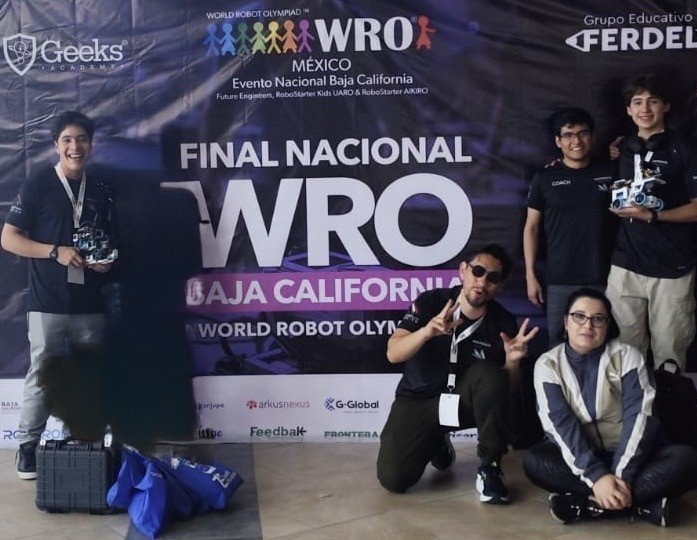<br>
***Disclaimer:***
*This image has been edited to remove former team members who are no longer part of the project, in order to protect their privacy. Editing was done using Microsoft Photos' generative erase feature.*

### Team Members

#### Christian Gael Centeno Velez
**Age:** 17\
**Role:** Captain. Software, electronics and mechanical design\


>I am currently in my senior year of high school at the Colegio de Estudios Científicos y Tecnológicos del Estado de Querétaro (CECyTEQ), specializing as a Mechatronics Technician. I have a strong background in competitive robotics, having participated in previous editions of the World Robot Olympiad (WRO). In 2024, I competed in the RoboMission category, and in 2025, I secured third place at the national level in the Future Engineers category with another team. Through my years of experience competing in the WRO, I have developed solid skills in robot programming, design, and electronics.

#### Sebastián Esquivel Mondragón
**Age:** 19\
**Role:** Documentation, electronics and mechanical design\


> Currently pursuing a Bachelor of Science in Mechatronics Engineering at Monterrey Institute of Technology and Higher Education (ITESM), on an academic talent scholarship. My background in robotics began in middle school with the MekLab Robotics team (UAQ), where I competed in WRO RoboMission, placing 3rd nationally in 2022 (Junior) and 2nd nationally in 2023 (Senior), qualifying for the international final in Panama. In 2025, our now independent and disaffiliated team moved into WRO Future Engineers, placing 2nd nationally. Most of my software and electronics experience comes from these competitions. I've also worked as an intern at GS de México (GS Global), in the Research and Development (R&D) department, where I further developed CAD design skills and many other engineering competencies, such as problem solving skills, now applied towards this project.

---

### National Final 2026

<table>
<tr>
<td align="center" width="45%">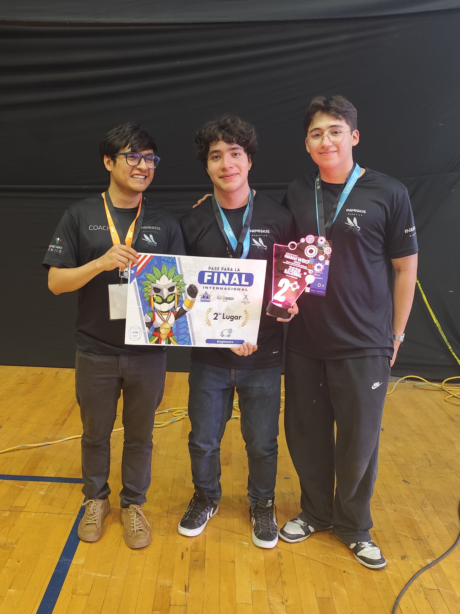<br><em>Team CSS with coach Manuel Alejandro Cardoso Duarte after the 2026 Mexico National Final (Tijuana): 2nd place and qualification for the International Final.</em></td>
<td align="center" width="55%">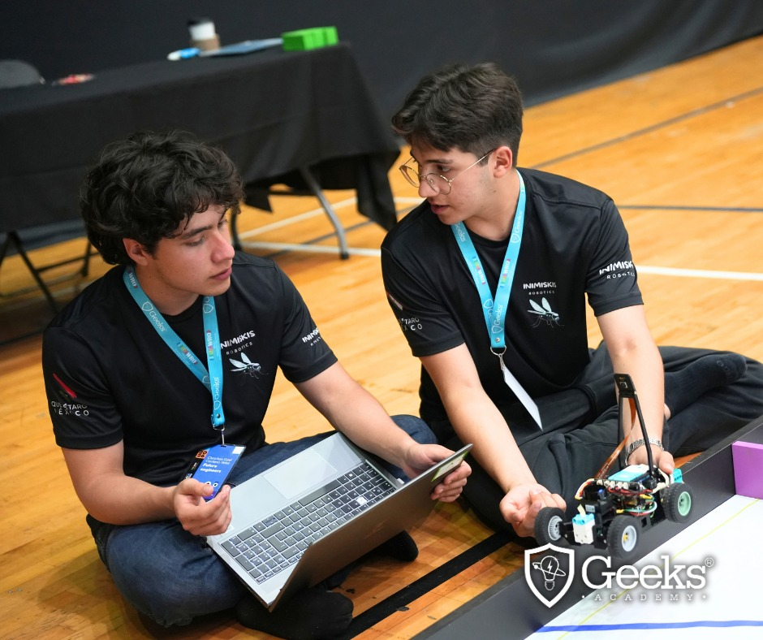<br><em>Preparing the vehicle at the field during the National Final. Photo: Geeks Academy.</em></td>
</tr>
</table>

---

### Coach and other members

#### Manuel Alejandro Cardoso Duarte
**Age:** 27\
**Role:** Coach\

> Bachelor of Technology from the Universidad Nacional Autónoma de México (UNAM), Centro de Física Aplicada y Tecnología Avanzada (CFATA), and currently works as an Embedded Software Engineer at KOSTAL Automotive Services Mexicana, developing AUTOSAR-based embedded software (C, CAN/LIN bus communication, memory stack integration) for automotive door control modules serving clients such as Stellantis, FORD, and Rivian. His background in robotics coaching spans since February 2018, guiding high school teams at the Facultad de Ingeniería, Universidad Autónoma de Querétaro (UAQ) through the World Robot Olympiad, including leading our team to the 2023 international final in Panama City and to a national podium finish in RoboMission. As coach, his role is to teach the underlying engineering and programming concepts (Python, C, embedded systems) and guide the team's problem-solving process, without building or programming the vehicle himself. For more information visit: [CV Alejandro](other/additionalMedia/Others/CV_Manuel_Alejandro_Cardoso_Duarte_2026-compressed.pdf)

---

#### José de Jesús Santana Ramírez, M.Sc.
**Age:** 40\
**Role:** Assistant coach\


>Mechatronics Engineer and Master of Science in Instrumentation and Control, with a solid track record in teaching, technological development, and innovation-oriented engineering applications. Currently pursuing a Ph.D. in Computer Science, focusing on research areas related to artificial intelligence, neural networks, computational modeling of physical systems, and control of mechanical systems. His expertise integrates hardware and software development for robotics, automation, and embedded systems projects. He serves as the coordinator of the Center for Studies in Robotics and Sciences (CEROC) at UAQ, as well as a professor in the Space Engineering degree program at ENES-UNAM. His professional profile is distinguished by connecting academic training, applied research, and a commitment to the scientific and technological education of future generations.
---

#### Rocío Damara Merlo Espino, Ph.D.
**Age:** 36\
**Role:** Administrative project manager\


>Academic Degrees:
>- Bachelor’s Degree in Psychology, Educational concentration.
>- Specialization in School Learning.
>- Master’s Degree in Innovation in Virtual Teaching-Learning Environments.
>- Ph.D. in Educational Technology.
>
>Professional with a background in Psychology, School Learning, Innovation in Virtual Teaching-Learning Environments, and Educational Technology. She is the co-leader of the international chapter Women in Robotics Querétaro, Mexico, and brings over 12 years of experience in educational robotics, science pedagogy, and scientific outreach. Currently, she is completing a postdoctoral fellowship in Quality Management Systems for Engineering and Space Industry Laboratories at the High Technology Unit of the Faculty of Engineering at UNAM. In addition, she is a professor of Aerospace Engineering at ENES Juriquilla, a researcher, and Head of the Outreach Department at the Center for Studies in Robotics and Sciences (CEROC) at UAQ. She has driven academic, scientific, and technological projects, as well as student development in STEAM competencies.

---

## 2. Challenge Overview <a id="challenge-overview"></a>

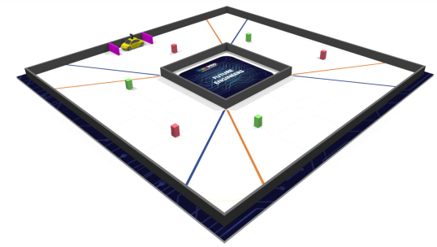

The **WRO Future Engineers** challenge requires teams to build a fully autonomous vehicle capable of completing both of the following challenges:

### Open Challenge
The vehicle must complete three laps on the track with random placements of the inside track walls.

### Obstacle Challenge
The vehicle must complete three laps on the track while detecting and avoiding randomly placed coloured obstacles (either green or red blocks), passing them on a specific side according to their colour, and then finish by performing a parallel parking maneuver.

More info: [WRO Official Site](https://wro-association.org/) | [Future Engineers Rules](https://wro-association.org/wp-content/uploads/WRO-2026-Future-Engineers-Self-Driving-Cars-General-Rules.pdf) (copy in [`other/`](other/WRO-2026-FE_GeneralRules.pdf)) | [Documentation rubric](other/WRO-2026-FE_DocumentationRubric.pdf) | [Playfield](other/WRO-2026-FE_Playfield.pdf)

---
## 3. Our Robot: design v7 at a glance <a id="our-robot"></a>

**Robot name:** ***"The Maker"***

### Design v7: International Final version (current)

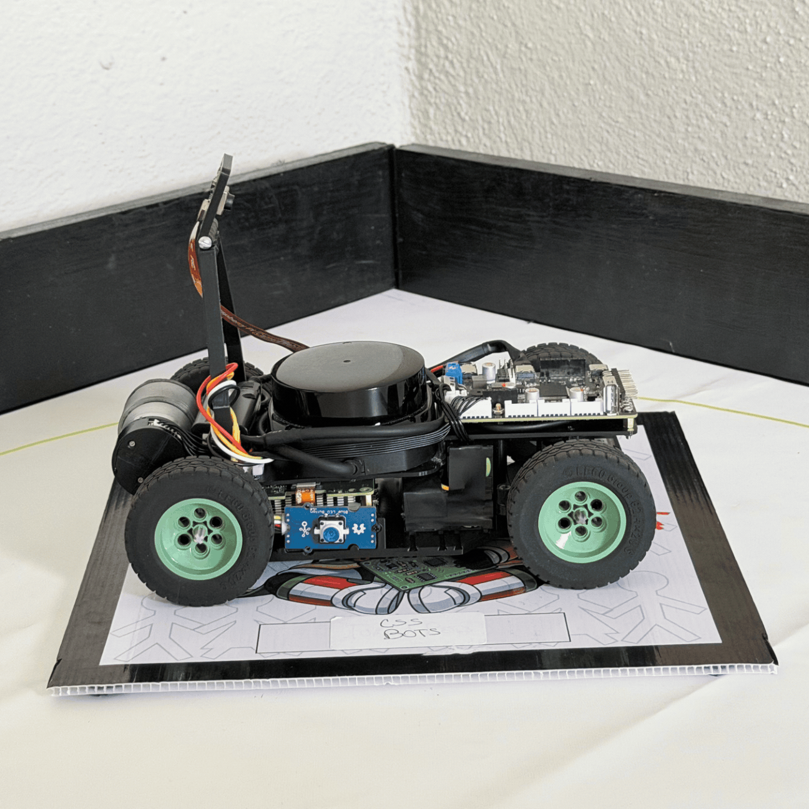

<table style="width:100%">
<tr>
<td align="center">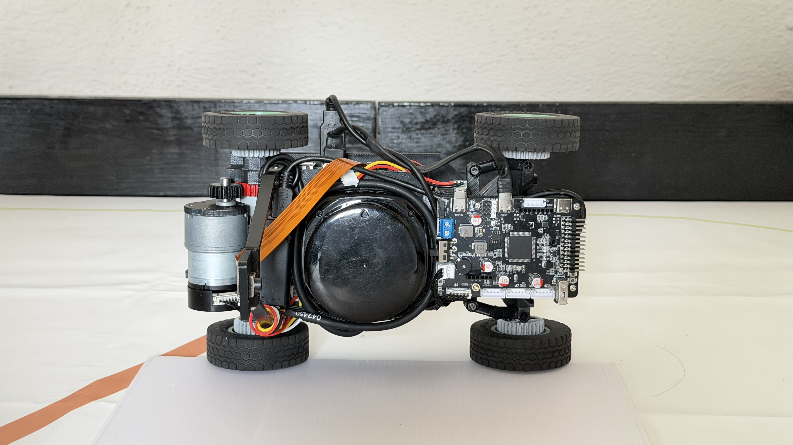<br>Top</td>
<td align="center">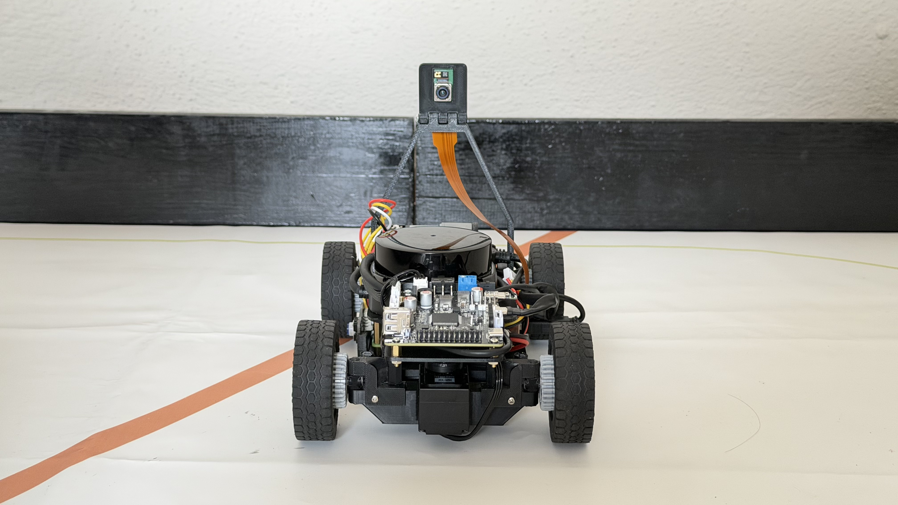<br>Front</td>
<td align="center">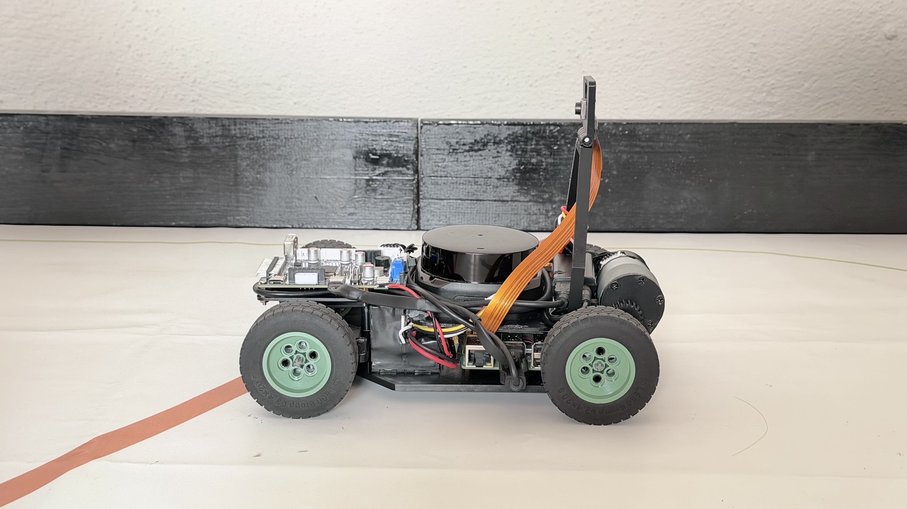<br>Left</td>
</tr>
<tr>
<td align="center">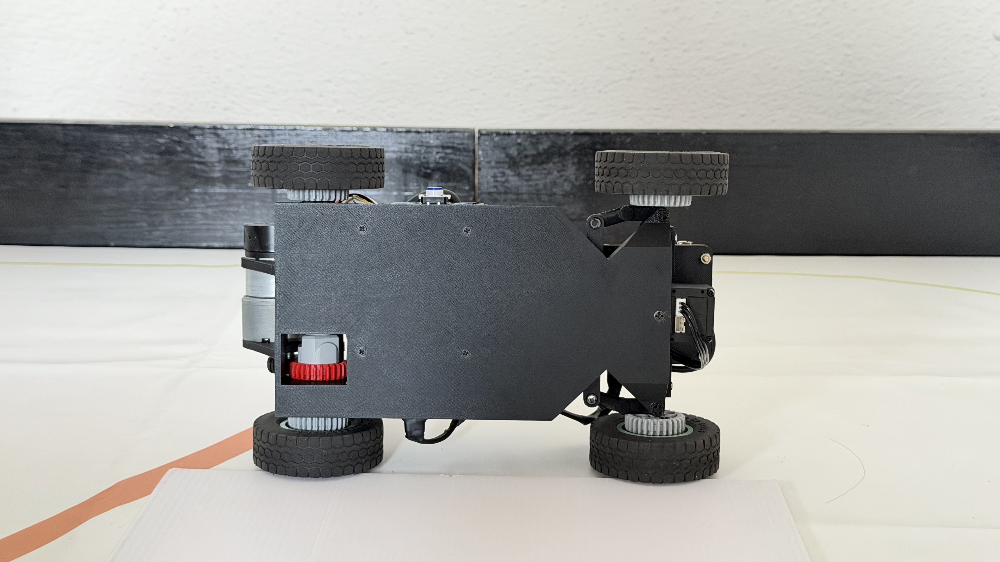<br>Bottom</td>
<td align="center">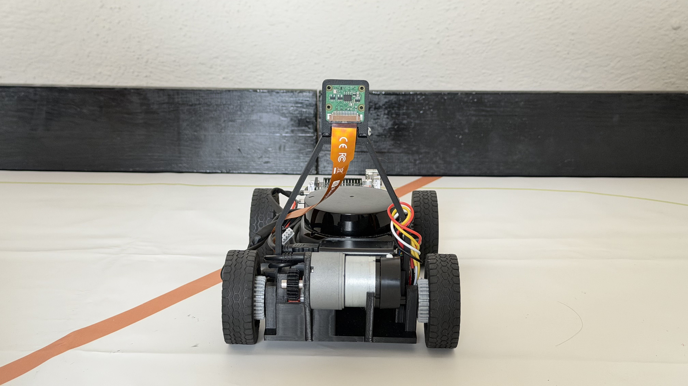<br>Back</td>
<td align="center">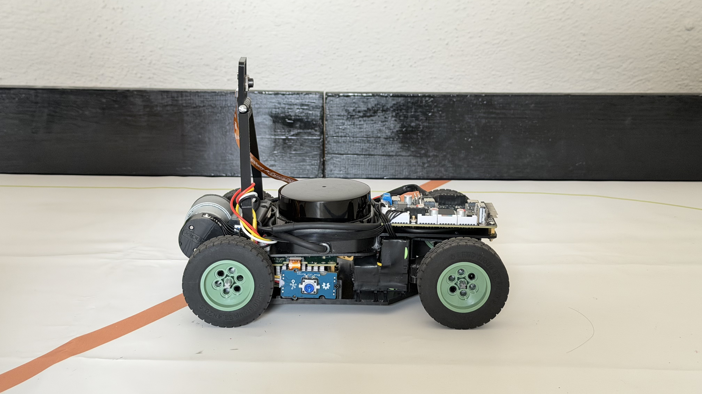<br>Right</td>
</tr>
</table>

### Design v6: National Final version (2nd place, Tijuana, September 2026)

Kept for comparison. The full design v6 state is preserved in release [`v1.0.0`](https://github.com/alex309-duarte/WRO_Future_Engineers_Queretaro_CSS/releases/tag/v1.0.0).

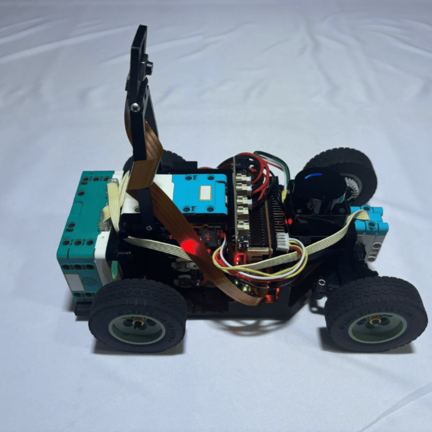

<table style="width:100%">
<tr>
<td align="center">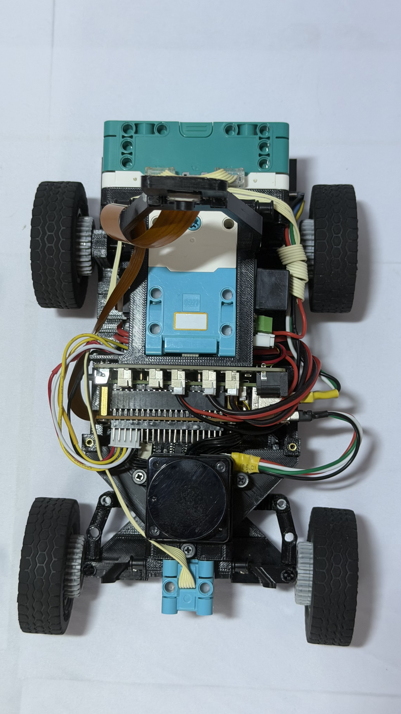<br>Top</td>
<td align="center">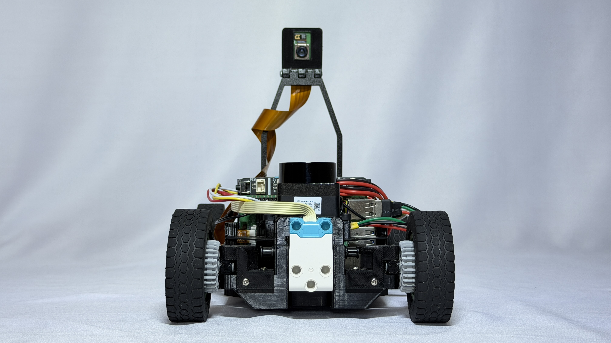<br>Front</td>
<td align="center">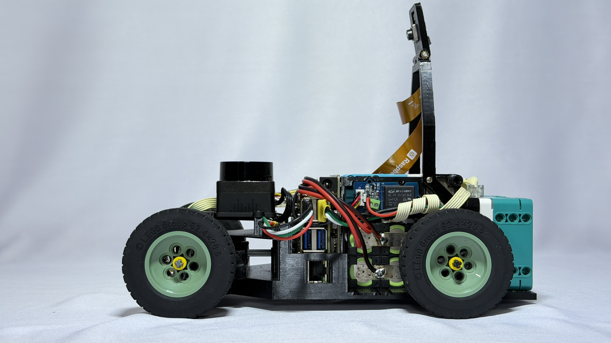<br>Left</td>
</tr>
<tr>
<td align="center">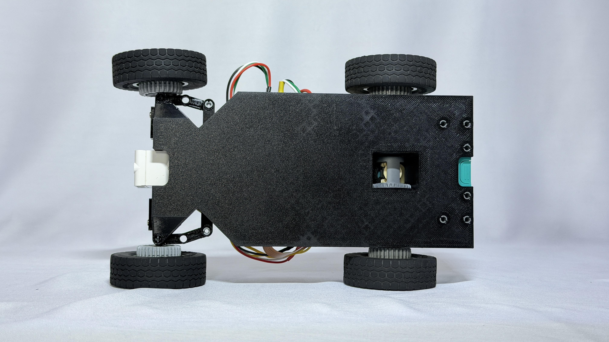<br>Bottom</td>
<td align="center">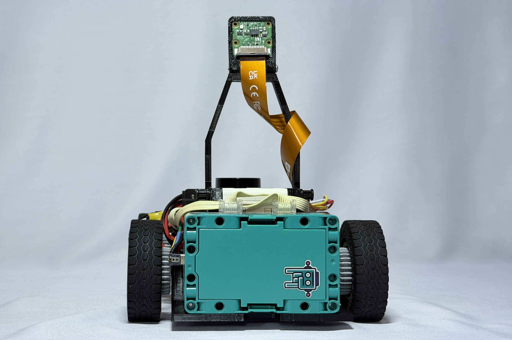<br>Back</td>
<td align="center">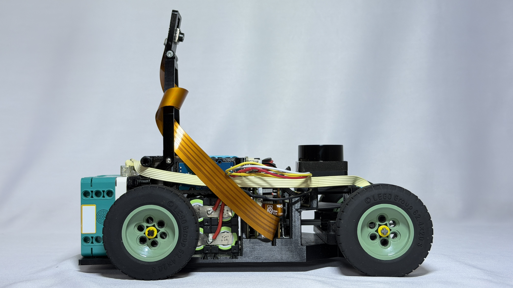<br>Right</td>
</tr>
</table>

### Overview

**Design v7: International Final version (current)**

***"The Maker"*** is a rear-wheel-drive autonomous vehicle with regular-Ackermann front steering, built around a custom SolidWorks chassis that was modified from the national design to fit the new components cleanly and to sit as low to the ground as possible, so the LiDAR always scans below the top of the 100 mm walls. For the international final the LEGO SPIKE actuation was replaced to gain speed and control: a Hiwonder JGB37-520 30:1 DC gear motor with a Hall encoder (1320 counts per output revolution) drives the rear axle through a differential under closed-loop speed and position control, a Hiwonder HX-35H serial bus servo actuates the steering, and both are commanded by a Hiwonder ROS Robot Control Board (STM32F407), whose on-board IMU now supplies the heading. Perception comes from a Slamtec RPLidar S2L, which we brought back after fixing our own integration of it, fused with a Raspberry Pi Camera Module 3 Wide accelerated by a Hailo-8 AI accelerator. The LiDAR handles wall-following and obstacle range, while the camera detects the pillars (and recognises the magenta parking markers, so they are never taken for pillars) with a YOLOv8n model retrained on 23,938 images (9,354 originals, 3,831 of them taken with the car's own camera), reaching mAP50 0.990 at 8 ms per frame on the Hailo-8. All control and vision code still runs in C/C++ on a Raspberry Pi 5: instead of rewriting the mission logic that placed 2nd at nationals, we ported it to the new board through a SPIKE-compatibility layer verified by 84 offline tests, and added a signal-based emergency stop that cuts the motors on any program exit, because the new board's firmware has no command watchdog. Power comes from three Panasonic NCR18650B cells in series (3S, 10.8 V nominal) with a BMS, which feed the 12 V motor and servo directly. The complete vehicle weighs 1.087 kg, 72 % of the 1.5 kg limit.

<details>
<summary><b>Design v6: National Final version (original description)</b></summary>

***"The Maker"*** is a rear-wheel-drive autonomous vehicle built around a fully custom, in-house 3D-printed chassis (designed in SolidWorks, printed on a Creality K1C) that repositions the battery pack and most components lower in the frame to lower the center of gravity and reduce weight transfer through corners. This year's chassis also trades the sharper-turning custom double-Ackermann steering geometry used in last year's prototype for a simpler regular-Ackermann, a deliberate trade-off made after trial and error showed the reliability gain outweighed the small loss in turning radius. A single LEGO SPIKE Large Angular Motor drives the rear axle while a LEGO SPIKE Small Angular Motor actuates the Ackermann steering, both commanded by a LEGO SPIKE Prime Hub, whose built-in IMU also supplies the robot's heading. Perception comes from a Orbbec Oradar MS200k LiDAR fused with a Raspberry Pi Camera Module 3 Wide accelerated by a Raspberry Pi AI HAT+ 2 (Hailo-10H, 40 TOPS). The LiDAR handles wall-following and obstacle range, the camera tracks the obstacles using a custom-trained YOLOv8n model (trained on our own labeled dataset and compiled to the Hailo-10H's `.hef` format) and classifies pillar colour, and this year's design drops the ultrasonic sensors, now using only the LiDAR and camera. All control and vision code runs in C/C++ on a Raspberry Pi 5, migrated from last year's Python codebase specifically to cut processing latency, and the whole robot is considerably lighter and more power-efficient than its predecessor: a smaller steering motor, a lighter AI/camera replacing an OAK-D Lite, and a 4-cell battery pack (down from 6 cells) sized to match the lower power draw.

</details>

### What changed from design v6 (national) to design v7 (international)

The robot has gone through seven designs across two seasons (see [§7.4](#lessons)). **Design v6** competed at the 2026 Mexico National Final; **design v7** is the international version documented here.

| Repository release | Vehicle design | Event |
|---|---|---|
| [`v1.0.0`](https://github.com/alex309-duarte/WRO_Future_Engineers_Queretaro_CSS/releases/tag/v1.0.0) | Design v6 | Mexico National Final, Tijuana (2nd place) |
| `v2.0.0` | Design v7 | International Final, Puerto Rico |

| Subsystem | Design v6: National Final (Sep 2026) | Design v7: International Final (Dec 2026) | Decision card |
|---|---|---|---|
| Motor controller | LEGO SPIKE Prime Hub | Hiwonder ROS Robot Control Board (STM32F407), firmware `pos-v8` | [D1](#d1) |
| Drive motor | LEGO SPIKE Large Angular Motor (45602), 175 rpm no-load | Hiwonder JGB37-520 Hall-encoder DC gear motor, 30:1, 12 V, 320 rpm no-load | [D2](#d2) |
| Rear differential | v6 differential | New differential (LEGO 65414 housing + 65413 28T gear in a custom mount), same 20:28 ratio | [D9](#d9) |
| Steering actuator | LEGO SPIKE Small Angular Motor (45607) | Hiwonder HX-35H serial bus servo (35 kg·cm) | [D3](#d3) |
| Heading (IMU) | SPIKE Hub built-in IMU | IMU on the Hiwonder board (20 Hz) | [D1](#d1) |
| Battery | 4× Panasonic NCR18650B + Geekworm X1203 UPS | 3× Panasonic NCR18650B in series (3S, 10.8 V nominal) with a 3S BMS | [D10](#d10) |
| LiDAR | Orbbec Oradar MS200k | Slamtec RPLidar S2L | [D4](#d4) |
| AI accelerator | Raspberry Pi AI HAT+ 2 (Hailo-10H) | Hailo-8 (HailoRT 4.23) | [D5](#d5) |
| Vision model | YOLOv8n, 320×320, previous dataset | YOLOv8n 640×640, retrained on 23,938 images (9,354 originals), mAP50 0.990 on the Hailo-8 | [D6](#d6) |
| Control software | SPIKE API over serial REPL | Same mission code on a `spike_compat` layer, with offline unit tests | [D7](#d7) |
| Safety | Ctrl+C stops the process only | Signal-based emergency stop: motors to COAST, steering torque off | [D8](#d8) |
| Chassis | Custom 3D-printed, SolidWorks | Modified to fit the new components and lowered as close to the ground as possible | [§4.1](#mobility) |
| Main computer, camera | Raspberry Pi 5, Camera Module 3 Wide | Unchanged | — |

### Design v7 specifications

| Parameter | Value |
|---|---|
| Dimensions (L × W × H) | 238.5 × 157.7 × 180 mm (limit 300 × 200 × 300 mm) |
| Mass | 1.087 kg (v6: 1.006 kg; limit 1.5 kg) |
| Drive | Rear-wheel drive, one JGB37-520 30:1 motor with Hall encoder, rear differential |
| Steering | Front Ackermann, HX-35H bus servo |
| Battery | 3S Panasonic NCR18650B, 10.8 V nominal, 12.6 V full, 3400 mAh, 36.7 Wh |
| Main computer | Raspberry Pi 5 (16 GB) |
| Perception | RPLidar S2L (360°, 10 Hz) + Camera Module 3 Wide + Hailo-8 |
| Language | C/C++ |

---

## 4. Mobility and Mechanical Design <a id="mobility"></a>

### 4.1 Chassis

The v7 chassis is a modification of the v6 design, modeled in SolidWorks. It was changed for two reasons:

1. **To fit the new components cleanly.** The Hiwonder board, the JGB37 motor, the HX-35H servo, the 3S battery with its BMS and the RPLidar S2L have different shapes and mounting points from the LEGO SPIKE Hub, the LEGO motors and the MS200k. The new parts in the assembly include a Hiwonder board mount, a combined Hiwonder/LiDAR support (`Soporte de hiwonder-lidar`), a motor mount and the rear differential.
2. **To sit as low to the ground as possible.** In v4 we learned that a LiDAR mounted too high scans over the 100 mm walls (see [§7.4](#lessons)). v7 keeps the LiDAR scanning plane low and also lowers the heavy parts, which keeps the centre of gravity low at the higher v7 speed.

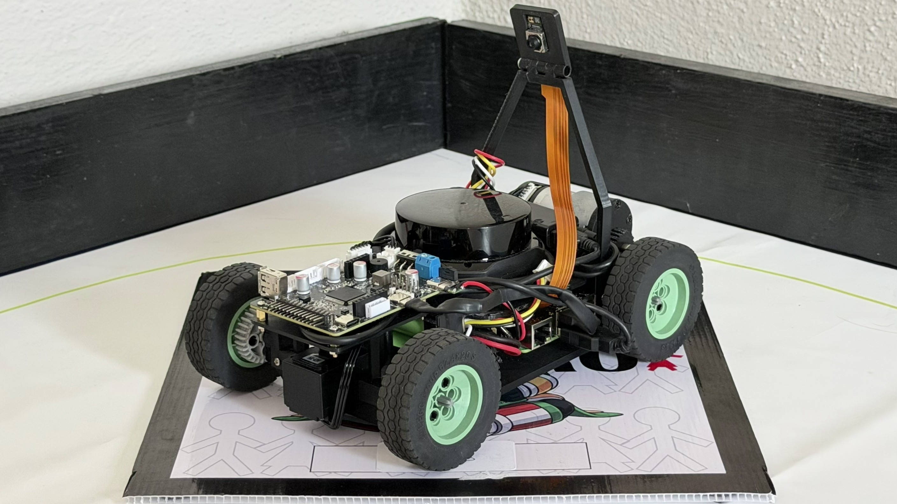

*Figure 1. Isometric view of design v7: Hiwonder controller at the front, RPLidar S2L in the centre, camera mast and JGB37 drive motor at the rear. The SolidWorks assembly is in [`models/cad/v7_assembly/`](models/cad/v7_assembly).*

**CAD views of design v7.**<a id="cad-v7"></a> Only one tyre is drawn, for reference: the tyres are LEGO parts, not printed.

| Side | Opposite side |
|---|---|
| 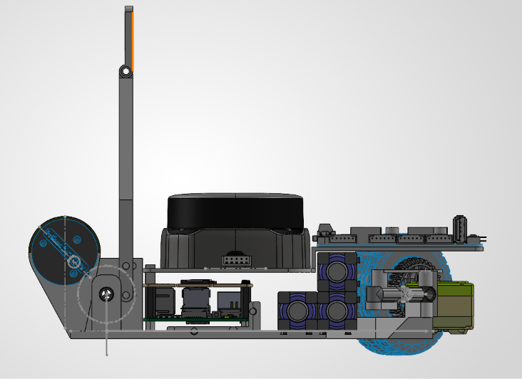 | 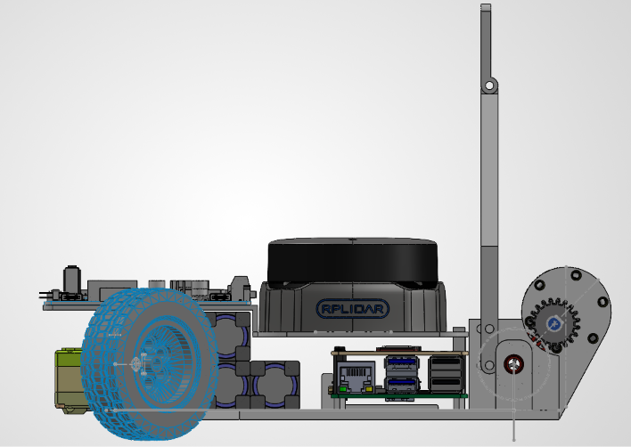 |
| **Front** | **Rear** |
| 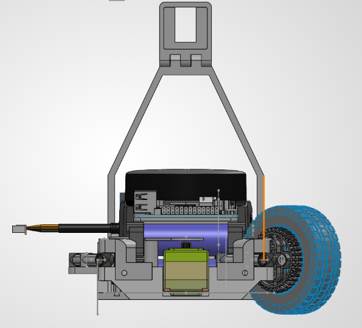 | 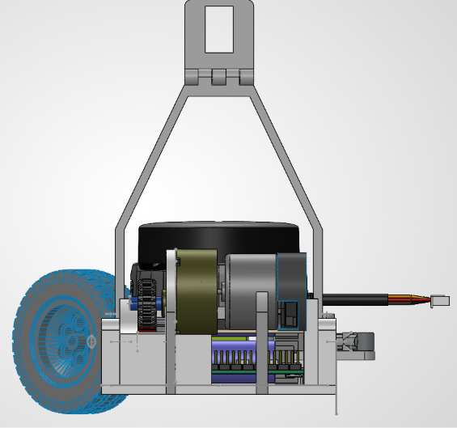 |
| **Top** | **Isometric** |
| 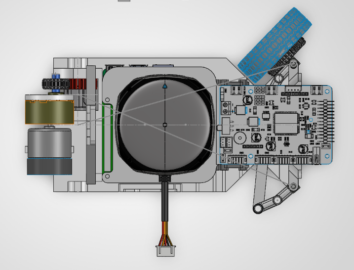 | 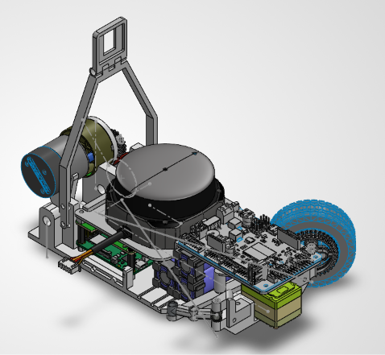 |

*Figure 2. Design v7 in SolidWorks. Side views: steering servo, Hiwonder board and front wheel on one end; camera mast, drive motor and differential on the other; the RPLidar S2L in the middle, its scanning plane about 75 mm above the ground; the Raspberry Pi and the 3S pack below it. Top view: Ackermann linkage with the wheel at full lock.*

<details>
<summary><b>Design v6 (national) chassis</b></summary>

The chassis is a fully custom, in-house design, modeled in SolidWorks and 3D-printed on a Creality K1C. This is a continuation of the team's own-design approach from previous years, refined for this iteration to package the electronics more densely and lower the center of gravity, positioning the battery pack and most of the main components lower in the frame.

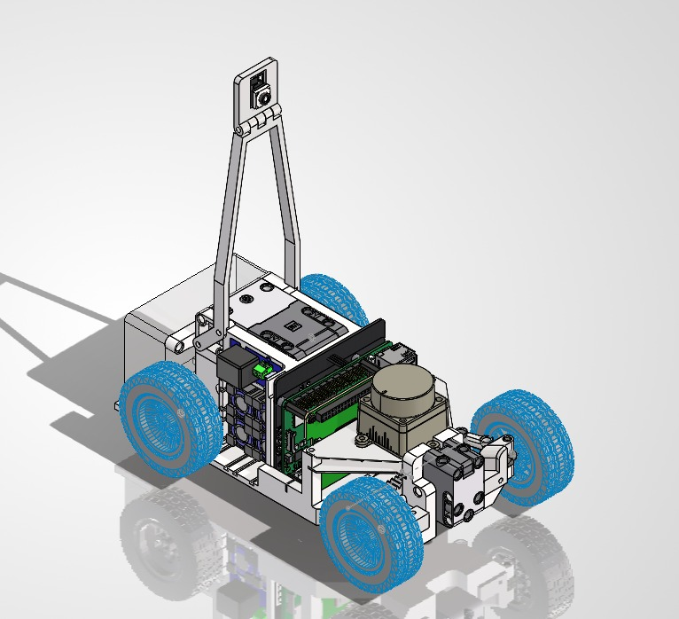

*Isometric view of the design v6 chassis CAD model.*

Repositioning the battery pack and heavier components (Raspberry Pi 5, UPS shield, LiDAR) lower in the frame was a deliberate choice to lower the chassis's center of gravity, reducing lateral weight transfer during high-speed cornering and improving mechanical traction without altering the Ackermann geometry itself. Component placement was also driven by the switch to a smaller, lighter camera/AI stack (Hailo-10H + Camera Module 3 Wide, replacing the OAK-D Lite) and a smaller battery pack, both of which reduced overall mass and allowed tighter, more balanced packaging than in previous prototypes.

</details>

### 4.2 Steering <a id="steering"></a>

The Maker's steering uses a regular Ackermann linkage. In the design v7 CAD the linkage reaches a maximum steering angle of **45.9°** (Figure 3), practically the 45.44° of design v6 (Figures 4 and 5), so the turning radius is the same as in v6. In software the steering is limited to **±35°** from center, inside that mechanical travel (see [D3](#d3)). This geometry ensures the inner and outer front wheels trace concentric arcs around a common turning center during a turn, minimizing tire scrub and keeping the front tires rolling rather than dragging through corners, a property that matters directly for both consistency and tire wear over a full run.

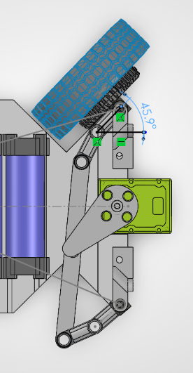

*Figure 3. Design v7: Ackermann linkage driven by the HX-35H bus servo, shown at full lock (45.9° in the CAD).*

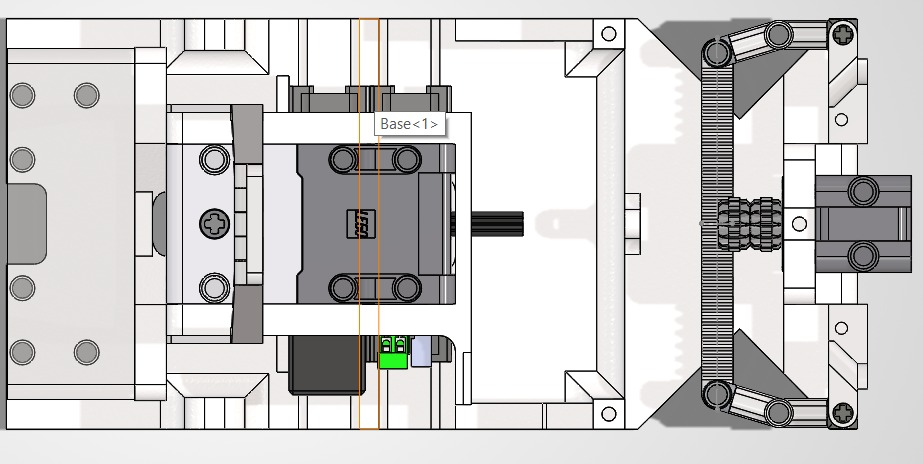

*Figure 4. Design v6: plan view of the Ackermann steering linkage, showing the tie-rod and knuckle geometry.*

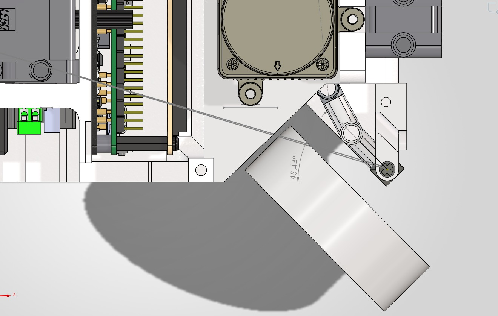

*Figure 5. Design v6: detail view of the CAD model highlighting the maximum steering angle of 45.44°.*

In design v6 the linkage was actuated by a LEGO SPIKE Prime Small Angular Motor (Part 45607). In v7 it is actuated by a bus servo (decision card D3 below).

This regular Ackermann design also represents a deliberate step back from the 2025 steering geometry (design v2). In the previous season, the team implemented a custom double-Ackermann linkage, which allowed for a tighter turning radius but introduced mechanical inconsistencies and reliability flaws during testing.

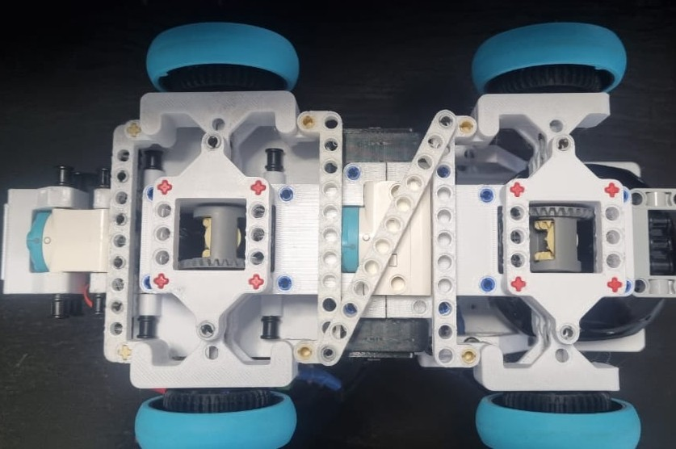

*Figure 6. Bottom view of the previous season's robot (design v2), showing the double-Ackermann steering configuration used last year.*

After weighing both options, the team concluded that the regular Ackermann's slightly wider turning radius was an acceptable trade-off given the reliability gained: it consistently completes every required turn on the WRO track, while eliminating the mechanical inconsistencies that affected the double-Ackermann design.


#### Decision card D3: steering servo <a id="d3"></a>

| | |
|---|---|
| **What** | The LEGO SPIKE Small Angular Motor was replaced by a **Hiwonder HX-35H serial bus servo** driving the same Ackermann linkage. |
| **Why** | With the SPIKE Hub removed ([D1](#d1)), the steering needed an actuator that the Hiwonder board can command. A bus servo holds its position on its own (closed loop inside the servo), reports its position, temperature and voltage, and runs directly from the 3S battery (9–12.6 V), so no extra regulator is needed. Its torque margin means the steering reaches its commanded angle at the same speed regardless of tire grip on the mat. |
| **When** | Design v7, October 2026 (bench calibration on 2026-10-04). |
| **How** | Positions 0–1000 map to 0–240° (0.24° per unit). Center (wheels straight) = 750; the linkage is assembled with the servo at that position. All steering commands pass through one function (`set_steering`) that clamps to **±35°** (`kDireccionMaxGrados`: 35 / 0.24 = 145 units each side, positions 605–895), so the wheel can never be driven into the chassis. At start-up the program refuses to move the servo if it is outside the allowed range, and on emergency stop the servo torque is released. Parameters: [`src/ondevice/hiwonder_config.h`](src/ondevice/hiwonder_config.h). |
| **What for** | Fast steering response (0.18 s/60° at 11.1 V) directly from battery voltage, with position feedback at start-up. |
| **Alternatives** | A PWM hobby servo (no position feedback, needs a separate PWM output); keeping a LEGO motor through an adapter. |

| HX-35H specification ([Hiwonder](https://www.hiwonder.com/products/hx-35h)) | Value |
|---|---|
| Operating voltage | 9–12.6 V |
| Stall torque | 35 kg·cm at 11.1 V |
| Speed | 0.18 s/60° at 11.1 V |
| Range / resolution | 0–240°, command range 0–1000 |
| Feedback | Position, temperature, voltage |
| Interface | Serial bus (UART) |
| Stall current | 3 A |
| Mass | 52 g |

<table>
  <tr>
    <td align="center">
      <a href="https://www.hiwonder.com/products/hx-35h">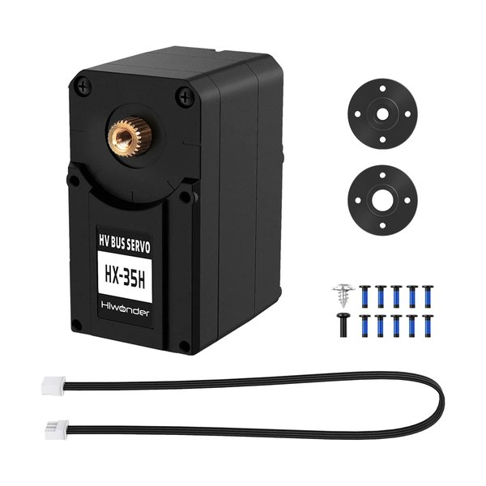</a><br>
      <em><a href="https://www.hiwonder.com/products/hx-35h">Hiwonder HX-35H serial bus servo</a></em>
    </td>
  </tr>
</table>


### 4.3 Drivetrain <a id="drivetrain"></a>

#### Decision card D2: drive motor <a id="d2"></a>

| | |
|---|---|
| **What** | The LEGO SPIKE Large Angular Motor was replaced by a **Hiwonder JGB37-520 Hall-encoder DC gear motor** (30:1, 12 V, 320 rpm no-load). |
| **Why** | The v6 motor reached a loaded top speed of only **0.365 m/s** (v6 calculation in the collapsible section below). With a 3-minute round limit and the same mission, a faster drivetrain gives margin for slower, more careful manoeuvres where they matter. The SPIKE motor was too slow for the level we expect at the international final, where every team is the best of its country, so v7 needed a faster drive motor. Its encoder also gives the board closed-loop speed and distance control. |
| **When** | Design v7, October 2026. |
| **How** | The board runs closed-loop speed and position control using the encoder: 11 pulses per motor revolution × 30:1 gearbox × 4 (quadrature) = **1320 counts per output revolution**, which matches the 1320 ticks/rev we measured. `speed = 100` in the mission code maps to `kRpsVelocidad100`; the environment variable `WRO_MAX_RPS` lowers it for first tests without recompiling. |
| **What for** | Calculated loaded top speed **0.62 m/s at 10.8 V**, about **1.7×** the v6 robot (calculation below). |
| **Alternatives** | Other JGB37 ratios (higher speed, less torque); other DC encoder motors; keeping the LEGO motor. We chose the Hiwonder JGB37 because we already had a similar Hiwonder motor and were familiar with it, and its speed and torque cover our needs with margin (calculation below). |

| JGB37-520R30-12V specification ([Hiwonder](https://www.hiwonder.com/products/hall-encoder-dc-geared-motor)) | Value |
|---|---|
| Rated voltage | 12 V |
| Gear ratio | 30:1 |
| No-load speed | 320 rpm |
| Rated speed / torque / current | 280 rpm / 1.2 kg·cm / 0.36 A |
| Stall torque / current | 5.8 kg·cm / 3.2 A |
| Encoder | Hall, AB quadrature, 11 pulses per motor revolution |
| Mass | 152 g |

<table>
  <tr>
    <td align="center">
      <a href="https://www.hiwonder.com/products/hall-encoder-dc-geared-motor">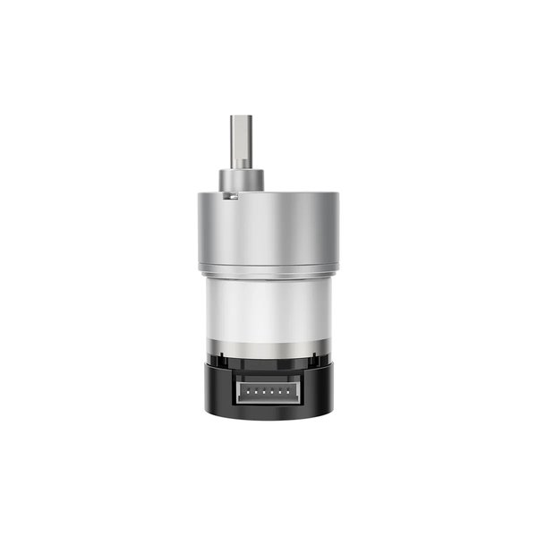</a><br>
      <em><a href="https://www.hiwonder.com/products/hall-encoder-dc-geared-motor">Hiwonder JGB37-520 Hall-encoder motor, 30:1</a></em>
    </td>
  </tr>
</table>


#### Design v7 torque and speed calculation

Same method as the v6 calculation below.

Inputs use the measured v7 mass (1.087 kg); the last row repeats the check at the 1.5 kg rule limit. The transmission is the same **20:28** gear reduction as v6, now driving the rear differential.

| Parameter | Symbol | Value |
|---|---|---|
| Robot mass | $m$ | 1.087 kg |
| Wheel diameter / radius | $d$ / $r$ | 0.0624 m / 0.0312 m |
| Target acceleration (cruise speed in ≈ 0.5 s) | $a$ | 1.3 m/s² |
| Rolling resistance coefficient | $C_{rr}$ | 0.03 |
| Transmission ratio (20:28) | $R$ | 1.4 |
| Transmission efficiency | $\eta$ | 0.85 |
| Battery voltage (3S nominal) | $V$ | 10.8 V |

$$F_{acc} = m \cdot a = 1.087 \cdot 1.3 = 1.413\text{ N} \qquad F_{rr} = C_{rr} \cdot m \cdot g = 0.03 \cdot 1.087 \cdot 9.81 = 0.320\text{ N}$$

$$T_w = (F_{acc} + F_{rr}) \cdot r = 1.733 \cdot 0.0312 = 0.0541\text{ N·m} \qquad T_m = \frac{T_w}{\eta R} = \frac{0.0541}{0.85 \cdot 1.4} = 0.0454\text{ N·m} \;(0.46\text{ kg·cm})$$

With the same 1.25× safety factor as v6: $T_{m,req} = 0.0568$ N·m (0.58 kg·cm).

| Check | Value | Interpretation |
|---|---|---|
| Load vs rated torque (1.2 kg·cm) | 39 % (48 % with safety factor) | Inside the continuous rating |
| Load vs stall torque (5.8 kg·cm) | 8 % | No stall risk in normal driving |
| No-load speed at 10.8 V | 320 × 10.8 / 12 = 288 rpm | Speed scales with voltage |
| Loaded motor speed | 288 × (1 − 0.0454 / 0.569) = 265 rpm | |
| Wheel speed | 265 / 1.4 = 189 rpm | |
| **Loaded top speed** | 189 × π × 0.0624 / 60 = **0.62 m/s** | v6: 0.365 m/s → **1.7×** |
| Time to top speed at $a$ = 1.3 m/s² | 0.48 s | Meets the 0.5 s target |
| Same check at the 1.5 kg rule limit | 53 % of rated torque, 0.60 m/s | The motor still has margin if mass is added |

> [!IMPORTANT]
> **Speed set-point and battery voltage.** The motor's speed falls with battery voltage (no-load 320 rpm at 12 V, 288 rpm at 10.8 V). With `kRpsVelocidad100 = 5.7` rev/s the speed loop saturates, so the real speed depends on the battery charge: measured **0.580 m/s at 12.3 V and 0.524 m/s at 10.7 V** (−9.7 %). With 4.0 rev/s the loss drops to −6.1 % (0.539 → 0.506 m/s), at the cost of about 7 % of top speed ([§6.9](#testing)).

#### Decision card D9: rear differential <a id="d9"></a>

| | |
|---|---|
| **What** | A **new rear differential**: LEGO 65414 differential housing with the 65413 28-tooth bevel gear, in a custom mount (`Diferencial.SLDASM`), replacing the differential of design v6. |
| **Why** | The v6 differential had a shape and size that did not fit the modified chassis and the new JGB37 motor well. This one fits the new structure and the motor mount better. A differential is kept because in a corner the outer rear wheel travels farther than the inner one; without it one wheel must slip, which wastes traction, wears the tyres and makes the encoder distance less accurate. |
| **When** | Design v7, October–November 2026. |
| **How** | The motor drives the differential through the 20:28 gear pair. CAD: `Diferencial.SLDASM` (`Cuerpo diferencial`, `Engrane_diferencial`, LEGO 65413/65414 parts). |
| **What for** | Same function as in v6 with a better fit to the new chassis and motor. Because the **gear ratio stays 20:28**, the speed and torque calculation above ([D2](#d2)) and the distance constants of the missions keep the same meaning. |
| **Alternatives** | Keeping the v6 differential with adapters; a solid axle (wheel scrub in corners); two independent motors (not allowed: one driving axle, rule 11.3). |

<table>
  <tr>
    <td align="center">
      <a href="https://www.brickshop.eu/lego-parts/technics/lego-differential-housing-light-grey.html">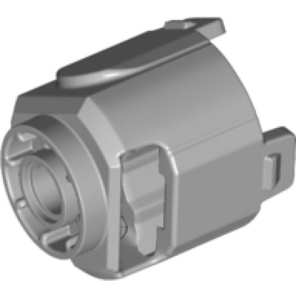</a><br>
      <em><a href="https://www.brickshop.eu/lego-parts/technics/lego-differential-housing-light-grey.html">LEGO differential housing (65414)</a></em>
    </td>
    <td align="center">
      <a href="https://www.brickowl.com/catalog/lego-red-bevel-gear-with-28-teeth-65413">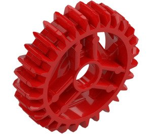</a><br>
      <em><a href="https://www.brickowl.com/catalog/lego-red-bevel-gear-with-28-teeth-65413">LEGO 28-tooth bevel gear (65413)</a></em>
    </td>
    <td align="center">
      <a href="https://www.amazon.com.mx/LEGO-Tire-86652-32019-75999/dp/B01CODUYCE">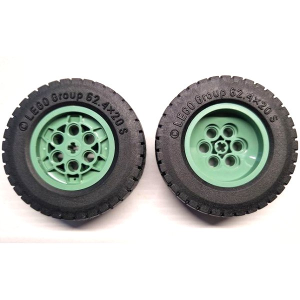</a><br>
      <em><a href="https://www.amazon.com.mx/LEGO-Tire-86652-32019-75999/dp/B01CODUYCE">LEGO tyre 62.4 × 20 S (32019)</a></em>
    </td>
  </tr>
</table>


Both 2026 designs (v6 and v7) also mark a layout change from last year's all-wheel-drive (AWD) configuration (see [Figure 6](other/additionalMedia/Others/Bottom2025.jpg)) to a rear-wheel-drive (RWD) layout. Driving only the rear axle simplified the drivetrain (removing the front differential/driveshaft hardware needed for AWD), reducing weight and mechanical complexity, while still providing enough traction for the WRO track once paired with the new LEGO 62.4×20S rubber tires.

<details>
<summary><b>Design v6 (national) drivetrain analysis: LEGO SPIKE Large Angular Motor</b></summary>

The vehicle uses a single LEGO SPIKE Large Angular Motor (Part 45602) driving the rear axle through a $20{:}28$ gear reduction ($R = 1.4$), turning LEGO $62.4 \times 20\text{S}$ rubber tires (Part 32019) ($r = 0.0312\text{ m}$). The motor and gear ratio were not assumed, they were sized against a full dynamic torque analysis targeting $a = 0.73\text{ m/s}^2$ over $t = 0.5\text{ s}$ to reach cruising speed.
<table>
  <tr>
    <td align="center">
      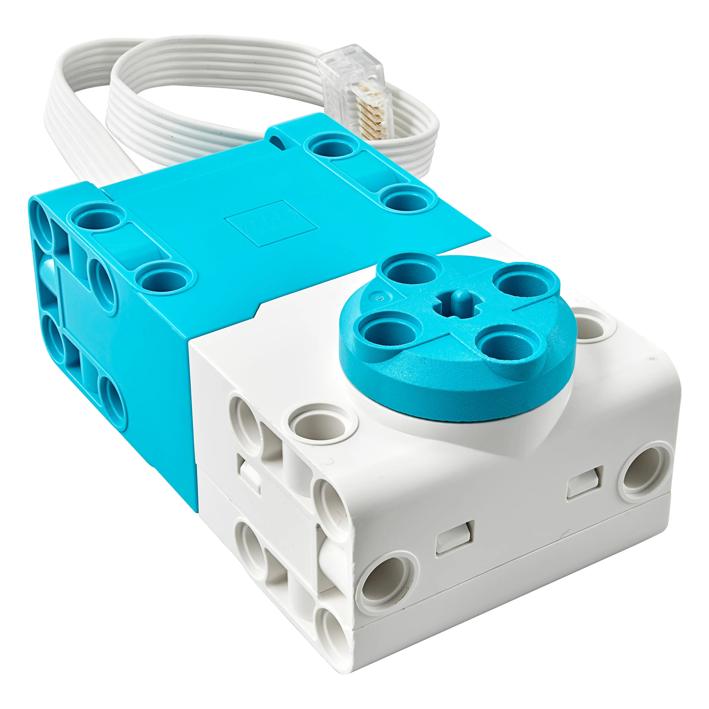<br>
      <em>LEGO SPIKE Large Angular Motor (45602)</em>
    </td>
    <td align="center">
      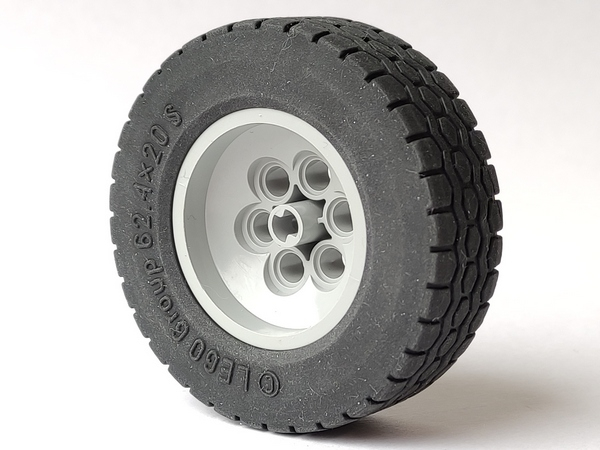<br>
      <em>LEGO Tire 62.4 x 20 S (32019)</em>
    </td>
  </tr>
</table>

**Result:**
 at this operating point, the motor runs at only **33.8%** of its continuous max-efficiency torque capacity, reaching a loaded top speed of **0.365 m/s**, leaving a **66.2%** torque reserve for inclines or unexpected track perturbations.

> ### Full torque & speed calculations
>
> #### 1. Design Inputs & Parameters
>
> | Parameter | Symbol | Value | Unit |
> | :--- | :---: | :---: | :---: |
> | Robot Mass | $m$ | $1.006$ | $\text{kg}$ |
> | Wheel Diameter | $d$ | $0.0624$ | $\text{m}$ |
> | Wheel Radius | $r$ | $0.0312$ | $\text{m}$ |
> | Target Linear Acceleration ($t = 0.5\text{ s}$) | $a$ | $0.73$ | $\text{m/s}^2$ |
> | Rolling Resistance Coeff. (Rubber LEGO $62.4 \times 20\text{ S}$) | $C_{rr}$ | $0.03$ | -- |
> | Acceleration of Gravity | $g$ | $9.81$ | $\text{m/s}^2$ |
> | Number of Drive Motors | $N$ | $1$ | -- |
> | Gearbox Reduction Ratio ($20:28$) | $R$ | $1.4$ | -- |
> | Gearbox Efficiency | $\eta$ | $0.85$ | -- |
>
> **2. Step-by-Step Derivation**
>
> **Step 1: Linear Acceleration Force ($F_{acc}$)**
>
> $$
> F_{acc} = m \cdot a = 1.006\text{ kg} \cdot 0.73\text{ m/s}^2 = 0.7344\text{ N}
> $$
>
> **Step 2: Rolling Resistance Force ($F_{rr}$)**
>
> $$
> F_{rr} = C_{rr} \cdot m \cdot g = 0.03 \cdot 1.006\text{ kg} \cdot 9.81\text{ m/s}^2 = 0.2961\text{ N}
> $$
>
> **Step 3: Total Linear Force ($F_{total}$)**
>
> $$
> F_{total} = F_{acc} + F_{rr} = 0.7344\text{ N} + 0.2961\text{ N} = 1.0305\text{ N}
> $$
>
> **Step 4: Total Wheel Torque ($T_w$)**
>
> $$
> T_w = F_{total} \cdot r = 1.0305\text{ N} \cdot 0.0312\text{ m} = 0.03215\text{ N}\cdot\text{m}
> $$
>
> **Step 5: Nominal Motor Torque ($T_m$)**
>
> $$
> T_m = \frac{T_w}{\eta \cdot R} = \frac{0.03215\text{ N}\cdot\text{m}}{0.85 \cdot 1.4} = 0.02702\text{ N}\cdot\text{m} \quad (\approx 2.70\text{ Ncm})
> $$
>
> **Step 6: Motor Torque with Safety Factor ($T_{m,req}$)**
>
> A 25% safety margin ($1.25\times$) is applied to establish the minimum required torque of the traction motor, accounting for dynamic losses not captured above:
>
> $$
> T_{m,req} = T_m \cdot 1.25 = 0.02702\text{ N}\cdot\text{m} \cdot 1.25 = \mathbf{0.03377\text{ N}\cdot\text{m}} \quad (\approx 3.38\text{ Ncm})
> $$
>
> **3. LEGO SPIKE Large Angular Motor (45602) Analysis & Speed Derivation**
>
> **3.1 Motor Technical Specifications (9V)**
>
> | Operating Condition | Torque ($\text{N}\cdot\text{m}$) | Torque ($\text{Ncm}$) | Speed ($\text{RPM}$) | Current ($\text{mA}$) |
> | :--- | :---: | :---: | :---: | :---: |
> | No Load | 0.0000 | 0.00 | 175 ± 15% | 135 ± 15% |
> | Max Efficiency | 0.0800 | 8.00 | 135 ± 15% | 430 ± 15% |
> | Stall Limit | 0.2500 | 25.00 | 0 | 1900 ± 15% |
>
> **3.2 Motor Operating Point & Load Analysis**
>
> **Continuous Duty Load (%)** (vs. Max Efficiency Point):
>
> $$
> \text{Load}_{\text{eff}} = \frac{T_m}{T_{\text{max-eff}}} \cdot 100 = \frac{2.70\text{ Ncm}}{8.00\text{ Ncm}} \cdot 100 = \mathbf{33.8}\verb|%|
> $$
>
> **Stall Limit Margin (%)** (vs. Stall Torque):
>
> $$
> \text{Load}_{\text{stall}} = \frac{T_m}{T_{\text{stall}}} \cdot 100 = \frac{2.70\text{ Ncm}}{25.00\text{ Ncm}} \cdot 100 = \mathbf{10.8}\verb|%|
> $$
>
> **3.3 Top Speed Derivation**
>
> **Step 1: Loaded Motor RPM**
>
> $$
> \text{RPM}_{\text{motor}} = \text{RPM}_{\text{no-load}} \cdot \left(1 - \frac{T_m}{T_{\text{stall}}}\right) = 175 \cdot \left(1 - \frac{2.702\text{ Ncm}}{25.00\text{ Ncm}}\right) = 156.1\text{ RPM}
> $$
>
> **Step 2: Loaded Wheel RPM**
>
> $$
> \text{RPM}_{\text{wheel}} = \frac{\text{RPM}_{\text{motor}}}{R} = \frac{156.1\text{ RPM}}{1.4} = 111.5\text{ RPM}
> $$
>
> **Step 3: Top Loaded Linear Speed**
> $$v_{loaded} = \frac{\text{RPM}_{wheel} \cdot \pi \cdot d}{60} = \frac{111.5 \cdot \pi \cdot 0.0624}{60} = \mathbf{0.365\text{ m/s}}$$
>
> **3.4 Technical Conclusion**
>
> With $a = 0.73\text{ m/s}^2$, the robot reaches its operational cruising speed of $0.365\text{ m/s}$ in exactly $0.5\text{ s}$. Operating at only 33.8% of the motor's continuous max-efficiency capacity ensures minimal thermal build-up and low current draw, leaving a 66.2% torque reserve to absorb unexpected track perturbations.


</details>

---

## 5. Power and Sensor Architecture <a id="power-sensors"></a>

### 5.1 Power architecture <a id="power"></a>

#### Decision card D10: 3S battery <a id="d10"></a>

| | |
|---|---|
| **What** | Three **Panasonic NCR18650B** cells in series (**3S**): 10.8 V nominal, 12.6 V full, 3400 mAh, 36.7 Wh, protected by a **3S BMS**. |
| **Why** | The new motor and the HX-35H servo are 12 V parts, and the Hiwonder board is designed for a 12 V supply. A 3S pack gives that voltage directly, without the boost stage of the v6 Geekworm X1203 (a 5 V UPS for the Pi only). We kept the NCR18650B cells because in v6 they solved the brownouts caused by generic high-resistance cells. |
| **When** | Design v7, October 2026. |
| **How** | Pack → 3S BMS → **Hiwonder ROS Robot Controller** (STM32F407VET6, input 7–14 V; [product page](https://hiwonder.com/products/ros-robot-control), [documentation](https://wiki.hiwonder.com/projects/ROS-Robot-Control-Board/en/latest/)), which drives the motor and the bus servo at battery voltage. The controller's independent **5 V / 5 A Type-C output powers the Raspberry Pi 5**, which in turn powers the Hailo-8, the camera, the LiDAR and the start button. The Pi 5 needs 5 V / 5 A to run its USB ports at full current, which matters because the LiDAR is USB-powered ([Raspberry Pi: USB Power Delivery on Raspberry Pi 5](other/datasheets/RP-009856-WP-1-USB-Power-Delivery-on-Raspberry-Pi-5.pdf)). Pi ↔ controller: USB serial (UART, 1 Mbaud). Wiring diagram below. |
| **What for** | Estimated runtime about 1.7 h (budget below), far above a 3-minute round. |
| **Alternatives** | v6 pack + X1203 for the Pi plus a separate 12 V pack (two batteries to charge, more mass); a 2S pack (7.2–8.4 V, too low for the 12 V motor's speed). |

<table>
  <tr>
    <td align="center">
      <a href="other/datasheets/Panasonic-NCR18650B-datasheet.pdf">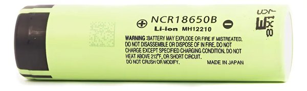</a><br>
      <em><a href="other/datasheets/Panasonic-NCR18650B-datasheet.pdf">Panasonic NCR18650B cell (×3, in series)</a></em>
    </td>
    <td align="center">
      <a href="https://www.inteligenciaartificialyrobotica.com/products/balanceador-cargador-de-baterias-li-ion-bms3s10a">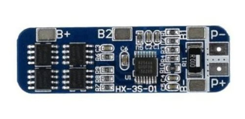</a><br>
      <em><a href="https://www.inteligenciaartificialyrobotica.com/products/balanceador-cargador-de-baterias-li-ion-bms3s10a">3S BMS (HX-3S-01)</a></em>
    </td>
  </tr>
</table>


**Power budget (estimates from datasheets)**

| Component | Supply | Operating state | Estimate |
|---|---|---|---|
| [Raspberry Pi 5](https://www.raspberrypi.com/products/raspberry-pi-5/) | 5 V | High CPU load | 9.0 W |
| Hailo-8 | 5 V (from the Pi) | Continuous inference (typical, [Hailo-8 product brief](other/datasheets/Hailo-8-product-brief-rev3.26.pdf)) | 2.5 W |
| RPLidar S2L | 5 V | Scanning, 10 Hz ([Slamtec](https://www.slamtec.com/en/s2): 500 mA typical) | 2.5 W |
| Grove LED button | 5 V | | 0.1 W |
| **5 V subtotal** | | | **14.1 W → 15.7 W from the pack at ~90 % regulator efficiency** |
| JGB37 drive motor | Battery | Accelerating at $a$ = 1.3 m/s² (≈ 0.35 A, linear torque–current estimate) | 3.8 W |
| HX-35H servo | Battery | Holding / small corrections (≈ 0.1 A) | 1.1 W |
| Hiwonder controller logic | Battery | Estimate | 0.5 W |
| **Total** | | | **≈ 21 W → 1.95 A from the pack at 10.8 V** |

$$t_{runtime} = \frac{36.7\text{ Wh}}{21\text{ W}} \approx 1.7\text{ h}$$

**Peak current.** The motor stall current is 3.2 A and the servo stall current is 3 A. In the worst case (both stalled while the 5 V side draws 1.45 A) the pack would supply ≈ 7.7 A, above the NCR18650B's 4.875 A continuous rating. In a 3S pack all three cells carry the full current (there is no parallel branch to share it, unlike v6). This is a short-duration case, but it is the same kind of transient that caused the v6 brownouts, so we calculated its effect below and track it in the risk register ([§7.3](#risks)).

#### Wiring diagram (design v7) <a id="wiring-v7"></a>

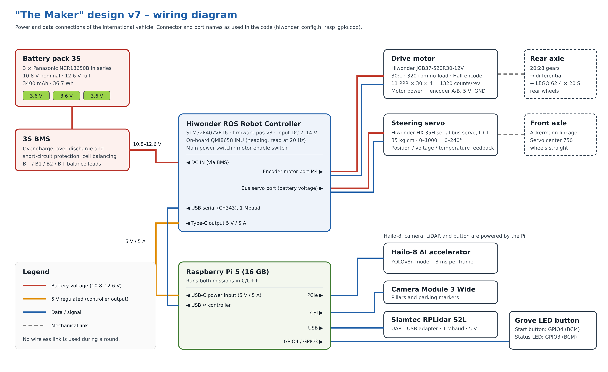

*Figure 7. Design v7 wiring diagram: battery voltage (red), regulated 5 V (orange), data (blue), mechanical links (dashed).*

**Electrical limits, calculated from the Panasonic datasheet**

| NCR18650B ([Panasonic datasheet](other/datasheets/Panasonic-NCR18650B-datasheet.pdf); max. discharge: [Battery Bro](https://batterybro.com/products/panasonic-b-ncr18650b-3400mah-4-8a); resistance: [lygte-info](https://lygte-info.dk/review/batteries2012/Panasonic%20NCR18650B%203400mAh%20(Green)%20UK.html)) | Value |
|---|---|
| Capacity | 3200 mAh rated minimum, 3350 mAh typical (sold as 3400 mAh) |
| Nominal / charge / cut-off voltage | 3.6 V / 4.20 V / 2.5 V per cell |
| Maximum continuous discharge | 4.875 A |
| Internal resistance (AC, 1 kHz) | ≤ 45 mΩ |
| Mass | 48.5 g max. |

| Quantity | Calculation | Result |
|---|---|---|
| Average pack current, Obstacle Challenge run | 21 W ÷ 10.8 V (1.67 A at 12.6 V full, 2.12 A at 9.9 V low) | **≈ 1.9 A**, 0.58 C, 40 % of the 4.875 A rating |
| Peak pack current, start from standstill | motor at stall 3.2 A + 5 V side 1.45 A + servo holding 0.1 A | **≈ 4.75 A**, 98 % of the rating, for the start-up transient only |
| Worst case | motor and servo both stalled + 5 V side | ≈ 7.7 A (157 % of the rating); avoided by the steering clamp, see [§7.3](#risks) |
| Voltage sag at the peak | I × R<sub>pack</sub>, R<sub>pack</sub> = 3 × 45 mΩ = 0.135 Ω (doubled to 0.27 Ω to allow for DC resistance, BMS and wiring) | 0.6–1.3 V at 4.75 A; 1.0–2.1 V at 7.7 A |
| Lowest board input | low pack (3.3 V/cell = 9.9 V) minus the worst-case sag | **≈ 7.8 V**, above the controller's 7 V minimum, so its 5 V / 5 A output to the Pi stays regulated |
| Energy per round | 21 W × 121 s (Obstacle) / 48 s (Open) | 0.71 Wh (2 % of the pack) / 0.28 Wh (0.8 %) |
| Test session of 10 + 10 runs | 10 × 0.71 + 10 × 0.28 Wh of driving | ≈ 9.9 Wh, 29 % of the 34.6 Wh minimum capacity, plus idle time between runs (≈ 16 W) |
| Runtime | 34.6 Wh (rated minimum) ÷ 21 W | ≈ 1.65 h (1.7 h with the typical capacity) |

Even the worst-case sag leaves the Hiwonder board's input inside its 7–14 V range, and the board regulates the Pi's 5 V from it.

<details>
<summary><b>Design v6 (national) power analysis: 4× NCR18650B + Geekworm X1203</b></summary>

The robot is powered by 4x Panasonic NCR18650B 3400mAh Li-ion cells, wired in a **4P** configuration (four cells in parallel) at **3.7 V** nominal, through the Geekworm X1203 UPS shield, which also boost-converts the output to the 5.1 V required by the Raspberry Pi 5 and peripherals.

**Total stored energy**

$$C_{\text{total}} = 4 \cdot 3400\text{ mAh} = 13.6\text{ Ah}$$

$$E_{\text{total}} = 13.6\text{ Ah} \cdot 3.7\text{ V} = 50.32\text{ Wh}$$

**Theoretical battery life (worst case)**

Under peak load, SLAM navigation and continuous computer vision inference, the components' estimated continuous power draw is:

| Component | Operating State | Estimated Power |
| :--- | :--- | :--- |
| Raspberry Pi 5 | High CPU / OS load | 9.0 W |
| Hailo-10H AI HAT | Active neural network inference | 4.0 W |
| Orbbec Oradar MS200k LiDAR | Continuous scanning with spinning motor | 1.5 W |
| Grove Modules | Relay (short pulses) + LED Button | 0.1 W |
| **Total Load** | **Peak consumption at 5.1 V** | **14.6 W** |

Accounting for the X1203 boost converter's ~90% efficiency ($\eta = 0.90$):

$$P_{\text{input}} = \frac{14.6\text{ W}}{0.90} \approx 16.22\text{ W}$$

$$I_{\text{battery}} = \frac{16.22\text{ W}}{3.7\text{ V}} \approx 4.38\text{ A}$$

> **Hardware Design Note:** Distributed across 4 parallel cells, this is an average of 1.10 A per cell, well within the NCR18650B's 4.8 A continuous discharge limit, avoiding thermal stress and premature degradation.

$$t_{\text{runtime}} = \frac{50.32\text{ Wh}}{16.22\text{ W}} \approx 3.10\text{ hours}$$

**Real-world battery life (measured)**

Physical testing recorded a steady current draw of 0.667 A per connector (each connector groups two cells in parallel), totaling 1.334 A at 5 V across the full integrated system.

$$P_{\text{output}} = 1.334\text{ A} \cdot 5\text{ V} = 6.67\text{ W}$$

$$P_{\text{input}} = \frac{6.67\text{ W}}{0.90} \approx 7.41\text{ W}$$

$$t_{\text{runtime}} = \frac{50.32\text{ Wh}}{7.41\text{ W}} \approx 6.8\text{ hours}$$

> **Conclusion:** Under real-world operating conditions, the robot runs continuously for approximately 6.8 hours before fully depleting the battery bank, well above the theoretical worst-case estimate, since sustained peak CPU/inference load is rarely held continuously in practice.

**Design limitation: charging & hot-swapping**

A drawback of this configuration is that the batteries charge internally, in place, via the X1203 board. The current assembly makes keeping a pre-charged spare set for a quick hot-swap impractical, since swapping cells requires partially disassembling the chassis, a depleted robot must instead be plugged in to recharge, which is a limitation for quick turnaround between test/competition runs.


</details>

### 5.2 Sensors

#### Decision card D4: LiDAR, back to the RPLidar S2L <a id="d4"></a>

| | |
|---|---|
| **What** | The Orbbec Oradar MS200k was replaced by the **Slamtec RPLidar S2L**, the LiDAR we had dropped in July. |
| **Why** | In July 2026 (design v4, before the v5 mount revision of 2026-08-01) we replaced the S2L for two reasons: distorted readings very close to the walls and its weight (185 g). For v7 we solved both. **Weight:** removing other parts (the SPIKE Hub, the X1203 UPS and one battery cell) freed the mass budget. **Readings:** the distorted readings came from our own integration, not from the sensor: we had reused the driver program written for another Slamtec LiDAR (the RPLidar A1) and, implementing it in the last days before the change, never properly adapted it to the S2L. Adapted with enough time and attention, the S2L proved accurate and reliable. |
| **When** | Design v7, October 2026 (commits `78e9faf`, `eba156a`). |
| **How** | Driver: [`src/ondevice/Oradar_S2L.cpp`](src/ondevice/Oradar_S2L.cpp) (S2L backend, 360-slot distance buffer, no quality filter). The build selects the S2L by default; the MS200 build is still available (Open Challenge: `make WRO_LIDAR=ORADAR`; Obstacle Challenge: `cmake ... -DWRO_LIDAR=ORADAR`). The emergency stop also sends the LiDAR stop frames so its motor does not keep spinning after the program ends. |
| **What for** | Wall detected in **98.4 %** of frames vs 96.2 % for the MS200k, with lower noise at every distance and as accurate at short range ([§6.9](#testing)). |
| **Alternatives** | Oradar MS200k (v5–v6), ultrasonic sensors (removed in 2026). |

| | RPLidar S2L ([Slamtec](https://www.slamtec.com/en/s2)) |
|---|---|
| Range | 0.05–18 m (white), 0.05–8 m (black) |
| Sample rate / scan rate | 32 kHz / 10 Hz |
| Angular resolution | 0.1125° (3,200 points per turn) |
| Accuracy / resolution | ±50 mm typical / 13 mm |
| Supply | 5 V, 500 mA typical (1.5 A at start-up) |
| Interface | UART, 1 Mbaud |
| Mass | 185 g |

<table>
  <tr>
    <td align="center">
      <a href="https://www.slamtec.com/en/s2">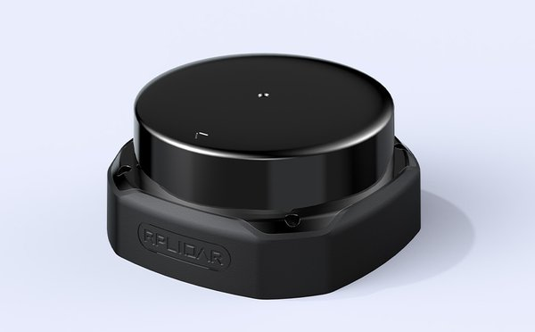</a><br>
      <em><a href="https://www.slamtec.com/en/s2">Slamtec RPLidar S2L</a></em>
    </td>
  </tr>
</table>


> **What we learned:** we judged the sensor by a test of our own integration. A component should be ruled out only after the integration has been tested on its own, with time to separate a sensor problem from a software problem.

**Placement and field geometry.** The track walls and the traffic signs (pillars) are both 100 mm tall. In v4 the LiDAR was mounted too high and its scanning plane passed over the walls; v5 lowered the mount (see [§7.4](#lessons)). The v7 chassis was lowered so the S2L's scanning plane sits about **75 mm above the ground**, 25 mm below the top of the walls and the pillars, so every wall and pillar is cut by the scan even with small chassis pitch on the track (side views in [Figure 2](#cad-v7)).

#### Camera and AI accelerator

**Raspberry Pi Camera Module 3 Wide** ([product brief](other/datasheets/RP-008151-DS-1-camera-module-3-product-brief.pdf)) captures the frames used to detect the obstacle pillars. The model also recognises the magenta parking markers, so that they are not mistaken for pillars ([§6.4](#d6)). The camera detects *what* the obstacle is and roughly *where*; the LiDAR gives the precise distance (see [§6.6](#heading)).

<table>
  <tr>
    <td align="center">
      <a href="other/datasheets/RP-008151-DS-1-camera-module-3-product-brief.pdf">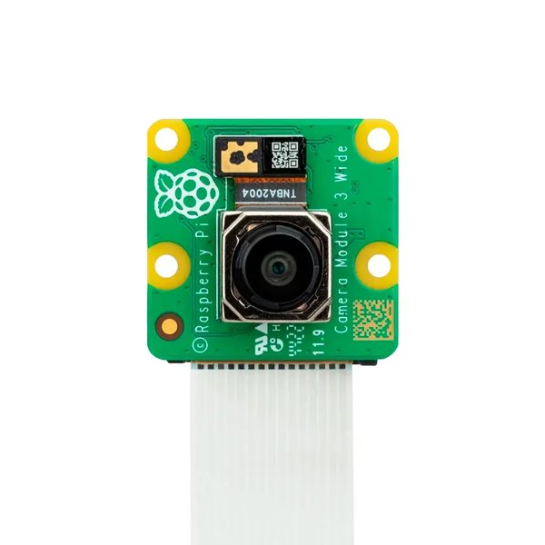</a><br>
      <em><a href="other/datasheets/RP-008151-DS-1-camera-module-3-product-brief.pdf">Raspberry Pi Camera Module 3 Wide</a></em>
    </td>
  </tr>
</table>


#### Decision card D5: Hailo-10H → Hailo-8 <a id="d5"></a>

| | |
|---|---|
| **What** | Design v7 runs inference on a **Hailo-8** ([Raspberry Pi AI HAT+ 26 TOPS](other/datasheets/RP-008133-DS-1-raspberry-pi-ai-hat-plus-product-brief.pdf), HailoRT 4.23) instead of the Hailo-10H AI HAT+ 2 used in v6. |
| **Why** | Our YOLOv8n model is light enough to run on the Hailo-8 at the same accuracy, and the Hailo-8 board is lighter and smaller, which reduces the overall mass and dimensions of the vehicle. For a single small detection model the Hailo-10H was more than we needed. |
| **When** | Design v7, October 2026. |
| **How** | The same v4 model was compiled for both chips ([D6](#d6)); the Hailo-8 version uses the [Hailo Dataflow Compiler](https://hailo.ai/products/hailo-software/hailo-ai-software-suite/) 3.34. Run script: `src/cpp/object_detection_hiwonder_h10/run_hiwonder_h8.sh`. |
| **What for** | Same accuracy on both chips (mAP50 0.990 Hailo-8 vs 0.991 Hailo-10H) and **8 ms per frame** on the Hailo-8. |
| **Alternatives** | Hailo-10H (v6), OAK-D Lite (2025 season). |

<table>
  <tr>
    <td align="center">
      <a href="other/datasheets/RP-008133-DS-1-raspberry-pi-ai-hat-plus-product-brief.pdf">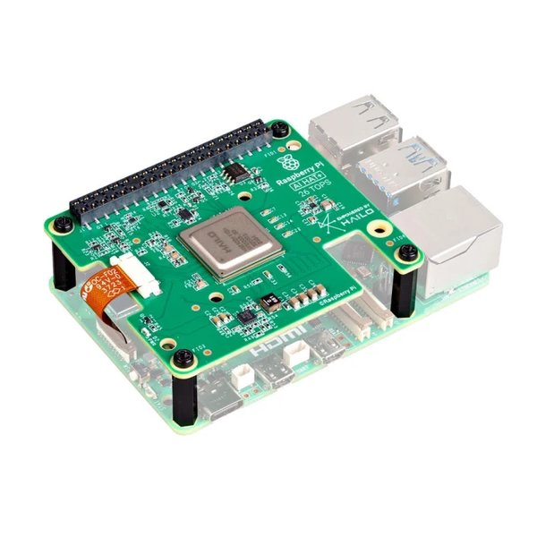</a><br>
      <em><a href="other/datasheets/RP-008133-DS-1-raspberry-pi-ai-hat-plus-product-brief.pdf">Raspberry Pi AI HAT+ 26 TOPS (Hailo-8)</a></em>
    </td>
  </tr>
</table>


#### Heading: IMU on the Hiwonder board

With the SPIKE Hub gone, heading comes from the **IMU on the Hiwonder board**, read at **20 Hz**. See [D1](#d1) and the calibration below.

#### Removed: ultrasonic sensors

Ultrasonic sensors used in previous seasons were removed in 2026; the robot relies on the LiDAR and camera only.

### 5.3 Calibration <a id="calibration"></a>

| What | Method | Where |
|---|---|---|
| Gyroscope bias | Automatic at start-up: the robot must stay still for **5 s** while the bias is measured (the button LED blinks when done). On the bench, 2 s left ~0.5° of drift in 20 s; the error falls with the square root of the averaging time, so 5 s reduces it about 1.6×. | `kSegundosCalibracionGiro` in `hiwonder_config.h` |
| Yaw sign | With the wheels lifted, turn the robot clockwise by hand: yaw must **decrease**, as on the SPIKE Hub. | [`src/ondevice/HIWONDER.md`](src/ondevice/HIWONDER.md) |
| Steering center and side | Servo at 750 = wheels straight. Commanding the "right" position must turn the wheels right; if not, swap `kDireccionDerecha` and `kDireccionIzquierda`. | `hiwonder_config.h` |
| Distance | `Spike_Advance_For_distance(50, 1000, 0)` must travel 1000 mm; if it travels L mm, multiply `kDiametroRuedaMm` by L/1000. | `reto2_config.h` |
| LiDAR angle offset | The S2L is mounted with its 0° mark facing the front of the robot and its angles growing clockwise: `RPLIDAR_FRONT_DEG = 0`, `RPLIDAR_CLOCKWISE = 1`. The driver converts every S2L reading into the buffer layout of design v6 (`ORADAR_ANGLE_OFFSET = 270°`), so the mission code reads `FRONT`, `RIGHT`, `BACK`, `LEFT` exactly as before. If the LiDAR is remounted, rebuild with e.g. `make LIDAR_FLAGS="-DRPLIDAR_FRONT_DEG=180"` and check the four walls in the LiDAR window. | `Oradar_S2L.cpp`, `Oradar_S2L.h` |
| Camera / lighting | No fixed camera settings: the camera runs with libcamera's automatic exposure and white balance (800×600 frames through GStreamer, stretched to 640×640 for the model). Robustness to light comes from the dataset: photos taken in poor light and with shadows, plus augmentation of brightness (±20 %) and exposure (±10 %) ([D6](#d6)). On the track: 96 of 100 pillars read correctly, the 4 errors in strong shadows. Check with `./run_hiwonder_h8.sh --solo-percepcion`, which shows the detections without moving the robot. | `toolbox.cpp`, `run_hiwonder_h8.sh` |

### 5.4 Noise, interference and failure points <a id="noise"></a>

| Issue | Effect | Mitigation |
|---|---|---|
| LiDAR outliers and seams | False walls | Angular windowing, chassis filter (< 150 mm), radius outlier removal and segment scoring ([§6.5](#lidar)) |
| Single noisy LiDAR reading at the start | Wrong start-box or direction decision | The Open Challenge now takes 3 readings that must agree within 30 mm (`Lidar_Debounced_Read`, `main.cpp`) |
| IMU at 20 Hz vs control loop every 2 ms | The D term of the heading PD only sees a change in 1 of ~25 calls, so steering may vibrate on straights | Documented in `HIWONDER.md`. The heading gains were re-tuned on the track by trial and error, with small adjustments until the robot held its straights satisfactorily ([§6.7](#67-steering-control-pd)) |
| Voltage sag on acceleration | Pi brownouts (seen in June 2026, design v4) | Low-resistance NCR18650B cells, kept in v7; 3S pack with BMS; peak current check in [§5.1](#power) |
| Lighting changes, shadows | Missed or wrong pillar color | Dataset with many lighting conditions ([D6](#d6)); on track 96 % correct, errors from strong shadows; fails consistently only in near darkness |

### 5.5 Processing architecture

The control loop runs on the **Raspberry Pi 5**. The RPLidar S2L streams 360° scans over USB-serial into a background buffer. The camera frames go through the YOLOv8n model on the Hailo-8, which classifies the pillars (green, red) and the parking marker. The Pi fuses both streams and sends motion commands over USB-serial (CH343, 1 Mbaud) to the **Hiwonder board**, which closes the speed and position loops of the drive motor, drives the HX-35H steering servo, and reports the IMU heading. The Pi GPIO handles the start button (GPIO4) and its LED (GPIO3). The v6 relay that powered the SPIKE Hub is no longer used.

<table>
  <tr>
    <td align="center">
      <a href="other/datasheets/RP-008348-DS-6-raspberry-pi-5-product-brief.pdf">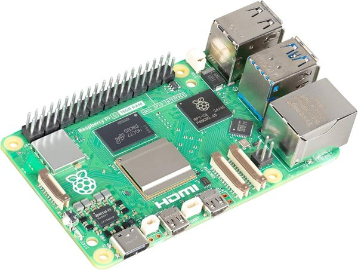</a><br>
      <em><a href="other/datasheets/RP-008348-DS-6-raspberry-pi-5-product-brief.pdf">Raspberry Pi 5 (16 GB)</a></em>
    </td>
    <td align="center">
      <a href="https://wiki.seeedstudio.com/Grove-LED_Button/">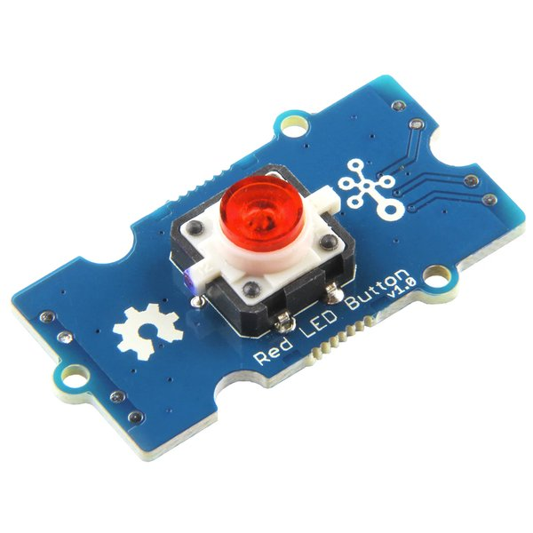</a><br>
      <em><a href="https://wiki.seeedstudio.com/Grove-LED_Button/">Grove LED button (start button, GPIO4 / LED GPIO3)</a></em>
    </td>
  </tr>
</table>


> The v7 wiring is in [Figure 7](#wiring-v7) (§5.1). The processing and wiring figures below are from **design v6** (SPIKE Hub, MS200k) and are kept for comparison.

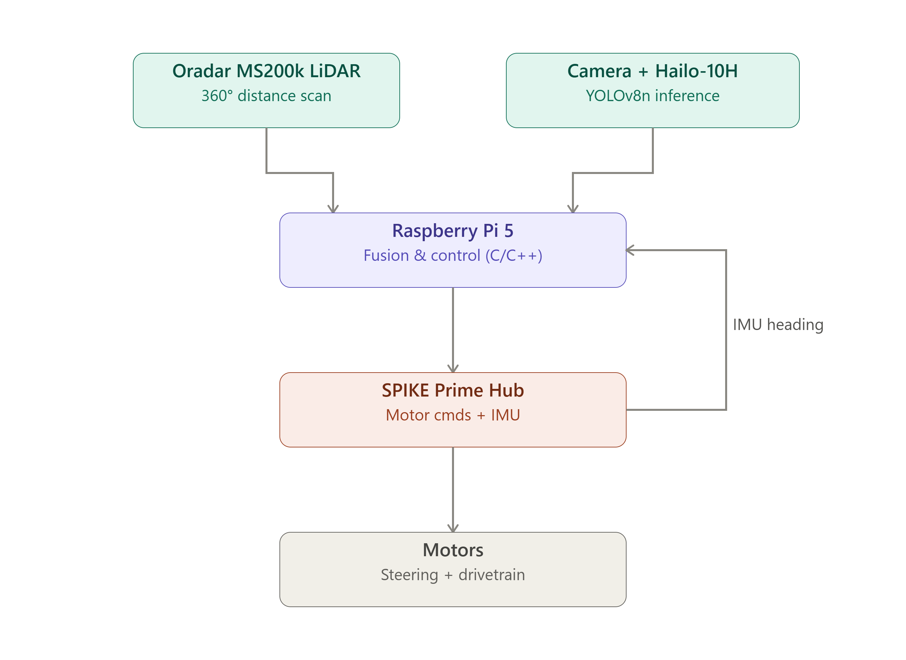

*Figure 8. Design v6: data flow between the robot's sensors, processing units, and actuators.*

#### Wiring (design v6)

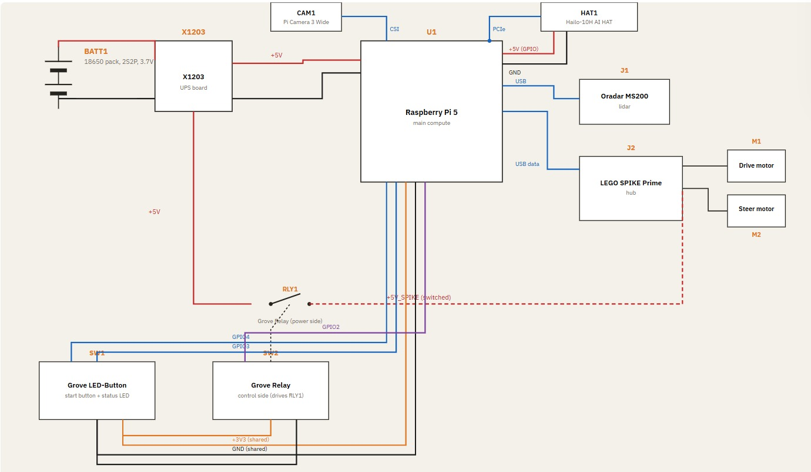

*Figure 9. Design v6 system wiring diagram showing power distribution (Geekworm X1203 UPS board from the 4P 18650 battery pack, four NCR18650B cells in parallel) and data connections between the Raspberry Pi 5, Camera Module 3 Wide (CSI), Hailo-10H AI HAT (PCIe), Oradar MS200 LiDAR (USB), LEGO SPIKE Prime hub (USB, driving the drive and steer motors), the GPIO-controlled start button/status LED (Grove LED-Button), and the Grove Relay that switches 5V power to the SPIKE hub.*

For design v7 see [Figure 7](#wiring-v7).

**Custom PCB.** Design v7 has no custom PCB. The Hiwonder ROS Robot Control Board replaced both the Geekworm X1203 UPS and the SPIKE Hub, so the motor driver, the servo bus, the IMU and the Raspberry Pi's 5 V supply all come from one stock board, and the rest of the system (LiDAR, camera, Hailo-8, Grove start button) connects with standard cables, as drawn in [Figure 7](#wiring-v7). The KiCad expansion-board project in [`schemes/hardware/pcb`](schemes/hardware/pcb) is a design study and is not mounted on the robot.

#### Wireless communication

During development, the team connects to the Raspberry Pi 5 primarily over SSH, occasionally through RealVNC Viewer when a full graphical display is needed, or through a direct terminal connection when the display is not required. This is normally done wirelessly for convenience during testing.

However, since the WRO Future Engineers rules prohibit wireless communication during the rounds, at the competition we disable the Raspberry Pi's Wi-Fi and Bluetooth radios and connect over wired Ethernet for setup and debugging between rounds, then physically disconnect the Ethernet cable before each round ([rule compliance, §7.2](#rule-compliance)).

---

## 6. Software Architecture and Obstacle Strategy <a id="software"></a>

### 6.1 Code modules and their hardware

| Module | Files | Hardware it talks to | Used by |
|---|---|---|---|
| Open Challenge mission | `src/ondevice/main.cpp` | — | Open Challenge |
| Obstacle Challenge mission | `src/cpp/object_detection_hiwonder_h10/object_detection.cpp` | Camera, Hailo-8 | Obstacle Challenge |
| Vision pipeline | `src/cpp/common/` (`hailo_infer.cpp`, `resources_manager.cpp`), `src/cpp/object_detection_hiwonder_h10/toolbox.cpp` | Camera Module 3 Wide, Hailo-8 | Obstacle Challenge |
| LiDAR driver and wall detection | `src/ondevice/Oradar_S2L.cpp`, `src/cpp/object_detection_hiwonder_h10/lidar_reto2.cpp` | RPLidar S2L | Both |
| SPIKE compatibility layer | `src/ondevice/spike_compat.cpp` (header `src/ondevice/hiwonder/include/spike_compat/spike_compat.h`), `src/ondevice/spike_hiwonder.cpp`, `src/ondevice/spike.h`; Obstacle Challenge unit conversions in `src/cpp/object_detection_hiwonder_h10/spike_reto2.cpp` | — | Both |
| Board protocol | `src/ondevice/hiwonder/` (`src/hiwonder_brick.cpp`, `include/hiwonder_brick/hiwonder_brick.hpp`) | Hiwonder board: motor, servo, IMU | Both |
| Robot calibration | `src/ondevice/hiwonder_config.h`, `src/cpp/object_detection_hiwonder_h10/reto2_config.h` | — | Both |
| Emergency stop | `src/ondevice/parada_emergencia.cpp` | Hiwonder board, LiDAR | Both |
| Start button and LED | `src/ondevice/rasp_gpio.cpp`, `src/cpp/object_detection_hiwonder_h10/rasp_gpio.cpp` | Raspberry Pi GPIO | Both |
| Offline tests | `src/ondevice/tests/`, `src/cpp/object_detection_hiwonder_h10/tests/` | Fake board (no hardware) | Development |

#### Decision card D1 and D7: Hiwonder board behind a compatibility layer <a id="d1"></a><a id="d7"></a>

| | |
|---|---|
| **What** | The LEGO SPIKE Prime Hub was replaced by the **Hiwonder ROS Robot Control Board** (STM32F407; [product page](https://hiwonder.com/products/ros-robot-control), [documentation](https://wiki.hiwonder.com/projects/ROS-Robot-Control-Board/en/latest/)). Instead of rewriting the mission code, we wrote a **`spike_compat` layer** that keeps the same API the missions already used (`Spike_Advance_For_Degrees`, `Spike_Turn_For_Degrees`, `Spike_Reset_Gyro`, …) and translates it to the board. |
| **Why** | The faster drive motor ([D2](#d2)) cannot be driven by the SPIKE Hub, so we needed a new controller that works with it and also replaces what the hub gave us, above all its **integrated IMU** for the heading. The Hiwonder board drives the JGB37 encoder motor, has an on-board IMU, and its 5 V / 5 A output also **powers the Raspberry Pi** ([D10](#d10)). Keeping the API meant the mission logic that placed 2nd at nationals did not have to be rewritten and re-tuned from zero two months before the international final. |
| **When** | Open Challenge on the board: 2026-10-04 (`7925b70`). Obstacle Challenge: 2026-10-18. Merged to `main`: 2026-11-08. |
| **How** | `hiwonder_brick` implements the board protocol. `spike_compat` reproduces the hub semantics, for example: `Spike_Reset_Gyro` receives **decidegrees** like the hub's `reset_yaw()`; `speed` 0–100 becomes rev/s in closed loop; `Spike_Turn_For_Degrees` turns with full steering like the hub's `turn()`; `Spike_Advance_For_Degrees` converts hub degrees to encoder ticks and stops 40 ticks early, then coasts, like the hub's `ag()`. The obstacle mission is the national `object_detection.cpp` with targeted substitutions, each marked with a `Hiwonder:` comment, so a diff against the original shows only the board-related changes. |
| **What for** | The same mission code runs on both robots, and the translations are covered by offline tests with a fake board: **53 checks** for the Open Challenge layer and **31** for the Obstacle Challenge layer. On the track (2026-11-08) the v7 robot completed **9 of 10** Open Challenge runs and **8 of 10** Obstacle Challenge runs ([§6.9](#testing)). |
| **Alternatives** | Rewriting the missions directly on the board API (more risk, no reuse of tuned constants); keeping the SPIKE Hub. |

| Hiwonder ROS Robot Controller specification ([Hiwonder](https://www.hiwonder.com/products/ros-robot-control), [documentation](https://wiki.hiwonder.com/projects/ROS-Robot-Control-Board/en/latest/)) | Value | How we use it |
|---|---|---|
| Microcontroller | STM32F407VET6: Arm Cortex-M4, 168 MHz with FPU, 512 KB flash, 192 KB RAM | Runs our modified Hiwonder firmware `pos-v8` (closed-loop motor control and position control, servo bus, IMU; see below) |
| Power input | DC 7–14 V | 3S pack, 9.9–12.6 V in use ([§5.1](#power)) |
| 5 V output | Independent 5 V / 5 A, USB Type-C | Powers the Raspberry Pi 5 and, through it, the Hailo-8, camera, LiDAR and button |
| Encoder motors | 4 channels with PID speed control | Port M4: JGB37-520 drive motor |
| Servos | 4 PWM servo ports (5 V), 2 serial bus servo ports (battery voltage) | One bus port: HX-35H steering servo (ID 1) |
| IMU | On-board 6-axis IMU (MPU6050 per Hiwonder) | Heading, read by the Pi at 20 Hz |
| Communication | 2 USB serial ports, CAN, SBUS, I²C, UART, Bluetooth module port | USB serial to the Pi at 1 Mbaud |
| Controls and indicators | Main power switch, motor enable switch, 2 user buttons, user LED, buzzer, OLED port | Main power switch = hardware kill switch ([D8](#d8)) |
| Protection | Over-temperature, short-circuit, over-current, reverse connection | |
| Size and mass | 85 × 60 mm (holes 57 × 49 mm), 39.5 g | Mounted on the combined board/LiDAR support |

<table>
  <tr>
    <td align="center">
      <a href="https://wiki.hiwonder.com/projects/ROS-Robot-Control-Board/en/latest/">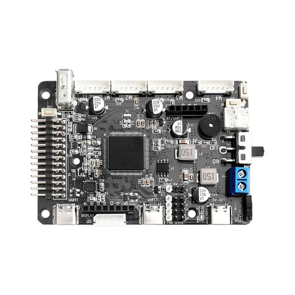</a><br>
      <em><a href="https://wiki.hiwonder.com/projects/ROS-Robot-Control-Board/en/latest/">Hiwonder ROS Robot Controller (STM32F407VET6)</a></em>
    </td>
  </tr>
</table>


<a id="board-firmware"></a>**Board firmware.** The Hiwonder board runs a version of Hiwonder's firmware that we modified, `pos-v8`. It adds a position-control command (function `0x0B`, *MOTOR_EXT*): the board turns the drive motor a given number of encoder ticks and stops on its own, which is how `Spike_Advance_For_Degrees` and `Spike_Advance_For_distance` cover exact distances; the same command holds the motor in place for `Spike_Hold_Motors`. At start-up `Spike_Hiwonder_Init()` asks the board for its position-control capabilities; a board with Hiwonder's stock firmware does not answer this command, and the program stops with the error "the firmware has no position control on M4 (is pos-v8 loaded?)" before anything moves. The modified firmware is not included in this repository.


The Obstacle Challenge program is structured as cooperating threads: a Hailo preprocess → inference → postprocess pipeline for the camera frames, a background LiDAR reader thread that keeps a 360-slot distance buffer up to date, and an `Obstacle_Challenge_Thread` that runs the navigation and avoidance logic and sends motion commands to the Hiwonder board through `spike_compat`.

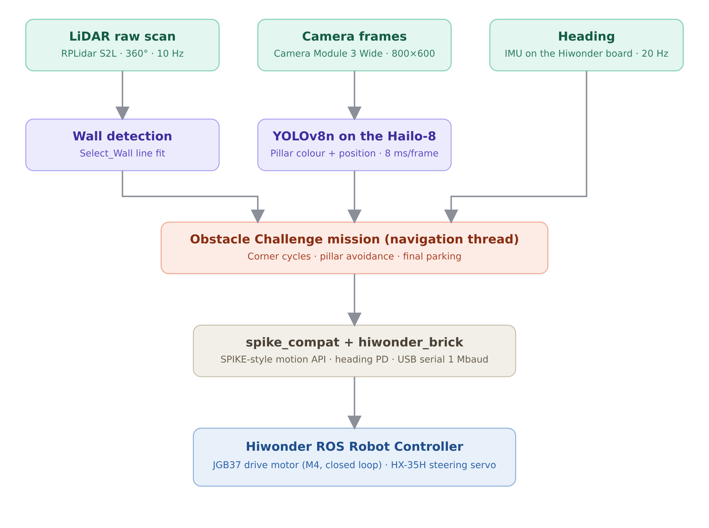

*Figure 10. Design v7 software data flow (Obstacle Challenge), from sensor input through processing and decision-making to the Hiwonder board, which drives the motor and the steering servo.*

### 6.2 Open Challenge

Unlike the Obstacle Challenge, the Open Challenge runs a separate, simpler program, [`src/ondevice/main.cpp`](src/ondevice/main.cpp). There are no color pillars to detect, so the Hailo/camera pipeline isn't used at all: the program only needs the Slamtec RPLidar S2L and the Hiwonder ROS Robot Controller board. Motion goes through the `spike_compat` layer (section 6.1), so the mission keeps the team's `Spike_*` API while the board does the driving; the LiDAR functions keep their historical `Oradar_S2L_*` names from design v6. The whole run lives in `Recorrido()` ("the run"), which `main()` calls directly, or from a second thread when the optional "Lidar Coordinates" debug window is open (`--no-display` turns it off; the window only reads the LiDAR and the gyro, so the run is identical with or without it).

**Strategy in one line:** find the driving direction at the first corner, then for each of the 12 corners wait for the inner wall to end, turn toward it, drive into the new section and re-zero the gyro on the outer wall, so heading errors never add up from one corner to the next. The trace below follows `Recorrido()` top to bottom. The two driving directions are mirror images in the code and are drawn once here as `sentido` (the detected open side); the speeds and turn angles that differ between them are in the table under the figure.

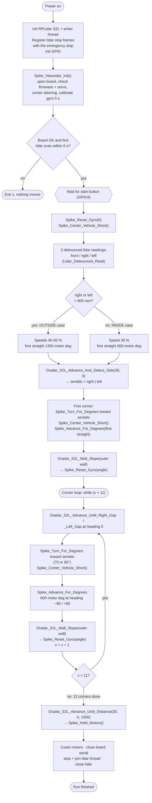

*Figure 11. Open Challenge program flow, traced directly from `Recorrido()` in [`src/ondevice/main.cpp`](src/ondevice/main.cpp).*

> **How each step works.** `Lidar_Debounced_Read` copies the 360-slot distance buffer until 3 consecutive samples of the same angle agree within 30 mm, so a single bad return cannot choose the wrong start case. `Oradar_S2L_Advance_And_Detect_Side` drives straight until the front wall is within 1100 mm and one side reads more than 1350 mm (or gives no return): that open side is `sentido`, fixed for the whole run (`right` = clockwise). `Spike_Turn_For_Degrees` turns with full steering lock until |yaw| reaches 70-80°, a little short of 90°, and `Spike_Advance_For_Degrees` then holds heading &minus;90 (right turn) or +90 (left turn) for a fixed number of motor degrees, which completes the turn and brings the robot into the new section. Finally, `Oradar_S2L_Wall_Slope` fits the outer wall (the continuous one, on the side opposite `sentido`) and `Spike_Reset_Gyro` redefines the yaw so that heading 0 is parallel to it. This cancels gyro drift and turn error at every corner.

| Case / `sentido` | First turn (speed, yaw) | First straight (speed, motor deg, heading) | Gap search speed | Loop turn (speed, yaw) | Loop straight (speed, motor deg, heading) | Outer wall |
|---|---|---|---|---|---|---|
| Outside, right | 50 %, 80° | 40 %, 1350, &minus;90 | 50 % | 40 %, 80° | 50 %, 600, &minus;90 | `LEFT` |
| Outside, left | 40 %, 80° | 50 %, 1350, +90 | 50 % | 40 %, 70° | 50 %, 600, +90 | `RIGHT` |
| Inside, right | 30 %, 70° | 30 %, 600, &minus;90 | 30 % | 30 %, 70° | 30 %, 600, &minus;90 | `LEFT` |
| Inside, left | 30 %, 70° | 30 %, 600, +90 | 30 % | 30 %, 70° | 30 %, 600, +90 | `RIGHT` |

The "outside" case (one side wall farther than 800 mm at the start) has room for faster moves and a longer first straight; the "inside" case starts close to both walls, so every move runs at 30 %. At the end of the 12th corner the robot is back in the starting section and drives at heading 0 until the front wall is at 1500 mm, i.e. the middle of the 3000 mm side, then holds the drive motor.

#### High-level states

The same run, one level up: the states a judge or teammate would actually watch the robot move through.


*Figure 12. Open Challenge high-level state machine. The Open Challenge has no parking: it ends with a stop in the starting section.*

> **Emergency stop.** The Hiwonder board firmware has no command watchdog: if the program died with the motor running, the motor would keep its last speed. So, from the moment the LiDAR is opened, Ctrl+C, `kill` or a crash triggers `parada_emergencia` ("emergency stop"), which sends the board a COAST command for all four motors and the LiDAR its stop frames, then ends the process immediately, so no half-finished loop can send another speed. If the board or the LiDAR does not start (no scan within 5 s), `Recorrido()` returns 1 before anything moves.

#### Thresholds

Pulled straight from the constants in [`main.cpp`](src/ondevice/main.cpp) and the `Oradar_S2L_*` helpers it calls, for whoever tunes this next. Distances are in mm from the LiDAR; straights are in motor degrees, the unit of `Spike_Advance_For_Degrees`.

| Threshold | Value | Where / purpose |
|---|---|---|
| LiDAR start timeout | `50 × 100 ms = 5 s` | Wait for the first full scan (`Oradar_S2L_Get_Scan_Seq`); without it every distance is 0, so the run exits without moving. |
| Gyro calibration | `5 s` | `Spike_Hiwonder_Init`, robot still, steering already centered so the servo does not shake the IMU. |
| Debounce | `3 samples, ≤ 30 mm apart` | `Lidar_Debounced_Read` for the front / right / left start readings. |
| Outside / inside split | `> 800 mm` | Right or left start reading above this selects the "outside" case, else "inside". |
| Open side (direction) | `> 1350 mm` or no return | `Oradar_S2L_Advance_And_Detect_Side`: the side where the inner wall ends sets `sentido`. |
| Corner gate, front | `≤ 1100 mm` | Detect-side and gap helpers only stop when the front wall is this close, so an opening seen too early is ignored. |
| Corner gap, side | `≥ 1350 mm`, or front `≤ 500 mm` | `Oradar_S2L_Advance_Until_Right_Gap` / `_Left_Gap`: inner wall gone (or wall ahead very close), time to turn. |
| Corner turn yaw | `80°` / `70°` | `Spike_Turn_For_Degrees`, full lock; 80° in the outside case (except the left-loop turns, 70°), 70° in the inside case. |
| First straight | `1350` / `600` motor deg | `Spike_Advance_For_Degrees` after the first turn, outside / inside case. |
| Corner straight | `600` motor deg | `Spike_Advance_For_Degrees` after every loop turn, at heading &minus;90 / +90. |
| Speeds | `30 %` inside, `40-50 %` outside | `Spike_*` speed scale 0-100, converted to closed-loop rev/s by `spike_compat`. |
| Corners per run | `1 + 11 = 12` (`while (v < 11)`) | First corner before the loop, 11 in the loop: 3 laps of the four-corner field. |
| Final stop | `≤ 1500 mm` front, `30 %` | `Oradar_S2L_Advance_Until_Distance(30, 0, 1500)`, then `Spike_Hold_Motors`: stops mid-way along the 3000 mm starting side. |

### 6.3 Obstacle Challenge

The v7 mission is the national (v6) mission running on the Hiwonder layer: the strategy, the corner and section logic, and every distance and angle in this section are the ones used at the national final. What changed in v7 (each change is marked `Hiwonder:` in the code):

- **Actuation:** the SPIKE calls of the mission go to the Hiwonder board through `spike_compat`. `Spike_Reto2_Init` converts the hub units the mission uses: steering `tire_turn` (4.29 steering-motor degrees per unit, so `40` = 0.96 of full lock) and hub degrees / millimetres to encoder ticks of the drive motor. Turns with `await` give the servo 150 ms to reach its position before the drive motor starts.
- **Start-up:** board check, steering centring and a 5 s gyro calibration with the robot still; the robot does not move until the LiDAR has delivered its first full scan (up to 5 s); the mission thread starts once camera, inference and post-processing are running, and the start button still starts the motion.
- **LiDAR-guarded advance:** `Advance_For_distance_Especial` (the crossing between two pillars of different color) stops early when the LiDAR ray in the direction of travel reads 370 mm or less; a ray with no return (0) is ignored. `Oradar_S2L_Advance_Until_Distance` (drive until the front wall is at a given distance) ends with a selectable brake type (`Hold` throughout the mission).
- **Bounded waits:** the pillar-color wait when leaving the parking lot gives up after 3 s and continues as "no pillar"; the wait for a valid wall in the avoidance geometry also ends on shutdown.
- **Shutdown:** Ctrl+C stops the robot at any moment (motors in coast, steering servo released); a board error stops the motors and ends the mission.
- **Perception-only mode:** `WRO_SOLO_PERCEPCION=1` runs camera, Hailo and LiDAR without opening the board, to check the model and the LiDAR orientation before arming the robot.

Two threads run at once (both started from `main()`): the Hailo camera
pipeline keeps the global `traffic_lights` struct (color, x-position, area,
confidence) updated in the background, while `Obstacle_Challenge_Thread`
drives the robot and reads that struct whenever it needs to know what cube
it's currently looking at. The diagrams below are the navigation thread.

#### High-level states


*Figure 13. Obstacle Challenge high-level state machine (navigation thread). `FinalParking` is described in [§6.8](#parking).*

> The direction of the run is fixed for the whole attempt by the single
> side-wall reading taken in `InitialScan`, and both branches feed the same
> `ExitParkingLot` &rarr; `CornerCycle` sequence. The counter-clockwise path is
> the sign-mirrored twin of the clockwise one, so the corner cycle below is
> drawn once rather than twice.

#### One corner cycle (repeats x12)

`Corner_Case` and `Desicion` together are the unit that repeats 12 times.
Drawn once here rather than 12 times over.


*Figure 14. One Obstacle Challenge corner cycle (clockwise run).*

> In the counter-clockwise run the two corner colors are swapped: red after a
> green stops at 400 / 600 mm, green after a green at 990 mm.

> `esquivar_cubos_1/2/middle` each call `calculte_angle_section_start_clockwise_chr`
> (or its `..._counterclockwise` counterpart) to get an angle + distance to the
> cube, turn toward it (left for green, right for red -- the passing side is set
> by the rules and does not mirror with the driving direction), advance alongside
> it, then small-turn back straight.
> `esquivar_cubos_2` additionally short-circuits to a plain advance to 1000mm
> from the front wall when no second cube is present or it's the same color as
> the first (two greens in the parking section: 1500mm, then a short S-shift to
> the left).

> `Obstacle_Challenge_Thread` also calls `Slope(front)` once, right after
> the initial button-press reset, and then resets the gyro to `0`: the
> starting heading is the robot's placement in the parking lot.

#### Thresholds referenced above

| Constant | Value | Where it acts |
|---|---|---|
| Direction-of-run split | `600 mm` | Right reading above this at start -> clockwise run; left reading above this -> counter-clockwise run. Fixed for the whole attempt. |
| Start pillar wait | `3 s` | Leaving the parking lot, the robot waits this long for the camera to report a pillar, then continues as "no pillar". |
| Corner approach | `1000 mm` | First advance in every `Corner_Case`, before reading the cube color. |
| Green-cube advance | `600 mm` (parking) / `400 mm` (not) | Second advance in `Corner_Case` when the corner cube is green and the previous one was red. |
| Red-cube advance | `990 mm` | Second advance in `Corner_Case` when the corner cube is red and the previous one was red. |
| No-cube advance | `650 mm` | Second advance in `Corner_Case` in every other case (treated as no corner cube). |
| Corner turn | `86 deg` | Every `Corner_Case`, turning into the next section: right when running clockwise, left when running counter-clockwise. |
| Gyro realign | `Slope(outer wall) +/- 90 deg` | Start of every `Desicion`, squares the robot to the outer side wall (on the left running clockwise, on the right running counter-clockwise) before looking for cubes. |
| Corners per run | `12` (3 laps x 4) | 4th corner of each lap calls `Corner_Case`/`Desicion` with `parking=true`. |
| Avoidance turn | angle `+5 deg` (cube 1) / `-5 deg` (cube 2) / `+3 deg` (middle), max `70 deg` | Turn toward the computed passing point before each avoidance advance. |
| Cube-1 clearance | `hypotenuse - 400` (normal) / `-200` (parking, green) | `esquivar_cubos_1`'s advance-past-cube distance. |
| Cube-2 clearance | `hypotenuse - 250` (normal) / `-260` (parking, red after green) | `esquivar_cubos_2`'s advance-past-cube distance when the second cube has the other color. |
| Middle-cube clearance | `hypotenuse - 450` (red) / `-350` (green) | `esquivar_cubos_middle`'s advance-past-cube distance. |
| LiDAR guard | `370 mm` | `Advance_For_distance_Especial` (cube-2 crossing) stops early when the ray in the direction of travel reads this or less. |

> Values are for the clockwise run. The counter-clockwise run uses the same
> corner distances (colors swapped, see above) and scales the clearance
> margins by `angle / 45 deg`, with its own avoidance-turn offsets.

### 6.4 Vision model

#### Decision card D6: retrained detection model <a id="d6"></a>

| | |
|---|---|
| **What** | YOLOv8n retrained on a new, much larger dataset (**23,938 images**, 9,354 of them originals, including scenes without pillars and in poor lighting) and compiled for both accelerators: [`src/HailoModels/wro_h8_yolov8n_v4.hef`](src/HailoModels) for the Hailo-8 (v7 robot) and a Hailo-10H version. Classes: `greenbox`, `redbox`, `xparking`. |
| **Why** | On the track the v6 model made three kinds of mistakes: it sometimes **missed a pillar** that was there, it took **objects outside the track for pillars** (for example, a red broom read as a red pillar), and it sometimes saw a **green pillar in an empty corner** of the track. Most failures happened in **poor lighting**. The v6 model had been trained on our small hand-labelled national dataset (501 images in [`other/dataset/`](other/dataset), mAP50 0.986 in training). The new dataset adds photos from the robot's own camera in those situations, including images with **no pillars at all**, so the model also learns when there is nothing to detect. |
| **When** | Dataset exported from Roboflow and model trained on 2026-10-18 (training run `h10_yolov8n_640_v4`). |
| **How** | See the dataset breakdown below. [YOLOv8n](https://docs.ultralytics.com/models/yolov8/), image size 640, Ultralytics 8.4.115. Images are stretched to 640×640 with no letterbox, the same preprocessing the car applies to the camera frame, so the model sees images shaped like the ones it gets on the robot. Hailo-8 version compiled with the Dataflow Compiler 3.34. |
| **What for** | See the results table below: decision correct in **99.2 %** of the October validation images on both chips, **8 ms** per frame on the Hailo-8. |
| **Alternatives** | Keeping the v6 model (`yolov8n_wro_hailo8.hef` is kept for comparison: `WRO_HIWONDER_MODEL=... ./run_hiwonder_h8.sh`). We kept the same model type (YOLOv8n) because it already runs well on our hardware (8 ms per frame on the Hailo-8); the errors came from the data, so we improved the dataset and retrained to make the model more accurate and less prone to the mistakes that could cost a run. |

**Dataset:** [`wro-dataset-completo`, version 1](https://universe.roboflow.com/roboteam-x6iuc/wro-dataset-completo) (Roboflow Universe, MIT license).

| Source | Original images | Description | Validation set |
|---|---|---|---|
| `octubre` | 3,831 | Photos from the car's own camera (800×600), labelled in October 2026 | 5 complete recording sessions held out (477 images) |
| `combinaditos` | 501 | Phone photos with pillars of both colours | Photos numbered c420 and above |
| `roboflow_v3` | 5,022 | Originals (320×320) of our previous Roboflow project `wro-round-2` | Its own train/valid/test split (the 495 test images come from here) |
| **Total** | **9,354** | | |

| Split | Images | Notes |
|---|---|---|
| Train | 21,876 | 7,292 originals × 3 augmented versions |
| Valid | 1,567 | Originals only |
| Test | 495 | Originals only |
| **Total** | **23,938** | |

- **Pre-processing:** auto-orientation (EXIF stripped), resize to 640×640 (stretch).
- **Augmentation (training split only, 3 versions per source image):** horizontal flip (50 %), rotation ±5°, brightness ±20 %, exposure ±10 %, Gaussian blur 0–1 px, salt-and-pepper noise on 1 % of pixels. Brightness, exposure and blur simulate the lighting changes and motion blur we expect on an unknown venue's field.
- **Held-out validation by session:** the October validation images are 5 entire recording sessions that never appear in training, not random frames. Consecutive video frames are almost identical, so a random split would leak near-copies into validation and inflate the scores.

**Results on held-out data**

| Test set | Metric | Result |
|---|---|---|
| `octubre` validation (477 images), on the Hailo-10H | mAP50 | 0.991 |
| `octubre` validation (477 images), on the Hailo-8 | mAP50 | 0.990 |
| Same 477 images, both chips | Obstacle Challenge decision correct (pillar colour → passing side) | 99.2 % |
| `combinaditos` held-out (81 images, 275 pillars) | mAP50-95 / recall | 0.875 / 0.982 |
| Hailo-8 on the robot | Inference time | 8 ms per frame |

> On the car, `class_id` = index + 1 (green 1, red 2, xparking 3), see `parse_nms_data` in `object_detection.cpp`.

**How the detections are used.** In every frame the post-processing gives an area of 0 to every box with a **score below 0.75** and to every `xparking` box, then picks the largest remaining box as the nearest pillar and publishes its colour, centre, area and confidence in `traffic_lights` ([§6.3](#63-obstacle-challenge)). The `xparking` class is kept in the model so that the magenta parking markers are recognised as markers and never mistaken for a pillar; it is not used to find the parking lot, which the mission reaches by counting sections and measuring walls with the LiDAR ([§6.8](#parking)).

### 6.5 LiDAR processing <a id="lidar"></a>

Wall and corner detection (`Select_Wall()`) follows this pipeline on each call:

1. **Angular windowing**, a 70°-wide window centered on the requested side (front/right/left/behind), with the innermost ±3° excluded to avoid seam/corner noise.
2. **Chassis filtering**, any return closer than 150 mm is discarded as the robot's own body, not an environmental wall.
3. **Radius Outlier Removal (ROR)**, a point is dropped if it has fewer than 3 neighbors within 300 mm (with 15° of padding outside the window so edge points aren't unfairly penalized).
4. **Segmentation**, the remaining points are split into candidate walls wherever consecutive points jump apart by more than 60 mm (gap-based segmentation), then further split at corners using a recursive max-perpendicular-deviation method (Iterative End-Point Fit) with a 40 mm threshold.
5. **Scoring**, a segment only qualifies as a wall if it has at least 6 points, spans at least 200 mm end-to-end (to reject compact objects/blocks), and has an RMS perpendicular residual under 15 mm against its own best-fit line (computed via Total Least Squares/PCA, since it has no bias toward any orientation).
6. **Per-side tracking**, once a wall is chosen for a side, subsequent frames prefer to keep following that same physical wall (matched within 300 mm position / 20° orientation) rather than re-snapping every frame.

The camera classifies the pillar color; the LiDAR's role is purely geometric: once a pillar is flagged by vision, the LiDAR supplies the distance and angle used to compute the avoidance maneuver.

### 6.6 Heading estimation <a id="heading"></a>

Heading comes from the IMU on the Hiwonder board (20 Hz), read and reset through `spike_compat`. LiDAR wall-orientation readings (`Slope()` / `Oradar_S2L_Wall_Slope()`) correct the heading at defined points of each maneuver, for example at the start of every corner decision, where the robot re-squares itself against the side wall (±90°).

This is **not** a formal sensor fusion (no complementary or Kalman filter): it is gyro-primary heading with situational LiDAR correction. We chose this because each correction happens at a known wall reference, where the LiDAR measurement is most reliable. Without any correction the gyro drifts about 1° per minute (3.2° after 180 s with the robot still, [§6.9](#testing)); a 3-lap run lasts about 48 s (Open) to 121 s (Obstacle), and the heading is re-squared against a wall at every corner, 12 times per run, so the drift cannot accumulate over the laps.

### 6.7 Steering control (PD)

Steering uses a Proportional-Derivative (PD) controller: the P term reacts to the lateral position error, and the D term anticipates the rate of change of that error to damp oscillations, allowing smooth trajectories through both the wall-following and obstacle-avoidance challenges.

In v7 both challenges steer through the same `spike_compat` layer, which rebuilds the SPIKE hub's PD functions on the Hiwonder board. The mission does not pass gains: it calls a motion function with a speed and a heading reference (degrees), and each function uses its own fixed gain set. The faster motor, the board's IMU and the S2L changed how the robot responds, so these gains were re-tuned for v7 on the track:

| Function (hub equivalent) | Used for | Kp | Kd |
| :--- | :--- | :---: | :---: |
| `Spike_Forward` (`da()`) | Advances that end on a LiDAR distance (`Oradar_S2L_Advance_Until_Distance`), parking approach | 0.05 | 0 |
| `Spike_Advance_For_Degrees` / `Spike_Advance_For_distance` (`ag()`) | Fixed-distance advances: past each pillar, Open Challenge straights, parking | 0.02 | 0.05 |
| Same, in reverse (`ag_u()`) | Parking manoeuvre | 0.003 (0.15 x Kp) | 0 |

The gains were obtained by trial and error on the physical track rather than derived analytically: small adjustments to the values, run after run, until the robot held its straights and turns satisfactorily.

In the competition runs every steering correction is a heading PD on the gyro: pillars are passed with the LiDAR geometry of [6.3](#63-obstacle-challenge) and the camera supplies only the color. Corner and avoidance turns are not PD-controlled: the steering is set to a fixed `tire_turn` and the robot drives until the gyro reaches the target angle.

**v7 chain, one PD step:**

1. **Error.** `e = yaw - reference`, in tenths of a degree. The hub reported yaw in decidegrees and its gains are expressed in those units, so `spike_compat` multiplies both angles by 10 and the hub gains keep their meaning.
2. **Heading dead band.** `kBandaMuertaRumboGrados = 0.3 deg` (`hiwonder_config.h`). Inside ±0.3° the error is 0; outside, 0.3° is subtracted, so there is no jump at the edge of the band. Without it, the residual gyro drift after calibration (~0.01 °/s) keeps the servo correcting by a few units while the robot holds a straight line.
3. **PD.** `u = Kp·e + Kd·(e - e_prev)`. `e_prev` is cleared on every gyro reset, so the D term never sees the jump of a re-zeroed heading. Fixed-distance advances run one step per new IMU sample (20 Hz).
4. **Servo.** `steering = clamp(u · kPdADireccion, -1, +1)`, where ±1 is the full steering travel allowed by software: `kDireccionRecorrido = 145` servo units either side of the centre (750; 605 right, 895 left), 0.24° per unit = ±34.8°, the ±35° software limit of [D3](#d3), which lies inside the 45.9° mechanical travel of the v7 linkage. `kPdADireccion = 0.133 · 200 / kDireccionRecorrido ≈ 0.183`.
5. **Reverse.** The output sign is inverted (in reverse the steering acts on the heading the opposite way), with 0.15 x Kp and no D term, as `ag_u()` did on the hub.

**Why the scaling matters.** One unit of PD output moves the servo `kPdADireccion · kDireccionRecorrido = 0.133 · 200 = 26.6` units, about 6.4° of servo rotation: the same 6.4° per unit that the hub commanded its steering motor (`et * 6.4`). Because the travel appears in the denominator of `kPdADireccion`, the per-unit response does not depend on the steering limit; limiting the travel to ±35° only makes the correction saturate earlier. With the gains above, 1° of heading error gives:

| Function | Steering per 1° of heading error (P term) | Full lock reached at |
| :--- | :---: | :---: |
| `Spike_Forward` | 13.3 servo units (≈ 3.2°) | ≈ 11° of error |
| `Spike_Advance_For_Degrees` | 5.3 servo units (≈ 1.3°) | ≈ 28° of error |

### 6.8 Avoidance, parking and edge cases

* **Passing Rules:** Green → pass on left | Red → pass on right
* **Underlying logic:** pillar color decisions are handled by `Desicion()`/`Corner_Case()`, and the actual avoidance maneuvers are implemented as `esquivar_cubos_1`/`esquivar_cubos_2`/`esquivar_cubos_middle` and `avoid_cube_start_section`, which use angle/hypotenuse geometry (`calculte_angle_section_start_clockwise[_chr]`, `calculte_angle_section_start_counterclockwise`) to aim the robot's approach at each detected pillar's position.
* **Parallel Parking Maneuver:** The parking lot is not located with the camera. The mission counts the sections, and after the 12th section, which ends back in the section that holds the parking lot, it parks with LiDAR wall distances, encoder-measured reverses and gyro-controlled turns (sequence below). The model still detects the magenta markers as `xparking` so that they are not mistaken for pillars; those boxes are discarded before the pillar is chosen ([§6.4](#d6)).

| Edge case | Handling |
|---|---|
| No pillar visible at a corner | `Corner_Case` advances 650 mm and uses the previous pillar's color to decide if there is a middle pillar |
| Second pillar missing or same color as the first | `esquivar_cubos_2` short-circuits to a plain 1000 mm advance |
| Run direction unknown at start | Decided once from the side-wall reading (600 mm) and held for the whole run |
| Start position inside or outside | Open Challenge: side reading > 800 mm → outside start |
| LiDAR not ready at start | The program waits up to 5 s (50 × 100 ms) for the first scan and exits without moving if none arrives |
| Start pillar not detected | The wait for the first pillar at the start gives up after 3 s and the run continues with the no-pillar case |
| Ctrl+C, kill or crash during a run | Emergency stop: motors in COAST, steering torque off, LiDAR stopped ([D8](#d8)) |

#### Final parallel parking (Obstacle Challenge) <a id="parking"></a>

**How the parking section is reached.** `Obstacle_Challenge_Impl` runs the 12 sections as a fixed sequence of calls: after leaving the lot (`estacionamiento_clockwise()` / `estacionamiento_counterclockwise()`), it calls `Corner_Case` + `Desicion` 12 times, 3 laps × 4 sections, and the 4th, 8th and 12th calls run with `parking = true` because that section holds the parking lot. The section count is therefore the position in the program, not a sensor reading. When the 12th `Desicion` returns, the robot is back in the parking section, and the parking sequence below runs, using the colour of the last pillar passed. Distances to walls come from the LiDAR, reverses are in hub degrees (1 hub degree ≈ 0.39 mm of travel, `kMmPorGradoSpike`), and turns end when the gyro has rotated the given angle. The values were tuned by hand on the track for the geometry of the lot.

| Step | Clockwise run | Counter-clockwise run |
|---|---|---|
| 1. Reposition after the last pillar | **Red:** advance to 950 mm from the front wall, turn 90° left, advance at heading 90° to 260 mm from the wall ahead, re-zero the gyro, turn 90° right. **Green:** turn 10° left and creep at heading 10° until the LiDAR ray 10° ahead of the left side reads ≤ 180 mm, re-zero the gyro, turn 4° right. **None:** no repositioning. | **Green:** the mirror of the clockwise red case (950 mm, 90° right, heading −90° to 260 mm, 90° left). **Red or none:** no repositioning. |
| 2. Approach the front wall | `Slope(front)` re-zeroes the gyro parallel to the front wall; advance until the front wall is at **150 mm** (heading +2° after a red pillar). | Creep forward at heading −10° until the right-side LiDAR reading (outer wall) is ≤ **160 mm**, then advance at heading 0 until the front wall is at **200 mm**. |
| 3. Reverse along the lot | Re-zero the gyro, reverse **2250 hub degrees** (≈ 875 mm). | Re-zero the gyro, reverse **740 hub degrees** (≈ 288 mm). |
| 4. Reverse S-turn into the lot | Reverse with the wheels right until the gyro has turned **50°**, re-zero, reverse with the wheels left for **105°**, reverse **400 hub degrees** (≈ 156 mm) at heading −105°, brake. | Reverse with the wheels left for **52°**, re-zero, reverse with the wheels right for **100°**, reverse **390 hub degrees** (≈ 152 mm) at heading 90°, brake. |
| 5. Straighten | Re-zero, reverse with the wheels right for **28°** and hold the motor, re-zero, short forward correction with the wheels left, centre the steering. | Mirror: reverse with the wheels left for **28°**, hold, short forward correction with the wheels right, centre the steering. |

After step 5 the robot stays parked (state `FinalParking` → `Idle` in [Figure 13](#63-obstacle-challenge)) until the program is stopped.

### 6.9 Testing and tuning workflow <a id="testing"></a>

1. **Offline tests, no hardware.** Every change to the hardware layer is checked against a fake board that records the commands it receives:
   ```bash
   (cd src/ondevice && make test)                               # 53 checks (Open Challenge layer)
   ./src/cpp/object_detection_hiwonder_h10/build/h8_s2l/reto2_test  # 31 checks (Obstacle Challenge layer)
   ```
2. **Perception only.** Camera, Hailo and LiDAR run, but the board is not opened, so nothing moves:
   ```bash
   ./run_hiwonder_h8.sh --solo-percepcion            # with display
   ./run_hiwonder_h8.sh --solo-percepcion --no-display  # over SSH
   ```
3. **Wheels lifted.** Yaw sign, steering side and distance checks ([§5.3](#calibration)).
4. **Slow track runs.** `WRO_MAX_RPS=1.5 ./my_lidar_app`: same distances and angles, lower speed.
5. **Competition speed**, with the emergency stop ready.
6. **Record every run** in the tables below: one row per attempt, including the failed ones. In the national journal, the lack of logged runs was our biggest methodological gap.

#### 6.9.1 Component tests (2026-11-08)

Full log: [`other/testing/WRO2026_v7_test_log.xlsx`](other/testing/WRO2026_v7_test_log.xlsx).

| Test | Method | Result |
|---|---|---|
| Encoder resolution | Counts per output revolution | 1320, matching 11 PPR × 30:1 × 4 |
| Distance | Advance 1000 mm × 10, tape measure | Mean **1001.9 mm**, std. dev. **11.1 mm**, range 985–1018 mm |
| Gyro drift | Robot still after the 5 s calibration | 0.5° (30 s), 1.1° (60 s), 2.3° (120 s), **3.2° (180 s)** |
| Wall detection | `Select_Wall()` on a straight at 0.4 m/s, 500 frames | S2L **98.4 %** (492/500); MS200k 96.2 % (481/500) |
| Vision on track | Perception-only mode | Pillar colour **96 %** (96/100, 4 shadow errors); parking marker 95 % (19/20) |
| Offline test suites | `make test`, `reto2_test` | 53 + 31 checks, 0 failures |

**LiDAR accuracy** (robot parallel to a wall, 50 readings per distance; error = mean measured − true distance)

| True distance | S2L error | S2L std. dev. | MS200k error | MS200k std. dev. |
|---|---|---|---|---|
| 100 mm | +2.1 mm | 4.2 mm | +3.5 mm | 5.1 mm |
| 150 mm | +1.8 mm | 4.6 mm | −2.8 mm | 5.8 mm |
| 300 mm | −3.5 mm | 5.2 mm | +4.8 mm | 6.9 mm |
| 1000 mm | +8.4 mm | 7.1 mm | −11.8 mm | 9.8 mm |
| 2500 mm | +22.6 mm | 11.4 mm | −28.5 mm | 16.3 mm |

**Speed vs battery** (2 m straight, `speed = 100`)

| Set-point | Battery | Time | Speed |
|---|---|---|---|
| `kRpsVelocidad100 = 5.7` | 12.3 V | 3.45 s | 0.580 m/s |
| `kRpsVelocidad100 = 5.7` | 10.7 V | 3.82 s | 0.524 m/s (−9.7 %) |
| `kRpsVelocidad100 = 4.0` | 12.3 V | 3.71 s | 0.539 m/s |
| `kRpsVelocidad100 = 4.0` | 10.7 V | 3.95 s | 0.506 m/s (−6.1 %) |

The measured full-battery speed is within 7 % of the calculated 0.62 m/s ([§4.3](#drivetrain)). The lower set-point reduces the speed loss on a low battery from 9.7 % to 6.1 %, at the cost of about 7 % of top speed.

#### 6.9.2 Run logs (2026-11-08, all runs at `speed = 100`)

**Open Challenge**

| # | Direction | Start | Laps | Time | Result | Notes |
|---|---|---|---|---|---|---|
| 1 | CW | Outside | 3 | 46.8 s | Pass | |
| 2 | CW | Inside | 3 | 45.2 s | Pass | |
| 3 | CCW | Outside | 3 | 49.1 s | Pass | |
| 4 | CCW | Inside | 3 | 46.5 s | Pass | |
| 5 | CW | Outside | 3 | 51.4 s | Pass | Minor drift on turn 2 |
| 6 | CCW | Outside | 3 | 48.2 s | Pass | |
| 7 | CW | Inside | 3 | 45.9 s | Pass | |
| 8 | CCW | Inside | 3 | 47.6 s | Pass | |
| 9 | CW | Outside | 2 | — | Fail | Clipped the inner wall on lap 3 |
| 10 | CCW | Outside | 3 | 48.3 s | Pass | |

**9/10 completed (90 %)**, mean time of the completed runs **47.7 s** (45.2–51.4 s).

**Obstacle Challenge**

| # | Direction | Layout | Laps | Parking | Time | Result | Notes |
|---|---|---|---|---|---|---|---|
| 1 | CCW | A | 3 | Yes | 118.5 s | Pass | |
| 2 | CW | A | 3 | Yes | 122.0 s | Pass | |
| 3 | CCW | B | 3 | Yes | 119.8 s | Pass | |
| 4 | CW | B | 3 | Yes | 124.2 s | Pass | |
| 5 | CCW | C | 3 | Yes | 117.5 s | Pass | |
| 6 | CW | C | 3 | Yes | 121.0 s | Pass | |
| 7 | CCW | D | 3 | Yes | 126.8 s | Pass | |
| 8 | CW | D | 3 | No | 115.0 s | Partial | Overshot the parking bay line |
| 9 | CCW | E | 2 | No | — | Fail | Stuck on a red pillar on lap 3 |
| 10 | CW | E | 2 | No | — | Partial | Clipped a green pillar on lap 3 |

**3 laps in 8/10 runs (80 %)**, parking completed in **7/10 (70 %)**, mean time of the complete runs **121.4 s** (117.5–126.8 s).

**What the logs tell us.** Every failure happened on **lap 3**, in both challenges, and two of the three Obstacle failures were on the same layout (E). Together with the measured gyro drift (≈ 1°/min), this points at accumulated heading and distance error late in the run rather than at a single bad manoeuvre. Next targets: the corner re-squaring on lap 3, the pillar approach of layout E, and the final parking approach.

#### 6.9.3 National Final rounds (design v6)

The official rounds of the 2026 Mexico National Final (2nd place) are linked in [§11](#driving-videos).

---

## 7. Systems Thinking and Engineering Decisions <a id="systems"></a>

### 7.1 How the subsystems interact

| If we change… | …it affects | Example from this project |
|---|---|---|
| Chassis layout | LiDAR height, center of gravity, battery access | The compact v4 chassis raised the LiDAR above the walls ([§7.4](#lessons)); v7 was lowered on purpose |
| Drive motor speed | Control loop timing, LiDAR and camera latency, braking distance | v7 top speed is ~1.7× v6 ([§4.3](#drivetrain)): at 0.62 m/s the robot moves 62 mm per LiDAR scan (10 Hz) and 5 mm per camera inference (8 ms). The higher speed, together with the new motor, IMU and LiDAR, made us recalculate several thresholds, above all the PD gains Kp and Kd, by trial and error on the track |
| Motor current | Supply voltage for the Pi and Hailo | Brownouts under acceleration in June 2026; v7 shares one 3S pack between the motors and the 5 V side |
| Controller board | Every motion function in the missions | Solved with the `spike_compat` layer ([D1](#d1)) |
| IMU rate | Heading PD stability | 20 Hz IMU vs 2 ms loop ([§5.4](#noise)) |
| Battery charge | Motor speed | `kRpsVelocidad100` above the motor's no-load speed makes speed depend on charge ([§4.3](#drivetrain)) |

### 7.2 Constraints

| Constraint | Limit | How it shaped the design |
|---|---|---|
| Mass | 1.5 kg (rules) | 1.087 kg (72 %). The drive motor is sized at the 1.5 kg limit; the S2L (185 g) came back after removing the SPIKE Hub, the X1203 and one cell; the Hailo-8 replaced the larger Hailo-10H |
| Size | 300 × 200 × 300 mm (rules) | 238.5 × 157.7 × 180 mm; the Hailo-8 is smaller than the Hailo-10H |
| Time | Less than 8 weeks from the national final (2026-09-19) to the repository deadline (2026-11-10); final 2026-12-08 | Reuse of the national mission code instead of a rewrite ([D1](#d1)) |
| Processing | Real-time vision + LiDAR on one Raspberry Pi 5 | C/C++ instead of Python; inference offloaded to the Hailo |
| No wireless during runs | Rules 11.6, 11.10 | Wired Ethernet for SSH between runs; Wi-Fi and Bluetooth off; cable unplugged before each round (list below) |
| Budget | Design v7 BOM **$23,679.82 MXN** at current prices ([§10](#construction-guide)) | Parts from v6 were reused (Raspberry Pi 5, camera, tyres, cells and start button); the JGB37 was chosen partly because the team already had a similar Hiwonder motor |

#### Rule compliance <a id="rule-compliance"></a>

How design v7 meets the round-start and communication rules of the [WRO 2026 Future Engineers General Rules](other/WRO-2026-FE_GeneralRules.pdf):

- **No wireless during the rounds (rules 11.6 and 11.10).** During development we work over Wi-Fi SSH. At the competition we connect over wired Ethernet for setup between rounds, disable the Raspberry Pi's Wi-Fi and Bluetooth radios, and physically disconnect the Ethernet cable before each round, so nothing is connected to the vehicle, by radio or by cable, while it runs.
- **One switch turns the car on, one button starts it (rules 9.6, 9.10, 9.11 and 9.14).** The vehicle is placed in the start zone switched off. The motor-enable switch on the Hiwonder board always stays in the on position and is never used to enter data (rule 9.9); the board's **main power switch** is the single switch that powers the whole robot (the board, and through its 5 V output the Raspberry Pi and every sensor). The program starts at boot ([§9.7](#97-auto-start)) and waits for the single **start button** (GPIO4), which begins the run.
- **No calibration or data entry by the team before the start (rule 9.9).** After power-on the program centres the steering and calibrates the gyro bias for 5 s by itself, with the robot standing still in the start zone and no input from the team; the gyro is zeroed when the start button is pressed. No switch, part or sensor is adjusted to tell the program anything, and the team does not touch the vehicle during the run (rule 11.7).

### 7.3 Risk and failure-mode register <a id="risks"></a>

#### Decision card D8: emergency stop <a id="d8"></a>

| | |
|---|---|
| **What** | A signal-based emergency stop that stops the robot from any state, including in the middle of a turn or an advance. |
| **Why** | In the [national Engineering Journal](https://github.com/alex309-duarte/WRO_Future_Engineers_Queretaro_CSS/blob/v1.0.0/Engineering_Journal_CSS_WRO2026.pdf) (§5.2) the emergency stop was listed as an **open, accepted risk**. Moving to the Hiwonder board made it urgent: its firmware has **no command watchdog**, so if the program dies while the motor is running, the motor keeps the last speed. |
| **When** | Design v7, October 2026. |
| **How** | [`src/ondevice/parada_emergencia.cpp`](src/ondevice/parada_emergencia.cpp) is installed in `Spike_Hiwonder_Init()`, right after opening the board and before anything moves. It opens a second descriptor of the board's port with pre-built frames, so the signal handler only has to write them: 4 motors to COAST, servo torque off, LiDAR stop frames, then exit with code 130 without returning to the mission. |
| **What for** | Ctrl+C, `kill`, closing the terminal or SSH session, Ctrl+Z and crashes (segfault, abort) all stop the robot. |
| **Alternatives** | A firmware watchdog (not available in `pos-v8`). The **hardware kill switch** is the Hiwonder board's power switch: it cuts the power to the motor, the servo and, through the board's 5 V output, the Raspberry Pi and every sensor, so it stops the robot even when the software cannot (`kill -9`, a frozen Pi). |


| Risk / failure mode | Consequence | Mitigation | Status |
|---|---|---|---|
| Program dies while the motor runs (the board firmware has **no command watchdog**) | The motor keeps the last speed | `parada_emergencia.cpp`: on Ctrl+C, kill, closed SSH session, Ctrl+Z or crash, the 4 motors go to COAST, the servo torque is released and the process exits without returning to the mission. Not covered by software: `kill -9` and Pi power loss; for those, the Hiwonder board's power switch cuts power to the whole robot. | Implemented |
| Steering driven past the mechanical limit | Wheel hits the chassis | Single clamp in `set_steering`; start-up refuses to move a servo outside the range | Implemented (±35°, see [D3](#d3)) |
| LiDAR keeps spinning after exit | Battery drain, heat | Emergency stop also sends the LiDAR stop frames | Implemented |
| LiDAR not ready at start | Decisions on an empty buffer | Waits up to 50 cycles for the first scan, aborts cleanly otherwise | Implemented |
| Gyro drift | Heading error accumulates over 3 laps | 5 s bias calibration; heading re-squared against the side wall at every corner | Implemented |
| Wrong pillar color | Penalty | Retrained model, 99.2 % correct decisions in validation | On track: 96 % (errors caused by shadows) ([§6.9](#testing)) |
| Peak current (motor + servo stall) above the cells' continuous rating | Rail sag, Pi reset | Steering clamp avoids pushing against the end stops; BMS. Calculated ([§5.1](#power)): start-up peak ≈ 4.75 A (98 % of the 4.875 A rating), worst case ≈ 7.7 A with ≤ 2.1 V sag, which keeps the board input ≥ 7.8 V, above its 7 V minimum | Accepted |
| Speed set-point above the motor's no-load speed | Speed changes as the battery drains | Effect measured: −9.7 % speed on a low battery at 5.7 rev/s, −6.1 % at 4.0 rev/s ([§6.9](#testing)) | Characterised |
| LiDAR fails mid-run | Robot continues on stale data | At start the program waits for the first scan and aborts without moving if none arrives. During the run, `Oradar_S2L_Get_Scan_Seq()` counts complete scans; the camera + LiDAR demo mode already brakes when no new scan arrives for 750 ms. The competition missions do not use this check yet. | Open (was open in v6 too) |

### 7.4 Iteration history <a id="lessons"></a>

>**Full engineering journal (international edition, design v7):** [`Engineering_Journal_CSS_WRO2026_International.pdf`](Engineering_Journal_CSS_WRO2026_International.pdf)
>
>The national edition (design v6, September 2026) is kept in release [`v1.0.0`](https://github.com/alex309-duarte/WRO_Future_Engineers_Queretaro_CSS/releases/tag/v1.0.0): [national Engineering Journal](https://github.com/alex309-duarte/WRO_Future_Engineers_Queretaro_CSS/blob/v1.0.0/Engineering_Journal_CSS_WRO2026.pdf).
>
>The summary below is deliberately short. The complete account, design reasoning, tradeoff and risk registers, power and torque budgets, the dated logbook, and photographs of every prototype, is in the journal.

#### Prototype evolution

Design v7 is the **seventh** distinct vehicle the team has built across two seasons (v6 competed at the national final; v7 is the international version). The break between the two seasons was deliberate: the 2026 car is not an incremental descendant of the 2025 one.

| # | Season | Design | Outcome / reason for the next step |
| :--- | :--- | :--- | :--- |
| v1 | 2025 | Hybrid LEGO Technic chassis | Fast to iterate, but component placement was dictated by the Technic hole grid and the assembly had play at every joint |
| v2 | 2025 | Fully custom 3D-printed chassis, double-Ackermann, AWD | **2nd place nationally.** Left us with three structural problems: barely under the 1.5 kg limit, high centre of gravity, inconsistent steering |
| v3 | 2026 | Clean-sheet redesign, RWD, regular Ackermann, battery and Pi dropped low | All three problems were *layout* problems, so the frame was restarted rather than retrofitted |
| v4 | 2026 | Packaging refinement | Component placement tightened around the new layout |
| v5 | 2026 | Mounting revision | Serviceability fixes, including the LiDAR mount fix described below |
| v6 | 2026 | **Final national geometry** | National final, 2nd place; documented in release v1.0.0 |
| v7 | 2026 | **International** | Hiwonder board, JGB37 motor, rear differential, HX-35H steering servo, 3S battery, RPLidar S2L, Hailo-8, retrained model; chassis lowered and modified for the new parts. The vehicle documented in this README; see the photos in [§3](#our-robot) |

Within the 2026 national season (v3–v6) the progress was incremental: no iteration after v3 changed the concept. v7 is the largest step since v3: it keeps the v6 layout but replaces the actuation, the power system and the LiDAR. See §2.5 of the journal for the full "we chose X instead of Y" reasoning behind each step.

<table style="width:100%">

<tr>
<td colspan="2" align="center"><b>2025 season</b> — two designs</td>
</tr>

<tr>
<td align="center" width="50%">
<br>
<b>v1</b> — Hybrid LEGO Technic chassis<br>
<em>Regional competition (Querétaro). Fast to iterate, but component placement was dictated by the Technic hole grid and the assembly had play at every beam connection.</em>
</td>
<td align="center" width="50%">
<br>
<b>v2</b> — Fully custom 3D-printed chassis<br>
<em>National competition, <b>2nd place nationally</b>. Double-Ackermann steering, AWD, RPLidar S2L. Left us with three structural problems: barely under 1.5 kg, high centre of gravity, inconsistent steering.</em>
</td>
</tr>

<tr>
<td colspan="2" align="center"><b>2026 season</b> — clean-sheet redesign, then four iterations</td>
</tr>

<tr>
<td colspan="2" align="center">
<br>
<b>v3, v4, v5</b> (bare printed frames) and <b>v6</b> (assembled, right)<br>
<em>The progression is visible in the frame itself: material removed, mounting features consolidated, and the central bay opened up to drop the electronics lower.</em>
</td>
</tr>

<tr>
<td colspan="2" align="center">
<br>
<b>v6 (final)</b> — <i>"The Maker"</i><br>
<em>RWD, regular Ackermann, Oradar MS200k LiDAR, Raspberry Pi 5 + Hailo-10H. 240 × 160 × 250 mm, 1.006 kg.</em>
</td>
</tr>

</table>

#### Key challenges and solutions

* **The LiDAR could not see the walls.** After the compact chassis was finished the robot behaved as though blind. The dense repackaging had raised the LiDAR so its scanning plane passed *over* the 100 mm track walls, every wall reading was a miss, not a bad measurement. We revised the central CAD mount to bring the sensor down to ~60–80 mm while keeping the rear field of view clear. Sensor placement is now treated as a constraint set by the field, checked *before* a chassis is printed.
* **Brownouts under hard acceleration.** The Pi 5 and Hailo accelerator caused abrupt shutdowns during acceleration, with the pack still charged. The traction motor's current spike was sagging the rail through the high internal resistance of generic 18650 cells. Fixed with Panasonic NCR18650B cells plus the X1203 board. The lesson: we had specified the pack by capacity (mAh), which is the wrong criterion for a load with sharp transients.
* **Python could not keep up.** With a higher-rate camera and LiDAR attached, the 2025 Python control loop consumed data slower than the sensors produced it, so the robot acted on stale readings. We rewrote acquisition and control in C/C++, a rewrite rather than an optimisation, because the ceiling was the runtime itself, not any single slow function. The loop now runs at **> 50 Hz**.

* **The S2L was not the problem; our integration was.** In July we dropped the RPLidar S2L after distorted readings near the walls. For v7, with time to test it on its own, the same sensor proved accurate and reliable once our driver was fixed ([D4](#d4)). Lesson: test an integration on its own before blaming the component.
* **No command watchdog on the new board.** If the program died, the motor kept running. Solved with the signal-based emergency stop ([D8](#d8)).
* **A faster robot needs new gains.** With the faster motor, the board's IMU and the S2L, the national thresholds and the PD gains no longer gave the same behaviour. We re-tuned them on the track by trial and error, with small changes to the values until the runs were satisfactory, while keeping the mission logic unchanged thanks to the compatibility layer ([D1](#d1)).

---

## 8. Reproducibility: repository, versions and testing <a id="reproducibility"></a>

### 8.1 Versions and releases

Each milestone of the vehicle is a tagged [GitHub release](https://github.com/alex309-duarte/WRO_Future_Engineers_Queretaro_CSS/releases) with release notes, so any past version can be downloaded and rebuilt.

| Release | Date | Vehicle state |
|---|---|---|
| [`v0.1.0`](https://github.com/alex309-duarte/WRO_Future_Engineers_Queretaro_CSS/releases/tag/v0.1.0) | 2026-06-20 | First LEGO prototype, RPLidar S2L, C/C++ |
| [`v0.2.0`](https://github.com/alex309-duarte/WRO_Future_Engineers_Queretaro_CSS/releases/tag/v0.2.0) | 2026-08-16 | New chassis, Hailo-10H, Oradar MS200 |
| [`v0.3.0`](https://github.com/alex309-duarte/WRO_Future_Engineers_Queretaro_CSS/releases/tag/v0.3.0) | 2026-09-13 | Full documentation, first complete Obstacle Challenge |
| [`v1.0.0`](https://github.com/alex309-duarte/WRO_Future_Engineers_Queretaro_CSS/releases/tag/v1.0.0) | 2026-10-03 | **Mexico National Final, 2nd place** (design v6; tagged after the 18–19 September event) |
| [`v2.0.0-alpha.1`](https://github.com/alex309-duarte/WRO_Future_Engineers_Queretaro_CSS/releases/tag/v2.0.0-alpha.1) | 2026-11-08 | Hiwonder board + RPLidar S2L, development snapshot |
| [`v2.0.0-alpha.2`](https://github.com/alex309-duarte/WRO_Future_Engineers_Queretaro_CSS/releases/tag/v2.0.0-alpha.2) | 2026-11-09 | International documentation snapshot: journal, wiring diagram, CAD v7, test log |
| [`v2.0.0-alpha.3`](https://github.com/alex309-duarte/WRO_Future_Engineers_Queretaro_CSS/releases/tag/v2.0.0-alpha.3) | 2026-11-09 | Source code commented in English, steering limit ±35° |
| [`v2.0.0-beta.1`](https://github.com/alex309-duarte/WRO_Future_Engineers_Queretaro_CSS/releases/tag/v2.0.0-beta.1) | 2026-11-09 | Documentation feature-complete: power calculations, CAD views, datasheets in the repository |
| [`v2.0.0-beta.2`](https://github.com/alex309-duarte/WRO_Future_Engineers_Queretaro_CSS/releases/tag/v2.0.0-beta.2) | 2026-11-10 | Review fixes: parking description, English program messages, v7 figures, rule compliance, firmware note |
| [`v2.0.0-beta.3`](https://github.com/alex309-duarte/WRO_Future_Engineers_Queretaro_CSS/releases/tag/v2.0.0-beta.3) | 2026-11-10 | Component photos with datasheet links, new driving videos |
| `v2.0.0` | 2026-11-09 | International Final version |

### 8.2 Repository structure

Build outputs (`build/`, `build_*` folders), compiled binaries and `__pycache__/` are excluded through `.gitignore`; every program is rebuilt from source with the commands in [§9](#setup-instructions).

```text
.
├── models/                               # CAD designs and 3D vehicle models
│   └── cad/                              # Computer-Aided Design files
│       ├── v7_assembly/                  # Design v7 CAD assembly (International Final)
│       ├── v6_assembly/                  # Design v6 CAD assembly (Mexico National Final)
│       ├── Iterations/                   # Prototype iterations and legacy CAD files
│       └── Stl/                          # STL files of the 3D-printed parts
├── other/                                # Supporting materials and external software
│   ├── additionalMedia/                  # Extra media assets for documentation
│   │   ├── Components_v7/                # Photos of the design v7 components
│   │   ├── Others/                       # Miscellaneous diagrams and graphic assets
│   │   └── Videos/                       # Short testing clips and component videos
│   ├── Assembly_photos/                  # Pictures for construction guide
│   ├── dataset/                          # Computer vision dataset for model training
│   │   ├── images/                       # Raw/annotated training images
│   │   └── labels/                       # Bounding box labels (YOLO format)
│   ├── datasheets/                       # Datasheets and product briefs (v6 and v7 parts)
│   ├── releases/                         # Release notes for each tagged version
│   ├── software_26topsRaspHAT/           # Raspberry Pi & Hailo AI HAT setup/tools
│   ├── testing/                          # Test log of design v7 (WRO2026_v7_test_log.xlsx)
│   ├── Training_model_and_results/       # Model training scripts and evaluation logs
│   │   └── weights/                      # Model weights (.pt, .onnx, .hef)
│   ├── WRO-2026-FE_DocumentationRubric.pdf # WRO documentation rubric
│   ├── WRO-2026-FE_Playfield.pdf         # WRO playfield drawing
│   └── WRO-2026-FE_GeneralRules.pdf      # WRO official competition rules
├── schemes/                              # Electrical documentation & schematics
│   └── hardware/                         # Circuit designs and wiring diagrams
│       ├── pcb/                          # KiCad expansion-board design study (not on the robot)
│       ├── wiringSchematics_v7.png       # Wiring diagram, design v7
│       └── wiringSchematics.jpeg         # Wiring diagram, design v6
├── src/                                  # Main C++ autonomous driving software
│   ├── config/                           # System YAML parameters and config files (Hailo)
│   ├── cpp/                              # Core driving, perception, and control logic
│   ├── HailoModels/                      # Pre-compiled models for Hailo AI accelerator
│   ├── ondevice/                         # Onboard sensor drivers and SDKs
│   │   ├── oradar_sdk/                   # ORadar LiDAR SDK
│   │   └── rplidar_sdk/                  # Slamtec RPLIDAR SDK (github.com/Slamtec/rplidar_sdk)
│   └── tools/                            # Utility test scripts and helper binaries (Hailo)
├── t-photos/                             # Team photos (members & coaches)
├── v-photos/                             # Required 6-view vehicle photos (design v7: *_v7.JPG, design v6: no suffix)
│   └── Robot_More_Photos/                # High-resolution gallery & field testing shots
├── video/                                # Open and Obstacle Challenges YouTube video links
├── .gitignore                            # .gitignore
├── Engineering_Journal_CSS_WRO2026_International.pdf   # Engineering Journal, international edition (design v7); national edition in release v1.0.0
├── LICENSE                               # MIT LICENSE file
├── SERVICES_README.md                    # Explanation for setting up daemon services
└── README.md                             # Main project documentation
```

### 8.3 Testing workflow

See [§6.9](#testing).

---

## 9. Setup and Execution Instructions <a id="setup-instructions"></a>

The v7 robot builds **two programs**: the Open Challenge (`src/ondevice/`, LiDAR + Hiwonder board) and the Obstacle Challenge (`src/cpp/object_detection_hiwonder_h10/`, camera + Hailo-8 + LiDAR + Hiwonder board). Both compile the same Hiwonder layer and read the same calibration (`src/ondevice/hiwonder_config.h`).

### 9.1 Prerequisites

1. **OS:** Raspberry Pi OS 64-bit (Bookworm or newer) on the Pi 5, via Raspberry Pi Imager. Enable SSH.
2. **Hailo-8 stack** (Obstacle Challenge only): [HailoRT](https://github.com/hailo-ai/hailort/tree/hailo8) **4.23** and the PCIe driver (see the [AI HAT+ documentation](https://www.raspberrypi.com/documentation/accessories/ai-hat-plus.html)). Check the device with `hailortcli fw-control identify`. The HailoRT version must be compatible with the Dataflow Compiler used for the `.hef` (3.34 for the v7 model).
3. **Build dependencies:**
   ```bash
   sudo apt update
   sudo apt install -y build-essential cmake git libopencv-dev libgpiod-dev pkg-config
   ```
   The camera is read through [libcamera](https://libcamera.org/) (part of Raspberry Pi OS) and the start button through [libgpiod](https://libgpiod.readthedocs.io/).
4. **Hiwonder board firmware:** the programs need the modified firmware `pos-v8` on the board (see [Board firmware](#board-firmware)).

### 9.2 Clone

```bash
git clone --recurse-submodules https://github.com/alex309-duarte/WRO_Future_Engineers_Queretaro_CSS.git
```

**Slamtec LiDAR SDK (once, both programs).** The S2L driver links the Slamtec [rplidar_sdk](https://github.com/Slamtec/rplidar_sdk), whose source is in `src/ondevice/rplidar_sdk`. The Makefile and the CMakeLists look for it in `~/rplidar_sdk` by default (variable `RPLIDAR_SDK_DIR`) and link `output/Linux/Release/libsl_lidar_sdk.a`. Build it once with `make` in its root, then either point the builds at it (commands in §9.5 and §9.6) or link it to the default location:

```bash
cd WRO_Future_Engineers_Queretaro_CSS/src/ondevice/rplidar_sdk
make                             # builds output/Linux/Release/libsl_lidar_sdk.a
ln -s "$PWD" ~/rplidar_sdk       # optional: then RPLIDAR_SDK_DIR is not needed
```

### 9.3 Hardware connections

| Device | Connection |
|---|---|
| Hiwonder board | USB (CH343), detected automatically at start-up. With several boards connected: `HIWONDER_DEVICE=/dev/serial/by-id/usb-1a86_USB_Single_Serial_<serial>-if00` |
| RPLidar S2L | USB (UART adapter), 1 Mbaud |
| Camera Module 3 Wide | CSI |
| Start button / LED | GPIO4 / GPIO3 (BCM) |

### 9.4 Before the first run

With the wheels lifted, run the yaw-sign, steering-side and distance checks in [§5.3](#calibration) ([`src/ondevice/HIWONDER.md`](src/ondevice/HIWONDER.md) has the troubleshooting table). At start-up the robot centers the steering and calibrates the gyroscope for 5 s: **it must stay still** until the button LED blinks.

### 9.5 Open Challenge

```bash
cd src/ondevice
make RPLIDAR_SDK_DIR=$PWD/rplidar_sdk   # builds my_lidar_app (plain `make` if ~/rplidar_sdk exists)
make test                        # offline tests, does not open the port
WRO_MAX_RPS=1.5 ./my_lidar_app   # first tests, slow
./my_lidar_app                   # competition speed, 5.7 rev/s
```

### 9.6 Obstacle Challenge

```bash
cd src/cpp/object_detection_hiwonder_h10
cmake -S . -B build/h8_s2l -DCMAKE_BUILD_TYPE=Release \
      -DRPLIDAR_SDK_DIR="$PWD/../../ondevice/rplidar_sdk"   # omit if ~/rplidar_sdk exists
make -C build/h8_s2l -j"$(nproc)"
./build/h8_s2l/reto2_test        # 31 offline checks
./run_hiwonder_h8.sh             # run the mission
```

More detail: [`src/cpp/object_detection_hiwonder_h10/README.md`](src/cpp/object_detection_hiwonder_h10/README.md). The board layer is described in [`src/ondevice/HIWONDER.md`](src/ondevice/HIWONDER.md), and the relation between the v6 and v7 Obstacle programs in [`ORIGEN.md`](src/cpp/object_detection_hiwonder_h10/ORIGEN.md).

### 9.7 Auto-start

See [`SERVICES_README.md`](SERVICES_README.md) to start either v7 program at boot with systemd (`run_hiwonder_h8.sh --no-display` for the Obstacle Challenge, `my_lidar_app --no-display` for the Open Challenge).

### 9.8 Training and compiling your own model

Only needed if retraining the vision model rather than using the one already checked into `src/HailoModels/`.

**Design v7 model** (`src/HailoModels/wro_h8_yolov8n_v4.hef`, decision card [D6](#d6)):

1. **Dataset.** Download [`wro-dataset-completo` v1](https://universe.roboflow.com/roboteam-x6iuc/wro-dataset-completo) from Roboflow Universe in **YOLOv8** format. Classes: `greenbox`, `redbox`, `xparking`. The export is already resized to 640×640 (stretch) and the training split already carries the 3× augmentation listed in D6.
2. **Train** YOLOv8n with Ultralytics **8.4.115** ([training documentation](https://docs.ultralytics.com/modes/train/)) at image size **640** (training run `h10_yolov8n_640_v4`), starting from `yolov8n.pt`.
3. **Compile for the Hailo-8** on an x86 Linux PC (not the Pi) with the Hailo **Dataflow Compiler 3.34** ([Hailo AI Software Suite](https://hailo.ai/products/hailo-software/hailo-ai-software-suite/)). The Hailo-8 uses the 3.x compiler, paired with **HailoRT 4.23** on the Pi; the Hailo-10H uses the 5.x pair, and a `.hef` built for one chip does not load on the other.
4. **Deploy.** Copy the `.hef` into `src/HailoModels/` and select it without rebuilding:
   ```bash
   WRO_HIWONDER_MODEL=../../HailoModels/<model>.hef ./run_hiwonder_h8.sh --solo-percepcion
   ```
   `--solo-percepcion` shows the camera detections and the LiDAR walls without opening the Hiwonder board, so the model can be checked on the track before arming the robot.

<details>
<summary><b>design v6 (national) model: YOLOv8n 320 for the Hailo-10H</b></summary>

1. **Get the labeled dataset**:
```bash
   git clone https://github.com/alex309-duarte/WRO_Future_Engineers_Queretaro_CSS.git
```
> Dataset in [`other/dataset`](other/dataset)\
> Training model and results in [`other/Training_model_and_results`](other/Training_model_and_results)

2. **Train the YOLOv8n model** via Google Colab, using [Luxonis's training notebook](https://colab.research.google.com/github/luxonis/depthai-ml-training/blob/master/colab-notebooks/YoloV8_training.ipynb). This project's model was trained with `model=yolov8n.pt`, `epochs=100`, `batch=16`, `imgsz=320`.
3. **Export to `.hef`**, on a laptop/desktop (not the Pi), the recommended one-command path via Ultralytics:
```bash
   pip install ultralytics
   pip install /path/to/hailo_dataflow_compiler-<version>-<pyver>-linux_x86_64.whl
```
```python
   from ultralytics import YOLO
   model = YOLO("best.pt")
   model.export(format="hailo", name="hailo10h", imgsz=320, data="data.yaml")
```
   Requires Hailo Dataflow Compiler **v5.x** (Hailo Developer Zone) for the Hailo-10H.
4. **Deploy:** copy the resulting `.hef` onto the Pi, into `src/HailoModels/`.

</details>

<details>
<summary><b>design v6 (national) build instructions: SPIKE Hub + Oradar MS200k + Hailo-10H</b></summary>

This repository builds **two separate programs**: `object_detection` (Obstacle Challenge, camera + Hailo-10H + LiDAR) and a second binary under `src/ondevice/` (Open Challenge, LiDAR + SPIKE hub only, no camera/Hailo). Steps 1–3 are shared setup; 4 and 5 cover each program's build/run.

>*More detailed instructions in:*[`src/README.md`](src/README.md)

#### v6 step 1: Prerequisites (OS & hardware stack)

1. **Flash the OS.** Raspberry Pi OS 64-bit (Bookworm or newer) on the Pi 5, via Raspberry Pi Imager. Enable SSH/serial as needed.
2. **Install the Hailo-10H stack** (required for the Obstacle Challenge only). Follow Hailo's Raspberry Pi setup for the AI HAT/M.2 Hailo-10H accelerator: install the `hailo-all` (or Hailo-10H specific) apt packages / PCIe driver + firmware + `HailoRT` runtime + `hailortcli`, then reboot and confirm the device is detected:
```bash
   hailortcli fw-control identify
```
   The installed HailoRT version must match (or be compatible with) the Hailo Dataflow Compiler version used to produce the `.hef` files, for the Hailo-10H specifically, both must be **v5.x** (Hailo-8/8L use a different, incompatible v3.x/v4.x pairing). Mismatched versions are a common cause of a `.hef` that "compiles fine" but fails to load on the Pi.
3. **Install build dependencies:**
```bash
   sudo apt update
   sudo apt install -y build-essential cmake git libopencv-dev libgpiod-dev pkg-config
```

#### v6 step 2: Clone the repository

```bash
git clone --recurse-submodules https://github.com/alex309-duarte/WRO_Future_Engineers_Queretaro_CSS.git
# or, if already cloned:
git submodule update --init --recursive
```
The `--recurse-submodules` step is required, `yaml-cpp` and `curl` under `src/cpp/external/` are vendored as submodules.

#### v6 step 3: Wire up the hardware

- **SPIKE Prime hub:** USB cable, appears as `/dev/ttyACM0` at 115200 baud. 
- **Orbbec Oradar MS200k LiDAR:** USB-serial, `/dev/ttyUSB0` at 230400 baud.
- **GPIO** (BCM numbering): start button on GPIO4, status LED on GPIO3, SPIKE power relay on GPIO2.

*To verify connection with SPIKE Prime HUB, run:*
```bash
   screen /dev/ttyACM0 115200
```
#### v6 step 4: Build & run, Obstacle Challenge (`object_detection`)

1. **Place the model.** Put a compiled `.hef` (see §9.8 to produce your own) under `src/HailoModels/`, or let `resources_manager` resolve/download it per `src/config/resources_config.yaml`.
2. **Set the visualization config path.** `main()` falls back to a hardcoded path that won't exist on a fresh Pi, so export the real one first:
```bash
   export WRO_VISUALIZATION_CONFIG=/absolute/path/to/src/cpp/object_detection_original_h10/visualization_config.yaml
```
3. **Build:**
```bash
   cd src/cpp/object_detection_original_h10/build/h10_original
   make
```
4. **Run** (competition mode, no display):
```bash
   sudo ./object_detection --net /path/to/roboflow_yolov8n_wro_h10.hef --input rpi --no-display
```
   **Run with display** (for debugging/calibration on-track):
```bash
   sudo ./object_detection --net /path/to/roboflow_yolov8n_wro_h10.hef --input rpi
```

#### v6 step 5: Build & run, Open Challenge (`src/ondevice/`)

This binary is built via its own `Makefile` (not CMake) and must be built with the Oradar driver explicitly selected, plain `make` defaults to last year's RPLidar S2L driver, which this year's hardware doesn't use:

```bash
cd src/ondevice
make LIDAR=oradar
make
sudo ./my_lidar_app
```

#### v6 step 6: Calibration steps before first run

- **Gyro:** zeroed automatically at the start of every run (`Reset gyro to 0°`), no manual calibration step needed here.
- **LiDAR mount offset:** `ORADAR_ANGLE_OFFSET` is set to 270°, empirically confirmed for this chassis's LiDAR mounting orientation, only needs re-checking if the LiDAR's physical mounting angle changes.
- **Ackermann steering angle:** fixed at 45.44° in hardware ([§4.2](#steering)), no software calibration needed.

</details>

---

## 10. Construction Guide and Bill of Materials <a id="construction-guide"></a>

See the [assembly guide](other/Assembly_photos/Assembly_Process_EN.md) for all the details.

### Bill of Materials

#### Design v7

| Component | Quantity | Unit cost (MXN) | Total (MXN) |
| --- | --- | --- | --- |
| [Hiwonder ROS Robot Controller (STM32F407)](https://www.hiwonder.com/products/ros-robot-control) | 1 | $929.31 | $929.31 |
| [Hiwonder JGB37-520 Hall-encoder DC gear motor, 12 V, 30:1](https://www.hiwonder.com/products/hall-encoder-dc-geared-motor?variant=40451123675223) | 1 | $241.48 | $241.48 |
| [Hiwonder HX-35H serial bus servo](https://www.hiwonder.com/products/hx-35h) | 1 | $353.02 | $353.02 |
| [Slamtec RPLidar S2L](https://www.dfrobot.com/product-2617.html) | 1 | $5,558.41 | $5,558.41 |
| [Raspberry Pi AI HAT+ 26 TOPS (Hailo-8)](https://www.sparkfun.com/products/27249) | 1 | $2,453.88 | $2,453.88 |
| [BMS3S10A 3S Li-ion balancing / protection board](https://www.inteligenciaartificialyrobotica.com/products/balanceador-cargador-de-baterias-li-ion-bms3s10a) | 1 | $49.00 | $49.00 |
| [LEGO Technic Gear Differential Housing (65414)](https://www.brickshop.eu/lego-parts/technics/lego-differential-housing-light-grey.html) | 1 | $82.79 | $82.79 |
| [LEGO Technic Bevel Gear 28 Teeth (65413)](https://www.brickowl.com/catalog/lego-red-bevel-gear-with-28-teeth-65413) | 1 | $10.97 | $10.97 |
| [Raspberry Pi 5 (16GB RAM)](https://www.330ohms.com/shop/raspberry-pi-raspberry-pi-5-2/rp-01113-raspberry-pi-5-16gb-1501) | 1 | $10,284.00 | $10,284.00 |
| [Raspberry Pi Camera Module 3 Wide](https://www.330ohms.com/shop/raspberry-pi-raspberry-pi-zero-9/rp-00874-raspberry-pi-camara-3-wide-1326) | 1 | $962.00 | $962.00 |
| [Panasonic NCR18650B 3400mAh 18650 Li-ion Battery](https://www.mercadolibre.com.mx/ncr18650b-bateria-panasonic-18650-3400mah/up/MLMU723197120) | 3 | $219.90 | $659.70 |
| [4-Pack: LEGO Tires 62.4 x 20 S (32019) & Rims (86652)](https://www.amazon.com.mx/LEGO-Tire-86652-32019-75999/dp/B01CODUYCE) | 1 | $2,079.07 | $2,079.07 |
| [Grove Red LED Button Module](https://www.330ohms.com/shop/sd-20069-boton-con-led-rojo-grove-361) | 1 | $16.19 | $16.19 |
| **Total (MXN)** | | | **$23,679.82** |

> **Prices.** All prices retrieved from the linked pages on Nov 9, 2026. USD prices (Hiwonder controller $49.99, JGB37 motor $12.99, HX-35H $18.99, RPLidar S2L $299.00, AI HAT+ 26 TOPS $132.00, LEGO 65413 $0.59) converted at 1 USD = 18.59 MXN, and the LEGO 65414 (€3.99) at 1 EUR = 20.75 MXN (Morningstar, Nov 9, 2026, 6:10 AM UTC).

<details>
<summary><b>Design v6 (national) Bill of Materials</b></summary>

| Component | Quantity | Unit Cost (MXN) | Total per Component (MXN) |
| --- | --- | --- | --- |
| [LEGO SPIKE Prime Large Angular Motor (Part 45602)](https://store.edacom.mx/products/spike-motor-angular-grande?pr_prod_strat=e5_desc&pr_rec_id=72c621cae&pr_rec_pid=7107742367844&pr_ref_pid=7253040758884&pr_seq=uniform) | 1 | $1,737.85 | $1,737.85 |
| [LEGO SPIKE Prime Small Angular Motor (Part 45607)](https://store.edacom.mx/products/spike-motor-angular-pequeno) | 1 | $1,643.96 | $1,643.96 |
| [LEGO Technic Large Hub (Part 45601)](https://www.toytag.com/en-us/products/lego-technic-45601-large-hub-for-spike-prime) | 1 | $10,775.82 | $10,775.82 |
| [4-Pack: LEGO Tires 62.4 x 20 S (32019) & Rims (86652)](https://www.amazon.com.mx/LEGO-Tire-86652-32019-75999/dp/B01CODUYCE) | 1 | $2,079.07 | $2,079.07 |
| [Geekworm X1203 5.1V 5A UPS Shield for Raspberry Pi 5 Series](https://geekworm.com/products/x1203) | 1 | $760.05 | $760.05 |
| [Raspberry Pi 5 (16GB RAM)](https://www.330ohms.com/shop/raspberry-pi-raspberry-pi-5-2/rp-01113-raspberry-pi-5-16gb-1501) | 1 | $7,329.99 | $7,329.99 |
| [Raspberry Pi Camera Module 3 Wide](https://www.330ohms.com/shop/raspberry-pi-raspberry-pi-zero-9/rp-00874-raspberry-pi-camara-3-wide-1326) | 1 | $949.99 | $949.99 |
| [Grove Relay Module](https://www.geekfactory.mx/producto/relevador-grove/) | 1 | $48.00 | $48.00 |
| [Grove Red LED Button Module](https://www.330ohms.com/shop/sd-20069-boton-con-led-rojo-grove-361) | 1 | $16.19 | $16.19 |
| [Raspberry Pi AI HAT+ 40 TOPS (Hailo-10H)](https://www.330ohms.com/shop/raspberrypi-ai-hat2-40tops-1612) | 1 | $5,002.00 | $5,002.00 |
| [Orbbec Oradar MS200k LiDAR](https://tecnodrive.es/products/lidar-ms200k) | 1 | $1,796.21 | $1,796.21 |
| [Panasonic NCR18650B 3400mAh 18650 Li-ion Battery](https://www.mercadolibre.com.mx/ncr18650b-bateria-panasonic-18650-3400mah/up/MLMU723197120#polycard_client=search-desktop&be_origin=backend&overlay_label=not_apply&search_layout=grid&position=10&type=product&tracking_id=464dd6eb-79c7-47da-8f85-c58e41ed7a4d&wid=MLM596134222&sid=search) | 4 | $219.90 | $879.60 |
| **Total (MXN)** |  |  | **$33,018.73** |

> **Disclaimer:** Conversion rates obtained from Google and applied when necessary: 1 United States Dollar equals 16.89 Mexican Peso (Sep 6, 8:28 PM UTC · From Morningstar); 1 Euro equals 19.62 Mexican Peso (Sep 6, 8:32 PM UTC). All prices were retrieved from the links on Sep 6, 2026.

---

### Conversion Notes

* **LEGO Technic Large Hub (45601):** $638.00 USD × 16.89 MXN = **$10,775.82 MXN**
* **Geekworm X1203 UPS Shield:** $45.00 USD × 16.89 MXN = **$760.05 MXN**
* **Orbbec Oradar MS200k LiDAR:** €91,55 EUR × 19.62 MXN = **$1,796.21 MXN**
* **Panasonic NCR18650B Batteries:** $219.90 MXN × 4 units = **$879.60 MXN**

</details>

## 11. Driving Videos <a id="driving-videos"></a>

[***Also on  `video/video.md`***](video/video.md)

### [Open Challenge](https://www.youtube.com/shorts/fHsPBr_Bzps)
*(Click on preview to visit YouTube Video)*

[](https://www.youtube.com/shorts/fHsPBr_Bzps)

### [Obstacle Challenge](https://www.youtube.com/shorts/g_2ZrS4TVyc)
*(Click on preview to visit YouTube Video)*

[](https://www.youtube.com/shorts/g_2ZrS4TVyc)

### 2026 Mexico National Final: official rounds

| Round | Video |
|---|---|
| Open Challenge | [File on Google Drive](https://drive.google.com/file/d/1y1_-eNPqLfp4mYmWrwkaJP0yCElOwc-E/view?usp=sharing) |
| Obstacle Challenge | [File on Google Drive](https://drive.google.com/file/d/1bAa3huMdQ8_E6Ghx8h6CbjzetpgeynWJ/view?usp=sharing) |

---

### More YouTube Shorts showing various iterations of our project across seasons in this YT channel:

**[@jesussantana2872](https://www.youtube.com/@jesussantana2872/shorts)**

<a href="https://www.youtube.com/@jesussantana2872/shorts"></a><br>
---

## 12. Resources <a id="resources"></a>

### About WRO
- [WRO Official Site](https://wro-association.org/) and the [2026 season page](https://wro-association.org/competition/2026-season/)
- [WRO 2026 Future Engineers General Rules](https://wro-association.org/wp-content/uploads/WRO-2026-Future-Engineers-Self-Driving-Cars-General-Rules.pdf) (copy in [`other/WRO-2026-FE_GeneralRules.pdf`](other/WRO-2026-FE_GeneralRules.pdf))
- [WRO 2026 Future Engineers Documentation Rubric](other/WRO-2026-FE_DocumentationRubric.pdf) ([source](https://wro-association.org/wp-content/uploads/WRO-2026-Future-Engineers-Documentation-Rubric.pdf))
- [WRO 2026 Future Engineers Playfield](other/WRO-2026-FE_Playfield.pdf) ([source](https://wro-association.org/wp-content/uploads/WRO-2026_FutureEngineers_Playfield.pdf))

### GitHub Repositories
- [2026 Repository (WRO_Future_Engineers_Queretaro_CSS)](https://github.com/alex309-duarte/WRO_Future_Engineers_Queretaro_CSS)
- [2025 Repository (WRO_2025_SSbots)](https://github.com/JRavenelco/WRO_2025_SSbots)

### Datasheets and documentation: design v7
- [Hiwonder ROS Robot Controller](https://hiwonder.com/products/ros-robot-control) (STM32F407VET6) and its [documentation](https://wiki.hiwonder.com/projects/ROS-Robot-Control-Board/en/latest/)
- [Hiwonder JGB37-520 Hall-encoder DC gear motor](https://www.hiwonder.com/products/hall-encoder-dc-geared-motor) (specifications on the product page)
- [Hiwonder HX-35H serial bus servo](https://www.hiwonder.com/products/hx-35h) (specifications on the product page)
- [Slamtec RPLIDAR S2L](https://www.slamtec.com/en/s2) and [RPLIDAR SDK](https://github.com/Slamtec/rplidar_sdk)
- [Raspberry Pi 5](https://www.raspberrypi.com/products/raspberry-pi-5/) and [USB Power Delivery on Raspberry Pi 5](other/datasheets/RP-009856-WP-1-USB-Power-Delivery-on-Raspberry-Pi-5.pdf) (5 V / 5 A supply; [source](https://pip-assets.raspberrypi.com/categories/685-app-notes-guides-whitepapers/documents/RP-009856-WP-1-USB%20Power%20delivery%20on%20Raspberry%20Pi%205.pdf))
- [Raspberry Pi AI HAT+ (26 TOPS, Hailo-8) product brief](other/datasheets/RP-008133-DS-1-raspberry-pi-ai-hat-plus-product-brief.pdf) ([source](https://datasheets.raspberrypi.com/ai-hat-plus/raspberry-pi-ai-hat-plus-product-brief.pdf)) and [documentation](https://www.raspberrypi.com/documentation/accessories/ai-hat-plus.html)
- [Hailo-8 AI processor product brief](other/datasheets/Hailo-8-product-brief-rev3.26.pdf) ([source](https://hailo.ai/wp-content/uploads/2023/10/hailo-8-product-brief-rev3.26.pdf); [product page](https://hailo.ai/products/ai-accelerators/hailo-8-ai-accelerator/)), [Hailo AI Software Suite](https://hailo.ai/products/hailo-software/hailo-ai-software-suite/) (Dataflow Compiler) and [HailoRT, Hailo-8 branch](https://github.com/hailo-ai/hailort/tree/hailo8)
- [Raspberry Pi Camera Module 3 product brief](other/datasheets/RP-008151-DS-1-camera-module-3-product-brief.pdf) ([source](https://pip-assets.raspberrypi.com/categories/786-raspberry-pi-camera-module-3/documents/RP-008151-DS-1-camera-module-3-product-brief.pdf))
- [Panasonic NCR18650B datasheet](other/datasheets/Panasonic-NCR18650B-datasheet.pdf) ([source](https://e2e.ti.com/cfs-file/__key/communityserver-discussions-components-files/196/Panasonic-NCR18650B-datasheet.pdf)), [maximum continuous discharge](https://batterybro.com/products/panasonic-b-ncr18650b-3400mah-4-8a), [independent cell test](https://lygte-info.dk/review/batteries2012/Panasonic%20NCR18650B%203400mAh%20(Green)%20UK.html)
- [3S BMS (BMS3S10A)](https://www.inteligenciaartificialyrobotica.com/products/balanceador-cargador-de-baterias-li-ion-bms3s10a)
- [Grove LED Button](https://wiki.seeedstudio.com/Grove-LED_Button/)

### Software
- [Ultralytics YOLOv8](https://docs.ultralytics.com/models/yolov8/) and [training mode](https://docs.ultralytics.com/modes/train/)
- [Roboflow dataset `wro-dataset-completo`](https://universe.roboflow.com/roboteam-x6iuc/wro-dataset-completo)
- [libcamera](https://libcamera.org/) and [libgpiod](https://libgpiod.readthedocs.io/)

### Datasheets: design v6 (national)
- [Orbbec Oradar MS200k LiDAR](other/datasheets/MS200k-dToF-2D-LiDARSR-User-Manual-A2-1.pdf)
- [Raspberry Pi 5 (16GB RAM)](other/datasheets/RP-008348-DS-6-raspberry-pi-5-product-brief.pdf)
- [Raspberry Pi AI HAT+ 2 (40 TOPS, Hailo-10H)](other/datasheets/RP-009655-MM-6-raspberry-pi-ai-hat-plus-2-product-brief.pdf)
- [Geekworm X1203 5.1V 5A UPS Shield for Raspberry Pi 5 Series](https://wiki.geekworm.com/X1203)
- [LEGO SPIKE Prime Large Angular Motor (Part 45602)](other/datasheets/techspecs_techniclargeangularmotor-1b79e2f4fbb292aaf40c97fec0c31fff.pdf)
- [LEGO SPIKE Prime Small Angular Motor (Part 45607)](other/datasheets/LE_SPIKE_Essential_Tech_fact_sheet_Small_Angular_Motor_45607_2HY21_Digital.pdf)
- [LEGO Technic Large Hub (Part 45601)](other/datasheets/techspecs_techniclargehub.pdf)

---

## 13. License <a id="license"></a>

Released under the [MIT License](LICENSE).

```text
MIT License

Copyright (c) 2026 CSS (Christian Gael Centeno Velez, Sebastián Esquivel Mondragón)

Permission is hereby granted, free of charge, to any person obtaining a copy
of this software and associated documentation files (the "Software"), to deal
in the Software without restriction, including without limitation the rights
to use, copy, modify, merge, publish, distribute, sublicense, and/or sell
copies of the Software, and to permit persons to whom the Software is
furnished to do so, subject to the following conditions:

The above copyright notice and this permission notice shall be included in all
copies or substantial portions of the Software.

THE SOFTWARE IS PROVIDED "AS IS", WITHOUT WARRANTY OF ANY KIND, EXPRESS OR
IMPLIED, INCLUDING BUT NOT LIMITED TO THE WARRANTIES OF MERCHANTABILITY,
FITNESS FOR A PARTICULAR PURPOSE AND NONINFRINGEMENT. IN NO EVENT SHALL THE
AUTHORS OR COPYRIGHT HOLDERS BE LIABLE FOR ANY CLAIM, DAMAGES OR OTHER
LIABILITY, WHETHER IN AN ACTION OF CONTRACT, TORT OR OTHERWISE, ARISING FROM,
OUT OF OR IN CONNECTION WITH THE SOFTWARE OR THE USE OR OTHER DEALINGS IN THE
SOFTWARE.
```

---

> *Document maintained by CSS | Last updated: November 2026*
