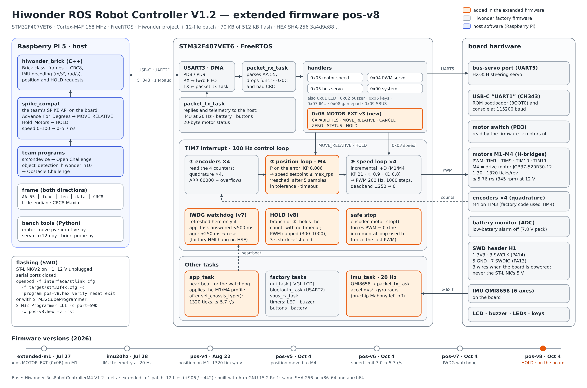

# Hiwonder ROS Robot Controller firmware `pos-v8`

The Hiwonder ROS Robot Controller V1.2 (STM32F407VET6) on design v7 runs **Hiwonder's FreeRTOS firmware with our patch on top**. The patch [`extended_m1.patch`](extended_m1.patch) changes 12 files of Hiwonder's official project `RosRobotControllerM4-armclang` (+906 / −442 lines). Hiwonder's project and factory images are included unmodified, with credit, in [`../hiwonder_original/`](../hiwonder_original). The image on the robot is **`pos-v8`**, built and flashed on 2026-10-04.

The Raspberry Pi 5 talks to the board over USB at 1 Mbaud with Hiwonder's frame format `AA 55 | function | length | data | CRC8`. On the Pi, `hiwonder_brick` speaks this protocol and `spike_compat` keeps the team's SPIKE API, so the mission code did not change ([`src/ondevice/hiwonder/`](../../src/ondevice/hiwonder)).



*Extended firmware `pos-v8`. The orange blocks are what we added to Hiwonder's firmware.*

## What we added

- **Position control on the drive motor (M4).** A P loop on the encoder error feeds the factory speed loop 100 times per second. `Spike_Advance_For_Degrees` and `Spike_Advance_For_distance` measure the distance on the board itself (1320 encoder ticks per output-shaft turn) instead of timing it from the Pi.
- **HOLD.** The motor keeps its position and comes back if pushed, like `motor.HOLD` on the SPIKE hub. The PWM is capped, and the motor lets go after 3 s stalled.
- **Watchdog (IWDG).** It resets the board in about 250 ms if the firmware hangs. Before it, a clock fault left the board frozen with the last PWM still applied. (It does not stop the motor when the Pi stops sending commands; that case is covered by the emergency stop on the Pi.)
- **Smaller fixes:** a stop forces the PWM to 0; the M4 encoder starts on its correct timer (TIM3); IMU telemetry at 20 Hz; motor speed limit 5.7 rev/s.

## `MOTOR_EXT` command (function `0x0B`)

| Sub-command | Request | Effect / reply |
|---|---|---|
| `0x00 CAPABILITIES` | — | protocol version 3, motor mask, ticks per turn |
| `0x01 MOVE_RELATIVE` | ticks, max rev/s, tolerance, timeout | relative move of M4: `moving` → `reached` or `timeout` |
| `0x02 CANCEL`, `0x03 ZERO`, `0x04 STATUS` | motor | stop, set the zero, read the 20-byte status |
| `0x05 HOLD` | max rev/s, tolerance, PWM cap | hold the current count: `holding`, or `stalled` after 3 s |

Byte-level description: [`PROTOCOL.md`](PROTOCOL.md). At start-up the Pi sends `CAPABILITIES`; with Hiwonder's stock firmware there is no answer and the programs stop before anything moves.

## Files

| File | What it is |
|---|---|
| [`RosRobotControllerM4-extended-m4-pos-v8.hex`](RosRobotControllerM4-extended-m4-pos-v8.hex) | Image to flash (the one on the robot) |
| [`RosRobotControllerM4-extended-m4-pos-v8.bin`](RosRobotControllerM4-extended-m4-pos-v8.bin) | Same image as raw binary (from `0x08000000`) |
| [`SHA256SUMS`](SHA256SUMS) | Checksums of both images |
| [`extended_m1.patch`](extended_m1.patch) | Our changes over Hiwonder's official `RosRobotControllerM4-armclang` (V1.2) |
| [`PROTOCOL.md`](PROTOCOL.md) | The `MOTOR_EXT` protocol, versions 1–3 |
| [`build/`](build) | GCC build: `build_gcc.py` (Linux), `build_gcc.ps1` (Windows), linker script `STM32F407VETX_FLASH.ld` |
| [`../hiwonder_original/`](../hiwonder_original) | Hiwonder's official source project (V1.2) and factory recovery images, unmodified (credit: Hiwonder) |

## Firmware versions

| Image | Date | Change | SHA-256 of the `.hex` |
|---|---|---|---|
| **`pos-v8`** (on the robot) | 2026-10-04 | `HOLD` (MOTOR_EXT v3) | `3a4d9e885ac408b11da56e7263b9e94c843f1b7bbbbf399f21cc93ab4a23f1e8` |
| `pos-v7` | 2026-10-04 | IWDG watchdog | `1ad94deb05f2f573d0f69d9522d5865dd068a88f9a78cc86f90ddbaeb5aa6553` |
| `pos-v6` | 2026-10-04 | speed limit 3.0 → 5.7 rev/s | `77d2aab02dd8bf9f997393cd11b6fbd759edaae416e16426fff9f513aa8e5889` |
| `pos-v5` | 2026-10-04 | position control moved to M4 (MOTOR_EXT v2) | `5eb0798013a704b4ef9c46cd7da30896dee56bb966fa5b5c025e31e2402d579b` |
| `pos-v4` | 2026-08-22 | position control on M1 (MOTOR_EXT v1), validated on the bench | `6963b050b47c2390e0d90b6acf1fdad641152b9954ee8320baa5ef35a335559e` |

Every image was built with Arm GNU Toolchain 15.2.Rel1 and gave the same SHA-256 on an x86-64 PC and on the Raspberry Pi (aarch64).

## Flash it

1. Check the image: `sha256sum RosRobotControllerM4-extended-m4-pos-v8.hex` (Windows: `Get-FileHash`) must match `SHA256SUMS`.
2. Connect an ST-LINK/V2 to header **H1**: pin 1 3V3, pin 3 SWCLK (PA14), pin 5 GND, pin 7 SWDIO (PA13).
3. **Unplug the 12 V battery** and close every program using the board's serial ports.
4. Flash and verify, with OpenOCD (validated on the Raspberry Pi):
   ```bash
   openocd -f interface/stlink.cfg -f target/stm32f4x.cfg -c "program RosRobotControllerM4-extended-m4-pos-v8.hex verify reset exit"
   ```
   or with STM32CubeProgrammer:
   ```bash
   STM32_Programmer_CLI -c port=SWD -w RosRobotControllerM4-extended-m4-pos-v8.hex -v -rst
   ```
5. Check it from the Pi: start either program. With the right image the board is reported ready; with any other image `Spike_Hiwonder_Init()` ([`src/ondevice/spike_hiwonder.cpp`](../../src/ondevice/spike_hiwonder.cpp)) stops with "the firmware has no position control on M4 (is pos-v8 loaded?)".

To go back to the factory firmware, flash one of Hiwonder's official images in [`../hiwonder_original/recovery/`](../hiwonder_original/recovery) the same way (`RosRobotControllerM4_factory_generic.hex`, or `RosRobotControllerM4_Ackermann_12V.hex` for an Ackermann chassis at 12 V). They are also on Hiwonder's [documentation and downloads](https://wiki.hiwonder.com/projects/ROS-Robot-Control-Board/en/latest/) page.

## Build it from source

1. Copy Hiwonder's official project from [`../hiwonder_original/`](../hiwonder_original) to a work folder, so the original stays untouched (it is also on Hiwonder's [documentation and downloads](https://wiki.hiwonder.com/projects/ROS-Robot-Control-Board/en/latest/) page). From `firmware/hiwonder_pos-v8/`:
   ```bash
   mkdir -p work && cp -r ../hiwonder_original/RosRobotControllerM4-armclang work/
   ```
2. Apply our patch from the work folder (the one that contains `RosRobotControllerM4-armclang/`):
   ```bash
   cd work
   patch -p1 --dry-run < ../extended_m1.patch && patch -p1 < ../extended_m1.patch
   ```
3. Build with the Arm GNU Toolchain 15.2.Rel1 (`arm-none-eabi-gcc` on the `PATH`):
   ```bash
   python3 ../build/build_gcc.py RosRobotControllerM4-armclang ../build/STM32F407VETX_FLASH.ld out
   ```
   It writes the `.elf`, `.map`, `.hex` and `.bin` and prints their SHA-256. On Windows use `build/build_gcc.ps1`. The project can also be built with Keil MDK from `MDK-ARM/`, as Hiwonder ships it.
