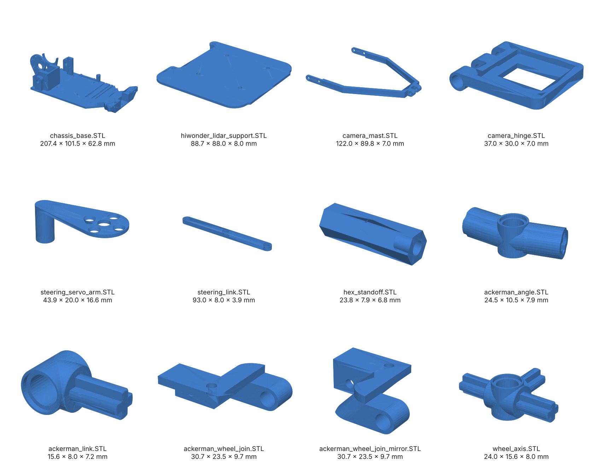

# 3D-printed parts (STL)

## Design v7 (International Final): [`v7/`](v7)

The 12 different printed parts of design v7 (16 pieces in total), exported from the SolidWorks assembly in [`../v7_assembly/`](../v7_assembly). Six are new or redesigned for v7; the camera hinge and five steering parts are unchanged from design v6.

| File | Qty | SolidWorks part | What it is | Size (mm) | Solid volume (each) | Compared with design v6 |
|---|---|---|---|---|---|---|
| [`chassis_base.STL`](v7/chassis_base.STL) | 1 | `Base` | Chassis base: carries every other part | 207.4 × 101.5 × 62.8 | 124.94 cm³ | New in v7 |
| [`hiwonder_lidar_support.STL`](v7/hiwonder_lidar_support.STL) | 1 | `Soporte de hiwonder-lidar` | Plate that holds the Hiwonder board and the RPLidar S2L | 88.7 × 88.0 × 8.0 | 14.60 cm³ | New in v7 |
| [`camera_mast.STL`](v7/camera_mast.STL) | 1 | `camera` | Camera mast (two arms) | 122.0 × 89.8 × 7.0 | 6.96 cm³ | New in v7 |
| [`camera_hinge.STL`](v7/camera_hinge.STL) | 1 | `camara visagra` | Camera frame with tilt hinge | 37.0 × 30.0 × 7.0 | 2.41 cm³ | Same as v6 (`camara_tilt.STL`) |
| [`steering_servo_arm.STL`](v7/steering_servo_arm.STL) | 1 | `otro eslabon` | Arm on the HX-35H servo horn | 43.9 × 20.0 × 16.6 | 1.37 cm³ | New in v7 |
| [`steering_link.STL`](v7/steering_link.STL) | 1 | `slabon` | Steering link, 93 mm | 93.0 × 8.0 × 3.9 | 2.59 cm³ | New in v7 |
| [`hex_standoff.STL`](v7/hex_standoff.STL) | 2 | `soporte 2` | Hexagonal standoff, 23.8 mm | 23.8 × 7.9 × 6.8 | 0.71 cm³ | New in v7 |
| [`ackerman_angle.STL`](v7/ackerman_angle.STL) | 2 | `ackerman_angle` | Ackermann steering joint | 24.5 × 10.5 × 7.9 | 0.59 cm³ | Same as v6 |
| [`ackerman_link.STL`](v7/ackerman_link.STL) | 2 | `ackerman_link` | Ackermann steering joint (ring and axle) | 15.6 × 8.0 × 7.2 | 0.28 cm³ | Same as v6 |
| [`ackerman_wheel_join.STL`](v7/ackerman_wheel_join.STL) | 1 | `ackerman_wheel_join` | Front wheel knuckle | 30.7 × 23.5 × 9.7 | 2.09 cm³ | Same as v6 |
| [`ackerman_wheel_join_mirror.STL`](v7/ackerman_wheel_join_mirror.STL) | 1 | `ackerman_wheel_join_mirror` | Front wheel knuckle, mirrored | 30.7 × 23.5 × 9.7 | 2.09 cm³ | Same as v6 |
| [`wheel_axis.STL`](v7/wheel_axis.STL) | 2 | `wheel_axis` | Wheel axle hub | 24.0 × 15.6 × 8.0 | 0.54 cm³ | Same as v6 |

Total solid volume of the 16 pieces: 161.3 cm³. Units are millimetres. The sizes are the bounding box of each file, longest side first.

The largest part, `chassis_base.STL` (207.4 × 101.5 mm footprint), fits the 220 × 220 mm bed of the Creality K1C.

### Printer and material

| | |
|---|---|
| Printer | Creality K1C (220 × 220 × 250 mm build volume) |
| Nozzle | 0.4 mm |
| Filament | Creality Hyper ABS (the slicer's stock preset, unchanged) |
| Slicer | Creality Print, default profile for this printer (`0.20mm Standard @Creality K1C 0.4 nozzle`) |
| Infill, walls, supports | Left to whoever prints the parts; we used the defaults |
| Profiles | [`../print_profiles/`](../print_profiles): `Creality_K1C_0.4_nozzle.printer.json` (printer preset) and `Hyper_ABS_K1C_0.4_nozzle.filament.json` (filament preset) |

To use the profiles, import both `.json` files in Creality Print.

## Design v6 (National Final): files directly in this folder

The 11 `.STL` files directly in this folder are the printed parts of design v6. `Base.STL`, `camera_support.STL`, `lidar_electronic_base.STL`, `lidar_support.STL` and `rack.STL` belong only to v6; the five `ackerman_*` / `wheel_axis` files and `camara_tilt.STL` are the same parts that v7 reuses.
