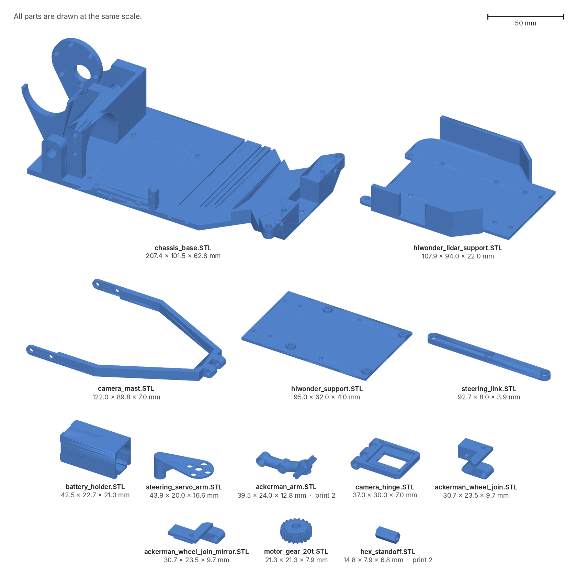

# 3D-printed parts (STL)

## Design v7 (International Final): [`v7/`](v7)

The 13 different printed parts of design v7 (15 pieces in total), exported from the SolidWorks assembly in [`../v7_assembly/`](../v7_assembly). Ten are new or redesigned for v7, among them the two plates, the battery holder, the motor gear and the one-piece steering arm; the camera hinge and the two wheel knuckles are unchanged from design v6.

On 2026-11-21 the files were exported again from the updated assembly (battery and controller board lowered): `chassis_base`, `hiwonder_lidar_support`, `steering_servo_arm`, `steering_link` and `hex_standoff` changed, and the three small joint pieces of each side became one part, `ackerman_arm`.

| File | Qty | SolidWorks part | What it is | Size (mm) | Solid volume (each) | Compared with design v6 |
|---|---|---|---|---|---|---|
| [`chassis_base.STL`](v7/chassis_base.STL) | 1 | `Base` | Chassis base: carries every other part | 207.4 × 101.5 × 62.8 | 128.11 cm³ | New in v7 |
| [`hiwonder_lidar_support.STL`](v7/hiwonder_lidar_support.STL) | 1 | `Soporte de hiwonder-lidar` | LiDAR plate: carries the RPLidar S2L and is screwed to the Hiwonder board plate | 107.9 × 94.0 × 22.0 | 24.77 cm³ | New in v7 |
| [`hiwonder_support.STL`](v7/hiwonder_support.STL) | 1 | `Soporte hiwonder` | Hiwonder board plate: carries the controller board on heat-set inserts | 95.0 × 62.0 × 4.0 | 11.79 cm³ | New in v7 |
| [`battery_holder.STL`](v7/battery_holder.STL) | 1 | `Soporte para pilas` | Holder that keeps the third cell at the same height as the other two | 42.5 × 22.7 × 21.0 | 7.01 cm³ | New in v7 (battery layout change) |
| [`motor_gear_20t.STL`](v7/motor_gear_20t.STL) | 1 | `Gear 20` | 20-tooth gear on the drive motor shaft (20:28 with the differential) | 21.3 × 21.3 × 7.9 | 1.86 cm³ | New in v7 |
| [`camera_mast.STL`](v7/camera_mast.STL) | 1 | `camera` | Camera mast (two arms) | 122.0 × 89.8 × 7.0 | 6.96 cm³ | New in v7 |
| [`camera_hinge.STL`](v7/camera_hinge.STL) | 1 | `camara visagra` | Camera frame with tilt hinge | 37.0 × 30.0 × 7.0 | 2.41 cm³ | Same as v6 (`camara_tilt.STL`) |
| [`steering_servo_arm.STL`](v7/steering_servo_arm.STL) | 1 | `otro eslabon` | Arm on the HX-12H servo horn | 43.9 × 20.0 × 16.6 | 1.55 cm³ | New in v7 |
| [`steering_link.STL`](v7/steering_link.STL) | 1 | `slabon` | Steering link, 93 mm | 92.7 × 8.0 × 3.9 | 2.58 cm³ | New in v7 |
| [`hex_standoff.STL`](v7/hex_standoff.STL) | 2 | `soporte 2` | Hexagonal standoff, 14.8 mm | 14.8 × 7.9 × 6.8 | 0.36 cm³ | New in v7 |
| [`ackerman_arm.STL`](v7/ackerman_arm.STL) | 2 | `Ackerman_Arm` | Ackermann steering arm, one piece: joins the steering link to the wheel knuckle | 39.5 × 24.0 × 12.8 | 1.87 cm³ | New in v7: replaces three pieces of v6 (`ackerman_angle`, `ackerman_link`, `wheel_axis`) |
| [`ackerman_wheel_join.STL`](v7/ackerman_wheel_join.STL) | 1 | `Ackerman 2` | Front wheel knuckle | 30.7 × 23.5 × 9.7 | 2.09 cm³ | Same as v6 |
| [`ackerman_wheel_join_mirror.STL`](v7/ackerman_wheel_join_mirror.STL) | 1 | `ackerman 2 mirror` | Front wheel knuckle, mirrored | 30.7 × 23.5 × 9.7 | 2.09 cm³ | Same as v6 |

Total solid volume of the 15 pieces: 195.7 cm³. Units are millimetres. The sizes are the bounding box of each file, longest side first. In the picture above all parts are drawn at the same scale.

The largest part, `chassis_base.STL` (207.4 × 101.5 mm footprint), fits the 220 × 220 mm bed of the Creality K1C.

### Printer and material

| | |
|---|---|
| Printer | Creality K1C (220 × 220 × 250 mm build volume) |
| Nozzle | 0.4 mm |
| Filament | Creality Hyper ABS (the slicer's stock preset, unchanged) |
| Slicer | Creality Print, default profile for this printer (`0.20mm Standard @Creality K1C 0.4 nozzle`) |
| Infill, walls, supports | Left to whoever prints the parts; we used the defaults |
| Profiles | [`../print_profiles/`](../print_profiles): `Creality_K1C_0.4_nozzle.printer.json` (printer preset) and `Hyper_ABS_K1C_0.4_nozzle.filament.json` (filament preset) |

To use the profiles, import both `.json` files in Creality Print.

The battery pack also uses four generic interlocking 18650 spacer brackets ([example](https://www.amazon.co.uk/100Pcs-Li-ion-Battery-Cylindrical-Bracket/dp/B07WW4JQZX)); they are bought, not printed.

## Design v6 (National Final): files directly in this folder

The 11 `.STL` files directly in this folder are the printed parts of design v6. `Base.STL`, `camera_support.STL`, `lidar_electronic_base.STL`, `lidar_support.STL` and `rack.STL` belong only to v6. `ackerman_wheel_join.STL`, its mirror and `camara_tilt.STL` are the same parts that v7 reuses. `ackerman_angle.STL`, `ackerman_link.STL` and `wheel_axis.STL` are the three joint pieces that v7 prints as one part (`v7/ackerman_arm.STL`).
