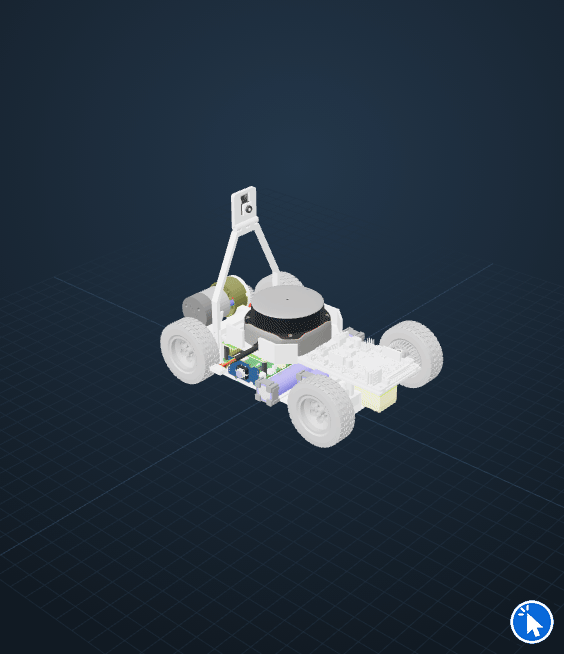

# Vehicle v7 — interactive 3D exploded view

**Open it:** <https://alex309-duarte.github.io/WRO_Future_Engineers_Queretaro_CSS/models/cad/viewer/>

The page loads the full SolidWorks assembly of the vehicle (27 components, 177 parts, original colours) in the browser. Nothing to install.

## Controls

| Action | Mouse / key |
|---|---|
| Rotate | Left drag |
| Pan | Right drag |
| Zoom | Mouse wheel (pinch on a phone) |
| Disassemble / assemble | **Disassemble** button, the **Explode** slider, or key `E` |
| Standard views | **Iso, Front, Back, Left, Right, Top, Bottom** buttons, or keys `1`–`7` |
| Zoom to fit | **Fit** button or key `F` |
| Name of a part | Move the mouse over it |
| Select a part | Click it in the model or in the **Parts** list (size and CAD name shown below the list) |
| Zoom to one part | Double-click it |
| Show only that part | **Isolate**; **Show all** brings everything back (`Esc` too) |
| Hide one part | Dot on the right of its row in the list |
| Sub-assembly parts | Arrow on the left of a row (wheels, differential, Raspberry Pi stack, battery pack…) |
| Wireframe / turntable | **Wire** / **Spin** |

The explosion goes in two stages: first the main components move apart, then the parts inside each sub-assembly separate.

**Links with options** (useful for slides or other pages):
`?explode=100` opens fully exploded, `?view=top` opens in a given view, `?spin=1` turns slowly, `?autoplay=1` disassembles on load, `?clean=1` hides the toolbar and the list. They can be combined, for example `index.html?explode=60&view=iso&spin=1`.

## Files

| File | What it is |
|---|---|
| `index.html` | The viewer (one page, uses three.js from a CDN) |
| `vehicle_v7.glb` | The assembly as glTF, 1.7 MB (compressed) |
| `../vehicle_v7.stl` | The whole vehicle in one STL; GitHub shows it in its own 3D viewer (rotate and zoom, no colours, no explosion) |
| `tools/export_step_ap214.vbs` | Exports `Assem1.SLDASM` from SolidWorks as STEP AP214 with colours |
| `tools/step2glb.py` | Converts that STEP into `vehicle_v7.glb`, keeping the component tree and colours |

## Updating it after a CAD change

1. `cscript //nologo tools/export_step_ap214.vbs "<path>\Assem1.SLDASM" "<path>\Assem1_AP214.step"`
2. `pip install cadquery-ocp trimesh numpy`, then `python tools/step2glb.py Assem1_AP214.step vehicle_v7.glb`
3. Optional, smaller file: `npx gltfpack -i vehicle_v7.glb -o vehicle_v7.glb -kn -km -cc -vpf`
4. Commit the new `vehicle_v7.glb`. The page picks it up on the next load.

Colours are the SolidWorks appearance colours. Parts without an appearance show in the default light grey.

## How it is published

The page is served by GitHub Pages. The workflow [`.github/workflows/viewer-pages.yml`](../../../.github/workflows/viewer-pages.yml) publishes **only this folder** (`index.html` and the `.glb` model) every time one of its files changes on `main`; the rest of the repository is not published, because it is larger than the 1 GB a Pages site may have. It needs one setting in the repository, made once: **Settings → Pages → Source: GitHub Actions**. The workflow can also be started by hand: **Actions → Publish the 3D viewer → Run workflow**.

## Viewing it locally

Browsers do not load the model from `file://`. From this folder run `python -m http.server 8000` and open <http://localhost:8000>.
