# Design v6: the Mexico National Final robot

[Back to the main README](../../README.md)

Design v6 is the vehicle that placed **2nd at the 2026 Mexico National Final** (Tijuana, September 2026). This page keeps its documentation for comparison with **design v7**, the vehicle of the International Final, which the [main README](../../README.md) describes. What changed between the two designs, and why, is in [What changed from design v6 to design v7](../../README.md#what-changed). The complete repository of design v6 is release [`v1.0.0`](https://github.com/alex309-duarte/WRO_Future_Engineers_Queretaro_CSS/releases/tag/v1.0.0).

## Contents

1. [Photos and description](#photos)
2. [Chassis](#chassis)
3. [Drivetrain analysis: LEGO SPIKE Large Angular Motor](#drivetrain)
4. [Power analysis: 4× NCR18650B + Geekworm X1203](#power)
5. [Processing and wiring diagrams](#wiring)
6. [Vision model: YOLOv8n 320 for the Hailo-10H](#model)
7. [Build instructions: SPIKE Hub + Oradar MS200k + Hailo-10H](#build)
8. [Bill of Materials](#bom)
9. [Datasheets](#datasheets)

---

## 1. Photos and description <a id="photos"></a>

Kept for comparison. The full design v6 state is preserved in release [`v1.0.0`](https://github.com/alex309-duarte/WRO_Future_Engineers_Queretaro_CSS/releases/tag/v1.0.0).

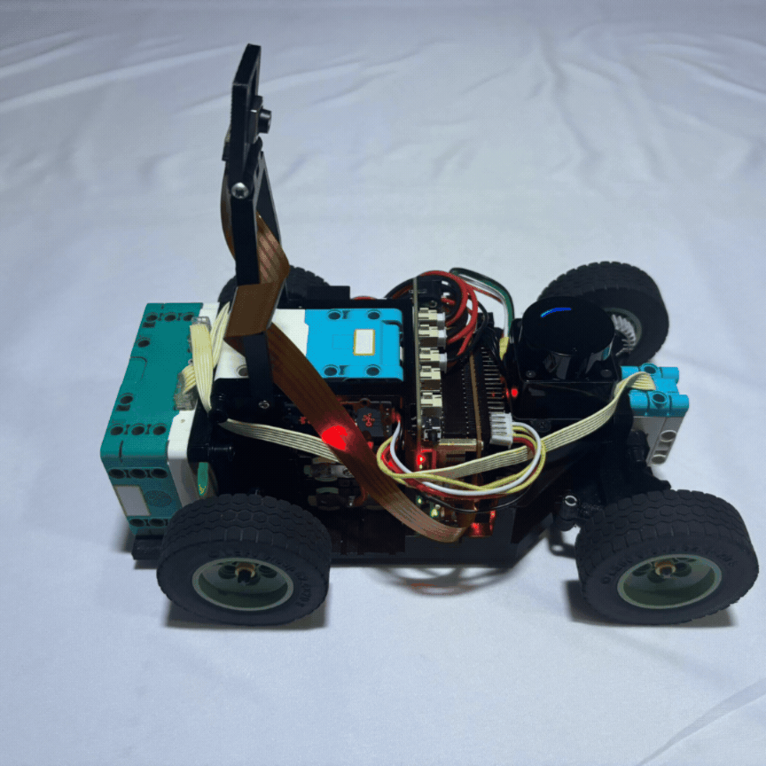

<table style="width:100%">
<tr>
<td align="center">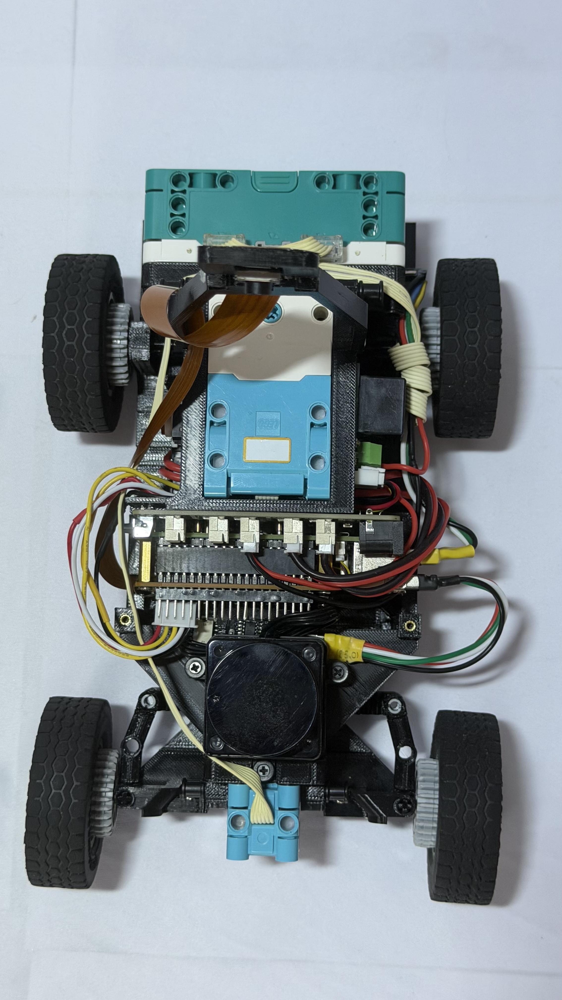<br>Top</td>
<td align="center">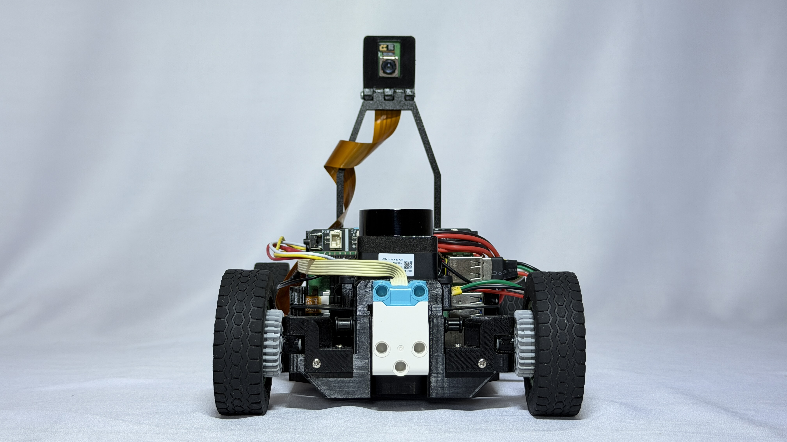<br>Front</td>
<td align="center">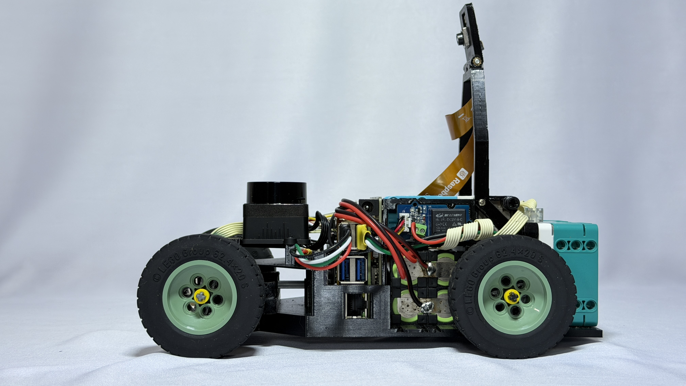<br>Left</td>
</tr>
<tr>
<td align="center">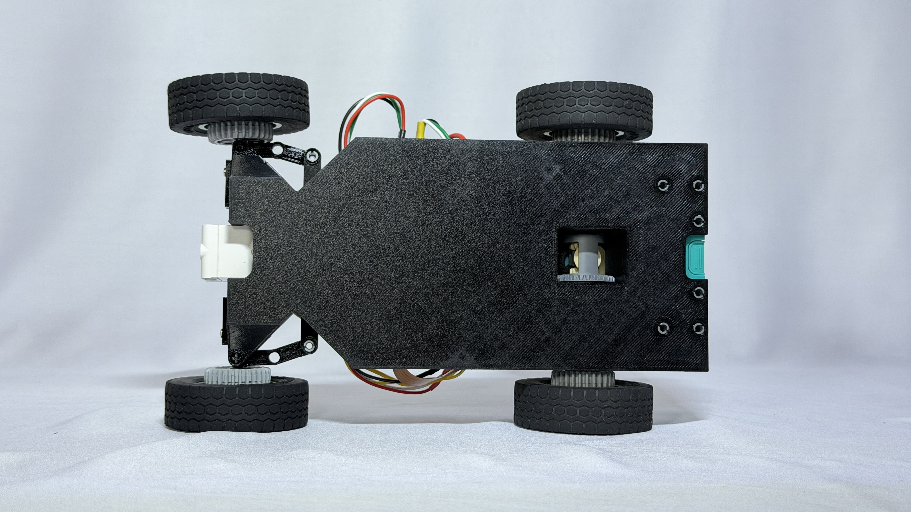<br>Bottom</td>
<td align="center">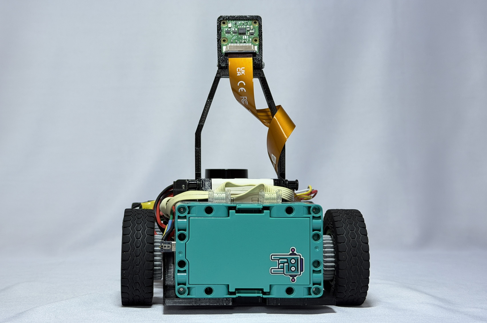<br>Back</td>
<td align="center">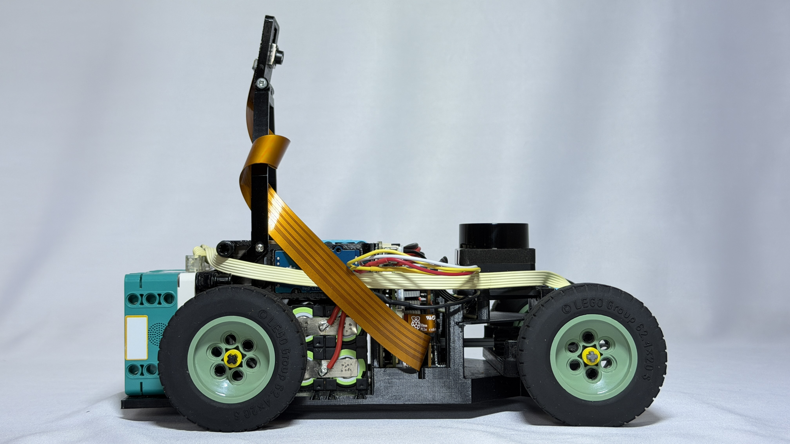<br>Right</td>
</tr>
</table>

***"The Maker"*** is a rear-wheel-drive autonomous vehicle built around a fully custom, in-house 3D-printed chassis (designed in SolidWorks, printed on a Creality K1C) that repositions the battery pack and most components lower in the frame to lower the center of gravity and reduce weight transfer through corners. This year's chassis also trades the sharper-turning custom double-Ackermann steering geometry used in last year's prototype for a simpler regular-Ackermann, a deliberate trade-off made after trial and error showed the reliability gain outweighed the small loss in turning radius. A single LEGO SPIKE Large Angular Motor drives the rear axle while a LEGO SPIKE Small Angular Motor actuates the Ackermann steering, both commanded by a LEGO SPIKE Prime Hub, whose built-in IMU also supplies the robot's heading. Perception comes from a Orbbec Oradar MS200k LiDAR fused with a Raspberry Pi Camera Module 3 Wide accelerated by a Raspberry Pi AI HAT+ 2 (Hailo-10H, 40 TOPS). The LiDAR handles wall-following and obstacle range, the camera tracks the obstacles using a custom-trained YOLOv8n model (trained on our own labeled dataset and compiled to the Hailo-10H's `.hef` format) and classifies pillar colour, and this year's design drops the ultrasonic sensors, now using only the LiDAR and camera. All control and vision code runs in C/C++ on a Raspberry Pi 5, migrated from last year's Python codebase specifically to cut processing latency, and the whole robot is considerably lighter and more power-efficient than its predecessor: a smaller steering motor, a lighter AI/camera replacing an OAK-D Lite, and a 4-cell battery pack (down from 6 cells) sized to match the lower power draw.

---

## 2. Chassis <a id="chassis"></a>

The chassis is a fully custom, in-house design, modeled in SolidWorks and 3D-printed on a Creality K1C. This is a continuation of the team's own-design approach from previous years, refined for this iteration to package the electronics more densely and lower the center of gravity, positioning the battery pack and most of the main components lower in the frame.

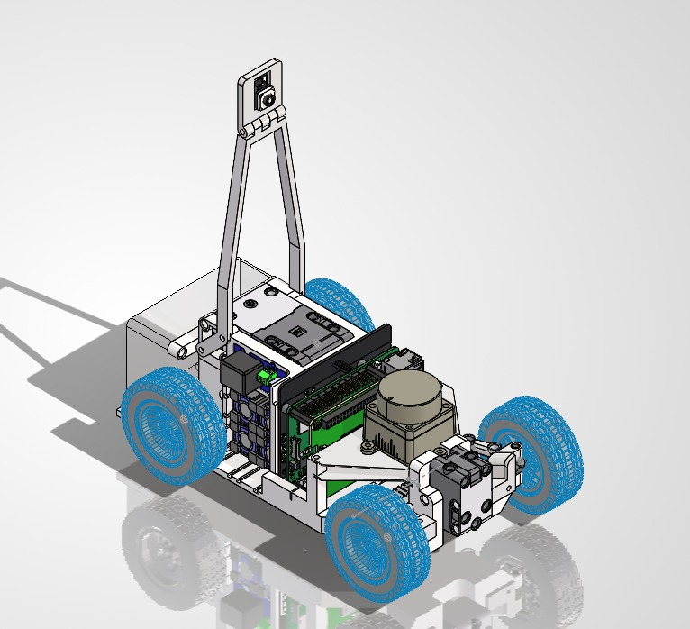

*Isometric view of the design v6 chassis CAD model.*

Repositioning the battery pack and heavier components (Raspberry Pi 5, UPS shield, LiDAR) lower in the frame was a deliberate choice to lower the chassis's center of gravity, reducing lateral weight transfer during high-speed cornering and improving mechanical traction without altering the Ackermann geometry itself. Component placement was also driven by the switch to a smaller, lighter camera/AI stack (Hailo-10H + Camera Module 3 Wide, replacing the OAK-D Lite) and a smaller battery pack, both of which reduced overall mass and allowed tighter, more balanced packaging than in previous prototypes.

---

## 3. Drivetrain analysis: LEGO SPIKE Large Angular Motor <a id="drivetrain"></a>

The vehicle uses a single LEGO SPIKE Large Angular Motor (Part 45602) driving the rear axle through a $20{:}28$ gear reduction ($R = 1.4$), turning LEGO $62.4 \times 20\text{S}$ rubber tires (Part 32019) ($r = 0.0312\text{ m}$). The motor and gear ratio were not assumed, they were sized against a full dynamic torque analysis targeting $a = 0.73\text{ m/s}^2$ over $t = 0.5\text{ s}$ to reach cruising speed.
<table>
  <tr>
    <td align="center">
      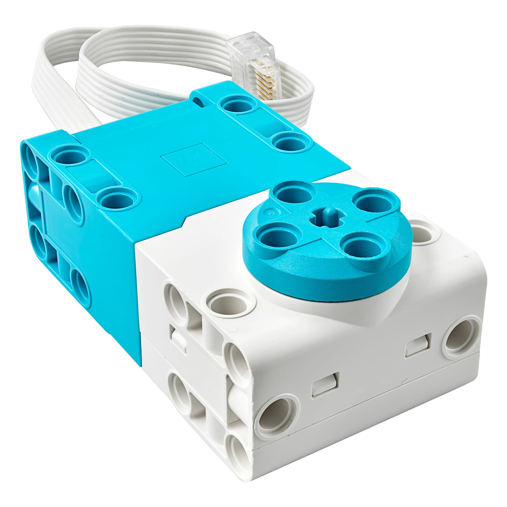<br>
      <em>LEGO SPIKE Large Angular Motor (45602)</em>
    </td>
    <td align="center">
      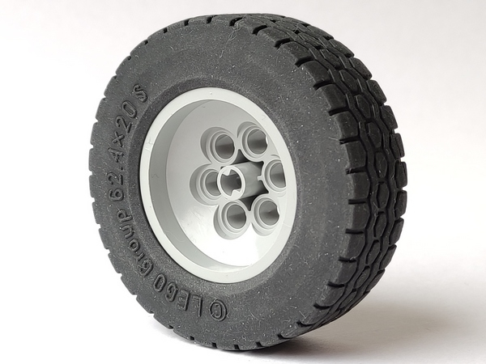<br>
      <em>LEGO Tire 62.4 x 20 S (32019)</em>
    </td>
  </tr>
</table>

**Result:**
 at this operating point, the motor runs at only **33.8%** of its continuous max-efficiency torque capacity, reaching a loaded top speed of **0.365 m/s**, leaving a **66.2%** torque reserve for inclines or unexpected track perturbations.

> ### Full torque & speed calculations
>
> #### 1. Design Inputs & Parameters
>
> | Parameter | Symbol | Value | Unit |
> | :--- | :---: | :---: | :---: |
> | Robot Mass | $m$ | $1.006$ | $\text{kg}$ |
> | Wheel Diameter | $d$ | $0.0624$ | $\text{m}$ |
> | Wheel Radius | $r$ | $0.0312$ | $\text{m}$ |
> | Target Linear Acceleration ($t = 0.5\text{ s}$) | $a$ | $0.73$ | $\text{m/s}^2$ |
> | Rolling Resistance Coeff. (Rubber LEGO $62.4 \times 20\text{ S}$) | $C_{rr}$ | $0.03$ | -- |
> | Acceleration of Gravity | $g$ | $9.81$ | $\text{m/s}^2$ |
> | Number of Drive Motors | $N$ | $1$ | -- |
> | Gearbox Reduction Ratio ($20:28$) | $R$ | $1.4$ | -- |
> | Gearbox Efficiency | $\eta$ | $0.85$ | -- |
>
> **2. Step-by-Step Derivation**
>
> **Step 1: Linear Acceleration Force ($F_{acc}$)**
>
> $$
> F_{acc} = m \cdot a = 1.006\text{ kg} \cdot 0.73\text{ m/s}^2 = 0.7344\text{ N}
> $$
>
> **Step 2: Rolling Resistance Force ($F_{rr}$)**
>
> $$
> F_{rr} = C_{rr} \cdot m \cdot g = 0.03 \cdot 1.006\text{ kg} \cdot 9.81\text{ m/s}^2 = 0.2961\text{ N}
> $$
>
> **Step 3: Total Linear Force ($F_{total}$)**
>
> $$
> F_{total} = F_{acc} + F_{rr} = 0.7344\text{ N} + 0.2961\text{ N} = 1.0305\text{ N}
> $$
>
> **Step 4: Total Wheel Torque ($T_w$)**
>
> $$
> T_w = F_{total} \cdot r = 1.0305\text{ N} \cdot 0.0312\text{ m} = 0.03215\text{ N}\cdot\text{m}
> $$
>
> **Step 5: Nominal Motor Torque ($T_m$)**
>
> $$
> T_m = \frac{T_w}{\eta \cdot R} = \frac{0.03215\text{ N}\cdot\text{m}}{0.85 \cdot 1.4} = 0.02702\text{ N}\cdot\text{m} \quad (\approx 2.70\text{ Ncm})
> $$
>
> **Step 6: Motor Torque with Safety Factor ($T_{m,req}$)**
>
> A 25% safety margin ($1.25\times$) is applied to establish the minimum required torque of the traction motor, accounting for dynamic losses not captured above:
>
> $$
> T_{m,req} = T_m \cdot 1.25 = 0.02702\text{ N}\cdot\text{m} \cdot 1.25 = \mathbf{0.03377\text{ N}\cdot\text{m}} \quad (\approx 3.38\text{ Ncm})
> $$
>
> **3. LEGO SPIKE Large Angular Motor (45602) Analysis & Speed Derivation**
>
> **3.1 Motor Technical Specifications (9V)**
>
> | Operating Condition | Torque ($\text{N}\cdot\text{m}$) | Torque ($\text{Ncm}$) | Speed ($\text{RPM}$) | Current ($\text{mA}$) |
> | :--- | :---: | :---: | :---: | :---: |
> | No Load | 0.0000 | 0.00 | 175 ± 15% | 135 ± 15% |
> | Max Efficiency | 0.0800 | 8.00 | 135 ± 15% | 430 ± 15% |
> | Stall Limit | 0.2500 | 25.00 | 0 | 1900 ± 15% |
>
> **3.2 Motor Operating Point & Load Analysis**
>
> **Continuous Duty Load (%)** (vs. Max Efficiency Point):
>
> $$
> \text{Load}_{\text{eff}} = \frac{T_m}{T_{\text{max-eff}}} \cdot 100 = \frac{2.70\text{ Ncm}}{8.00\text{ Ncm}} \cdot 100 = \mathbf{33.8}\verb|%|
> $$
>
> **Stall Limit Margin (%)** (vs. Stall Torque):
>
> $$
> \text{Load}_{\text{stall}} = \frac{T_m}{T_{\text{stall}}} \cdot 100 = \frac{2.70\text{ Ncm}}{25.00\text{ Ncm}} \cdot 100 = \mathbf{10.8}\verb|%|
> $$
>
> **3.3 Top Speed Derivation**
>
> **Step 1: Loaded Motor RPM**
>
> $$
> \text{RPM}_{\text{motor}} = \text{RPM}_{\text{no-load}} \cdot \left(1 - \frac{T_m}{T_{\text{stall}}}\right) = 175 \cdot \left(1 - \frac{2.702\text{ Ncm}}{25.00\text{ Ncm}}\right) = 156.1\text{ RPM}
> $$
>
> **Step 2: Loaded Wheel RPM**
>
> $$
> \text{RPM}_{\text{wheel}} = \frac{\text{RPM}_{\text{motor}}}{R} = \frac{156.1\text{ RPM}}{1.4} = 111.5\text{ RPM}
> $$
>
> **Step 3: Top Loaded Linear Speed**
> $$v_{loaded} = \frac{\text{RPM}_{wheel} \cdot \pi \cdot d}{60} = \frac{111.5 \cdot \pi \cdot 0.0624}{60} = \mathbf{0.365\text{ m/s}}$$
>
> **3.4 Technical Conclusion**
>
> With $a = 0.73\text{ m/s}^2$, the robot reaches its operational cruising speed of $0.365\text{ m/s}$ in exactly $0.5\text{ s}$. Operating at only 33.8% of the motor's continuous max-efficiency capacity ensures minimal thermal build-up and low current draw, leaving a 66.2% torque reserve to absorb unexpected track perturbations.

---

## 4. Power analysis: 4× NCR18650B + Geekworm X1203 <a id="power"></a>

The robot is powered by 4x Panasonic NCR18650B 3400mAh Li-ion cells, wired in a **4P** configuration (four cells in parallel) at **3.7 V** nominal, through the Geekworm X1203 UPS shield, which also boost-converts the output to the 5.1 V required by the Raspberry Pi 5 and peripherals.

**Total stored energy**

$$C_{\text{total}} = 4 \cdot 3400\text{ mAh} = 13.6\text{ Ah}$$

$$E_{\text{total}} = 13.6\text{ Ah} \cdot 3.7\text{ V} = 50.32\text{ Wh}$$

**Theoretical battery life (worst case)**

Under peak load, SLAM navigation and continuous computer vision inference, the components' estimated continuous power draw is:

| Component | Operating State | Estimated Power |
| :--- | :--- | :--- |
| Raspberry Pi 5 | High CPU / OS load | 9.0 W |
| Hailo-10H AI HAT | Active neural network inference | 4.0 W |
| Orbbec Oradar MS200k LiDAR | Continuous scanning with spinning motor | 1.5 W |
| Grove Modules | Relay (short pulses) + LED Button | 0.1 W |
| **Total Load** | **Peak consumption at 5.1 V** | **14.6 W** |

Accounting for the X1203 boost converter's ~90% efficiency ($\eta = 0.90$):

$$P_{\text{input}} = \frac{14.6\text{ W}}{0.90} \approx 16.22\text{ W}$$

$$I_{\text{battery}} = \frac{16.22\text{ W}}{3.7\text{ V}} \approx 4.38\text{ A}$$

> **Hardware Design Note:** Distributed across 4 parallel cells, this is an average of 1.10 A per cell, well within the NCR18650B's 4.8 A continuous discharge limit, avoiding thermal stress and premature degradation.

$$t_{\text{runtime}} = \frac{50.32\text{ Wh}}{16.22\text{ W}} \approx 3.10\text{ hours}$$

**Real-world battery life (measured)**

Physical testing recorded a steady current draw of 0.667 A per connector (each connector groups two cells in parallel), totaling 1.334 A at 5 V across the full integrated system.

$$P_{\text{output}} = 1.334\text{ A} \cdot 5\text{ V} = 6.67\text{ W}$$

$$P_{\text{input}} = \frac{6.67\text{ W}}{0.90} \approx 7.41\text{ W}$$

$$t_{\text{runtime}} = \frac{50.32\text{ Wh}}{7.41\text{ W}} \approx 6.8\text{ hours}$$

> **Conclusion:** Under real-world operating conditions, the robot runs continuously for approximately 6.8 hours before fully depleting the battery bank, well above the theoretical worst-case estimate, since sustained peak CPU/inference load is rarely held continuously in practice.

**Design limitation: charging & hot-swapping**

A drawback of this configuration is that the batteries charge internally, in place, via the X1203 board. The current assembly makes keeping a pre-charged spare set for a quick hot-swap impractical, since swapping cells requires partially disassembling the chassis, a depleted robot must instead be plugged in to recharge, which is a limitation for quick turnaround between test/competition runs.

---

## 5. Processing and wiring diagrams <a id="wiring"></a>

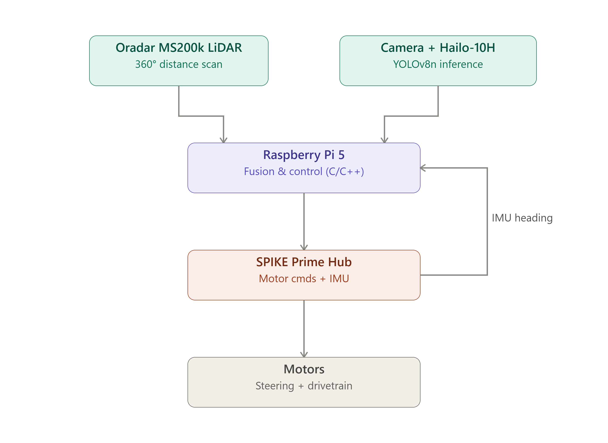

*Figure 8. Design v6: data flow between the robot's sensors, processing units, and actuators.*

#### Wiring (design v6)

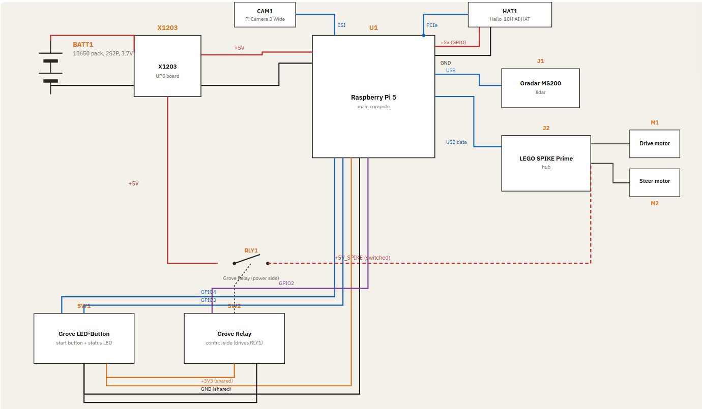

*Figure 9. Design v6 system wiring diagram showing power distribution (Geekworm X1203 UPS board from the 4P 18650 battery pack, four NCR18650B cells in parallel) and data connections between the Raspberry Pi 5, Camera Module 3 Wide (CSI), Hailo-10H AI HAT (PCIe), Oradar MS200 LiDAR (USB), LEGO SPIKE Prime hub (USB, driving the drive and steer motors), the GPIO-controlled start button/status LED (Grove LED-Button), and the Grove Relay that switches 5V power to the SPIKE hub.*

---

## 6. Vision model: YOLOv8n 320 for the Hailo-10H <a id="model"></a>

1. **Get the labeled dataset**:
```bash
   git clone https://github.com/alex309-duarte/WRO_Future_Engineers_Queretaro_CSS.git
```
> Dataset in [`other/dataset`](../../other/dataset)\
> Training model and results in [`other/Training_model_and_results`](../../other/Training_model_and_results)

2. **Train the YOLOv8n model** via Google Colab, using [Luxonis's training notebook](https://colab.research.google.com/github/luxonis/depthai-ml-training/blob/master/colab-notebooks/YoloV8_training.ipynb). This project's model was trained with `model=yolov8n.pt`, `epochs=100`, `batch=16`, `imgsz=320`.
3. **Export to `.hef`**, on a laptop/desktop (not the Pi), the recommended one-command path via Ultralytics:
```bash
   pip install ultralytics
   pip install /path/to/hailo_dataflow_compiler-<version>-<pyver>-linux_x86_64.whl
```
```python
   from ultralytics import YOLO
   model = YOLO("best.pt")
   model.export(format="hailo", name="hailo10h", imgsz=320, data="data.yaml")
```
   Requires Hailo Dataflow Compiler **v5.x** (Hailo Developer Zone) for the Hailo-10H.
4. **Deploy:** copy the resulting `.hef` onto the Pi, into `src/HailoModels/`.

---

## 7. Build instructions: SPIKE Hub + Oradar MS200k + Hailo-10H <a id="build"></a>

This repository builds **two separate programs**: `object_detection` (Obstacle Challenge, camera + Hailo-10H + LiDAR) and a second binary under `src/ondevice/` (Open Challenge, LiDAR + SPIKE hub only, no camera/Hailo). Steps 1–3 are shared setup; 4 and 5 cover each program's build/run.

>*More detailed instructions in:*[`src/README.md`](../../src/README.md)

#### v6 step 1: Prerequisites (OS & hardware stack)

1. **Flash the OS.** Raspberry Pi OS 64-bit (Bookworm or newer) on the Pi 5, via Raspberry Pi Imager. Enable SSH/serial as needed.
2. **Install the Hailo-10H stack** (required for the Obstacle Challenge only). Follow Hailo's Raspberry Pi setup for the AI HAT/M.2 Hailo-10H accelerator: install the `hailo-all` (or Hailo-10H specific) apt packages / PCIe driver + firmware + `HailoRT` runtime + `hailortcli`, then reboot and confirm the device is detected:
```bash
   hailortcli fw-control identify
```
   The installed HailoRT version must match (or be compatible with) the Hailo Dataflow Compiler version used to produce the `.hef` files, for the Hailo-10H specifically, both must be **v5.x** (Hailo-8/8L use a different, incompatible v3.x/v4.x pairing). Mismatched versions are a common cause of a `.hef` that "compiles fine" but fails to load on the Pi.
3. **Install build dependencies:**
```bash
   sudo apt update
   sudo apt install -y build-essential cmake git libopencv-dev libgpiod-dev pkg-config
```

#### v6 step 2: Clone the repository

```bash
git clone --recurse-submodules https://github.com/alex309-duarte/WRO_Future_Engineers_Queretaro_CSS.git
# or, if already cloned:
git submodule update --init --recursive
```
`yaml-cpp` and `curl` under `src/cpp/external/` are included in the repository; the only submodule is the Slamtec SDK used by design v7.

#### v6 step 3: Wire up the hardware

- **SPIKE Prime hub:** USB cable, appears as `/dev/ttyACM0` at 115200 baud. 
- **Orbbec Oradar MS200k LiDAR:** USB-serial, `/dev/ttyUSB0` at 230400 baud.
- **GPIO** (BCM numbering): start button on GPIO4, status LED on GPIO3, SPIKE power relay on GPIO2.

*To verify connection with SPIKE Prime HUB, run:*
```bash
   screen /dev/ttyACM0 115200
```
#### v6 step 4: Build & run, Obstacle Challenge (`object_detection`)

1. **Place the model.** Put a compiled `.hef` (see [training and compiling your own model](Setup_and_Execution.md#training) to produce your own) under `src/HailoModels/`, or let `resources_manager` resolve/download it per `src/config/resources_config.yaml`.
2. **Set the visualization config path.** `main()` falls back to a hardcoded path that won't exist on a fresh Pi, so export the real one first:
```bash
   export WRO_VISUALIZATION_CONFIG=/absolute/path/to/src/cpp/object_detection_original_h10/visualization_config.yaml
```
3. **Build:**
```bash
   cd src/cpp/object_detection_original_h10/build/h10_original
   make
```
4. **Run** (competition mode, no display):
```bash
   sudo ./object_detection --net /path/to/roboflow_yolov8n_wro_h10.hef --input rpi --no-display
```
   **Run with display** (for debugging/calibration on-track):
```bash
   sudo ./object_detection --net /path/to/roboflow_yolov8n_wro_h10.hef --input rpi
```

#### v6 step 5: Build & run, Open Challenge (`src/ondevice/`)

This binary is built via its own `Makefile` (not CMake) and must be built with the Oradar driver explicitly selected, plain `make` defaults to last year's RPLidar S2L driver, which this year's hardware doesn't use:

```bash
cd src/ondevice
make LIDAR=oradar
make
sudo ./my_lidar_app
```

#### v6 step 6: Calibration steps before first run

- **Gyro:** zeroed automatically at the start of every run (`Reset gyro to 0°`), no manual calibration step needed here.
- **LiDAR mount offset:** `ORADAR_ANGLE_OFFSET` is set to 270°, empirically confirmed for this chassis's LiDAR mounting orientation, only needs re-checking if the LiDAR's physical mounting angle changes.
- **Ackermann steering angle:** fixed at 45.44° in hardware ([§4.2](../../README.md#steering)), no software calibration needed.

---

## 8. Bill of Materials <a id="bom"></a>

| Component | Quantity | Unit Cost (MXN) | Total per Component (MXN) |
| --- | --- | --- | --- |
| [LEGO SPIKE Prime Large Angular Motor (Part 45602)](https://store.edacom.mx/products/spike-motor-angular-grande?pr_prod_strat=e5_desc&pr_rec_id=72c621cae&pr_rec_pid=7107742367844&pr_ref_pid=7253040758884&pr_seq=uniform) | 1 | $1,737.85 | $1,737.85 |
| [LEGO SPIKE Prime Small Angular Motor (Part 45607)](https://store.edacom.mx/products/spike-motor-angular-pequeno) | 1 | $1,643.96 | $1,643.96 |
| [LEGO Technic Large Hub (Part 45601)](https://www.toytag.com/en-us/products/lego-technic-45601-large-hub-for-spike-prime) | 1 | $10,775.82 | $10,775.82 |
| [4-Pack: LEGO Tires 62.4 x 20 S (32019) & Rims (86652)](https://www.amazon.com.mx/LEGO-Tire-86652-32019-75999/dp/B01CODUYCE) | 1 | $2,079.07 | $2,079.07 |
| [Geekworm X1203 5.1V 5A UPS Shield for Raspberry Pi 5 Series](https://geekworm.com/products/x1203) | 1 | $760.05 | $760.05 |
| [Raspberry Pi 5 (16GB RAM)](https://www.330ohms.com/shop/raspberry-pi-raspberry-pi-5-2/rp-01113-raspberry-pi-5-16gb-1501) | 1 | $7,329.99 | $7,329.99 |
| [Raspberry Pi Camera Module 3 Wide](https://www.330ohms.com/shop/raspberry-pi-raspberry-pi-zero-9/rp-00874-raspberry-pi-camara-3-wide-1326) | 1 | $949.99 | $949.99 |
| [Grove Relay Module](https://www.geekfactory.mx/producto/relevador-grove/) | 1 | $48.00 | $48.00 |
| [Grove Red LED Button Module](https://www.330ohms.com/shop/sd-20069-boton-con-led-rojo-grove-361) | 1 | $16.19 | $16.19 |
| [Raspberry Pi AI HAT+ 40 TOPS (Hailo-10H)](https://www.330ohms.com/shop/raspberrypi-ai-hat2-40tops-1612) | 1 | $5,002.00 | $5,002.00 |
| [Orbbec Oradar MS200k LiDAR](https://tecnodrive.es/products/lidar-ms200k) | 1 | $1,796.21 | $1,796.21 |
| [Panasonic NCR18650B 3400mAh 18650 Li-ion Battery](https://www.mercadolibre.com.mx/ncr18650b-bateria-panasonic-18650-3400mah/up/MLMU723197120#polycard_client=search-desktop&be_origin=backend&overlay_label=not_apply&search_layout=grid&position=10&type=product&tracking_id=464dd6eb-79c7-47da-8f85-c58e41ed7a4d&wid=MLM596134222&sid=search) | 4 | $219.90 | $879.60 |
| **Total (MXN)** |  |  | **$33,018.73** |

> **Disclaimer:** Conversion rates obtained from Google and applied when necessary: 1 United States Dollar equals 16.89 Mexican Peso (Sep 6, 8:28 PM UTC · From Morningstar); 1 Euro equals 19.62 Mexican Peso (Sep 6, 8:32 PM UTC). All prices were retrieved from the links on Sep 6, 2026.

---

### Conversion Notes

* **LEGO Technic Large Hub (45601):** $638.00 USD × 16.89 MXN = **$10,775.82 MXN**
* **Geekworm X1203 UPS Shield:** $45.00 USD × 16.89 MXN = **$760.05 MXN**
* **Orbbec Oradar MS200k LiDAR:** €91,55 EUR × 19.62 MXN = **$1,796.21 MXN**
* **Panasonic NCR18650B Batteries:** $219.90 MXN × 4 units = **$879.60 MXN**

---

## 9. Datasheets <a id="datasheets"></a>

- [Orbbec Oradar MS200k LiDAR](../../other/datasheets/MS200k-dToF-2D-LiDARSR-User-Manual-A2-1.pdf)
- [Raspberry Pi 5 (16GB RAM)](../../other/datasheets/RP-008348-DS-6-raspberry-pi-5-product-brief.pdf)
- [Raspberry Pi AI HAT+ 2 (40 TOPS, Hailo-10H)](../../other/datasheets/RP-009655-MM-6-raspberry-pi-ai-hat-plus-2-product-brief.pdf)
- [Geekworm X1203 5.1V 5A UPS Shield for Raspberry Pi 5 Series](https://wiki.geekworm.com/X1203)
- [LEGO SPIKE Prime Large Angular Motor (Part 45602)](../../other/datasheets/techspecs_techniclargeangularmotor-1b79e2f4fbb292aaf40c97fec0c31fff.pdf)
- [LEGO SPIKE Prime Small Angular Motor (Part 45607)](../../other/datasheets/LE_SPIKE_Essential_Tech_fact_sheet_Small_Angular_Motor_45607_2HY21_Digital.pdf)
- [LEGO Technic Large Hub (Part 45601)](../../other/datasheets/techspecs_techniclargehub.pdf)

---

[Back to the main README](../../README.md)
