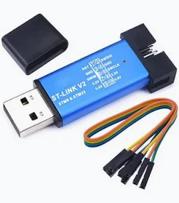

# Setup and execution instructions (design v7)

[Back to the main README](../../README.md)

The v7 robot builds **two programs**: the Open Challenge (`src/ondevice/`, LiDAR + Hiwonder board) and the Obstacle Challenge (`src/cpp/object_detection_hiwonder_h10/`, camera + Hailo-8 + LiDAR + Hiwonder board). Both compile the same Hiwonder layer and read the same calibration (`src/ondevice/hiwonder_config.h`). The short version of this page is in the [main README, section 9](../../README.md#setup-instructions).

## Contents

1. [Prerequisites](#prerequisites)
2. [Clone](#clone)
3. [Hardware connections](#connections)
4. [Before the first run](#first-run)
5. [Open Challenge](#open)
6. [Obstacle Challenge](#obstacle)
7. [Auto-start](#auto-start)
8. [Training and compiling your own model](#training)
9. [Design v6 (national) build instructions](Design_v6_National.md#build)
10. [Competition-day checklist](../../README.md#checklist)

---

## 1. Prerequisites <a id="prerequisites"></a>

1. **OS:** Raspberry Pi OS 64-bit (Bookworm or newer) on the Pi 5, via Raspberry Pi Imager. Enable SSH.
2. **Hailo-8 stack** (Obstacle Challenge only): [HailoRT](https://github.com/hailo-ai/hailort/tree/hailo8) **4.23** and the PCIe driver (see the [AI HAT+ documentation](https://www.raspberrypi.com/documentation/accessories/ai-hat-plus.html)). Check the device with `hailortcli fw-control identify`. The HailoRT version must be compatible with the Dataflow Compiler used for the `.hef` (3.34 for the v7 model).
3. **Build dependencies:**
   ```bash
   sudo apt update
   sudo apt install -y build-essential cmake git libopencv-dev libgpiod-dev pkg-config
   ```
   The camera is read through [libcamera](https://libcamera.org/) (part of Raspberry Pi OS) and the start button through [libgpiod](https://libgpiod.readthedocs.io/).
4. **Hiwonder board firmware:** flash our firmware `pos-v8` once with an ST-LINK/V2 programmer ([the one we use](https://es.aliexpress.com/item/1005004828761496.html); see [Board firmware](../../README.md#board-firmware) and [`firmware/hiwonder_pos-v8/README.md`](../../firmware/hiwonder_pos-v8/README.md)); the programs refuse to run on the stock firmware.



*The ST-LINK/V2 programmer used to flash the board firmware (prerequisite 4).*

## 2. Clone <a id="clone"></a>

```bash
git clone --recurse-submodules https://github.com/alex309-duarte/WRO_Future_Engineers_Queretaro_CSS.git
```

**Slamtec LiDAR SDK (once, both programs).** The S2L driver links the Slamtec [rplidar_sdk](https://github.com/Slamtec/rplidar_sdk), which is a Git submodule in `src/ondevice/rplidar_sdk` (fetched by `--recurse-submodules`; if that folder is empty, run `git submodule update --init`). The Makefile and the CMakeLists look for it in `~/rplidar_sdk` by default (variable `RPLIDAR_SDK_DIR`) and link `output/Linux/Release/libsl_lidar_sdk.a`. Build it once with `make` in its root, then either point the builds at it (commands in sections [5](#open) and [6](#obstacle)) or link it to the default location:

```bash
cd WRO_Future_Engineers_Queretaro_CSS/src/ondevice/rplidar_sdk
make                             # builds output/Linux/Release/libsl_lidar_sdk.a
ln -s "$PWD" ~/rplidar_sdk       # optional: then RPLIDAR_SDK_DIR is not needed
```

## 3. Hardware connections <a id="connections"></a>

| Device | Connection |
|---|---|
| Hiwonder board | USB (CH343), detected automatically at start-up. With several boards connected: `HIWONDER_DEVICE=/dev/serial/by-id/usb-1a86_USB_Single_Serial_<serial>-if00` |
| RPLidar S2L | USB (UART adapter), 1 Mbaud |
| Camera Module 3 Wide | CSI |
| Start button / LED | GPIO4 / GPIO3 (BCM) |

## 4. Before the first run <a id="first-run"></a>

With the wheels lifted, run the yaw-sign, steering-side and distance checks in [§5.3](../../README.md#calibration) ([`src/ondevice/HIWONDER.md`](../../src/ondevice/HIWONDER.md) has the troubleshooting table). At start-up the robot centers the steering and calibrates the gyroscope for 5 s: **it must stay still** until the button LED blinks.

## 5. Open Challenge <a id="open"></a>

```bash
cd src/ondevice
make RPLIDAR_SDK_DIR=$PWD/rplidar_sdk   # builds my_lidar_app (plain `make` if ~/rplidar_sdk exists)
make test                        # offline tests, does not open the port
WRO_MAX_RPS=1.5 ./my_lidar_app   # first tests, slow
./my_lidar_app                   # competition speed, 5.7 rev/s
```

## 6. Obstacle Challenge <a id="obstacle"></a>

```bash
cd src/cpp/object_detection_hiwonder_h10
cmake -S . -B build/h8_s2l -DCMAKE_BUILD_TYPE=Release \
      -DRPLIDAR_SDK_DIR="$PWD/../../ondevice/rplidar_sdk"   # omit if ~/rplidar_sdk exists
make -C build/h8_s2l -j"$(nproc)"
./build/h8_s2l/reto2_test        # 31 offline checks
./run_hiwonder_h8.sh             # run the mission
```

More detail: [`src/cpp/object_detection_hiwonder_h10/README.md`](../../src/cpp/object_detection_hiwonder_h10/README.md). The board layer is described in [`src/ondevice/HIWONDER.md`](../../src/ondevice/HIWONDER.md), and the relation between the v6 and v7 Obstacle programs in [`ORIGEN.md`](../../src/cpp/object_detection_hiwonder_h10/ORIGEN.md).

## 7. Auto-start <a id="auto-start"></a>

See [`src/SERVICES_README.md`](../../src/SERVICES_README.md) to start either v7 program at boot with systemd (`run_hiwonder_h8.sh --no-display` for the Obstacle Challenge, `my_lidar_app --no-display` for the Open Challenge).

## 8. Training and compiling your own model <a id="training"></a>

Only needed if retraining the vision model rather than using the one already checked into `src/HailoModels/`.

**Design v7 model** (`src/HailoModels/wro_h8_yolov8n_v4.hef`, decision card [D8](../../README.md#d8)):

1. **Dataset.** Download [`wro-dataset-completo` v1](https://universe.roboflow.com/roboteam-x6iuc/wro-dataset-completo) from Roboflow Universe in **YOLOv8** format. Classes: `greenbox`, `redbox`, `xparking`. The export is already resized to 640×640 (stretch) and the training split already carries the 3× augmentation listed in D6.
2. **Train** YOLOv8n with Ultralytics **8.4.115** ([training documentation](https://docs.ultralytics.com/modes/train/)) at image size **640** (training run `h10_yolov8n_640_v4`), starting from `yolov8n.pt`.
3. **Compile for the Hailo-8** on an x86 Linux PC (not the Pi) with the Hailo **Dataflow Compiler 3.34** ([Hailo AI Software Suite](https://hailo.ai/products/hailo-software/hailo-ai-software-suite/)). The Hailo-8 uses the 3.x compiler, paired with **HailoRT 4.23** on the Pi; the Hailo-10H uses the 5.x pair, and a `.hef` built for one chip does not load on the other.
4. **Deploy.** Copy the `.hef` into `src/HailoModels/` and select it without rebuilding:
   ```bash
   WRO_HIWONDER_MODEL=../../HailoModels/<model>.hef ./run_hiwonder_h8.sh --solo-percepcion
   ```
   `--solo-percepcion` shows the camera detections and the LiDAR walls without opening the Hiwonder board, so the model can be checked on the track before arming the robot.


The model of design v6 (YOLOv8n 320 for the Hailo-10H) is described on the [design v6 page](Design_v6_National.md#model).

---

## 9. Design v6 (national) build instructions

The national robot (SPIKE Hub, Oradar MS200k, Hailo-10H) is built and run with different steps: see the [design v6 page](Design_v6_National.md#build).

## 10. Competition-day checklist

The checks after a change on the robot and the nine steps before every round are in the [main README](../../README.md#checklist).

---

[Back to the main README](../../README.md)
