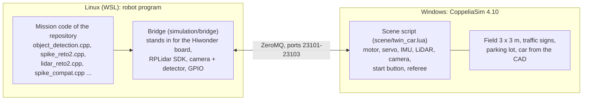

# Digital twin of the Obstacle Challenge (CoppeliaSim)

A simulated WRO 2026 Future Engineers field and a simulated "The Maker" (design v7) that is driven by **the same Obstacle Challenge program that runs on the robot**. The mission code of this repository is compiled without changes; only the hardware underneath it is replaced.

It is a test bench, not a second implementation: what turns the wheels in the simulation is `src/cpp/object_detection_hiwonder_h10/object_detection.cpp`.



## What is real and what is simulated

| Part | In the twin |
| --- | --- |
| Mission logic, LiDAR wall fitting, heading control, steering and drive commands | Repository code, compiled as it is |
| Hiwonder board (drive motor position/speed loop, steering servo, IMU, button, LED) | Emulated in `scene/twin_car.lua`, reached through `bridge/sim_brick.cpp` |
| RPLidar S2L | Computed in its scanning plane against the walls, parking limits and signs (10 turns per second, 320 points per turn, 5 mm noise); the camera mast hides the rear, as on the robot |
| Camera Module 3 Wide | Simulated camera, 800 x 600, at the position of the real lens |
| Traffic-sign detector (Hailo, YOLOv8n) | Replaced by a colour detector that fills the same output buffer (`bridge/sim_hailo.cpp`) |
| Car | Meshes exported from the SolidWorks assembly; kinematic bicycle model; collision outline of the real body |
| Referee | The scene script records laps, the side each sign is passed on, signs moved and wall contacts |

## Requirements

- Windows with [CoppeliaSim Edu 4.10](https://www.coppeliarobotics.com/) and Python 3.12 (`pip install coppeliasim-zmqremoteapi-client numpy opencv-python`).
- WSL with Ubuntu 24.04. `tools/wsl_setup.sh` installs the build packages, clones this repository and builds the program.

## Quick start

1. Open CoppeliaSim (an empty scene is enough).
2. Once, in WSL: `bash simulation/tools/wsl_setup.sh`
3. In PowerShell:

```powershell
cd simulation\tools
.\run_episode.ps1 -Layout A -Direction cw            # one complete run
.\run_episode.ps1 -Layout A -Direction cw -Record    # the same, and a video of it
```

`run_episode.ps1` builds the scene for the layout, starts the simulation, runs the robot program (it presses the start button by itself), stops the simulation and prints the referee's result. Results are kept in `scene/results/` and `logs/`.

| Option | Meaning |
| --- | --- |
| `-Layout A..E` / `random` | Sign layout. A to E are the team's test layouts (`other/testing/obstacle_layout_*.png`) |
| `-Direction cw` / `ccw` | Driving direction (the way the car faces in the parking lot) |
| `-Record` | Renders a 1920 x 1080 video after the run: field view, chase view, the program's camera with its detections, path map, stopwatch |
| `-Modify "x,y,h"` | Surprise rule: replaces the sign at x, y (mm) by one of the opposite colour, `h` mm tall |
| `-Surprise` | Runs the surprise-rule prototype in the program (see below) |
| `-Adapted` | Runs the mission with the proposed changes in `proposed/` |
| `-Watch` | Keeps the 3D view of CoppeliaSim drawing during the run |
| `-Title`, `-UntilLaps` | Title written on the video; end the video when that many laps are done |

The robot program works on the wall clock, so the simulation has to keep up with real time (10 ms steps). To help it, CoppeliaSim's 3D view is not drawn during a run (`-Watch` keeps it on) and videos are rendered afterwards from the record of the run, so recording does not slow the run down. Each result reports the speed the simulation reached while the program was running (`sim_speed`, 1 = real time; about 0.9 on the PC it was developed on). The stopwatch of the videos is simulated time.

## Folders

| Folder | Content |
| --- | --- |
| `bridge/` | Stand-ins for the hardware libraries and the `main()` of the twin |
| `scene/` | `build_scene.py` (builds the field and the car), `twin_car.lua` (car, sensors, referee), `layouts/`, `assets/` |
| `tools/` | Run, record, plot, check and survey scripts (`run_episode.ps1`, `replay_video.py`, `make_compilation.py`, `run_summary.py`, `lidar_check.py`, `profile_step.py`, ...) |
| `proposed/` | Changes to the mission that are being tried in the twin before they go to the robot |

## Surprise rule prototype

`bridge/surprise_rule.cpp` is a first version of the plan described in the main README (section 6.10): it measures each sign's height from its detection box and the camera geometry, compares it with the 50 mm base, and treats a sign that is not 100 mm tall as one of the opposite colour, so the mission passes it on the side of the original colour. It lives in the twin only; it is not part of the robot program.

In the twin, with the limits 1.5 and 2.5 for the height-to-base ratio, a 50 mm sign reads 0.99, a standard sign 2.00 and a 150 mm sign 3.00 (`tools/ratio_survey.py`). On the real camera the lens height, tilt and angle of view have to be measured and the limits taken from real frames.

## Proposed changes to the mission

`proposed/mission_changes.patch` holds two changes that came out of the twin: how the mission passes a single sign in the middle of a section right after a corner, and a short hold before the colour of the corner sign is read. See [`proposed/README.md`](proposed/README.md) for the cases, the changes and the results. The patch is not applied to the mission code of the repository.

## What the twin showed about the camera pipeline

The frame queues of the pipeline (`MAX_QUEUE_SIZE = 60`, two queues) keep every frame in order. In the twin, when the PC fell slightly behind the frame rate (for example while the program was saving its video), the queues filled up and the mission took its colour decisions on images more than a second old: by lap 3 it read the sign it had passed 1.6 s before as the sign in the next corner. The twin's camera now sends a frame only when the previous one has left the pipeline (`bridge/sim_main.cpp`), as a live camera with a fast detector behaves. On the robot it is worth checking that nothing slows the pipeline below the camera rate during a run (saving video, the display window).

## Limits of the twin

- The turning radius of the simulated car comes from the CAD linkage and a steering ratio that has not been compared with the real robot. Measuring the real turning circle would settle it (`scene/twin_params.txt`, `steer_gain`).
- No wheel slip, no battery sag, no camera exposure or motion blur. The colour detector is easier than the real one.
- A run that is clean in the twin shows that the logic and the geometry work; it does not replace testing on the mat.
