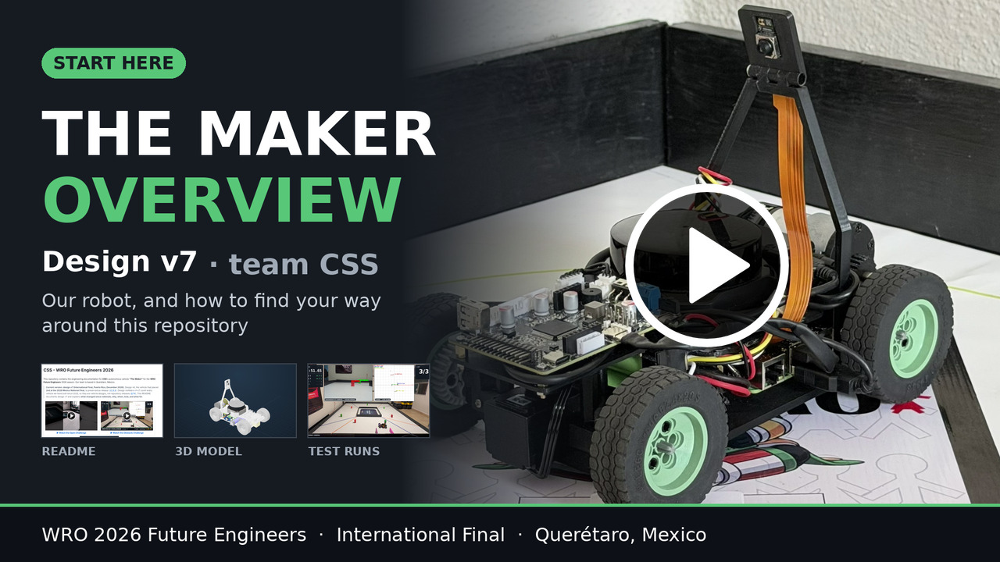
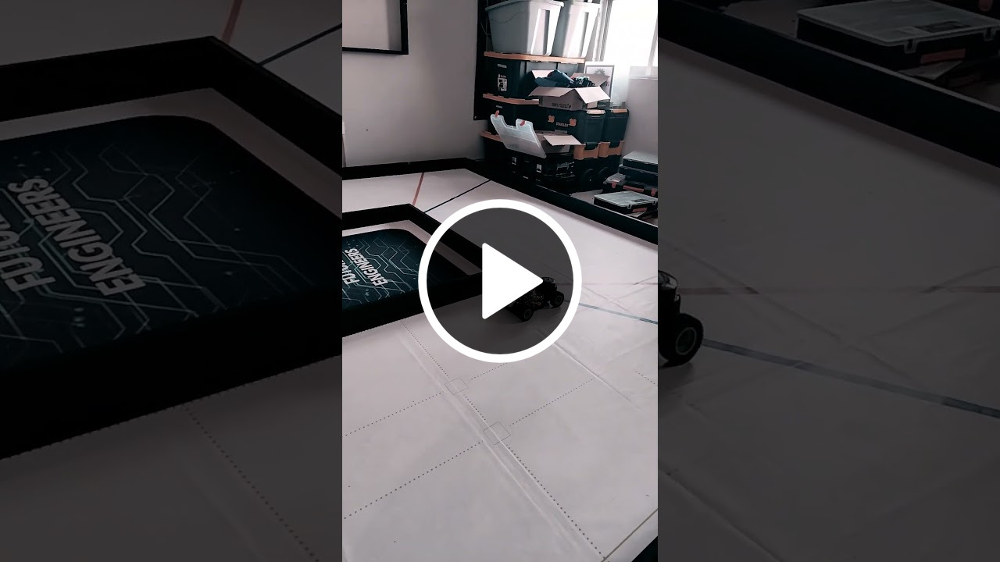
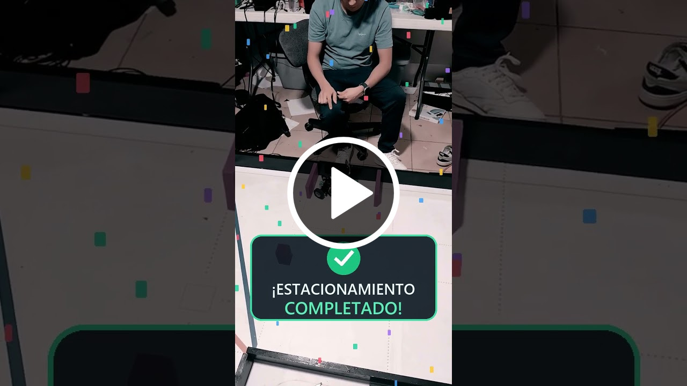
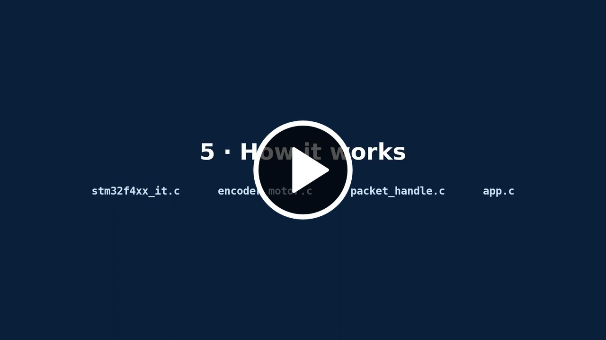
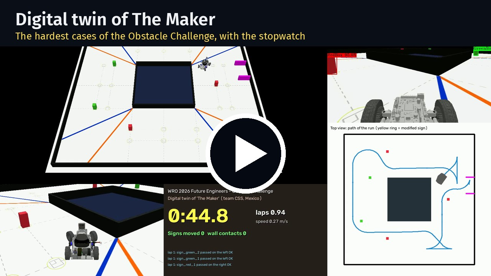
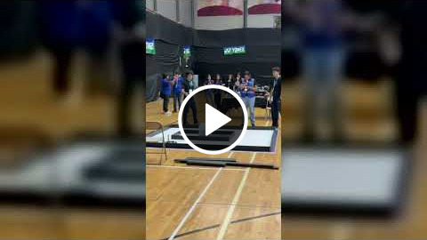
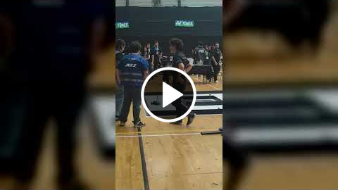

## Overview: our project and how to navigate this repository
*(Click on preview to visit YouTube Video)*

An introduction to our project and to The Maker, and a guided tour of the repository: what is in each part, how to navigate it, and where each rubric item is answered.

## Open Challenge
*(Click on preview to visit YouTube Video)*

## Obstacle Challenge
*(Click on preview to visit YouTube Video)*

Design v7 on our practice field (22 November 2026): the external view with the robot's camera (and the detections of its model) and its LiDAR scan, synchronised, with a stopwatch and a lap counter. Laps of 26.4, 24.6 and 25.4 s, parking in 20.6 s, 1:36.97 in total.

## Board firmware explained
*(Click on preview to visit YouTube Video)*

The extended firmware of the Hiwonder ROS Robot Controller, from scratch in STM32CubeIDE (9:52): creating the project, the sources, the settings, the build, how the firmware works (5:51) and flashing and testing it (8:31).

 Source, bench logs and everything else about the firmware: **[github.com/JRavenelco/hiwonder-brick](https://github.com/JRavenelco/hiwonder-brick)**, the firmware development repository.

The firmware alone, in English, as the STM32CubeIDE project built in the video: **[github.com/JRavenelco/hiwonder-rrc-extended-firmware](https://github.com/JRavenelco/hiwonder-rrc-extended-firmware)**.

## Digital twin of the Obstacle Challenge
*(Click on preview to visit YouTube Video)*

The robot's own mission program drives a simulated car in CoppeliaSim (about 14 minutes): a sign right after the corner and the change that solves it, decisions on old camera images, the surprise rule, why this simulator, and the limits of the twin.

## 2026 Mexico National Final: official rounds

### Open Challenge, official round
*(Click on preview to visit YouTube Video)*

### Obstacle Challenge, official round
*(Click on preview to visit YouTube Video)*

